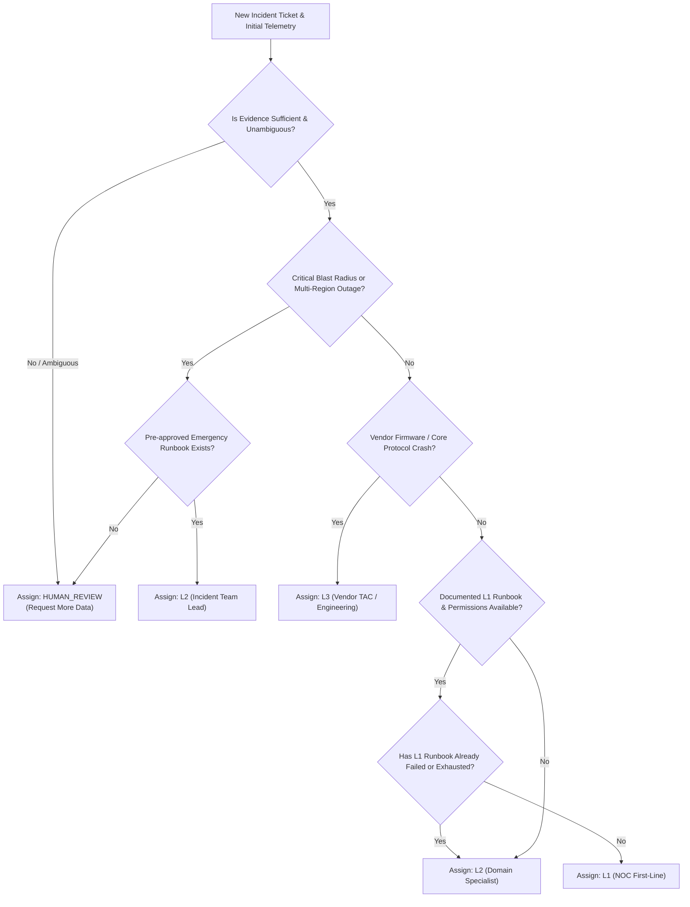

# L1 / L2 Support Tier Annotation Guidelines & Decision Framework

- **Document Version:** 1.0
- **Milestone:** M1 — Data Foundation (Deliverable M1.7)
- **Status:** Complete / Approved Policy Baseline
- **Author:** Principal AI/ML Engineer & Telecom NOC Operations Lead
- **Date:** 2026-10-31

---

## 1. Foundational Principles

> [!IMPORTANT]
> **A network fault category is NEVER equivalent to a support-tier label.**
> A Radio Access Network anomaly, a high packet error rate, or a transport degradation does NOT automatically dictate L2 ownership. 

Support tier ownership is determined by **operational support policy**, which balances:
1. **Diagnostic permissions:** What commands, telemetry views, and element managers is the engineer authorized to access?
2. **Approved runbooks:** Does an approved, deterministic first-line standard operating procedure (SOP) exist for this specific symptom pattern?
3. **Operational blast radius:** Does the triage action risk service interruption to other subscribers or base stations?
4. **Diagnostic complexity:** Does root-cause isolation require correlated packet traces, spectrum analyzers, core protocol decodes, or cross-domain investigation?
5. **Escalation conditions:** Have standard first-line remediation steps been attempted and documented as unsuccessful?
6. **Evidence sufficiency:** Is the incoming ticket description and initial telemetry clear enough to make a safe determination without guessing?

---

## 2. Support Tier Label Definitions

| Label | Role & Scope | Authority & Diagnostic Boundary | Prerequisites for Assignment |
| :--- | :--- | :--- | :--- |
| **`L1`** | **Frontline NOC / Service Desk Analyst** | Routine alarm triage, basic service health checks, standard runbook execution, customer verification, safe service resets with documented runbooks. | 1. Symptom matches an approved runbook. 2. Diagnostic steps require standard NOC permissions. 3. No elevated risk of service disruption. 4. Evidence is unambiguous. |
| **`L2`** | **Specialized Domain / Network Engineer** | Deep packet analysis, radio parameter re-tuning, core control-plane tracing (NGAP, HTTP/2 SBI), routing re-convergence, cell lock/unlock, hardware diagnostics. | 1. L1 runbook exhausted OR requires elevated diagnostic access. 2. Multi-cell or cross-domain correlation required. 3. Non-trivial technical investigation needed before action. |
| **`L3`** | **Principal Specialist / Vendor TAC / R&D** | Software bug patching, firmware regressions, microcode crashes, physical fiber cut repairs, protocol stack implementation flaws, emergency vendor escalation. | 1. Confirmed vendor equipment or firmware defect. 2. Architectural network redesign needed. 3. Vendor TAC contract escalation required. |
| **`HUMAN_REVIEW`** | **Incident Commander / Senior Triage Lead** | Ambiguous symptoms, conflicting evidence, severe critical blast radius, new uncharacterized failure mode, or low model confidence. | 1. Insufficient evidence to justify L1 or L2 assignment. 2. Conflicting telemetry signals. 3. High operational risk requiring human judgement. |
| **`UNLABELED`** | **Unreviewed Intake** | Newly imported tickets awaiting formal human review or policy assessment. | Raw ingested state prior to annotation. |

---

## 3. Deterministic Decision Framework

### Formal Decision Rules
- **Rule R1 (Conservative Fallback):** If `evidence_sufficient == False` or contradictory telemetry is present, output `HUMAN_REVIEW`.
- **Rule R2 (L1 Assignment):** Assign `L1` IF AND ONLY IF:
  - `known_issue_match == True`
  - `approved_runbook_available == True`
  - `required_permissions_available == True`
  - `advanced_diagnostics_required == False`
  - `l1_runbook_attempted == False`
- **Rule R3 (L2 Escalation on Failure):** If an approved L1 runbook was executed but the fault symptoms persist (`l1_runbook_exhausted == True`), escalate to `L2`.
- **Rule R4 (L2 Assignment on Complexity):** Assign `L2` if symptoms require cross-domain correlation, deep protocol decoding, RF field measurements, or non-standard configuration audit.
- **Rule R5 (L3 Assignment):** Assign `L3` if symptoms point to unrecoverable baseband software panic, vendor switch kernel panic, or vendor-acknowledged bug requiring patch delivery.

---

## 4. Ambiguous & Boundary Case Studies

### Case Study 1: Cell Degradation (Same Fault, Different Tier)
- **Scenario A (L1):** Single sector reports high RRC connection failures immediately following a scheduled commercial software maintenance window. An approved SOP exists: verify sector operational state, run automated self-test script via OSS portal, and reset the digital unit if alarm persists. 
  - *Annotation: `L1` (Clear runbook, routine permissions).*
- **Scenario B (L2):** Three adjacent sectors report elevated RRC failures, high Uplink Block Error Rate (UL_BLER > 40%), and sudden drops in UL_MCS, while downlink telemetry remains stable. No maintenance occurred.
  - *Annotation: `L2` (Symptom indicates external RF uplink jamming or PIM interference; requires L2 radio field investigation with an RF spectrum analyzer).*

### Case Study 2: Authentication Failures
- **Scenario A (L1):** 10 subscribers in a corporate enterprise APN report 5G AKA authentication rejections. Runbook SOP-SEC-012 authorizes L1 NOC to verify enterprise HSS/UDM profile subscription flags and clear stale session tokens.
  - *Annotation: `L1`.*
- **Scenario B (L2):** Sudden spike in 5G-AKA authentication timeouts across multiple AMFs and slices. UDM/AUSF logs report diameter/SBI interface queue exhaustion.
  - *Annotation: `L2` (Core network signaling capacity degradation; requires core network engineer).*

### Case Study 3: Transport Degradation
- **Scenario A (HUMAN_REVIEW):** Ticket text reads: *"Cell site B-104 reports degraded throughput and customer complaints."* Telemetry is missing for the last 45 minutes; alarms show both a backhaul link flap and a local baseband power supply alarm.
  - *Annotation: `HUMAN_REVIEW` (Conflicting signals, incomplete telemetry; forcing L1 or L2 risks dispatching wrong team).*

---

## 5. Human Annotation Protocol & Quality Assurance

### 5.1 Annotator Blindness & Leakage Prevention
1. Annotators must be provided **ONLY** the ticket information and telemetry available at the prediction timestamp.
2. The resolution summary, root-cause notes, post-investigation comments, and subsequent telemetry **MUST BE MASKED**.
3. Annotating routing labels based on what team eventually solved the issue in hindsight is strictly prohibited.

### 5.2 Inter-Annotator Agreement (IAA) Plan
1. **Dual Annotation:** A random holdout set of 20% of all incidents, plus 100% of high-severity incidents, must be annotated independently by two certified telecom support engineers.
2. **Agreement Metrics:**
   - **Cohen's Kappa ($\kappa$):** Computed for pairwise agreement between annotators.
   - **Target Benchmark:** $\kappa \ge 0.75$ (substantial agreement). If $\kappa < 0.70$, annotation stops, decision guidelines are refined, and annotators undergo recalibration.
   - **Abstention Coverage:** Disagreements where one annotator selected `HUMAN_REVIEW` are categorized separately from direct L1/L2 splits.

### 5.3 Adjudication Procedure
- When Annotator A and Annotator B disagree:
  1. Both annotators meet with the Lead Telecom Architect.
  2. The rationales and evidence citations are reviewed against the approved operator policy.
  3. Final consensus label is recorded under `annotation_status="ADJUDICATED"`.
  4. The root cause of the initial disagreement (e.g., guideline ambiguity, missing SOP document, subtle telemetry symptom) is documented in the annotation log.
