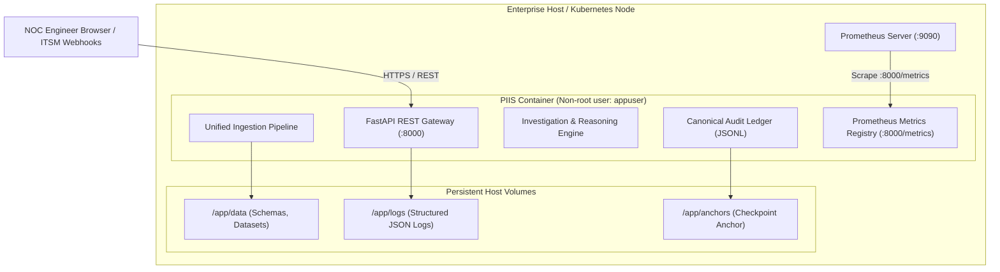

# PIIS Deployment & Operations Guide

> [!IMPORTANT]
> **Operational Baseline & Constraints**
> - **Milestone:** M6 — Enterprise Integration & Operational Readiness
> - **Operational Boundary:** Strictly Read-Only Telecom Decision Support.
> - **Zero Production Execution:** PIIS has no authority, integration, or network credentials to execute configuration mutations on telecommunications network elements.
> - **Production Pilot:** BLOCKED pending enterprise live infrastructure prerequisites (`DEP-M5.3-001`, `DEP-M5.3-002`, `DEP-M5.5.1-001a`, `DEP-M5.5.1-001b`).

---

## 1. System Overview & Deployment Topology

PIIS is deployed as a containerized Python service exposing a high-performance FastAPI REST gateway, background asynchronous ingestion pipelines, an in-memory Prometheus metrics endpoint, and an interactive Single-Page Application (SPA) operator dashboard.



---

## 2. Containerization & Docker Configuration

PIIS provides a secure, multi-stage [`infra/docker/Dockerfile`](file:///c:/Production%20level%20projects/PIIS/infra/docker/Dockerfile) designed adhering to enterprise security baselines:
- **Base Image:** `python:3.11-slim`
- **User Execution:** Runs under dedicated unprivileged system user `appuser` (UID 10001, GID 10001).
- **Attack Surface Minimization:** Build tools (`gcc`, build headers) discarded in stage 1; final runtime container contains zero compilers.
- **Port Exposure:** Exposes port `8000` (FastAPI REST Gateway & UI).

### 2.1 Multi-Container Orchestration (`compose.yaml`)

The standard local deployment stack is defined in [`infra/docker/compose.yaml`](file:///c:/Production%20level%20projects/PIIS/infra/docker/compose.yaml):

```yaml
services:
  piis:
    build:
      context: ../..
      dockerfile: infra/docker/Dockerfile
    container_name: piis-service
    restart: unless-stopped
    ports:
      - "8000:8000"
    environment:
      - PIIS_PORT=8000
      - PIIS_HOST=0.0.0.0
      - PIIS_ENVIRONMENT=staging
      - PIIS_LOG_LEVEL=INFO
      - PIIS_AUDIT_SIGNING_KEY=staging-audit-hmac-key-must-be-at-least-32-bytes!
      - PIIS_RATE_LIMIT_RPM=100
      - PIIS_RATE_LIMIT_BURST=20
    volumes:
      - piis_data:/app/data
      - piis_logs:/app/logs
      - piis_anchors:/app/anchors
    healthcheck:
      test: ["CMD", "python", "-c", "import urllib.request; urllib.request.urlopen('http://localhost:8000/healthz')"]
      interval: 15s
      timeout: 5s
      retries: 3
      start_period: 10s

  prometheus:
    image: prom/prometheus:v2.51.0
    container_name: piis-prometheus
    restart: unless-stopped
    ports:
      - "9090:9090"
    volumes:
      - ./prometheus.yml:/etc/prometheus/prometheus.yml:ro
      - prom_data:/prometheus
    depends_on:
      - piis

volumes:
  piis_data:
  piis_logs:
  piis_anchors:
  prom_data:
```

---

## 3. Configuration Management & Environment Variables

| Variable Name | Required | Default | Operational Description |
| :--- | :---: | :---: | :--- |
| `PIIS_PORT` | No | `8000` | Port on which the Uvicorn ASGI server listens. |
| `PIIS_HOST` | No | `0.0.0.0` | Bind host address. |
| `PIIS_ENVIRONMENT` | **Yes** | `staging` | Runtime mode: `development`, `staging`, `production`. When `production`, local fallback providers fail closed. |
| `PIIS_LOG_LEVEL` | No | `INFO` | Logging threshold: `DEBUG`, `INFO`, `WARNING`, `ERROR`, `CRITICAL`. |
| `PIIS_AUDIT_SIGNING_KEY` | **Yes** | None | Cryptographic secret for RFC 8785 HMAC checkpoint signatures. **Must be $\ge 32$ bytes**. |
| `PIIS_RATE_LIMIT_RPM` | No | `100` | Token bucket sustained throughput threshold (requests per minute). |
| `PIIS_RATE_LIMIT_BURST` | No | `20` | Token bucket maximum instantaneous burst token capacity. |
| `PIIS_OIDC_ISSUER` | No | None | Enterprise OpenID Connect IdP Issuer URL (e.g., `https://login.telecom.net/v2.0`). |
| `PIIS_OIDC_AUDIENCE` | No | None | Audience claim (`aud`) identifying the PIIS application client ID. |
| `PIIS_OIDC_JWKS_URL` | No | None | Remote HTTPS endpoint for dynamically fetching public RSA/ECDSA signing keys. |

---

## 4. Health Checks, Readiness Probes & Prometheus Scraping

### 4.1 Probe Specifications

| Probe Type | Endpoint | Frequency | Success Criteria | Failure Action |
| :--- | :--- | :--- | :--- | :--- |
| **Liveness** | `GET /healthz` | Every 10s | HTTP 200 within 2s | Orchestrator restarts container. |
| **Readiness** | `GET /api/v1/system/health` | Every 15s | HTTP 200 and all component statuses == `healthy` | Load balancer removes container from traffic pool. |

### 4.2 Prometheus Metrics Exposition (`infra/docker/prometheus.yml`)

The Prometheus configuration scrapes PIIS every 15 seconds:

```yaml
global:
  scrape_interval: 15s
  evaluation_interval: 15s

scrape_configs:
  - job_name: "piis"
    metrics_path: "/metrics"
    static_configs:
      - targets: ["piis:8000"]
```

---

## 5. Routine Operations & Maintenance Procedures

### 5.1 Starting and Stopping the Service

```bash
# Navigate to Docker orchestration directory
cd infra/docker

# Start service stack in background
docker compose up -d

# Verify running container health
docker compose ps

# View real-time structured JSON logs
docker compose logs -f piis

# Graceful stop
docker compose down
```

### 5.2 Dead-Letter Queue (DLQ) Triage & Replay

When upstream systems transmit malformed JSON or schema-violating fields, events are quarantined in the DLQ:

1. **Inspect Quarantined Events:**
   ```bash
   curl -H "Authorization: Bearer <ADMIN_TOKEN>" http://localhost:8000/api/v1/integrations/dlq
   ```
2. **Review Failure Diagnostics:**
   Inspect the `failure_stage` and `failure_reason` in the returned JSON array.
3. **Trigger Audited Event Replay:**
   ```bash
   curl -X POST -H "Authorization: Bearer <ADMIN_TOKEN>" http://localhost:8000/api/v1/integrations/dlq/{dlq_id}/replay
   ```

### 5.3 Audit Ledger Backup & Disaster Recovery

The audit ledger [`artifacts/audit/audit_log.jsonl`](file:///c:/Production%20level%20projects/PIIS/artifacts/audit/audit_log.jsonl) and checkpoint anchor maintain cryptographic state:

1. **Daily Backup:** Copy `audit_log.jsonl` and checkpoint anchor files to immutable enterprise backup storage (WORM-compliant S3 Object Lock).
2. **Ledger Head Verification:**
   ```bash
   curl -H "Authorization: Bearer <VIEWER_TOKEN>" http://localhost:8000/api/v1/audit/verify
   ```
3. **Disaster Recovery Restoration:**
   - Restore `audit_log.jsonl` and anchor into `/app/anchors/`.
   - On startup, `FileBasedCheckpointAnchor` verifies monotonic sequence numbers and SHA-256 entry hashes before serving requests.

### 5.4 Audit Signing Key Rotation

To rotate the HMAC signing key without invalidating historical ledger entries:
1. Provide the new key via `PIIS_AUDIT_SIGNING_KEY` ($\ge 32$ bytes).
2. The audit verification engine reads existing entries using their historical `key_id` while signing new checkpoint appends using the updated active key.

---

## 6. Pre-Production Readiness Checklist

Before transitioning PIIS from staging lab verification to live production, the following prerequisites must be fulfilled:

- [x] **Container Security:** Multi-stage Docker build with unprivileged `appuser` (UID 10001).
- [x] **Automated Regression:** 332 / 332 tests passing (100.0%).
- [x] **Read-Only Invariant:** Verified zero write/command capabilities to network elements.
- [x] **Service Principal Restriction:** Automated systems barred from approving operational recommendations.
- [ ] **`DEP-M5.3-001` (Enterprise OIDC IdP):** Corporate IdP discovery endpoint and client credentials provisioned in production environment.
- [ ] **`DEP-M5.3-002` (Hardware WORM Storage):** S3 Object Lock or Azure Immutable Blob storage configured for audit anchor syncing.
- [ ] **`DEP-M5.5.1-001a` (Cloud KMS Hardware Signing):** Enterprise KMS Key ARN configured for asymmetric hardware signing.
- [ ] **`DEP-M5.5.1-001b` (RFC 3161 TSA):** Trusted HTTPS RFC 3161 Timestamp Authority service endpoint configured.
