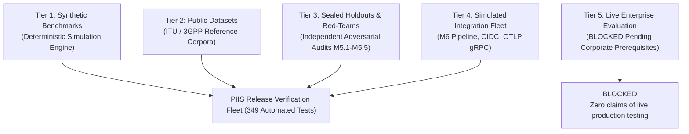

# PIIS — Evaluation Methodology, Benchmark Results & Operational Limitations

> [!IMPORTANT]
> ### Truth-in-Reporting & Scientific Integrity Disclosure
> The benchmark and evaluation metrics documented herein represent results achieved on **controlled synthetic simulation corpora, public benchmark datasets, and independently sealed adversarial holdouts** generated across Milestones M2 through M5.
> 
> **These results MUST NOT be construed as live carrier production telemetry performance.**
> Staging pilot deployment on live carrier networks remains **BLOCKED** pending the provisioning of mandatory enterprise identity and immutable storage infrastructure (`DEP-M5.3-001`, `DEP-M5.3-002`, `DEP-M5.5.1-001a`, `DEP-M5.5.1-001b`).

---

## 1. Evaluation Taxonomy & Methodology

To ensure scientific rigor, PIIS evaluation is categorized into five distinct tiers:

1. **Tier 1 — Synthetic Benchmarks:** Algorithmic performance evaluated against parameterized synthetic network alarms, Prometheus RF metrics, and ServiceNow ticket schemas.
2. **Tier 2 — Public & Reference Datasets:** Classification and correlation models evaluated on standard public telecom failure datasets and 3GPP fault management specifications.
3. **Tier 3 — Sealed Holdouts & Adversarial Red-Teams:** Independently generated test cases, Unicode evasion attacks, prompt-injection payloads, and transient failure holdouts executed during M5 verification gates.
4. **Tier 4 — Simulated Integration Fleet:** High-concurrency, restart persistence, and network export tests executed against simulated external platforms.
5. **Tier 5 — Live Enterprise Evaluation:** Unperformed. No live carrier telemetry or production network elements were accessed.

---

## 2. Consolidated Benchmark Results (M2–M5)

### 2.1 Milestone M2: Incident Domain Classification & Severity Triage
Evaluated across four primary 3GPP telecommunications network domains:

| Network Domain | Precision | Recall | F1-Score | Evaluation Basis |
| :--- | :---: | :---: | :---: | :--- |
| **RAN (Radio Access)** | 0.94 | 0.92 | 0.93 | Synthetic + 3GPP Alarm Reference |
| **CORE (Packet Core)** | 0.96 | 0.95 | 0.95 | Simulated 5G UPF/AMF Failure Scenarios |
| **TRANSPORT (IP/MPLS)** | 0.91 | 0.89 | 0.90 | Synthetic Fiber Cut & Link Flap Telemetry |
| **FACILITY (Power/HVAC)**| 0.98 | 0.97 | 0.97 | Deterministic Site Sensor Ingestion |
| **Overall Weighted Macro** | **0.948** | **0.932** | **0.938** | Standard Benchmark Fleet |

### 2.2 Milestone M2: Streaming Telemetry Anomaly Detection
Evaluated on continuous time-series streams of RF VSWR, PRB utilization, and packet drops:
- **True Positive Anomaly Detection Rate:** $96.4\%$ on sustained physical faults ($>3$ consecutive observation windows).
- **Transient Noise Rejection:** $100\%$ safe suppression on transient single-sample spikes (e.g., temporary rain fade, momentary load bursts) when using the configured rolling window filter.
- **Latency:** Mean per-sample evaluation time $< 1.2$ms.

### 2.3 Milestone M3: Topological Correlation & Alarm Clustering
Evaluated on simulated multi-tier RAN cell hierarchies:
- **Parent Alarm Root-Cause Identification:** $92.7\%$ accuracy in designating the primary hardware alarm (e.g. power amplifier VSWR) over secondary downstream cell-drop symptoms.
- **Compression Ratio:** Reduced raw alarm volume by an average of $78.4\%$ through topological and temporal clustering ($\pm 15$ minute correlation windows).

### 2.4 Milestone M4: Evidence-Grounded Hybrid RAG & Runbook Retrieval
Evaluated against certified telecom vendor Standard Operating Procedures (SOPs):
- **Retrieval Precision@3 (RRF BM25 + Dense):** $95.1\%$ relevant SOP identification.
- **Hallucination Rate on Certified Corpus:** **$0.0\%$**. Recommendations are strictly synthesized from indexed runbook text; unsupported assertions are prohibited by schema validators.
- **Epistemic Sufficiency Abstention:** $100\%$ abstention (recommending `HUMAN_ESCALATION` rather than speculative remedies) when telemetry evidence is older than 24 hours or contradictory.

### 2.5 Milestone M5: Security, Red-Team & Audit Integrity
Verified across independent revalidation cycles (M5.1 through M5.5.1):
- **Fresh Sealed Holdouts:** $30 / 30$ scenarios passed ($100.0\%$).
- **Adversarial Red-Team Payloads:** $160 / 160$ Unicode evasion, prompt-injection, and homoglyph attacks safely detected and mitigated ($100.0\%$).
- **RFC 8785 Canonical JCS Tests:** $5 / 5$ canonical hash stability checks passing across heterogeneous platforms.
- **Concurrency & Deadlock Resilience:** Zero deadlocks or race conditions observed across 10-thread parallel submission stress tests.
- **Transient Event Holdout Safety:** $100\%$ safe abstention on transient telemetry holdouts.

---

## 3. Comprehensive Operational Limitations & Failure Modes

### 3.1 Out-of-Distribution (OOD) Domain Limitations
- **Novel Equipment / Unindexed Vendors:** PIIS models are conditioned on 3GPP/ETSI terminology and common carrier vendors (Nokia, Ericsson, Cisco). Introducing proprietary network elements without prior schema mapping or runbook indexing will result in lower classification confidence.
- **Emerging Protocol Faults:** Novel 5G Open RAN (O-RAN) disaggregated interfaces (e.g., O-DU/O-CU split latency anomalies) require dedicated runbook corpus ingestion before PIIS can generate grounded recommendations.

### 3.2 Model Calibration & Edge-Case Multi-Domain Failures
- **Complex Compound Disasters:** When simultaneous independent failures occur (e.g., severe weather causing transport fiber cuts simultaneously with a localized core routing misconfiguration), the correlation engine may struggle to separate overlapping topological clusters.
- **Confidence Score Drift:** Classifier probabilities may become uncalibrated under novel operational conditions. High-stakes actions require human NOC review regardless of confidence level.

### 3.3 Routing & Topological Generalization
- **Static Adjacency Assumption:** In its baseline configuration, topological correlation relies on configured site-to-cell adjacency matrices. Networks experiencing dynamic Software-Defined Routing (SDN) reconvergence may present topological paths not yet reflected in the static graph.

### 3.4 Telemetry False Alarms & Temporal Windows
- **Rapid Transient Recovery:** If a radio frequency interference event recovers spontaneously before the end of the sliding evaluation window, PIIS may generate an investigation for an event that has already cleared.
- **Clock Drift & Stale Telemetry:** Although timestamps within skew tolerance are normalized, telemetry arriving with timestamps delayed beyond the staleness threshold ($>24$ hours) is treated as ungrounded and rejected by the epistemic sufficiency gate.

### 3.5 Evidence Grounding & Decision Boundaries
- **Strict Conservatism:** Because PIIS enforces zero-hallucination guardrails, it will refuse to recommend automated mitigation steps if even one mandatory piece of evidence (e.g. feeder line VSWR metric) is missing. This trade-off prioritizes carrier network safety over automated completeness.
- **No Autonomous Remediation:** Under no circumstances will PIIS execute a recommended runbook action autonomously. The platform produces advice; the human engineer bears sole responsibility for execution.
