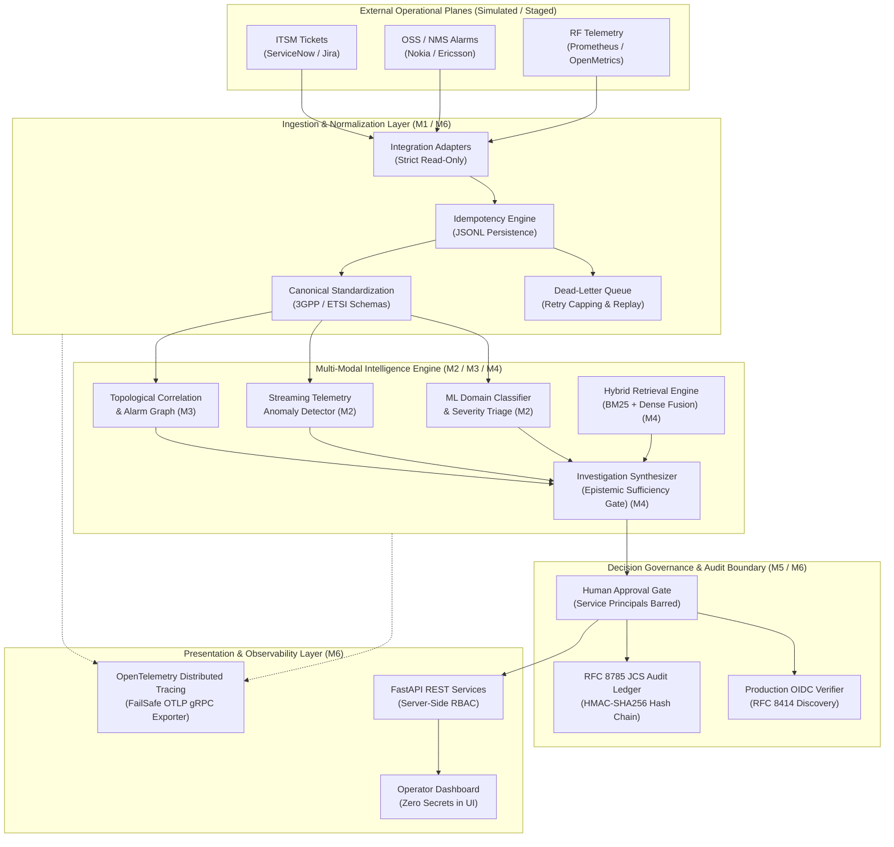

# PIIS — Technical Architecture & System Overview

> [!IMPORTANT]
> **Operational Scope & Decision-Support Boundary**
> The Production Incident Intelligence System (PIIS) operates strictly as a **read-only decision-support engine** for telecommunications Network Operations Centers (NOCs). PIIS synthesizes multi-modal telemetry, topology, and historical runbooks to generate evidence-grounded hypotheses and actionable recommendations.
> 
> **PIIS possesses ZERO autonomous execution authority:**
> - Zero production network command execution or element reconfiguration.
> - Zero autonomous ticket creation, modification, reassignment, or closure.
> - Zero automated customer or third-party communications.
> - Mandatory authenticated human sign-off for any consequential operational action.

---

## 1. Problem Statement & Telecom Operational Context

Modern telecommunications networks (5G Standalone, Cloud RAN, IP Core, Optical Transport) generate tens of thousands of alarms, metrics, and incident tickets per hour during major service disruptions. Network Operations Centers face three acute challenges:

1. **Alert Fatigue & Event Flooding:** A single fiber cut or power amplifier failure triggers cascading downstream alarms across hundreds of network elements, obscuring the primary root cause.
2. **Prolonged Mean Time to Resolution (MTTR):** NOC engineers must manually query disparate systems (ITSM platforms, NMS alarm managers, time-series telemetry) and consult hundreds of pages of vendor Standard Operating Procedures (SOPs).
3. **The AI Autonomy Danger:** Unbounded generative AI models risk hallucinating network commands or executing destabilizing automated configuration changes on live carrier equipment.

**PIIS resolves this dilemma** by providing an evidence-grounded, tamper-evident intelligence layer that unifies multi-modal operational evidence, grounds all guidance in certified vendor runbooks, and strictly confines its output to human-in-the-loop decision support.

---

## 2. Target Users & Personas

- **Tier 1 NOC Technicians:** Immediate incident triage, domain routing, and alert flood de-duplication.
- **Tier 2 / Tier 3 Network Engineers:** In-depth multi-hypothesis root-cause analysis, correlated topological visualization, and SOP diagnostic runbook review.
- **Incident Commanders:** Situational awareness during high-severity (P1/P2) network degradation events.
- **Telecom Security & Compliance Auditors:** Cryptographic audit trail inspection, tamper-evident sign-off logs, and model governance verification.

---

## 3. High-Level System Architecture

The following diagram illustrates the verified modular architecture of PIIS:

---

## 4. Subsystem Deep Dive & Component Workflows

### 4.1 Ingestion & Normalization Layer (Milestones M1 & M6)
- **Integration Adapters ([`src/piis/integrations`](file:///c:/Production%20level%20projects/PIIS/src/piis/integrations)):** Specialized ingress adapters for ServiceNow, Jira Service Management, Generic OSS alarms, and Prometheus time-series metrics.
- **Strict Read-Only Boundaries:** Adapters enforce `ALLOWED_OPERATIONS = frozenset(["NORMALIZE", "HEALTH_CHECK", "READ_ONLY_INGEST"])`. Any call to `CREATE_TICKET`, `MODIFY_CONFIG`, or `EXECUTE_COMMAND` immediately raises `ReadOnlyBoundaryViolationError`.
- **Deduplication Persistence ([`src/piis/pipeline/deduplication.py`](file:///c:/Production%20level%20projects/PIIS/src/piis/pipeline/deduplication.py)):** File-backed JSONL idempotency engine. Prevents duplicate event ingestion across process restarts and resolves high-concurrency bursts via thread-safe file locks.
- **Dead-Letter Queue ([`src/piis/pipeline/dead_letter.py`](file:///c:/Production%20level%20projects/PIIS/src/piis/pipeline/dead_letter.py)):** Captures unparseable or schema-violating envelopes with failure classification, retry counters, and dead-letter replay without duplicate downstream side-effects.

### 4.2 ML Incident Classification & Anomaly Detection (Milestone M2)
- **Telecom Domain Classification:** Multi-class classification categorizing incidents into 3GPP/ETSI domains: `RAN` (Radio Access Network), `CORE` (Packet Core), `TRANSPORT` (IP/MPLS, Microwave), and `FACILITY` (Power, Cooling).
- **Severity Triage:** Deterministic mapping combined with Random Forest / Gradient Boosting models predicting operational severity (`CRITICAL`, `MAJOR`, `MINOR`, `WARNING`).
- **Telemetry Anomaly Detection ([`src/piis/models/anomaly.py`](file:///c:/Production%20level%20projects/PIIS/src/piis/models/anomaly.py)):** Streaming statistical detectors computing rolling Z-scores and exponential moving averages over RF parameters (VSWR, PRB utilization, latency, packet drop rate), filtering transient blips while flagging sustained degradation.

### 4.3 Multi-Modal Correlation & Topology Graph (Milestone M3)
- **Topological Adjacency Engine ([`src/piis/models/correlation.py`](file:///c:/Production%20level%20projects/PIIS/src/piis/models/correlation.py)):** Maintains an in-memory graph representing cellular site hierarchies (Cell $\rightarrow$ Sector $\rightarrow$ gNodeB/eNodeB $\rightarrow$ Transmission Router $\rightarrow$ Core UPF).
- **Alarm Clustering:** Clusters correlated alarms across temporal windows ($\pm 15$ minutes) and topological paths to isolate root-cause equipment from symptomatic cascading alarms.

### 4.4 Evidence-Grounded Hybrid RAG & Synthesis (Milestone M4)
- **Hybrid Retrieval Engine ([`src/piis/investigation`](file:///c:/Production%20level%20projects/PIIS/src/piis/investigation)):** Combines sparse lexical search (BM25) with dense semantic embeddings (`sentence-transformers`) via Reciprocal Rank Fusion (RRF).
- **Grounding Corpus:** Indexed vendor SOPs, standard troubleshooting playbooks, and equipment engineering guides.
- **Epistemic Sufficiency Gate:** Before generating diagnostic hypotheses, PIIS verifies evidence sufficiency. If telemetry is stale ($>24$ hours), contradictory, or missing, the system abstains from automated diagnosis and defaults to conservative `HUMAN_ESCALATION` guidance.

### 4.5 Decision Governance & Cryptographic Audit Ledger (Milestone M5)
- **RFC 8785 Canonical JSON (JCS):** All audit records are normalized according to RFC 8785 rules (lexicographical key sorting, strict Unicode UTF-8 serialization, floating-point formatting) prior to hashing.
- **HMAC-SHA256 Hash Chain:** Every operational decision, approval, or rejection is cryptographically linked to the preceding entry hash (`previous_entry_sha256`), forming a tamper-evident audit ledger (`AuditLogEntry`).
- **External Checkpoint Anchoring:** Supports external immutable anchors (e.g., S3 Object Lock, WORM storage) to detect fork attacks, truncation, or history rewrites.
- **Human Approval Security Boundary:** Automated service principals attempting review approvals are barred at the engine layer with `HTTP 403 Forbidden` (`PROHIBITED_HUMAN_OPERATOR_IDS`).

### 4.6 Enterprise Identity & Production OIDC (Milestones M5 & M6)
- **OIDC Discovery ([`src/piis/investigation/approval.py`](file:///c:/Production%20level%20projects/PIIS/src/piis/investigation/approval.py)):** Implements standard RFC 8414 discovery (`/.well-known/openid-configuration`), dynamically resolving JWKS keys.
- **SSRF Filtering:** Rejects discovery and JWKS URIs pointing to loopback (`127.0.0.1`), private RFC 1918 subnets, or cloud instance metadata services (`169.254.169.254`).
- **Token Security:** Strict asymmetric validation (RS256/ES256), token expiration checks, and future not-before (`nbf`) rejection (`ImmatureSignatureError`).

### 4.7 Observability & Distributed Tracing (Milestone M6)
- **OpenTelemetry SDK ([`src/piis/observability/tracing.py`](file:///c:/Production%20level%20projects/PIIS/src/piis/observability/tracing.py)):** Context-propagated tracing conforming to W3C TraceContext standards.
- **FailSafeSpanExporter:** Isolates incident triage from telemetry transport failures. If an external collector crashes or times out, span export logs a warning and fails silently without interrupting incident processing.
- **OTLP gRPC Export:** Validated against real local network sockets using standard OpenTelemetry protocol definitions (`opentelemetry.proto.collector.trace.v1`).

---

## 5. Security & Isolation Boundaries

1. **Air-Gap Capable:** PIIS core algorithms (classification, correlation, RAG retrieval, decision synthesis, and audit hashing) run 100% locally without outbound connections to third-party cloud LLM APIs.
2. **Network Plane Air-Gap:** PIIS does not hold credentials for, nor have network routing to, carrier element management systems (EMS) or element CLI interfaces (SSH, NETCONF, SNMP write).
3. **Role-Based Access Control (RBAC):**
   - `ROLE_SERVICE_PRINCIPAL`: Allowed ingestion (`POST /api/v1/incidents/ingest`), read-only incident status queries. Strictly barred from review approvals (403 Forbidden).
   - `ROLE_OPERATOR` (`NOC_L1`, `NOC_L2`, `NOC_L3`): Allowed to investigate and cryptographically sign approvals/rejections.
   - `ROLE_SECURITY_AUDITOR`: Read-only access to `/api/v1/audit/records` and execution of `/api/v1/audit/verify`.
   - `ROLE_ADMIN`: System configuration, key rotation, and administration.

---

## 6. Known Architectural & Operational Limitations

1. **Synthetic & Simulated Training Baselines:** Historical benchmark figures are derived from high-fidelity telecom simulations and public datasets. Operational calibration against carrier-specific live telemetry is required during staging trials.
2. **Static Topology Representation:** The topology correlation engine operates on configured network element hierarchies. Dynamic SDN topology updates require integration with carrier inventory systems (e.g. Amdocs, Netcracker).
3. **Out-of-Distribution Runbooks:** If an incident involves an un-indexed vendor device or novel fault code not present in the RAG runbook corpus, the system safely falls back to human escalation.
4. **Local Development Key Provider:** In local development, HMAC keys are loaded from environment variables. Full enterprise compliance requires cloud HSM hardware signing (`DEP-M5.5.1-001a`) and RFC 3161 Timestamp Authority integration (`DEP-M5.5.1-001b`).
