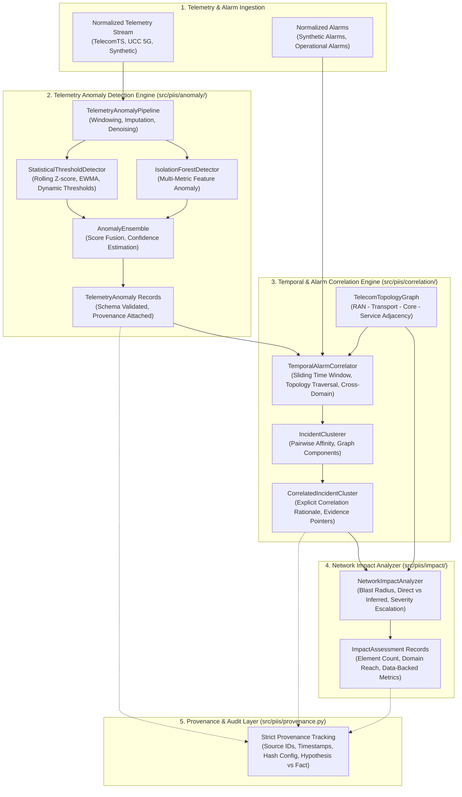

# Milestone 3 Implementation Plan — Network Intelligence

**Target Milestone:** Milestone 3 (M3): Network Intelligence  
**Role:** Senior ML Systems Engineer and Telecom Network Intelligence Architect  
**Governance:** `/gstack` Autonomous Execution Standard  
**Date:** 2026-10-31  
**Status:** APPROVED FOR EXECUTION  

---

## 1. Executive Context & Boundary Enforcement

Following the independent validation verdict of **ACCEPTED WITH LIMITATIONS** on Milestone 2.1 ([`docs/research/M2_1_INDEPENDENT_VALIDATION_REPORT.md`](file:///c:/Production%20level%20projects/PIIS/docs/research/M2_1_INDEPENDENT_VALIDATION_REPORT.md)), Milestone 3 is authorized for execution.

### Strict Scope Boundaries
- **Milestone 3 (THIS MILESTONE):** Network Intelligence — telemetry anomaly detection, temporal analysis, alarm/incident correlation, network element impact analysis, and strict provenance tracking.
- **Milestone 4 (FUTURE):** Historical incident retrieval and hybrid RAG.
- **Milestone 5 (FUTURE):** L1/L2 AI assistant and runbook guidance.
- **Milestone 6 (FUTURE):** Application and integration layer.
- **Milestone 7 (FUTURE):** System-wide evaluation, security, and production hardening.

> [!IMPORTANT]
> Milestone 3 is strictly scoped to Network Intelligence. There shall be **NO RAG**, **NO vector store retrieval**, and **NO autonomous production network execution** introduced in this milestone. Anomaly detection and correlation must maintain robust deterministic fallbacks with no hard dependency on external LLMs.

### Carried-Forward M2.1 Limitations & Guardrails
1. **Hybrid Severity Modeling:** Severity prediction remains hybrid — strict operational rule thresholds are primary, with ML-based probability estimation serving as advisory input.
2. **OOD Operating Points:** Out-of-distribution detection threshold ($\tau = 0.30$) is recognized as an experimental benchmark threshold and will not be hardcoded as an immutable universal truth.
3. **Abstention on Uncertainty:** Any incident or correlation cluster with ambiguous or low evidence must route to `HUMAN_REVIEW`.
4. **Historical Report Preservation:** All historical artifacts (`M1_INDEPENDENT_VERIFICATION.md`, `M2_EXPERIMENT_REPORT.md`, `M2_ADVERSARIAL_VALIDATION_REPORT.md`, `M2_1_INDEPENDENT_VALIDATION_REPORT.md`) are immutable historical records.
5. **No Data Fabrication:** Inferred network impact and subscriber numbers must strictly derive from verifiable telemetry or topology data; zero synthetic hallucinations.

---

## 2. Technical Architecture & Component Breakdown

---

## 3. Detailed Component Specifications

### 3.1. Telemetry Anomaly Detection Engine (`src/piis/anomaly/`)

#### A. Preprocessing & Conditioning (`pipeline.py`)
- **Handling Incomplete Data:** Time-series interpolation (linear for numeric KPIs, forward-fill with decay for categorical/states, null sentinels for extended outages).
- **Packet Delays & Out-of-Order Samples:** Event-time windowing using monotonic ingestion buffers ($t_{\text{event}}$ vs $t_{\text{arrival}}$).
- **Sensor Noise Filtering:** Rolling median filter to suppress spurious single-sample spikes.
- **Reporting Intervals:** Adaptive resampler supporting high-frequency (10 Hz TelecomTS) and standard NOC polling (15-minute, 1-minute, 5-minute UCC 5G / Synthetic).

#### B. Statistical Dynamic Threshold Detector (`statistical.py`)
- **Rolling Z-Score:**
  $$z_t = \frac{x_t - \mu_{w}(t)}{\sigma_{w}(t) + \epsilon}$$
- **Exponentially Weighted Moving Average (EWMA) & Dynamic Bands:**
  $$\hat{\mu}_t = \alpha x_t + (1 - \alpha) \hat{\mu}_{t-1}$$
  $$\hat{\sigma}^2_t = \beta (x_t - \hat{\mu}_t)^2 + (1 - \beta) \hat{\sigma}^2_{t-1}$$
  $$\text{Threshold}_{\text{dynamic}} = \hat{\mu}_t \pm k \cdot \hat{\sigma}_t$$
- **Adaptive Asymmetric Bounds:** Differentiates metrics where only drops are bad (e.g., RSRP, Throughput, MCS) from metrics where only surges are bad (e.g., BLER, PRB Utilization, Latency).

#### C. Unsupervised Multi-Metric ML Detector (`isolation_forest.py`)
- **Feature Space:** Vector composed of raw metric values, first-order differences ($\Delta x_t$), rolling volatility ($\sigma_{w}$), and cross-metric ratios (e.g., DL_BLER vs DL_MCS).
- **Isolation Forest Baseline:** Contamination parameter tuned against known nominal baseline; outputs continuous anomaly score $s \in [0, 1]$ and binary decision.
- **Uncertainty/Confidence Formulation:** Distance from decision boundary transformed to confidence $c \in [0.0, 1.0]$.

#### D. Pipeline Outputs (`TelemetryAnomaly`)
- Schema:
  - `anomaly_id`: Unique identifier (`ANOM-<hash>`).
  - `network_element_id`: Target node (e.g., `GNB-TESTBED-5G-01`, `CELL-101`).
  - `network_domain`: Subsystem (`RAN`, `5G_CORE`, `TRANSPORT`, etc.).
  - `start_timestamp`, `end_timestamp`: Duration of anomalous condition.
  - `anomaly_score`: Normalized severity score $[0.0, 1.0]$.
  - `confidence`: Estimate of detector certainty $[0.0, 1.0]$.
  - `affected_metrics`: List of violating metrics with trigger values and baselines.
  - `detector_type`: `STATISTICAL_EWMA`, `ISOLATION_FOREST`, or `ENSEMBLE`.
  - `provenance`: Full `ProvenanceRecord` pointing to raw observation IDs.

---

### 3.2. Temporal & Alarm Correlation Engine (`src/piis/correlation/`)

#### A. Telecom Topology Graph (`topology.py`)
- Graph representation $G = (V, E)$ of telecom nodes:
  - Nodes $V$: Cells (`CELL-*`), gNodeBs (`GNB-*`), Microwave/IP-MPLS Routers (`RTR-*`), Core UPF (`UPF-*`), AMF (`AMF-*`), SMF (`SMF-*`), DNS/IMS (`IMS-*`).
  - Edges $E$: Directed or undirected relations (`serves_cell`, `backhaul_link`, `n3_interface`, `n4_control`, `peer_link`).
  - Path Distance & Adjacency: $d(u, v)$ hops between network elements.

#### B. Correlation Logic (`engine.py`, `clustering.py`)
- **Temporal Window Proximity:** Alarms and anomalies occurring within configurable $\Delta T_{\text{window}}$ (default 15 minutes, configurable up to 60 minutes).
- **Spatial / Topological Affinity:**
  $$A_{\text{topo}}(u, v) = \exp(-\lambda \cdot d(u, v))$$
- **Domain Affinity:** Cross-layer mapping rules (e.g., Transport link down $\to$ RAN cell unreachable $\to$ Core session termination).
- **Clustering Algorithm:** Connected components over the composite affinity matrix:
  $$S(e_i, e_j) = w_t \cdot S_{\text{time}}(e_i, e_j) + w_s \cdot A_{\text{topo}}(u_i, u_j) + w_d \cdot S_{\text{domain}}(d_i, d_j)$$
- **Correlation vs Causation Boundary:**
  - Strict distinction: All cluster associations are labeled `CORRELATED_ASSOCIATION` unless deterministic topological causality is verified.
  - Explicit rationale: Every edge produces a human-auditable rationale string citing observed facts and topological relationship.

---

### 3.3. Network Impact Analysis Engine (`src/piis/impact/`)

#### A. Blast Radius Analysis (`analyzer.py`)
- **Direct Blast Radius:** Network elements directly producing alarms or verified anomalies ($V_{\text{direct}}$).
- **Inferred Blast Radius:** Topological children or dependent nodes that are at risk or exhibiting cascading service degradation ($V_{\text{inferred}}$).
- **Domain Span:** Count and list of affected network domains (`RAN`, `TRANSPORT`, `5G_CORE`, `SERVICE`).

#### B. Impact Severity & Subscriber Metrics
- **Service Impact Quantification:** Number of impacted cells, carrier sectors, aggregate bandwidth drop, packet loss percentage.
- **Zero-Fabrication Subscriber Impact:**
  - If telemetry contains active user counts (`Active_UE_Count`), calculate exact drop.
  - If topology provides nominal subscriber capacity ($C_{\text{cell}}$), report as `estimated_affected_subscribers_capacity` with explicit `DERIVED` flag.
  - If no subscriber data exists, field is explicitly `None` or omitted. Never hallucinate subscriber counts.
- **Escalation Risk Score:** Calculates probability of cascading outage based on core vs edge involvement and topology depth.

---

### 3.4. Strict Provenance & Evidence Layer

All output records (`TelemetryAnomaly`, `CorrelatedIncidentCluster`, `ImpactAssessment`) implement the PIIS provenance protocol:
1. `source_record_ids`: List of underlying observation IDs and alarm IDs.
2. `source_datasets`: Datasets involved (`AliMaatouk/TelecomTS`, `PIIS-TelcoBench-Synthetic`, etc.).
3. `processing_timestamp`: Exact ISO-8601 UTC timestamp of execution.
4. `model_or_rule_version`: Version string and SHA-256 config hash of the detection/correlation logic.
5. `epistemic_status`: `FACT` (directly measured), `STATISTICAL_INFERENCE` (anomaly model output), or `HYPOTHESIS` (inferred correlation/causation).

---

## 4. Evaluation Protocol & Datasets

### 4.1. Telemetry Anomaly Detection Evaluation (`scripts/evaluate_anomaly_detection.py`)
- **Ground-Truth Real Dataset:** `TelecomTS` physical/MAC layer jammer telemetry (`data/processed/telemetry/telecomts_jammer_telemetry.jsonl`).
  - Total observations: 5,000 across 10 metrics (500 timesteps @ 10 Hz).
  - Ground truth: 40 timesteps labeled `ground_truth_anomaly = True` (Jamming episode).
- **Evaluation Metrics:**
  - Precision-Recall AUC (PR-AUC).
  - Event-Level Precision, Recall, and F1.
  - Detection Delay (timesteps from onset to first threshold trigger).
  - False Alarm Rate (FAR) during nominal baseline phases.
- **Synthetic Telemetry Evaluation:**
  - Evaluate against `synthetic_telemetry_m2.jsonl` with known simulated fault injection times across S01–S10.

### 4.2. Temporal & Alarm Correlation Evaluation (`scripts/evaluate_correlation.py`)
- **Evaluation Dataset:** `data/synthetic/synthetic_alarms_m2.jsonl` and multi-incident synthetic scenarios.
- **Adversarial Noise Injection:** Interleave independent, concurrent alarms from separate geographic sites in the same time window to test false correlation resistance.
- **Evaluation Metrics:**
  - Pairwise Precision & Pairwise Recall (percentage of true alarm pairs correctly co-clustered).
  - Cluster Purity & Cluster Homogeneity.
  - B-cubed Precision, Recall, and F1.
  - False Correlation Rate (FCR): Rate of incorrectly linking alarms from unrelated incidents occurring within $\Delta T_{\text{window}}$.

### 4.3. Network Impact Evaluation (`scripts/evaluate_impact_analysis.py`)
- **Evaluation Metric:**
  - Direct Element Accuracy ($100\%$ on observed alarms/anomalies).
  - Inferred Element Precision & Recall against synthetic ground-truth failure graphs.
  - Over-estimation rate vs under-estimation rate.

---

## 5. Test Suite & Validation Strategy

1. **Unit Tests:**
   - `tests/unit/test_anomaly_detection.py`:
     - Test EWMA and rolling z-score on known deterministic step functions and sinusoids.
     - Test Isolation Forest fit, predict, and score outputs.
     - Test `TelemetryAnomalyPipeline` handling of missing values, NaN imputation, sensor spikes, and irregular timestamps.
   - `tests/unit/test_correlation.py`:
     - Test topology graph construction, shortest path, and hop distances.
     - Test time-window clustering with exact timestamp margins.
     - Test cross-domain grouping (e.g., RAN + Core).
     - Test strict distinction between correlation and causation rationale strings.
   - `tests/unit/test_impact_analysis.py`:
     - Test blast radius calculation (direct vs inferred).
     - Test domain impact categorization.
     - Test zero-fabrication subscriber handling (null when unobserved).
2. **Adversarial & Edge Case Tests:**
   - Burst of 50 simultaneous alarms from 5 completely unrelated base stations.
   - Delayed out-of-order telemetry arrival ($t_{\text{arrival}} \gg t_{\text{event}}$).
   - Sensor failure (flatline at 0 or continuous NaNs).
   - High-noise low-amplitude drift vs sudden step discontinuity.
3. **Regression Safety:**
   - Verify all 46 existing unit tests continue to pass without error.
   - Verify `ruff check src tests scripts` passes with zero lint violations.

---

## 6. Execution Roadmap & Milestones

| Step | Task | Deliverable | Status |
|:---|:---|:---|:---|
| **Step 1** | Inspect repository and reconcile state | `docs/research/M3_IMPLEMENTATION_PLAN.md` | **COMPLETED** |
| **Step 2** | Technical Design & Mathematical Specification | `docs/research/M3_TECHNICAL_DESIGN.md` | In Progress |
| **Step 3** | Implement Anomaly Detection Engine | `src/piis/anomaly/{statistical,isolation_forest,pipeline}.py` | Pending |
| **Step 4** | Implement Correlation & Topology Engine | `src/piis/correlation/{topology,engine,clustering}.py` | Pending |
| **Step 5** | Implement Network Impact Analyzer | `src/piis/impact/analyzer.py` | Pending |
| **Step 6** | Build Comprehensive Evaluation Scripts | `scripts/evaluate_{anomaly_detection,correlation,impact}.py` | Pending |
| **Step 7** | Execute Evaluations & Export Metrics | `artifacts/m3_metrics/*.json` | Pending |
| **Step 8** | Generate Model & Engine Cards | `docs/models/{anomaly_detector,correlation_engine}_card.md` | Pending |
| **Step 9** | Implement Comprehensive Unit & Adversarial Tests | `tests/unit/test_{anomaly_detection,correlation,impact}.py` | Pending |
| **Step 10** | Verify Complete Test Suite & Lint Cleanliness | Full test run (all M1+M2+M2.1+M3 tests passing) | Pending |
| **Step 11** | Compile M3 Completion Report | `docs/research/M3_COMPLETION_REPORT.md` | Pending |
