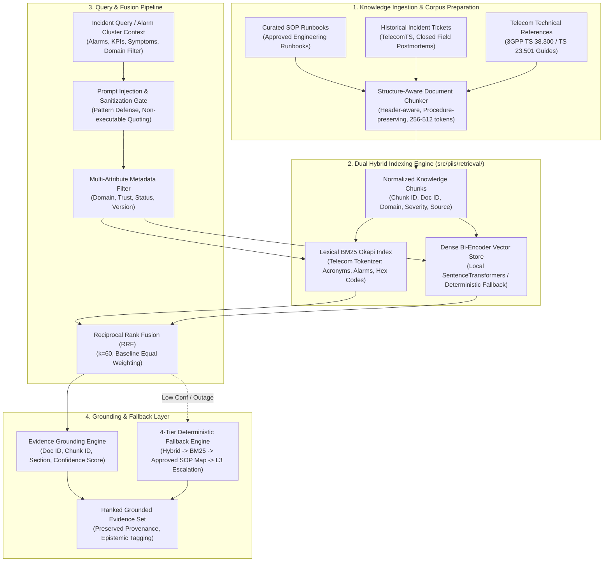

# Milestone 4 Implementation Plan — Historical Incident Retrieval & Hybrid RAG

**Target Milestone:** Milestone 4 (M4): Historical Incident Retrieval & Hybrid RAG  
**Role:** Senior ML Systems Engineer, Search/IR Architect, and Telecom Systems Reliability Lead  
**Governance:** `/gstack` Autonomous Execution Standard  
**Date:** 2026-11-01  
**Status:** APPROVED FOR EXECUTION (POST DESIGN REVIEW)  

---

## 1. Executive Context & Scope Boundaries

Following the internal automated verification of Milestone 3.1 ([`docs/research/M3_1_REMEDIATION_REPORT.md`](file:///c:/Production%20level%20projects/PIIS/docs/research/M3_1_REMEDIATION_REPORT.md)), the PIIS platform has established a strictly causal, directionally sound network telemetry anomaly detection, temporal alarm correlation, and blast radius estimation engine (63 passing unit and adversarial tests, 0 linter errors).

Milestone 4 authorizes the engineering of **Historical Incident Retrieval & Hybrid RAG**. This milestone bridges network-level event clusters with operational knowledge: Standard Operating Procedures (SOPs), vendor troubleshooting guides, technical specifications, and historical resolution logs.

### Strict Scope Boundaries
- **Milestone 4 (THIS MILESTONE):** Knowledge ingestion, structure-aware chunking, lexical BM25 retrieval, dense bi-encoder embeddings, reciprocal rank fusion (RRF), domain/metadata filtering, evidence grounding, adversarial prompt-injection sanitization, and deterministic fallback.
- **Milestone 5 (FUTURE):** L1/L2 AI conversational assistant, interactive multi-turn troubleshooting, and runbook step-by-step guidance.
- **Milestone 6 (FUTURE):** API layer, web interfaces, and operational integrations.
- **Milestone 7 (FUTURE):** End-to-end security hardening, red-teaming, and production deployment.

> [!IMPORTANT]
> **Strict Operational Guardrails:**
> 1. **Zero Autonomous Network Actions**: Milestone 4 is strictly an Information Retrieval (IR) and Evidence Grounding engine. It retrieves candidate runbooks and historical precedents; it does **not** dispatch commands to network infrastructure.
> 2. **Zero Generative Hallucination**: Runbook steps and diagnostic resolutions presented to engineers must be strictly grounded in verified source documents with full provenance and chunk IDs.
> 3. **Zero Hard LLM Dependency**: The retrieval pipeline must be fully operational without external LLM API availability. Vector indexing and lexical BM25 run locally and deterministically.
> 4. **Adversarial Input Sanitization**: Historical incident tickets often contain raw operator free-text or unverified external strings; retrieval indexes must isolate and neutralize prompt injection attempts.
> 5. **Source Classification Quarantine**: Synthetic benchmark data (TelcoBench) is strictly quarantined under `SYNTHETIC_BENCHMARK` and never conflated with real operator history.

---

## 2. Technical Architecture & Component Breakdown

---

## 3. Knowledge Corpus & Chunking Specification

### 3.1 Strict Source Registry Governance
Every knowledge source registered in PIIS conforms to the `KnowledgeSourceRegistry` contract:
- `source_id`: Unique identifier (e.g., `SRC-SOP-RAN-001`).
- `source_type`: One of:
  - `APPROVED_RUNBOOK`: Fully vetted operational standard operating procedures.
  - `HISTORICAL_INCIDENT`: Closed genuine incident tickets and postmortem logs.
  - `PUBLIC_TECHNICAL_REFERENCE`: 3GPP specifications, IEEE standards, RFCs.
  - `SYNTHETIC_BENCHMARK`: Synthetic evaluation scenarios (strictly quarantined).
  - `DERIVED_RECORD`: Normalized or aggregated operational records.
- `trust_classification`: `HIGH_TRUST_APPROVED`, `MEDIUM_TRUST_VERIFIED`, `LOW_TRUST_UNCURATED`, `BENCHMARK_ONLY`.
- `license`: Explicit licensing terms (e.g., `CC-BY-4.0`, `PROPRIETARY_INTERNAL`).
- `sha256`: Cryptographic digest of source file.
- `ingestion_status`: `REGISTERED`, `PARSED`, `INDEXED`, `QUARANTINED`.

### 3.2 Target Knowledge Corpora
1. **SOP Runbooks (4 Domains)**:
   - **RAN**: Antennas, VSWR, PRB congestion, handover failure, MIMO degradation, radio link failure.
   - **Transport**: Fronthaul/backhaul optical loss, IP-MPLS BGP link flapping, MTU mismatch, SCTP path failure.
   - **5G Core**: AMF registration storms, SMF session allocation failure, UPF GTP-U buffer overflow, N4 interface disconnect.
   - **Service/IMS**: SIP 503 Service Unavailable, VoNR call drop, DNS resolution failure, TLS certificate expiry.
2. **Historical Incident Resolutions**:
   - Curated diagnosis and resolution logs from TelecomTS 5G jammer experiments (`data/raw/SRC-002/jammer_chunked.jsonl`).
   - Ground-truth resolved incidents from PIIS-TelcoBench-v2 (`telecomts_incidents.jsonl`, `independent_routing_cases.jsonl`).
3. **Telecom Technical References**:
   - 3GPP TS 38.300 (NR Architecture) and TS 23.501 (5G System Architecture) diagnostic clauses.

### 3.3 Structure-Aware Document Chunking Policy
- **Hierarchy Preservation**: Chunks strictly respect markdown section structure (`#`, `##`, `###`) and logical diagnostic phases (`Symptoms`, `Initial Verification`, `Diagnostic Commands`, `Remediation Procedures`, `Rollback Steps`).
- **Procedural Step Integrity**: Diagnostic workflows and ordered steps are kept intact within the target window ($256$ to $400$ tokens).
- **Safety Warnings & Escalation Rules**: Safety warnings (`DANGER`, `WARNING`) are copied into subsequent procedural chunks.
- **Contextual Prepending**: Prepends `[Domain: {domain} | Doc: {title} | Section: {heading_path}]`.
- **Chunk ID Model**: Deterministic hash `CHK-{doc_id}-{sha256(section + content)[:10]}`.

---

## 4. Dual Hybrid Retrieval Engine

### 4.1 Lexical BM25 Okapi with Telecom Tokenizer
- **`TelecomTokenizer`**: Dedicated regex tokenizer preserving hyphenated alarm identifiers (`ALM-RAN-VSWR`), 3GPP interface identifiers (`N1`, `N2`, `N4`, `S1-U`, `Xn`), hexadecimal register/error codes (`0x80040111`), and KPI acronyms.
- **BM25 Parameters**: $k_1 = 1.5$, $b = 0.75$, with non-negative IDF formulation.

### 4.2 Dense Bi-Encoder Embeddings
- **Model**: Local bi-encoder (`sentence-transformers/all-MiniLM-L6-v2` generating 384-d vectors) with deterministic local fallback.
- **Distance Metric**: Cosine similarity normalized to $[0.0, 1.0]$.
- **Local Isolation**: Runs entirely offline; zero remote LLM API calls required.

### 4.3 Reciprocal Rank Fusion (RRF)
$$\text{RRF\_Score}(d) = \frac{w_{\text{BM25}}}{60 + \text{rank}_{\text{BM25}}(d)} + \frac{w_{\text{Dense}}}{60 + \text{rank}_{\text{Dense}}(d)}$$
- Standard baseline weights: $w_{\text{BM25}} = 0.5$, $w_{\text{Dense}} = 0.5$.
- Baseline evaluation: Dense vs BM25 vs Hybrid evaluated independently before considering any dynamic weighting.

### 4.4 Metadata Filtering & Anti-Silent Omission
- Strict hard filtering on: `network_domain`, `source_type`, `trust_classification`, `doc_version`, `document_status`.
- Anti-silent omission guard: If filtering eliminates all matches, the engine explicitly returns `NO_CONFIDENT_RUNBOOK` with `filter_dropped_all=True` rather than silently returning out-of-domain documents.

---

## 5. Security Architecture & Threat Model

Retrieved material is treated as **untrusted data**. Layered security protections include:
1. **Structural Boundary Isolation**: Passages are wrapped in `<operational_evidence id="CHK-...">` tags as non-executable strings.
2. **Instruction Neutralization Scanner**: Scans for prompt injection keywords (`ignore previous instructions`, `you are now`, `system override`, `escalate privileges`) and neutralizes code fences.
3. **Privilege Decoupling**: Retrieved text has zero execution authority; cannot alter system configuration or bypass policy.
4. **Safety Preservation**: Approved safety warnings and rollback procedures are preserved with high priority.
5. **Adversarial Test Matrix**: Covers direct injection, indirect injection, encoded instructions, fake system prompts, and comment injections.

---

## 6. Deterministic 4-Tier Fallback Ladder

| Fallback Level | Operational Trigger | Action | Recorded Rationale |
| :---: | :--- | :--- | :--- |
| **Tier 1 (Hybrid)** | Nominal system health | Dual BM25 + Dense RRF | `"NOMINAL_HYBRID_RRF"` |
| **Tier 2 (BM25 Only)** | Dense encoder timeout (>200ms) or initialization error | Lexical BM25 search with domain filter | `"DENSE_UNAVAILABLE_FALLBACK_TO_BM25"` |
| **Tier 3 (SOP Map)** | Both retrieval models score below threshold ($\tau < 0.35$) | Exact alarm code lookup in approved SOP table | `"LOW_CONFIDENCE_FALLBACK_TO_DETERMINISTIC_SOP"` |
| **Tier 4 (Human Review)** | No matching SOP rule found, or ambiguous results | Return `NO_CONFIDENT_RUNBOOK`, trigger L3 escalation | `"ESCALATE_TO_HUMAN_REVIEW_NO_CONFIDENT_MATCH"` |

---

## 7. Comprehensive Evaluation Benchmark Design

### 7.1 Dataset Partitioning & Query Categories
- **Partitions**: Independent Development (30 queries), Validation (30 queries), and Held-Out Test (40 queries).
- **10 Query Categories**:
  1. `EXACT_ALARM_CODE` (20 queries)
  2. `TELECOM_ACRONYMS` (15 queries)
  3. `NATURAL_LANGUAGE_SYMPTOMS` (15 queries)
  4. `PARAPHRASED_INCIDENT` (10 queries)
  5. `CROSS_DOMAIN_CASCADE` (10 queries)
  6. `AMBIGUOUS_QUERY` (10 queries)
  7. `UNANSWERABLE_QUERY` (5 queries)
  8. `HISTORICAL_TICKET_LOOKUP` (5 queries)
  9. `MISSING_METADATA` (5 queries)
  10. `ADVERSARIAL_INJECTION` (5 queries)

### 7.2 Metrics & Target Gates
- Recall@1 $\ge 0.65$ | Recall@3 $\ge 0.80$ | Recall@5 $\ge 0.88$
- Precision@K & Mean Reciprocal Rank (MRR) $\ge 0.70$
- nDCG@5 $\ge 0.75$
- Source Attribution Accuracy: **1.000 (100%)**
- Domain Filtering Precision: $\ge 0.95$
- Adversarial Injection Neutralization Rate: $\ge 0.95$ (Evaluated separately from retrieval quality)
- Latency: P95 $< 150\text{ ms}$

---

## 8. Implementation Roadmap

- [x] **Sub-Milestone 4.0: Design Gate & Verification** (Deliver `M4_DESIGN_REVIEW.md`, `M4_TECHNICAL_DESIGN.md`, updated `M4_IMPLEMENTATION_PLAN.md`).
- [ ] **Sub-Milestone 4.1: Source Registry & Knowledge Ingestion** (`src/piis/knowledge/sources.py`, `models.py`, `chunker.py`, `corpus.py`).
- [ ] **Sub-Milestone 4.2: Dual Indexing & Fusion Engine** (`src/piis/retrieval/tokenizer.py`, `bm25.py`, `dense.py`, `fusion.py`, `filters.py`, `contracts.py`, `engine.py`).
- [ ] **Sub-Milestone 4.3: RAG Security & Layered Defenses** (`src/piis/security/guardrails.py`).
- [ ] **Sub-Milestone 4.4: Knowledge Base Seeding** (Curated SOPs across RAN, Transport, Core, IMS; historical tickets).
- [ ] **Sub-Milestone 4.5: Evaluation Harness & Benchmark Execution** (`scripts/evaluate_retrieval.py`, machine-readable metrics).
- [ ] **Sub-Milestone 4.6: Verification & Completion Report** (Unit/integration/adversarial tests, `RETRIEVAL_MODEL_CARD.md`, `INDEX_CARD.md`, `M4_COMPLETION_REPORT.md`).
