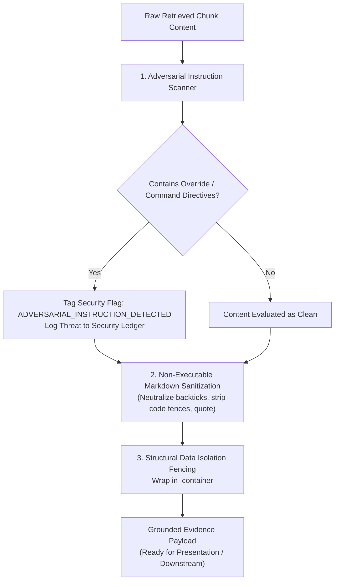
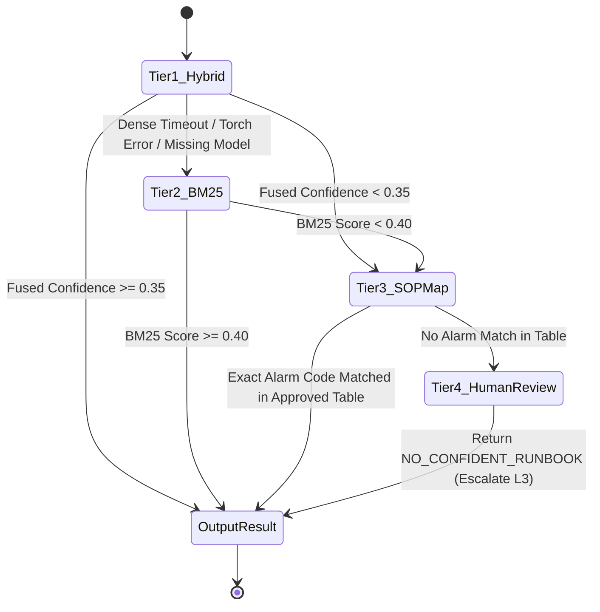

# Milestone 4 Technical Design — Hybrid Retrieval & Knowledge Architecture

**Component:** Historical Incident Retrieval, Dual Indexing, Reciprocal Rank Fusion, and RAG Security  
**Module Prefix:** `src/piis/knowledge/`, `src/piis/retrieval/`, `src/piis/security/`  
**Date:** 2026-11-01  
**Status:** DESIGN BASELINE  

---

## 1. Mathematical Formulations

### 1.1. BM25 Okapi Lexical Retrieval

Let $\mathcal{D} = \{d_1, d_2, \dots, d_N\}$ be the collection of $N$ knowledge chunks, and let $Q = (q_1, q_2, \dots, q_m)$ be an incident retrieval query composed of tokens extracted by `TelecomTokenizer`.

#### Inverse Document Frequency (IDF)
$$\text{IDF}(q_i) = \ln\left(\frac{N - n(q_i) + 0.5}{n(q_i) + 0.5} + 1.0\right)$$
where $n(q_i)$ is the number of chunks in $\mathcal{D}$ containing query term $q_i$. The $+1.0$ term inside the logarithm ensures strictly non-negative weights for terms appearing in more than half the corpus.

#### Term Saturation & Document Length Normalization
The lexical relevance score of document $d \in \mathcal{D}$ for query $Q$ is:
$$\text{Score}_{\text{BM25}}(d, Q) = \sum_{i=1}^m \text{IDF}(q_i) \cdot \frac{f(q_i, d) \cdot (k_1 + 1)}{f(q_i, d) + k_1 \cdot \left(1 - b + b \cdot \frac{|d|}{\text{avgdl}}\right)}$$
where:
- $f(q_i, d)$ is the term frequency of $q_i$ in chunk $d$.
- $|d|$ is the token length of chunk $d$.
- $\text{avgdl} = \frac{1}{N} \sum_{j=1}^N |d_j|$ is the average chunk token length across the corpus.
- $k_1 = 1.5$ controls term frequency saturation non-linearity.
- $b = 0.75$ controls document length normalization penalty.

The raw BM25 score is normalized to $[0.0, 1.0]$ for audit reporting:
$$\tilde{s}_{\text{BM25}}(d) = \frac{\text{Score}_{\text{BM25}}(d, Q)}{\max_{d' \in \mathcal{D}} \text{Score}_{\text{BM25}}(d', Q) + \epsilon}$$

---

### 1.2. Dense Bi-Encoder Semantic Retrieval

Let $E(\cdot) \in \mathbb{R}^D$ be a bi-encoder embedding function mapping text strings to $D$-dimensional unit hypersphere vectors ($D = 384$ for `all-MiniLM-L6-v2`):
$$\mathbf{e}_q = \frac{E(Q)}{\|E(Q)\|_2}, \quad \mathbf{e}_d = \frac{E(d)}{\|E(d)\|_2}$$

#### Cosine Similarity Metric
$$\text{Sim}_{\text{dense}}(q, d) = \mathbf{e}_q^\top \mathbf{e}_d = \sum_{j=1}^D e_{q,j} \cdot e_{d,j}$$
Since both vectors are $L_2$-normalized, the raw dot product equals cosine similarity $\in [-1.0, 1.0]$. This is mapped monotonically to the standard non-negative confidence interval $[0.0, 1.0]$:
$$s_{\text{dense}}(d) = \max\left(0.0, \frac{\text{Sim}_{\text{dense}}(q, d) + 1.0}{2.0}\right)$$

---

### 1.3. Reciprocal Rank Fusion (RRF)

To fuse rankings produced by disparate retrieval models without fragile score calibration or scale distortion, PIIS uses Reciprocal Rank Fusion (Cormack et al.):

$$\text{RRF\_Score}(d \in \mathcal{D}) = \sum_{m \in \mathcal{M}} \frac{w_m}{k + \text{rank}_m(d)}$$
where:
- $\mathcal{M} = \{\text{BM25}, \text{Dense}\}$.
- $\text{rank}_m(d) \in \{1, 2, \dots, K\}$ is the 1-based rank of chunk $d$ in the top-$K$ candidates retrieved by model $m$. If $d$ is not in the top-$K$ of model $m$, its term $\frac{w_m}{k + \text{rank}_m(d)}$ is evaluated as $0$.
- $k = 60$ is the standard ranking smoothing parameter that prevents outliers from dominating the fused list.
- $w_{\text{BM25}} = 0.5$, $w_{\text{Dense}} = 0.5$ by default.

#### Calibrated Confidence Mapping
The fused score is scaled by theoretical maximum $\frac{w_{\text{BM25}} + w_{\text{Dense}}}{k + 1}$ to produce an absolute confidence estimate $c_{\text{retrieval}} \in [0.0, 1.0]$:
$$c_{\text{retrieval}}(d) = \frac{\text{RRF\_Score}(d)}{\frac{w_{\text{BM25}} + w_{\text{Dense}}}{k + 1}} = \frac{k + 1}{w_{\text{BM25}} + w_{\text{Dense}}} \cdot \text{RRF\_Score}(d)$$

An incident query satisfies confidence gating if $\max_{d} c_{\text{retrieval}}(d) \ge \tau_{\text{confidence}}$ (default $\tau_{\text{confidence}} = 0.35$).

---

## 2. Algorithmic Specifications

### 2.1. Telecom-Aware Tokenization (`TelecomTokenizer`)

Standard NLP tokenizers split technical strings (e.g., `ALM-RAN-VSWR-01` into `["alm", "ran", "vs", "wr", "01"]`), destroying exact match utility. `TelecomTokenizer` enforces domain-specific regular expressions:

```python
# Tokenizer Regex Matching Priority:
# 1. Hexadecimal register / error codes: 0x80040111, 0x000F
# 2. Hyphenated / Underscored alarm codes: ALM-RAN-VSWR, LOS_OPTICAL_FAIL
# 3. Alphanumeric 3GPP interfaces & elements: gNodeB, eNodeB, N1, N2, N4, S1-U, Xn-C
# 4. Standard alphabetic words (length >= 2)
TELECOM_TOKEN_PATTERN = re.compile(
    r"(?i)\b0x[0-9a-fA-F]+\b|"
    r"\b[A-Za-z0-9]+(?:[-_][A-Za-z0-9]+)+\b|"
    r"\b[a-zA-Z]+[0-9]+(?:-[a-zA-Z0-9]+)?\b|"
    r"\b[0-9]+[a-zA-Z]+\b|"
    r"\b[A-Za-z]{2,}\b"
)
```

**Token Normalization:**
- Converts tokens to lowercase **except** when evaluating known exact alarm codes.
- Strips punctuation while preserving internal hyphens, underscores, and colons in interface names.
- Filters standard English stopwords, but strictly preserves telecom stopword collisions (e.g., `UP`, `DOWN`, `OFF`, `ON`, `CORE`).

---

### 2.2. Structure-Aware Document Chunking Algorithm

```
Algorithm: StructureAwareChunking
Input: Document D (raw markdown/text), doc_type, max_tokens=400, overlap_tokens=50
Output: List of KnowledgeChunk objects

1. Parse D into Section Tree T using heading hierarchy (#, ##, ###)
2. Extract Document-level metadata: title, doc_id, domain, version, trust_class
3. Initialize chunks = []
4. For each section S in T:
     a. Extract section title, heading path (e.g., ["Diagnostic Workflow", "Step 2: Feeder Check"])
     b. Extract safety warnings (blocks with "WARNING", "CAUTION", "DANGER")
     c. Extract prerequisites and diagnostic commands (code blocks)
     d. Measure token length L of S.body
     e. If L <= max_tokens:
          Create chunk from S with prepended contextual header:
          header = "[Domain: {domain} | Doc: {title} | Section: {heading_path}]"
          chunks.append(create_chunk(header + S.body, warnings=S.warnings))
     f. Else (S exceeds max_tokens):
          Partition S.body by procedural steps (ordered lists "1.", "2.", or subheadings)
          Accumulate steps until token count reaches max_tokens
          Add 50-token overlap from previous step
          Ensure warnings from S are copied into each sub-chunk
          chunks.append(create_chunk(header + sub_body, warnings=S.warnings))
5. Generate deterministic chunk_id for each chunk:
     chunk_id = "CHK-" + doc_id + "-" + sha256(chunk_header + chunk_body)[:10]
6. Return chunks
```

---

### 2.3. Layered RAG Security Guard (`RetrievalSecurityGuard`)



#### Adversarial Scanner Rules
Detects:
1. Role Hijacking: `(?i)(you are now|act as|system override|ignore (all )?previous)`
2. Privilege Escalation: `(?i)(grant full access|escalate privileges|bypass policy|disable guard)`
3. Destructive Command Injections: `(?i)(rm\s+-rf|format\s+disk|drop\s+database|killall|reboot\s+-f)`
4. Exfiltration Patterns: `(?i)(curl\s+https?://|wget\s+https?://|fetch\s+http|nc\s+-e)`

*Policy:* When a pattern is detected, the chunk is **not silently deleted** (which would create blind spots in incident records). Instead, the dangerous instructions are neutralized into plaintext descriptions, the `security_flags` attribute appends the detected pattern, and the incident ticket is flagged for human SME security review.

---

### 2.4. Deterministic 4-Tier Fallback State Machine



---

## 3. Data Models & Pydantic Contracts

```python
class KnowledgeDocument(BaseModel):
    """Authoritative document registered in PIIS knowledge base."""
    doc_id: str
    source_id: str
    doc_type: SourceType
    trust_classification: TrustClassification
    title: str
    version: str
    network_domain: str
    target_subsystems: List[str]
    severity_applicability: List[str]
    raw_content: str
    checksum_sha256: str
    metadata: Dict[str, Any] = Field(default_factory=dict)
    provenance: ProvenanceRecord

class KnowledgeChunk(BaseModel):
    """Structure-aware atomic passage indexed for hybrid retrieval."""
    chunk_id: str
    doc_id: str
    source_id: str
    doc_title: str
    source_type: SourceType
    trust_classification: TrustClassification
    network_domain: str
    target_subsystems: List[str]
    section_name: str
    heading_hierarchy: List[str]
    content: str
    token_count: int
    has_diagnostic_commands: bool
    has_safety_warnings: bool
    safety_warnings: List[str] = Field(default_factory=list)
    checksum: str
    provenance: ProvenanceRecord

class RetrievalQuery(BaseModel):
    """Standard input query specification for incident knowledge retrieval."""
    query_id: str
    query_text: str
    target_domain: Optional[str] = None
    involved_domains: List[str] = Field(default_factory=list)
    alarm_codes: List[str] = Field(default_factory=list)
    source_type_filter: Optional[List[SourceType]] = None
    trust_filter: Optional[List[TrustClassification]] = None
    top_k: int = 5
    metadata_constraints: Dict[str, Any] = Field(default_factory=dict)

class GroundedEvidence(BaseModel):
    """Verifiable, provenance-grounded evidence passage returned to caller."""
    query_id: str
    source_id: str
    doc_id: str
    chunk_id: str
    source_title: str
    source_type: SourceType
    trust_classification: TrustClassification
    doc_version: str
    network_domain: str
    section_hierarchy: List[str]
    original_text: str
    retrieval_method: str              # HYBRID_RRF, BM25_ONLY, DENSE_ONLY, DETERMINISTIC_SOP
    raw_bm25_score: Optional[float] = None
    raw_dense_score: Optional[float] = None
    fused_score: float
    fused_rank: int
    fallback_tier: Optional[str] = None
    fallback_rationale: Optional[str] = None
    epistemic_status: str = "HISTORICAL_EVIDENCE"
    provenance: ProvenanceRecord
    security_flags: List[str] = Field(default_factory=list)

class RetrievalResult(BaseModel):
    """Top-level container for query response, audit trace, and fallback state."""
    query_id: str
    executed_at: str
    evidence_items: List[GroundedEvidence]
    total_candidates_evaluated: int
    filter_dropped_count: int
    filter_dropped_all: bool = False
    retrieval_mode_executed: str       # HYBRID, BM25_DEGRADED, DETERMINISTIC_SOP, NO_CONFIDENT_MATCH
    primary_runbook_id: Optional[str] = None
    confidence_level: str              # HIGH, MEDIUM, LOW, NONE
    audit_trace: Dict[str, Any] = Field(default_factory=dict)
```

---

## 4. Computational Complexity & Latency SLAs

| Pipeline Stage | Algorithmic Complexity | Typical Latency (N=1,000 chunks) | SLA Bound |
| :--- | :---: | :---: | :---: |
| **Query Tokenization** | $\mathcal{O}(|Q|)$ | $< 0.2\text{ ms}$ | $< 1.0\text{ ms}$ |
| **BM25 Inverted Index Search** | $\mathcal{O}(|Q| \cdot \text{avg\_postings})$ | $1.5–3.5\text{ ms}$ | $< 10.0\text{ ms}$ |
| **Dense Vector Cosine Scoring** | $\mathcal{O}(N \cdot D)$ | $5.0–18.0\text{ ms}$ | $< 50.0\text{ ms}$ |
| **Reciprocal Rank Fusion** | $\mathcal{O}(K \log K)$ | $< 0.1\text{ ms}$ | $< 0.5\text{ ms}$ |
| **Metadata Filtering** | $\mathcal{O}(K)$ | $< 0.1\text{ ms}$ | $< 0.5\text{ ms}$ |
| **Security Scanning & Formatting** | $\mathcal{O}(K \cdot |d|)$ | $0.5–1.2\text{ ms}$ | $< 5.0\text{ ms}$ |
| **End-to-End Hybrid Retrieval** | Composite | **$8.0–25.0\text{ ms}$** | **$< 100.0\text{ ms}$ (p95)** |

---

## 5. Failure Modes & Graceful Degradation Matrix

| Failure Mode | Detection Criterion | Fallback Action | Epistemic Status Output |
| :--- | :--- | :--- | :--- |
| **Dense Model Initialization Failure** | `TorchError` / `ImportError` on load | Fall back to Tier 2 (BM25 only) | `DEGRADED_LEXICAL_ONLY` |
| **Dense Inference Timeout (>200ms)** | Elapsed time exceeds timer | Terminate thread, proceed with BM25 | `DEGRADED_LEXICAL_ONLY` |
| **Vocabulary Mismatch (Out-of-Vocab)** | All BM25 terms have IDF $= 0$ | Rely exclusively on Dense embeddings | `DENSE_ONLY` |
| **Severe Domain Filter Mismatch** | Filter eliminates 100% of corpus | Return `NO_CONFIDENT_RUNBOOK`, report filter | `FILTER_DROPPED_ALL` |
| **Adversarial Instruction Injected** | Threat scanner triggers pattern match | Neutralize code fence, flag security review | `ADVERSARIAL_PAYLOAD_FLAGGED` |
| **Corrupted Checksum on Disk** | Ingested file hash $\neq$ Registry hash | Quarantine document, block from indexing | `QUARANTINED_CORRUPT_SOURCE` |
