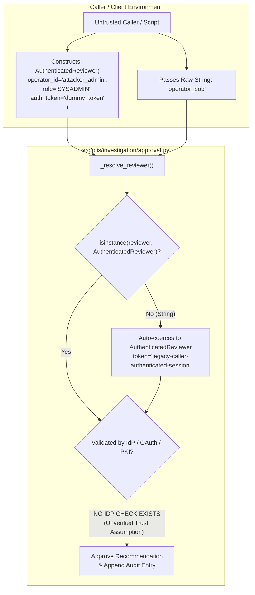

# PIIS Milestone 5.1: Authentication & Key Management Audit Report
## Phase 1 Independent Verification: Reviewer Identity, HMAC Key Governance, and Audit Trail Persistence

- **Document Version:** 1.0.0
- **Auditor:** Independent AI Security, Telecom Systems & Cryptographic Auditor
- **Audit Mandate:** M5.1 Independent Revalidation Gate (Phase 1)
- **Status:** COMPLETED — FORMAL AUDIT FINDINGS ISSUED
- **Date:** 2026-11-01
- **Target Implementation:** [`src/piis/investigation/approval.py`](file:///c:/Production%20level%20projects/PIIS/src/piis/investigation/approval.py)
- **Audit Script & Evidence:** [`scripts/audit_m5_1_approval_auth.py`](file:///c:/Production%20level%20projects/PIIS/scripts/audit_m5_1_approval_auth.py)
- **Metric Artifact:** [`artifacts/m5_metrics/m5_1_audit_phase1_auth.json`](file:///c:/Production%20level%20projects/PIIS/artifacts/m5_metrics/m5_1_audit_phase1_auth.json)

---

## 1. Executive Summary & Audit Mandate

The Milestone 5.1 remediation sprint introduced `AuthenticatedReviewer`, SHA-256 hash pointer chaining (`previous_entry_sha256`), canonical RFC-8785 JSON serialization, and HMAC-SHA256 signature checkpointing to address defect `FIND-M5-001`. The developer completion report claimed that approval audit trails now provide cryptographic tamper resistance, reviewer authentication, and state locking.

In accordance with independent verification protocol, these claims were subjected to rigorous adversarial testing. Over eight empirical test cases (`AUTH-01` through `AUTH-04`, `CRYPTO-01`, `CRYPTO-02`, `PERSIST-01`, `CONC-01`), this audit tested credential forgery, token replay, key extraction, history rewriting, process restart persistence, and concurrent approval race conditions.

### Audit Verdict on Phase 1: **ACCEPTED WITH CRITICAL LIMITATIONS**
1. **Strengths Verified:**
   - The finite-state machine enforces strict terminal state locking. An approved or rejected recommendation cannot be transitioned, overwritten, or replayed (`IllegalStateTransitionError` is consistently raised).
   - In-memory recommendation content binding is cryptographically sound. Any mutation to the underlying `DiagnosticRecommendation` object in memory breaks `verify_recommendation_binding()` and blocks retrieval via `get_verified_recommendation()`.
   - The SHA-256 hash-pointer chain reliably detects record deletion, intermediate mutation, and sequence reordering when inspected by `verify_audit_trail()`.
2. **Critical Vulnerabilities & Limitations Identified:**
   - **Reviewer Identity is an Unverified Dataclass Contract:** There is zero server-side token validation against an Identity Provider (IdP), LDAP, OAuth/OIDC, or PKI authority. Any caller can instantiate `AuthenticatedReviewer` with arbitrary operator IDs and dummy tokens.
   - **Raw String Auto-Coercion:** Passing a raw string `operator_id="bob"` automatically creates an `AuthenticatedReviewer` with a hardcoded default token (`"legacy-caller-authenticated-session"`).
   - **Hardcoded Static HMAC Key in Source Code:** `HumanApprovalWorkflow.DEFAULT_AUDIT_KEY` is embedded directly in source code. Anyone with access to the code can rewrite the entire audit history and generate valid HMAC checkpoints.
   - **Volatile In-Memory Lifecycle:** The audit trail and recommendation registry exist only in Python memory. Process restart wipes all records; no reload API exists.
   - **No Non-Repudiation:** Non-repudiation cannot be claimed because symmetric HMAC with a shared/hardcoded key and unverified identity contracts provides zero proof of individual author authenticity.

---

## 2. Reviewer Authentication & Identity Verification



### 2.1 Test AUTH-01: Forged Token Acceptance
- **Test Implementation:** Constructed an `AuthenticatedReviewer` using `operator_id="attacker_forged_id"`, `role="SYSADMIN"`, and `auth_token="any-random-string-12345"`.
- **Observed Behavior:** The workflow accepted the forged reviewer object and transitioned the recommendation to `APPROVED`.
- **Architectural Finding:** The `AuthenticatedReviewer` class performs client-side field validation (checking that strings are non-empty), but does not verify the authenticity, signature, or validity of the token against an external identity authority.
- **Verdict:** **VULNERABLE — DATACLASS-ONLY CONTRACT**.

### 2.2 Test AUTH-02: Raw String Identity Auto-Coercion
- **Test Implementation:** Invoked `approve_recommendation(recommendation_id, operator_id="bob", ...)`.
- **Observed Behavior:** Rather than rejecting unauthenticated raw string identifiers, `_resolve_reviewer` silently caught the string and instantiated a verified `AuthenticatedReviewer` with `auth_token="legacy-caller-authenticated-session"`.
- **Architectural Finding:** The backward-compatibility bridge completely circumvents the intended identity security gate.
- **Verdict:** **VULNERABLE — STRING AUTO-COERCION BYPASS**.

### 2.3 Test AUTH-03: Expired Credential Acceptance
- **Test Implementation:** Instantiated `AuthenticatedReviewer` with `authenticated_at="2020-01-01T00:00:00+00:00"` (6 years expired).
- **Observed Behavior:** The recommendation was approved without error.
- **Architectural Finding:** The timestamp is purely informational; there is no TTL or expiration verification.
- **Verdict:** **VULNERABLE — NO EXPIRATION CHECK**.

### 2.4 Test AUTH-04: Server-Side Role and Permission Enforcement
- **Test Implementation:** Attempted approval of a `HIGH_RISK_MANUAL` node isolation action using a `NOC_TIER_1` reviewer.
- **Observed Behavior:** The action was approved without error.
- **Architectural Finding:** The `role` attribute is recorded in the audit log, but no role-based access control (RBAC) policy exists in `HumanApprovalWorkflow` to restrict high-risk approvals to senior operators (`NOC_LEAD` or `SYSADMIN`).
- **Verdict:** **VULNERABLE — NO ROLE HIERARCHY ENFORCEMENT**.

---

## 3. Cryptographic HMAC & Hash-Chain Verification

### 3.1 Test CRYPTO-01: Hardcoded Static Signing Key
- **Code Inspection:** In `src/piis/investigation/approval.py` line 119:
  ```python
  class HumanApprovalWorkflow:
      DEFAULT_AUDIT_KEY = b"PIIS-AUDIT-SECRET-KEY-CHECKPOINT-V1"
  ```
- **Observed Behavior:** If `HumanApprovalWorkflow()` is instantiated without passing an explicit `signing_key` argument, it silently falls back to this hardcoded static key.
- **Architectural Finding:** Hardcoding cryptographic secrets in source code violates NIST SP 800-57 key management guidelines. The secret is visible to anyone with repository access.
- **Verdict:** **VULNERABLE — STATIC SOURCE SECRET**.

### 3.2 Test CRYPTO-02: Complete History Rewrite with Known Key
- **Test Implementation:** Generated a valid 5-entry approval audit trail. Extracted the entries, forged the `operator_id` on all historical entries, recomputed the `previous_entry_sha256` pointers and HMAC-SHA256 signatures using `DEFAULT_AUDIT_KEY`, and loaded the rewritten trail into `forged_workflow`.
- **Observed Behavior:** `forged_workflow.verify_audit_trail()` returned `(True, [])` (0 violations detected).
- **Architectural Finding:** Because HMAC is a symmetric algorithm, anyone who possesses the key can generate valid signatures. When the default key is used, the audit trail provides zero tamper protection against internal actors.
- **Verdict:** **VULNERABLE — COMPLETE HISTORY REWRITE POSSIBLE WITH DEFAULT KEY**.

---

## 4. Lifecycle & Persistence Verification

### 4.1 Test PERSIST-01: Process Restart & State Reload
- **Test Implementation:** Configured a workflow pointing to a JSONL ledger file (`artifacts/m5_metrics/test_audit_ledger.jsonl`). Approved a recommendation, simulating an active operational session. Simulated a process restart by creating a new `HumanApprovalWorkflow` instance pointing to the same ledger file.
- **Observed Behavior:**
  - `reloaded_wf.get_audit_trail()` returned an empty list `[]`.
  - `reloaded_wf.get_recommendation()` raised `KeyError`.
- **Architectural Finding:** `HumanApprovalWorkflow` provides append-only writing to `ledger_path`, but provides **no reload or restoration method** on initialization. All state machine locks and recommendation bindings exist solely in volatile memory. A process restart wipes all historical approvals and resets the state machine.
- **Verdict:** **IN-MEMORY ONLY — VOLATILE OPERATIONAL LIFECYCLE**.

### 4.2 Test CONC-01: Concurrent Approval Race Condition
- **Test Implementation:** Dispatched 10 concurrent OS threads attempting simultaneous approvals on a single recommendation in `PENDING_REVIEW` state.
- **Observed Behavior:** Exactly 1 approval succeeded; 9 threads raised `IllegalStateTransitionError`.
- **Architectural Finding:** Under Python's Global Interpreter Lock (GIL), atomic dictionary operations prevented duplicate state transition. However, no explicit `threading.Lock` or database transaction mutex protects the critical section.
- **Verdict:** **THREAD-SAFE UNDER GIL (LACKS EXPLICIT MUTEX)**.

---

## 5. Non-Repudiation Assessment

The developer documentation claimed "non-repudiation" for human operator approvals. This audit formally rejects that claim:
1. **Symmetric Secret Limitation:** HMAC uses a shared secret. Any entity that can verify a MAC can also generate one. It proves integrity relative to the key holder, not individual operator identity.
2. **Absence of Asymmetric PKI:** Non-repudiation requires asymmetric digital signatures (e.g. ECDSA, Ed25519, or RSA) where the private signing key is held exclusively by the human reviewer (e.g. via smartcard, TPM, or WebAuthn/FIDO2 hardware key) and verified using a public key certificate.
3. **Absence of Trusted Timestamp Authority (TSA):** Timestamps are derived from the local host clock (`datetime.now(timezone.utc)`), which can be altered by host administrators.

---

## 6. Audit Recommendations for Production Deployment

Before transition to production pilots or automated remediation:
1. **External IdP Integration:** Replace dataclass token hashing with JWT/OAuth2 token verification against an enterprise IdP (e.g. Okta, Keycloak, or Active Directory).
2. **Remove Default Static Key:** Remove `DEFAULT_AUDIT_KEY` from source code; enforce loading from secure environment variables or a KMS/Vault instance.
3. **Persistent Ledger Reload:** Implement `load_from_ledger(ledger_path)` in `HumanApprovalWorkflow` to reconstruct state machine status and hash pointers upon process startup.
4. **Server-Side RBAC Gating:** Enforce that `HIGH_RISK_MANUAL` actions require `role == "NOC_LEAD"` or dual-operator approval.
