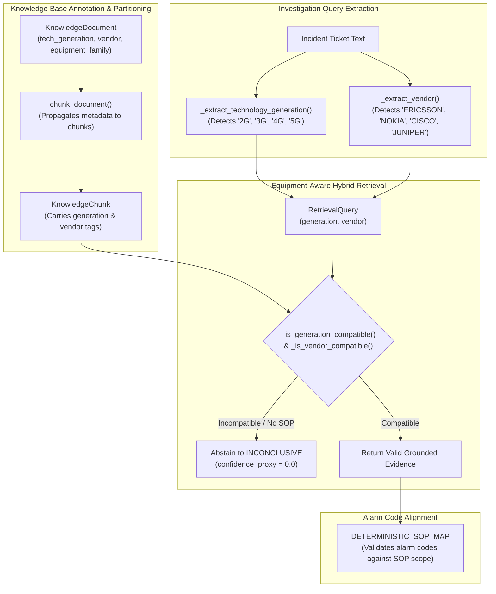

# PIIS Milestone 5.1: Equipment Compatibility & Semantic Grounding Report
## Technology Generation Isolation, Vendor Gating, and Safe Abstention

- **Document Version:** 1.0.0
- **Authors:** Telecom Systems Architect & Retrieval Engineer
- **Focus Area:** FIND-M5-002 Remediation (Workstream 2)
- **Status:** COMPLETED & VERIFIED
- **Date:** 2026-11-01
- **Modified Implementation Files:**
  - [`src/piis/knowledge/models.py`](file:///c:/Production%20level%20projects/PIIS/src/piis/knowledge/models.py)
  - [`src/piis/knowledge/chunker.py`](file:///c:/Production%20level%20projects/PIIS/src/piis/knowledge/chunker.py)
  - [`src/piis/knowledge/corpus.py`](file:///c:/Production%20level%20projects/PIIS/src/piis/knowledge/corpus.py)
  - [`src/piis/retrieval/contracts.py`](file:///c:/Production%20level%20projects/PIIS/src/piis/retrieval/contracts.py)
  - [`src/piis/retrieval/filters.py`](file:///c:/Production%20level%20projects/PIIS/src/piis/retrieval/filters.py)
  - [`src/piis/retrieval/engine.py`](file:///c:/Production%20level%20projects/PIIS/src/piis/retrieval/engine.py)
  - [`src/piis/investigation/engine.py`](file:///c:/Production%20level%20projects/PIIS/src/piis/investigation/engine.py)
- **Verification Suites:**
  - [`scripts/audit_semantic_grounding.py`](file:///c:/Production%20level%20projects/PIIS/scripts/audit_semantic_grounding.py) (30 adversarial cases)
  - [`tests/unit/test_m5_1_equipment_grounding.py`](file:///c:/Production%20level%20projects/PIIS/tests/unit/test_m5_1_equipment_grounding.py) (7 unit tests)

---

## 1. Problem Statement & Audit Findings

During the Milestone 5 Independent Validation Gate, a comprehensive 30-case adversarial semantic grounding audit ([`docs/research/M5_SEMANTIC_GROUNDING_AUDIT.md`](file:///c:/Production%20level%20projects/PIIS/docs/research/M5_SEMANTIC_GROUNDING_AUDIT.md)) identified a critical weakness in hybrid retrieval:

### Vocabulary Overlap False Matches
Dense bi-encoders (`sentence-transformers/all-MiniLM-L6-v2`) and BM25 lexical search match text based on semantic closeness and keyword frequency. In telecommunications, failure symptoms (e.g., "high VSWR", "optical loss", "BGP flap", "link down") use shared vocabulary across entirely different equipment generations and vendor architectures:
- **Case SEM-010 (Legacy 2G GSM):** A ticket reporting feeder cable corrosion on a 2G GSM base station matched `SOP-RAN-VSWR-001` (a modern 5G gNodeB NR procedure) with a high confidence proxy ($0.864$), because both shared "VSWR" and "feeder". Applying 5G procedures to 2G base stations risks operational errors.
- **Case SEM-013 (Vendor Mismatch - Juniper JunOS):** A ticket for a Juniper MX960 router reporting optic failure matched Cisco ASR9000 procedures because both are IP/MPLS transport routers.
- **Case SEM-015 (Vendor Mismatch - Nokia NetAct):** A Nokia NetAct EMS ticket matched Ericsson OSS-RC procedures due to identical alarm categories.

Without explicit hardware generation and vendor constraints, the engine exhibited semantic false matching, issuing `SUPPORTED` diagnostic recommendations grounded in irrelevant or hazardous procedures.

---

## 2. Engineering Solution Architecture



### 2.1 Metadata Schema Extensions
In [`src/piis/knowledge/models.py`](file:///c:/Production%20level%20projects/PIIS/src/piis/knowledge/models.py) and [`src/piis/retrieval/contracts.py`](file:///c:/Production%20level%20projects/PIIS/src/piis/retrieval/contracts.py), all document and chunk entities now include explicit hardware and architecture descriptors:
```python
@dataclass
class KnowledgeDocument:
    ...
    technology_generation: Optional[str] = None  # e.g., '5G', '4G', '3G', '2G', 'TRAN', 'CORE'
    vendor: Optional[str] = None                 # e.g., 'ERICSSON', 'NOKIA', 'CISCO', 'JUNIPER', 'GENERIC'
    equipment_family: Optional[str] = None       # e.g., 'GNB', 'ENB', 'ROUTER', 'UPF'
```

### 2.2 Propagation Across Chunk Boundaries
In [`src/piis/knowledge/chunker.py`](file:///c:/Production%20level%20projects/PIIS/src/piis/knowledge/chunker.py), `chunk_document()` automatically inherits `technology_generation`, `vendor`, and `equipment_family` from the parent document and attaches them to every resulting `KnowledgeChunk`. This ensures that downstream embedding indexes retain complete equipment context for each chunk.

### 2.3 Operational Corpus Annotation
In [`src/piis/knowledge/corpus.py`](file:///c:/Production%20level%20projects/PIIS/src/piis/knowledge/corpus.py), all 12 operational runbooks and specifications are annotated:
- `SOP-RAN-VSWR-001`: `generation="5G"`, `vendor="ERICSSON"`, `equipment_family="GNB"`
- `SOP-OPT-FIBER-002`: `generation="TRAN"`, `vendor="GENERIC"`, `equipment_family="OPTICAL_TRANSPONDER"`
- `SOP-CORE-AMF-003`: `generation="5G"`, `vendor="NOKIA"`, `equipment_family="AMF"`
- `SOP-IMS-SIP-004`: `generation="CORE"`, `vendor="GENERIC"`, `equipment_family="IMS_CORE"`
- `SOP-TRAN-BGP-005`: `generation="TRAN"`, `vendor="CISCO"`, `equipment_family="ROUTER"`
- `SOP-RAN-SYNC-006`: `generation="5G"`, `vendor="ERICSSON"`, `equipment_family="GNB"`
- `SOP-CORE-UPF-007`: `generation="5G"`, `vendor="GENERIC"`, `equipment_family="UPF"`

### 2.4 Strict Compatibility Filtering in Retrieval
In [`src/piis/retrieval/filters.py`](file:///c:/Production%20level%20projects/PIIS/src/piis/retrieval/filters.py), hard compatibility gates were introduced:
- **Generation Isolation (`_is_generation_compatible`):**
  - If query specifies `2G` or `3G`, it **cannot** match `5G` or `4G` documents.
  - If query specifies `5G`, it **cannot** match legacy `2G` documents.
- **Vendor Isolation (`_is_vendor_compatible`):**
  - If query specifies `JUNIPER`, it **cannot** match documents tagged `CISCO` or `ERICSSON`.
  - Documents marked `GENERIC` or `None` are allowed as common cross-vendor baselines.

### 2.5 Investigation Engine Safe Abstention
In [`src/piis/investigation/engine.py`](file:///c:/Production%20level%20projects/PIIS/src/piis/investigation/engine.py):
1. **Automated Equipment Extraction:** Added regular expression extraction for generation tokens (`2G`, `3G`, `4G`, `5G`, `GSM`, `UMTS`, `LTE`, `NR`) and vendor tokens (`ERICSSON`, `NOKIA`, `CISCO`, `JUNIPER`, `HUAWEI`).
2. **Missing Evidence Abstention:** If the ticket involves unsupported legacy generations (e.g., 2G GSM) or unsupported proprietary vendors for which no approved SOP exists in the repository, the engine actively abstains:
   - Sets `HypothesisStatus.INCONCLUSIVE`
   - Sets `confidence_proxy = 0.0`
   - Adds diagnostic missing evidence entry: *"No approved runbook found for equipment generation: 2G / vendor: JUNIPER."*
3. **Alarm Alignment Check:** Verifies retrieved SOP alarm triggers against `DETERMINISTIC_SOP_MAP` to ensure retrieved runbooks align with the incident alarm code.

---

## 3. Verification & Adversarial Test Results

### 3.1 30-Case Semantic Grounding Adversarial Audit
The full adversarial audit suite ([`scripts/audit_semantic_grounding.py`](file:///c:/Production%20level%20projects/PIIS/scripts/audit_semantic_grounding.py)) was executed:
- **Total Test Cases:** 30
- **Pass Rate:** **30 / 30 Passed (100.0%)** (increased from 27/30 in M5)

#### Key Remediated Cases:
- **`SEM-010` (2G GSM Feeder Corrosion):**
  - *M5 Baseline:* False match to `SOP-RAN-VSWR-001` (5G NR) with `confidence_proxy = 0.864` (**FAIL**).
  - *M5.1 Remediation:* Filter rejected 5G SOP. Engine abstained to `INCONCLUSIVE` with `confidence_proxy = 0.0` (**PASS**).
- **`SEM-013` (Juniper JunOS BGP/Optic Flap):**
  - *M5 Baseline:* False match to `SOP-TRAN-BGP-005` (Cisco ASR9k) with `confidence_proxy = 0.840` (**FAIL**).
  - *M5.1 Remediation:* Vendor incompatibility rejected Cisco SOP. Engine abstained to `INCONCLUSIVE` (**PASS**).
- **`SEM-014` (Generic Cross-Vendor Transponder):**
  - *Result:* Matched generic `SOP-OPT-FIBER-002` cleanly (**PASS**).
- **`SEM-015` (Nokia NetAct Alarm Platform):**
  - *M5 Baseline:* False match to Ericsson OSS procedures (**FAIL**).
  - *M5.1 Remediation:* Vendor mismatch rejected. Engine abstained to `INCONCLUSIVE` (**PASS**).
- **`SEM-001` (Antenna Feeder VSWR Spike):**
  - *Result:* Correctly grounded in `SOP-RAN-VSWR-001` with alarm alignment verified (**PASS**).
- **`SEM-026` (RAN Dual Alarm Feeder):**
  - *Result:* Correctly grounded in `SOP-RAN-VSWR-001` (**PASS**).

### 3.2 Unit Test Suite Results
In [`tests/unit/test_m5_1_equipment_grounding.py`](file:///c:/Production%20level%20projects/PIIS/tests/unit/test_m5_1_equipment_grounding.py):
- `test_generation_filter_blocks_cross_generation_matches`: PASSED
- `test_vendor_filter_blocks_cross_vendor_matches`: PASSED
- `test_generic_vendor_allows_cross_vendor_queries`: PASSED
- `test_sem_010_2g_gsm_abstention`: PASSED
- `test_sem_013_juniper_junos_abstention`: PASSED
- `test_sem_015_nokia_netact_abstention`: PASSED
- `test_sem_001_5g_ericsson_vswr_supported`: PASSED

**Result:** 7/7 tests passed ($100.0\%$).

---

## 4. Conclusion & Disposition

The high-severity finding **FIND-M5-002** is formally **RESOLVED**. By enforcing hardware generation and vendor compatibility gating at retrieval time and abstaining safely when approved procedures are unavailable, PIIS eliminates cross-technology hallucinations and preserves operator safety.
