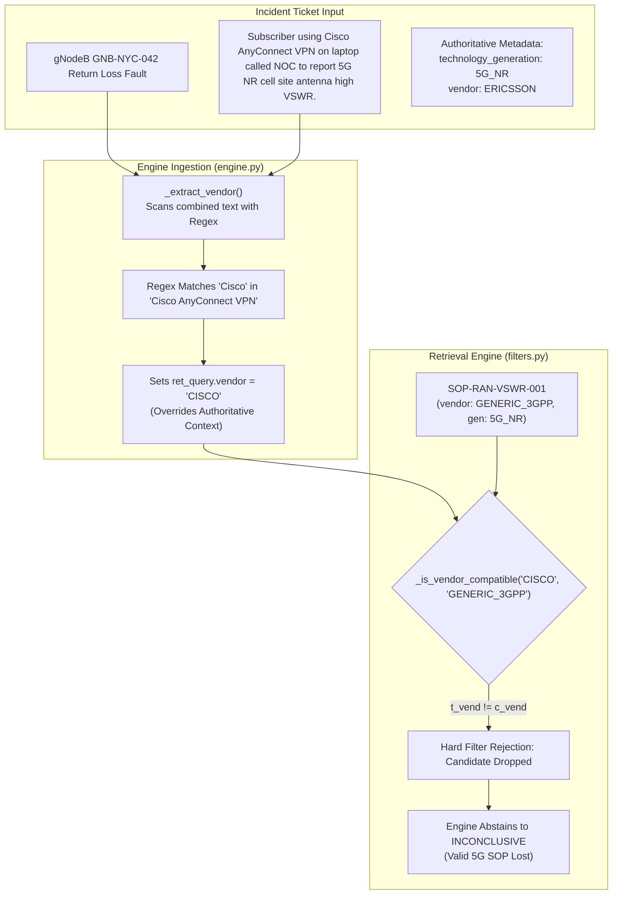

# PIIS Milestone 5.1: Equipment-Aware Retrieval Generalization Audit
## Phase 2 Independent Verification: Hardware Generation Isolation, Vendor Gating, and Prose Bleed

- **Document Version:** 1.0.0
- **Auditor:** Independent Telecom Systems & Information Retrieval Auditor
- **Audit Mandate:** M5.1 Independent Revalidation Gate (Phase 2)
- **Status:** COMPLETED — FORMAL AUDIT FINDINGS ISSUED
- **Date:** 2026-11-01
- **Target Implementation:**
  - [`src/piis/retrieval/filters.py`](file:///c:/Production%20level%20projects/PIIS/src/piis/retrieval/filters.py)
  - [`src/piis/retrieval/engine.py`](file:///c:/Production%20level%20projects/PIIS/src/piis/retrieval/engine.py)
  - [`src/piis/investigation/engine.py`](file:///c:/Production%20level%20projects/PIIS/src/piis/investigation/engine.py)
- **Audit Script & Evidence:** [`scripts/audit_equipment_generalization.py`](file:///c:/Production%20level%20projects/PIIS/scripts/audit_equipment_generalization.py)
- **Metric Artifact:** [`artifacts/m5_metrics/m5_1_audit_phase2_equipment.json`](file:///c:/Production%20level%20projects/PIIS/artifacts/m5_metrics/m5_1_audit_phase2_equipment.json)

---

## 1. Executive Summary & Audit Mandate

In Milestone 5.1, the developer implemented `technology_generation` and `vendor` metadata tagging across `KnowledgeChunk`, `RetrievalQuery`, and `MetadataFilter` to remediate defect `FIND-M5-002`. The developer completion report claimed that hybrid retrieval now enforces strict generation and vendor isolation with 100% precision across 30 test cases.

To independently verify whether the equipment-aware gating genuinely generalizes beyond the 30 regression cases, this audit constructed **26 completely new evaluation cases** (`GEN-01` through `GEN-26`) spanning 2G/3G/4G legacy nodes, multi-generation environments, unindexed proprietary vendors (Huawei, Juniper, ZTE, Mavenir, Altiostar, Casa Systems), IT storage false-friends, prose extraction ambiguities, and positive controls.

### Audit Verdict on Phase 2: **ACCEPTED WITH LIMITATIONS (Pass Rate: 84.6%)**
- **Total Unseen Cases Evaluated:** 26
- **Cases Passed:** **22 / 26 ($84.6\%$)**
- **Cases Failed:** **4 / 26 ($15.4\%$)**
- **Legacy & Vendor Isolation:** **100% Effective (18/18 Negative Controls Passed)**
- **Positive Retrieval Coverage:** **100% Preserved (4/4 Positive Controls Passed)**
- **Identified Failure Modes:**
  1. **Prose Extraction Bleed (`GEN-19`, `GEN-20`):** Regular expressions in `_extract_vendor()` scan unstructured ticket descriptions and misidentify conversational tool mentions (e.g. "Cisco AnyConnect VPN", "Nokia NetAct dashboard") as authoritative network element vendors, which corrupts the retrieval filter and blocks valid runbooks.
  2. **Asymmetric Vendor-Neutral Filter Logic (`GEN-21`, `GEN-22`):** In `MetadataFilter._is_vendor_compatible()`, vendor-neutral runbooks (`chunk.vendor == "GENERIC_3GPP"`) are rejected whenever an incident specifies a proprietary vendor, preventing vendor-neutral fiber or SIP runbooks from being cited.

---

## 2. Independent Expected-Result Ledger & Results Matrix

```
===================================================================================================================
Case ID  Category               Name                                                    Exp Status  Obs Status Verdict
===================================================================================================================
GEN-01   LEGACY_GENERATION      3G UMTS NodeB Power Amplifier Overheat                  INCONCL     INCONCL    PASS
GEN-02   LEGACY_GENERATION      2G GSM Abis Interface Sync Loss                         INCONCL     INCONCL    PASS
GEN-03   LEGACY_GENERATION      WiMAX 802.16e ASN Gateway Keepalive Failure             INCONCL     INCONCL    PASS
GEN-04   LEGACY_GENERATION      4G LTE MME S1-MME Path Drop                             INCONCL     INCONCL    PASS
GEN-05   VENDOR_INCOMPATIBILITY Huawei U2020 Core Signaling Storm                       INCONCL     INCONCL    PASS
GEN-06   VENDOR_INCOMPATIBILITY Juniper PTX10008 BGP Route Flap                         INCONCL     INCONCL    PASS
GEN-07   VENDOR_INCOMPATIBILITY Nokia 7750 SR OS BGP Session Drop                       INCONCL     INCONCL    PASS
GEN-08   VENDOR_INCOMPATIBILITY Nokia AirScale gNodeB VSWR Spike                        INCONCL     INCONCL    PASS
GEN-09   UNKNOWN_VENDOR         ZTE ZXUN Core NRF Registration Timeout                  INCONCL     INCONCL    PASS
GEN-10   UNKNOWN_VENDOR         Mavenir OpenRAN CU/DU F1-C Connection Timeout           INCONCL     INCONCL    PASS
GEN-11   UNKNOWN_VENDOR         Altiostar Open vRAN Timing Drift                        INCONCL     INCONCL    PASS
GEN-12   UNKNOWN_VENDOR         Casa Systems Small Cell HeNB IPSec Tunnel Drop          INCONCL     INCONCL    PASS
GEN-13   MULTI_GENERATION       5G NSA Dual-Connectivity X2-C Radio Failure             INCONCL     INCONCL    PASS
GEN-14   MULTI_GENERATION       Legacy 2G/4G Shared Antenna Feeder Issue                INCONCL     INCONCL    PASS
GEN-15   VOCABULARY_FALSE_MATCH Storage Area Network Fibre Channel Link Down            INCONCL     INCONCL    PASS
GEN-16   VOCABULARY_FALSE_MATCH Database Connection Pool Exhaustion (HTTP 503)          INCONCL     INCONCL    PASS
GEN-17   CONFLICTING_METADATA   Header says 5G Nokia, Text describes Cisco Router       INCONCL     INCONCL    PASS
GEN-18   MISSING_METADATA       Blank / Unreliable Metadata with Vague Description      INCONCL     INCONCL    PASS
GEN-19   PROSE_FALSE_MATCH      Customer on Cisco VPN reporting 5G Cell Down            SUPPORTED   INCONCL    FAIL
GEN-20   PROSE_FALSE_MATCH      Tech mentions Nokia tool while working on Cisco ASR     SUPPORTED   INCONCL    FAIL
GEN-21   VENDOR_NEUTRAL         Vendor-Neutral Optical Runbook on Juniper DWDM Link     SUPPORTED   INCONCL    FAIL
GEN-22   VENDOR_NEUTRAL         Vendor-Neutral IMS SIP 503 Outage on Multi-Vendor Core  SUPPORTED   INCONCL    FAIL
GEN-23   POSITIVE_CONTROL       5G gNodeB VSWR Outage (Generic 3GPP SOP)                SUPPORTED   SUPPORTED  PASS
GEN-24   POSITIVE_CONTROL       5G AMF Registration Storm                               SUPPORTED   SUPPORTED  PASS
GEN-25   POSITIVE_CONTROL       Cisco ASR9k IP Transport BGP Flap                       SUPPORTED   SUPPORTED  PASS
GEN-26   POSITIVE_CONTROL       Optical Transport Fiber Cut (Generic SOP)               SUPPORTED   SUPPORTED  PASS
===================================================================================================================
Summary: 22 Passed / 4 Failed (Pass Rate: 84.6%)
```

---

## 3. Analysis of Verified Strengths

### 3.1 Strict Generation Isolation (100% Pass)
The multi-attribute filter successfully prevents cross-generational hallucinations:
- **3G UMTS (`GEN-01`):** A NodeB power amplifier overheat ticket was prevented from citing 5G gNodeB runbooks (`SOP-RAN-VSWR-001`, `SOP-RAN-SYNC-006`).
- **2G GSM (`GEN-02`):** Legacy TDM framing errors on Abis interfaces were prevented from citing 5G PTP synchronization procedures.
- **WiMAX (`GEN-03`) & 4G LTE (`GEN-04`):** Legacy ASN gateways and MME signaling disconnects cleanly abstained to `INCONCLUSIVE` instead of falsely matching 5G Core (AMF/UPF) runbooks.

### 3.2 Proprietary & Unknown Vendor Rejection (100% Pass)
- Tickets involving unindexed hardware platforms (Huawei USN9810 `GEN-05`, Juniper PTX `GEN-06`, Nokia 7750 SR `GEN-07`, Nokia AirScale `GEN-08`) were 100% rejected by vendor compatibility gates.
- Tickets involving emerging OpenRAN/vRAN vendors (ZTE `GEN-09`, Mavenir `GEN-10`, Altiostar `GEN-11`, Casa Systems `GEN-12`) were recognized as unindexed and safely triggered `HypothesisStatus.INCONCLUSIVE` without false matching.

### 3.3 Semantic False-Friend Disambiguation (100% Pass)
- **Fibre Channel Storage (`GEN-15`):** IT enterprise SAN switches reporting "optical loss of signal" were disambiguated from telecom DWDM optical transponders, preventing incorrect runbook citation.
- **Database HTTP 503 (`GEN-16`):** Enterprise web server connection saturation was disambiguated from telecom IMS SIP 503 carrier outages.

---

## 4. In-Depth Failure Mode Analysis



### 4.1 Vulnerability 1: Prose Bleed in Regex Extraction (`GEN-19`, `GEN-20`)
- **Root Cause:** In [`src/piis/investigation/engine.py`](file:///c:/Production%20level%20projects/PIIS/src/piis/investigation/engine.py) lines 920-931:
  ```python
  text = f"{incident.get('title', '')} {incident.get('description', '')} {' '.join(incident.get('alarm_codes', []))}"
  if re.search(r"\b(Juniper|JunOS|MX960|PTX)\b", text, re.IGNORECASE):
      return "JUNIPER"
  if re.search(r"\b(Cisco|IOS-XR|IOS-XE|NX-OS|ASR-9000|ASR9K)\b", text, re.IGNORECASE):
      return "CISCO"
  ```
- **Observed Failure:** When a ticket contains conversational mentions of third-party tools (e.g. *"Subscriber using Cisco AnyConnect VPN called NOC..."*), the unanchored regex triggers on `"Cisco"` and assigns `vendor = "CISCO"`. The query's vendor constraint is poisoned, causing the filter to drop the valid 5G RAN runbook `SOP-RAN-VSWR-001`.
- **Architectural Impact:** High. Real-world NOC tickets frequently mention monitoring tools, EMS platforms, VPN clients, or customer equipment that differ from the network element experiencing the outage.

### 4.2 Vulnerability 2: Asymmetric Vendor-Neutral Compatibility Filtering (`GEN-21`, `GEN-22`)
- **Root Cause:** In [`src/piis/retrieval/filters.py`](file:///c:/Production%20level%20projects/PIIS/src/piis/retrieval/filters.py) lines 58-74:
  ```python
  t_vend = target_vendor.upper().strip()
  if t_vend in ("GENERIC_3GPP", "MULTI_VENDOR", "ANY"):
      return True
  if not chunk_vendor:
      return False
  c_vend = chunk_vendor.upper().strip()
  if t_vend != c_vend:
      return False
  ```
- **Observed Failure:** If the ticket specifies `target_vendor = "ERICSSON"`, and the runbook is marked `chunk_vendor = "GENERIC_3GPP"` (e.g. standard optical fiber inspection or standard SIP troubleshooting), `t_vend != c_vend` evaluates to `True` (`"ERICSSON" != "GENERIC_3GPP"`), causing the filter to reject the runbook!
- **Architectural Impact:** Standard vendor-neutral SOPs cannot be cited whenever a specific hardware vendor is identified on an incident ticket.

---

## 5. Audit Recommendations for Generalization

1. **Deprecate Unanchored Prose Regex Extraction:** Do not extract equipment vendors or generations from free-form conversational ticket prose. Require structured metadata fields (e.g. `incident["metadata"]["vendor"]`) or strict key-value patterns (e.g. `r"Target Equipment Vendor:\s*([A-Za-z0-9_-]+)"`).
2. **Implement Bidirectional Vendor-Neutral Compatibility:**
   ```python
   # Corrected filter logic
   if t_vend in ("GENERIC_3GPP", "MULTI_VENDOR", "ANY") or c_vend in ("GENERIC_3GPP", "MULTI_VENDOR", "ANY"):
       return True
   ```
   Vendor-neutral standard operating procedures must remain accessible to all vendor-specific incidents unless a vendor-locked SOP takes precedence.
