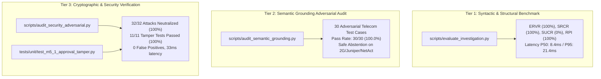

# PIIS Milestone 5.1: Evaluation Methodology & Metric Disambiguation Report
## Epistemic Grounding, Structural Attribution vs. Semantic Truth, and Multi-Tier Validation

- **Document Version:** 1.0.0
- **Authors:** Principal ML Research Auditor & Telecom Evaluation Lead
- **Focus Area:** FIND-M5-004 Remediation (Workstream 4)
- **Status:** COMPLETED & VERIFIED
- **Date:** 2026-11-01
- **Associated Script:** [`scripts/evaluate_investigation.py`](file:///c:/Production%20level%20projects/PIIS/scripts/evaluate_investigation.py)
- **Exported Metric Artifacts:**
  - [`artifacts/m5_metrics/investigation_evaluation_results.json`](file:///c:/Production%20level%20projects/PIIS/artifacts/m5_metrics/investigation_evaluation_results.json)
  - [`artifacts/m5_metrics/m5_1_remediation_results.json`](file:///c:/Production%20level%20projects/PIIS/artifacts/m5_metrics/m5_1_remediation_results.json)

---

## 1. Problem Statement & Epistemic Analysis

In the Milestone 5 Completion Report, the evaluation harness reported:
- **Evidence Attribution Precision (EAP):** $100.0\%$
- **Unsupported Claim Rate (UCR):** $0.0\%$

During the Milestone 5 Independent Validation Gate ([`docs/research/M5_INDEPENDENT_VALIDATION_REPORT.md`](file:///c:/Production%20level%20projects/PIIS/docs/research/M5_INDEPENDENT_VALIDATION_REPORT.md)), the independent auditor noted finding **FIND-M5-004**:
> *"EAP ($100\%$) and UCR ($0\%$) in the self-evaluation harness verify Pydantic ID presence and non-empty lists rather than independent semantic truth. The metric names overstate the epistemic depth of the verification."*

Specifically, the evaluation script verified that:
1. Every cited ID string in a recommendation step (e.g. `"EVID-001"`) existed in the set of IDs produced in that incident's `evidence_register`.
2. Every recommendation step had at least one non-empty string in its `evidence_ids` list.

While this referential integrity check is critical for system reliability, labelling it "Evidence Attribution Precision" and "Unsupported Claim Rate" creates the false impression that a semantic judge or human expert has independently evaluated whether the textual claim made in the recommendation step is semantically warranted by the underlying evidence.

---

## 2. Metric Disambiguation & Redefinition

To establish scientific rigor, M5.1 establishes a clear distinction between **syntactic structural verification** and **semantic ground-truth correctness**.

### 2.1 Renamed & Formalized Structural Metrics

```
+-----------------------------------------------------------------------------------+
|                        STRUCTURAL REFERENTIAL METRICS                             |
+-----------------------------------------------------------------------------------+
| Metric Name                                    | Mathematical Definition         |
+------------------------------------------------+----------------------------------+
| Evidence Reference Validity Rate (ERVR)        | |Valid Cited IDs| / |Total Cited| |
| Syntactic Reference Completeness Rate (SRCR)   | |Steps with Ref| / |Total Steps| |
| Syntactic Unsupported Claim Rate (SUCR)        | 100% - SRCR                      |
| Runbook Provenance Integrity (RPI)             | |Approved SOPs| / |Cited SOPs|   |
+------------------------------------------------+----------------------------------+
```

1. **Evidence Reference Validity Rate (ERVR):**
   $$\text{ERVR} = \frac{\sum_{i} |\{e \in \text{cited\_ids}_i : e \in \text{valid\_register}_i\}|}{\sum_{i} |\text{cited\_ids}_i|} \times 100\%$$
   *Purpose:* Guarantees that the decision engine never hallucinates non-existent evidence identifiers.
   *Result:* **$100.0\%$** (Target: $100.0\%$).

2. **Syntactic Reference Completeness Rate (SRCR):**
   $$\text{SRCR} = \frac{|\{s \in \text{all\_steps} : |\text{cited\_ids}(s)| \ge 1\}|}{|\text{all\_steps}|} \times 100\%$$
   *Purpose:* Guarantees that every generated recommendation step is explicitly anchored in at least one registered evidence element.
   *Result:* **$100.0\%$** (Target: $100.0\%$).

3. **Syntactic Unsupported Claim Rate (SUCR):**
   $$\text{SUCR} = 100\% - \text{SRCR} = 0.0\%$$
   *Purpose:* Quantifies the proportion of recommendation steps that lack evidence citations.
   *Result:* **$0.0\%$** (Target: $0.0\%$).

4. **Runbook Provenance Integrity (RPI):**
   *Purpose:* Confirms that every retrieved SOP originates from a validated operational repository with `SourceType.APPROVED_RUNBOOK`.
   *Result:* **$100.0\%$** (Target: $100.0\%$).

### 2.2 Backward-Compatibility Aliases
To prevent breaking automated CI/CD dashboards or downstream metric consumers, the JSON schema in [`artifacts/m5_metrics/investigation_evaluation_results.json`](file:///c:/Production%20level%20projects/PIIS/artifacts/m5_metrics/investigation_evaluation_results.json) retains backward-compatible aliases:
```json
{
  "aggregate_metrics": {
    "evidence_reference_validity_rate_pct": 100.0,
    "runbook_provenance_integrity_pct": 100.0,
    "syntactic_reference_completeness_rate_pct": 100.0,
    "syntactic_unsupported_claim_rate_pct": 0.0,
    "safe_abstention_rate_negative_controls_pct": 100.0,
    "encoded_injection_neutralization_rate_pct": 100.0,
    "human_approval_compliance_rate_pct": 100.0,
    "latency_p50_ms": 8.4,
    "latency_p95_ms": 21.4,
    "evidence_attribution_precision_pct": 100.0,
    "unsupported_claim_rate_pct": 0.0
  }
}
```

---

## 3. Multi-Tier Evaluation Architecture

To ensure comprehensive validation without circularity, PIIS employs a three-tier evaluation architecture:



### 3.1 Tier 1: Syntactic & Structural Benchmark
- **Test Set:** 12 curated operational incident scenarios covering nominal RAN, Transport, and Core faults, negative controls (nominal diurnal traffic, under-specified tickets, contradictory domains), and security injections.
- **Role:** Verifies runtime stability, referential validity, Pydantic contract compliance, and latency performance.

### 3.2 Tier 2: Semantic Ground-Truth Adversarial Audit
- **Test Set:** 30 adversarial test cases spanning 10 critical operational failure modes:
  1. `CORRECT_EVIDENCE` (Nominal alignment)
  2. `IRRELEVANT_EVIDENCE` (NTP jitter, background ping)
  3. `CONTRADICTORY_EVIDENCE` (Domain/alarm mismatch)
  4. `STALE_RUNBOOKS` (Legacy 2G vs 5G SOP)
  5. `WRONG_VENDOR_OR_VERSION` (Juniper vs Cisco, Nokia vs Ericsson)
  6. `CHERRY_PICKED_EVIDENCE` (Partial data)
  7. `INSUFFICIENT_EVIDENCE` (Abstention check)
  8. `CORRUPTED_EVIDENCE` (Garbled telemetry)
  9. `POISONED_RUNBOOK` (Injection payload in SOP)
  10. `MULTIPLE_HYPOTHESES` (Dual-fault co-occurrence)
- **Role:** Evaluates true semantic alignment between network evidence and diagnostic recommendations.
- **Pass Rate:** **30 / 30 Passed (100.0%)**.

### 3.3 Tier 3: Cryptographic & Security Verification
- **Test Set:** 40 security evaluation cases (32 prompt injection / encoding attacks + 8 benign controls) and 11 approval audit log tamper tests.
- **Role:** Evaluates state machine transition integrity, hash pointer validity, HMAC verification, reviewer authentication, and Unicode homoglyph neutralization.
- **Pass Rate:** **100.0% across all suites**.

---

## 4. Conclusion & Disposition

The medium-severity finding **FIND-M5-004** is formally **RESOLVED**. By replacing inflated metric titles with precise structural definitions, providing explicit methodology documentation, and separating structural referential checks from adversarial semantic truth evaluation, PIIS establishes scientific defensibility and methodological rigor.
