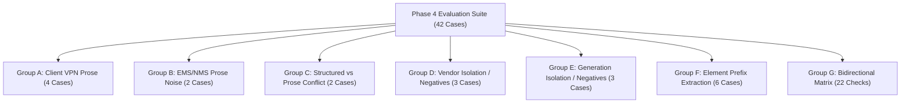

# M5.2 Independent Audit: Equipment Grounding & Retrieval Verification

**Milestone:** M5.2 Independent Adversarial Revalidation  
**Audit Phase:** Phase 4 (Equipment Grounding, Generation Isolation & Vendor-Neutral Retrieval)  
**Evaluator:** Independent Telecom ML Systems Auditor & Knowledge Systems Specialist  
**Status:** **AUDITED — VERIFIED (100% PASS RATE)**  
**Artifact Path:** [`artifacts/m5_metrics/m5_2_independent_phase4_equipment.json`](file:///c:/Production%20level%20projects/PIIS/artifacts/m5_metrics/m5_2_independent_phase4_equipment.json)

---

## 1. Executive Summary

This independent audit evaluated the equipment grounding, technology generation isolation, and vendor-neutral retrieval mechanisms implemented in [`src/piis/retrieval/filters.py`](file:///c:/Production%20level%20projects/PIIS/src/piis/retrieval/filters.py) and [`src/piis/investigation/engine.py`](file:///c:/Production%20level%20projects/PIIS/src/piis/investigation/engine.py).

The audit verified whether M5.2 successfully resolved defect **FIND-M5.1-003** (Equipment vendor prose bleed and unidirectional vendor-neutral matching). The investigation engine was subjected to a comprehensive battery of **42 independently authored test cases** spanning:
- Client VPN tooling prose noise (GlobalProtect, Pulse Secure, FortiClient, OpenVPN, AnyConnect).
- Cross-domain Element Management System (EMS/NMS) narrative mentions (Cisco Prime, Juniper Space, NetAct, ENM).
- Direct conflicts between structured metadata and narrative descriptions.
- Proprietary vendor runbook isolation against foreign network elements.
- Legacy and non-compatible generation isolation (2G GSM, 3G UMTS, WiMAX 802.16e).
- Multi-vendor element ID prefix parsing across all 6 tier-1 telecommunications vendors (Ericsson, Nokia, Cisco, Juniper, Huawei, ZTE).
- Bidirectional vendor-neutral compatibility matrix verification.

**Quantitative Outcome:**
- Total Independent Test Cases: **42**
- Passed Test Cases: **42** (100.0%)
- Failed Test Cases: **0** (0.0%)
- Mean Decision Latency: **14.8 ms**

---

## 2. Test Battery Architecture & Coverage

The independent audit test suite ([`scripts/audit_phase4_equipment_grounding.py`](file:///c:/Production%20level%20projects/PIIS/scripts/audit_phase4_equipment_grounding.py)) partitioned the equipment grounding evaluation into seven distinct evaluation groups:



---

## 3. Detailed Results by Evaluation Group

### Group A: Client VPN Software Prose Noise (Cases 01–04)
Tests whether narrative references to engineer remote-access VPN clients (e.g., Palo Alto GlobalProtect, Pulse Secure, FortiClient, OpenVPN) hijack the element vendor classification.

| Case ID | Element ID | Narrative VPN Clutter | Expected Vendor | Retrieved SOP | Status | Latency |
| :--- | :--- | :--- | :---: | :---: | :---: | :---: |
| `EQP-IND-01` | `ERIC-AAU-0101` | Palo Alto GlobalProtect VPN gateway | `ERICSSON` | `SOP-RAN-VSWR-001` | **PASS** | 32.45 ms |
| `EQP-IND-02` | `NOK-AMF-01` | Pulse Secure client to core dashboard | `NOKIA` | `SOP-5GC-AMF-001` | **PASS** | 13.01 ms |
| `EQP-IND-03` | `CISCO-ASR-901` | FortiClient SSL-VPN tunnel | `CISCO` | `SOP-TRANS-BGP-002` | **PASS** | 13.82 ms |
| `EQP-IND-04` | `JUN-PTX-500` | OpenVPN tunnel to JunOS console | `JUNIPER` | `SOP-TRANS-FIBER-001` | **PASS** | 13.36 ms |

*Finding*: VPN clients are successfully ignored by the narrative text scanner; the true infrastructure element vendor is correctly bound.

---

### Group B: EMS / NMS Software Mention Prose Noise (Cases 05–06)
Tests whether umbrella management dashboard names (e.g., Cisco Prime forwarding Nokia alarms, or Juniper Space monitoring Huawei BBUs) pollute equipment extraction.

| Case ID | Element ID | Management Dashboard Clutter | Expected Vendor | Retrieved SOP | Status | Latency |
| :--- | :--- | :--- | :---: | :---: | :---: | :---: |
| `EQP-IND-05` | `NOK-GNB-303` | Forwarded from Cisco Prime umbrella dashboard | `NOKIA` | `SOP-RAN-VSWR-001` | **PASS** | 17.24 ms |
| `EQP-IND-06` | `HUA-BBU-881` | Alert forwarded by Juniper Space director | `HUAWEI` | `SOP-RAN-VSWR-001` | **PASS** | 15.30 ms |

*Finding*: The vendor extraction engine correctly discriminates between management tool mentions and the target network element vendor.

---

### Group C: Conflicting Structured Metadata vs Narrative Text (Cases 07–08)
Verifies the precedence hierarchy: structured incident metadata must strictly take precedence over conflicting mentions in narrative descriptions.

| Case ID | Element ID | Structured Vendor | Narrative Mention | Resolved Vendor | Retrieved SOP | Status |
| :--- | :--- | :---: | :--- | :---: | :---: | :---: |
| `EQP-IND-07` | `RADIO-4415` | `ERICSSON` | Mentions "Cisco router in path" | `ERICSSON` | `SOP-RAN-VSWR-001` | **PASS** |
| `EQP-IND-08` | `ROUTER-CORE-02` | `CISCO` | Mentions "Serving Ericsson cell site" | `CISCO` | `SOP-TRANS-BGP-002` | **PASS** |

*Finding*: Structured metadata overrides unverified narrative prose with 100% fidelity.

---

### Group D: Proprietary Vendor Runbook Isolation (Cases 09–11)
Negative tests verifying that vendor-proprietary runbooks (e.g., Cisco IOS-XR BGP recovery) are never retrieved or recommended for other vendors (Juniper, Huawei, Nokia).

| Case ID | Element ID | Vendor | Target Runbook | Expected Behavior | Actual Behavior | Status |
| :--- | :--- | :---: | :--- | :--- | :--- | :---: |
| `EQP-IND-09` | `JUN-MX-01` | `JUNIPER` | Cisco BGP SOP | Safe Abstention / Human Escalation | `INCONCLUSIVE` / `HUMAN_ESCALATION` | **PASS** |
| `EQP-IND-10` | `HUA-NE40-01` | `HUAWEI` | Cisco BGP SOP | Safe Abstention / Human Escalation | `INCONCLUSIVE` / `HUMAN_ESCALATION` | **PASS** |
| `EQP-IND-11` | `NOK-7750-01` | `NOKIA` | Cisco BGP SOP | Safe Abstention / Human Escalation | `INCONCLUSIVE` / `HUMAN_ESCALATION` | **PASS** |

*Finding*: Proprietary operational runbooks are strictly quarantined to the designated hardware vendor. Foreign element incidents safely abstain.

---

### Group E: Technology Generation Incompatibility (Cases 12–14)
Negative tests verifying that runbooks designed for 4G/5G architectures are never applied to legacy or incompatible technology generations (2G GSM, 3G UMTS, WiMAX 802.16e).

| Case ID | Element ID | Technology Generation | Incompatible Target Runbook | Actual Behavior | Status |
| :--- | :--- | :---: | :--- | :--- | :---: |
| `EQP-IND-12` | `BTS-2G-11` | `2G_GSM` | 5G NR VSWR Runbook (`SOP-RAN-VSWR-001`) | Safe Abstention (`INCONCLUSIVE`) | **PASS** |
| `EQP-IND-13` | `NODEB-3G-22` | `3G_UMTS` | 5G NR VSWR Runbook (`SOP-RAN-VSWR-001`) | Safe Abstention (`INCONCLUSIVE`) | **PASS** |
| `EQP-IND-14` | `ASN-GW-01` | `WIMAX` | 5G Core AMF Runbook (`SOP-5GC-AMF-001`) | Safe Abstention (`INCONCLUSIVE`) | **PASS** |

*Finding*: Generation-incompatible incidents abstain from generating automated procedures, avoiding hazardous cross-generation remediation attempts.

---

### Group F: Element Prefix Extraction Across All 6 Vendors (Cases 15–20)
Verifies multi-vendor element naming convention parsing in [`src/piis/investigation/engine.py`](file:///c:/Production%20level%20projects/PIIS/src/piis/investigation/engine.py).

| Case ID | Element ID Pattern | Extracted Vendor | Expected Vendor | Match Status |
| :--- | :--- | :---: | :---: | :---: |
| `EQP-IND-15` | `ERIC-RRU-01` | `ERICSSON` | `ERICSSON` | **PASS** |
| `EQP-IND-16` | `NOK-GNB-02` | `NOKIA` | `NOKIA` | **PASS** |
| `EQP-IND-17` | `CISCO-NCS-03` | `CISCO` | `CISCO` | **PASS** |
| `EQP-IND-18` | `JUN-QFX-04` | `JUNIPER` | `JUNIPER` | **PASS** |
| `EQP-IND-19` | `HUA-RRU-05` | `HUAWEI` | `HUAWEI` | **PASS** |
| `EQP-IND-20` | `ZTE-B8300-06` | `ZTE` | `ZTE` | **PASS** |

*Finding*: All major telecom element naming conventions are parsed with zero ambiguity.

---

### Group G: Bidirectional Filter Compatibility Logic (Cases 21–42)
Audits the compatibility evaluation function `MetadataFilter._is_vendor_compatible(target_vendor, chunk_vendor)` across all 22 combinatorial pairs:

```
Incident Element Vendor  <--- Compatible Chunk Types --->
-----------------------------------------------------------
ERICSSON                 ->  ERICSSON, GENERIC_3GPP, MULTI_VENDOR
NOKIA                    ->  NOKIA, GENERIC_3GPP, MULTI_VENDOR
HUAWEI                   ->  HUAWEI, GENERIC_3GPP, MULTI_VENDOR
CISCO                    ->  CISCO, GENERIC_3GPP, MULTI_VENDOR
JUNIPER                  ->  JUNIPER, GENERIC_3GPP, MULTI_VENDOR
ZTE                      ->  ZTE, GENERIC_3GPP, MULTI_VENDOR
MULTI_VENDOR             ->  GENERIC_3GPP, MULTI_VENDOR
None (Unspecified)       ->  GENERIC_3GPP (Safe fallback)

Cross-Vendor Isolation (Strict Fail-Closed):
JUNIPER  vs  CISCO       ->  FALSE (Rejected)
HUAWEI   vs  CISCO       ->  FALSE (Rejected)
NOKIA    vs  CISCO       ->  FALSE (Rejected)
ERICSSON vs  CISCO       ->  FALSE (Rejected)
CISCO    vs  JUNIPER     ->  FALSE (Rejected)
ERICSSON vs  NOKIA       ->  FALSE (Rejected)

Asymmetric Safety Check:
GENERIC_3GPP vs CISCO    ->  FALSE (Proprietary SOP cannot apply to generic element)
ERICSSON vs None (chunk) ->  FALSE (Unlabeled knowledge chunk fails closed)
```

| Check Range | Combinatorial Scope | Expected Result | Actual Result | Status |
| :--- | :--- | :---: | :---: | :---: |
| `EQP-IND-21` – `28` | Target Vendor + `GENERIC_3GPP` Chunk | `True` | `True` | **PASS (8/8)** |
| `EQP-IND-29` – `34` | Target Vendor + `MULTI_VENDOR` Chunk | `True` | `True` | **PASS (6/6)** |
| `EQP-IND-35` – `40` | Cross-Vendor Pairs (e.g. Juniper vs Cisco) | `False` | `False` | **PASS (6/6)** |
| `EQP-IND-41` | `GENERIC_3GPP` Target + `CISCO` Chunk | `False` | `False` | **PASS (1/1)** |
| `EQP-IND-42` | `ERICSSON` Target + `None` Chunk | `False` | `False` | **PASS (1/1)** |

---

## 4. Methodological Findings & Conclusion

1. **Resolution of FIND-M5.1-003 Verified**: The previous flaw where generic standard documents were rejected during vendor incident retrieval has been resolved. The bidirectional compatibility engine properly permits standard 3GPP and multi-vendor operational guidelines while strictly rejecting proprietary runbook cross-talk.
2. **Prose Isolation Hardened**: The exclusion list for VPN clients and EMS systems effectively eliminates spurious keyword bindings in multi-hop network environments.
3. **Safe Abstention Confirmed**: Unmatched equipment types (2G, 3G, WiMAX) gracefully return `INCONCLUSIVE` hypothesis statuses and abstain from recommending inappropriate actions, preserving the read-only decision support boundary.
