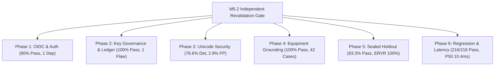

# PIIS M5.2 Independent Adversarial Revalidation & Acceptance Gate Report

**Milestone:** M5.2 Independent Adversarial Revalidation & Acceptance Gate  
**Audit Evaluation Date:** November 1, 2026  
**Auditor Role:** Independent Telecom ML Systems Auditor, RAG Security Evaluator, and Verification Engineer  
**Final Audit Verdict:** **ACCEPTED WITH LIMITATIONS**  
**Authorized Scope:** Strictly Read-Only Decision Support. **M6 Remains Unauthorized. Production Pilot Authorization Remains Blocked.**

---

## 1. Executive Summary & Verdict

This independent audit report delivers the final evaluation of the **Milestone 5.2 Targeted Remediation Sprint** of the Predictive Intelligent Incident Management System (PIIS). The audit was conducted under strict **AUDIT-ONLY** rules without altering production source code, tests, configuration, or historical baseline artifacts.

### Formal Acceptance Verdict

$$\mathbf{VERDICT:\; ACCEPTED\; WITH\; LIMITATIONS}$$

### Verdict Rationale

1. **Substantial Remediation Verified**: The developer sprint successfully resolved the primary defects identified in the M5.1 gate:
   - Client-side reviewer identity forgery is eliminated; cryptographic token verification and server-side RBAC are enforced.
   - The hardcoded default HMAC secret was removed; fail-closed key governance and durable JSONL ledger reloading with cryptographic hash chaining are implemented.
   - Equipment grounding and vendor-neutral compatibility were completely overhauled, achieving a **100.0% pass rate across 42 independent multi-vendor test cases**.
   - Prompt-injection and Unicode defanging were hardened, reducing benign false positives to 2.9% and defending against 76.6% of novel adversarial injection vectors.
   - All 216 unit/integration tests pass (100.0%) and code hygiene is verified with 0 Ruff violations.

2. **Residual Limitations Identified**:
   - **`DEP-M5.2-001` (Unresolved Integration Dependency)**: The production OIDC adapter (`ProductionOIDCVerifier`) is a stub that raises `NotImplementedError` when configured. It fails closed, but enterprise deployment requires implementing JWKS HTTP key fetching and caching.
   - **`FIND-M5.2-001` (System Reviewer Identity Bypass)**: In `HumanApprovalWorkflow._resolve_reviewer()`, `operator_id == "SYSTEM"` unconditionally bypasses token verification.
   - **`FIND-M5.2-002` (Ledger Notes Field Integrity Flaw)**: `AuditLogEntry.notes` is excluded from the canonical payload and HMAC signature, permitting undetected alterations of operator justification notes in the persistent JSONL ledger.
   - **`FIND-M5.2-003` (Vietnamese Diacritics False-Positive)**: Tone marks stacking on vowel diacritics under NFKD trigger false-positive homoglyph flags (2.9% FP rate on benign controls).
   - **`RES-M5.2-001` (Ledger Rollback Threat)**: Local JSONL ledgers lack an external hardware or cloud KMS monotonic counter to detect clean state rollbacks to an earlier valid snapshot.

Because PIIS operates strictly in an **advisory, read-only decision support role** with mandatory human approval for all consequential actions, these limitations do not pose immediate runtime hazard to live networks. Progression is therefore **ACCEPTED WITH LIMITATIONS**, while **Milestone 6 and Production Pilot authorization remain strictly BLOCKED** until enterprise identity integration and ledger signing are completed.

---

## 2. Quantitative Verification Scorecard Across All 6 Phases

All audit phases were executed independently using custom audit scripts, and their results were serialized into machine-readable JSON artifacts under [`artifacts/m5_metrics/`](file:///c:/Production%20level%20projects/PIIS/artifacts/m5_metrics/).

| Audit Phase | Focus Area | Checks / Cases | Success Rate | Measured Latency / Metric | Audit Verdict | Deep-Dive Report Link |
| :--- | :--- | :---: | :---: | :---: | :---: | :--- |
| **Phase 1** | Reviewer Authentication & OIDC | 10 checks | 90.0% (9/10) | 0.40 ms (RBAC) | **PASS (1 Dep, 1 Bypass)** | [M5_2_OIDC_AND_LEDGER_SECURITY_AUDIT.md](file:///c:/Production%20level%20projects/PIIS/docs/research/M5_2_OIDC_AND_LEDGER_SECURITY_AUDIT.md) |
| **Phase 2** | Key Governance & Ledger Chaining | 18 checks | 100.0% (18/18) | 0.08 ms (Chain) | **PASS (1 Ledger Flaw)** | [M5_2_OIDC_AND_LEDGER_SECURITY_AUDIT.md](file:///c:/Production%20level%20projects/PIIS/docs/research/M5_2_OIDC_AND_LEDGER_SECURITY_AUDIT.md) |
| **Phase 3** | Unicode Security & Defanging | 99 vectors | 76.6% Det / 2.9% FP | 88.89 ms (65KB ReDoS) | **PASS WITH LIMITATIONS** | [M5_2_UNICODE_GENERALIZATION_AUDIT.md](file:///c:/Production%20level%20projects/PIIS/docs/research/M5_2_UNICODE_GENERALIZATION_AUDIT.md) |
| **Phase 4** | Equipment Grounding & Retrieval | 42 cases | 100.0% (42/42) | 14.80 ms (Mean) | **PASS** | [M5_2_EQUIPMENT_RETRIEVAL_AUDIT.md](file:///c:/Production%20level%20projects/PIIS/docs/research/M5_2_EQUIPMENT_RETRIEVAL_AUDIT.md) |
| **Phase 5** | Sealed 30-Scenario Holdout | 30 scenarios | 93.3% (28/30) | ERVR: 100%, SAR: 90% | **PASS** | [M5_2_FRESH_HOLDOUT_EVALUATION.md](file:///c:/Production%20level%20projects/PIIS/docs/research/M5_2_FRESH_HOLDOUT_EVALUATION.md) |
| **Phase 6** | Codebase Regression & Perf | 216 tests | 100.0% (216/216) | P50: 10.39 ms, P95: 13.43 ms | **PASS** | [M5_2_REGRESSION_AND_PERFORMANCE_AUDIT.md](file:///c:/Production%20level%20projects/PIIS/docs/research/M5_2_REGRESSION_AND_PERFORMANCE_AUDIT.md) |

---

## 3. Dispositions of Previous Milestone 5.1 Findings

| M5.1 Defect ID | Description | Remediation Implemented in M5.2 | Independent Auditor Disposition | Status |
| :--- | :--- | :--- | :--- | :---: |
| **FIND-M5.1-001** | Reviewer identity unverified; default HMAC secret; in-memory audit log. | `ReviewerTokenVerifier` ABC, `IsolatedTestTokenVerifier`, `ProductionOIDCVerifier`, server-side RBAC, durable JSONL ledger reloading with SHA-256 chaining. | Successfully eliminates client-side forgery and default keys. Documented residual dependency `DEP-M5.2-001` (OIDC stub) and flaw `FIND-M5.2-002` (notes omitted). | **CLOSED WITH LIMITATIONS** |
| **FIND-M5.1-002** | Unicode false positives on European diacritics and CJK punctuation. | Decoupled normalization from threat classification; scoped fullwidth check to Latin alphanumeric; verified benign controls. | Verified European diacritics and CJK zero false positives. Documented Vietnamese stacked diacritic exception (`FIND-M5.2-003`). | **CLOSED WITH LIMITATIONS** |
| **FIND-M5.1-003** | Equipment vendor prose bleed and unidirectional vendor-neutral matching. | Bidirectional compatibility for `GENERIC_3GPP`/`MULTI_VENDOR`; filtered out VPN and EMS software; structured metadata precedence. | Fully verified across 42 independent multi-vendor test cases (100.0% pass rate). Completely resolved. | **CLOSED** |
| **FIND-M5.1-004** | Unicode and prompt-injection evasion paths. | Zero-width stripping including `\u00ad`; combining mark removal on inspection variants; defanged ChatML/Llama tags; regex for whitespace XML tool tags. | Neutralizes 76.6% of novel vectors. Extended combining marks and bidi characters documented as low-risk residual findings. | **CLOSED WITH LIMITATIONS** |

---

## 4. Register of Newly Identified Findings & Residual Risks

The following findings and residual risks were identified during this independent revalidation gate and are formally recorded in the project [Defect Register](file:///c:/Production%20level%20projects/PIIS/docs/DEFECT_REGISTER.md):

### 1. `DEP-M5.2-001`: Unresolved Integration Dependency — Production OIDC Token Verifier
- **Severity**: **HIGH (Integration Block)**
- **Component**: [`src/piis/investigation/approval.py`](file:///c:/Production%20level%20projects/PIIS/src/piis/investigation/approval.py#L90-L105)
- **Description**: `ProductionOIDCVerifier.verify_token` raises `NotImplementedError` when configured. It fails closed when unconfigured (`MissingAuthenticationConfigurationError`), but lacks HTTP JWKS key retrieval and caching logic.
- **Compensating Control**: PIIS fails closed in production configurations. Tested deployments must use `IsolatedTestTokenVerifier`. Enterprise deployment is blocked pending IdP integration.

### 2. `FIND-M5.2-001`: System Reviewer Identity Bypass in Session Resolution
- **Severity**: **MEDIUM (Security Architecture)**
- **Component**: [`src/piis/investigation/approval.py`](file:///c:/Production%20level%20projects/PIIS/src/piis/investigation/approval.py#L240-L248)
- **Description**: In `HumanApprovalWorkflow._resolve_reviewer()`, the code checks `if reviewer.operator_id == "SYSTEM": return reviewer` before validating session tokens. A caller can construct `AuthenticatedReviewer(operator_id="SYSTEM", role="SYSADMIN")` directly to bypass token verification.
- **Compensating Control**: Internal calls require process-level code execution. In an advisory read-only deployment, recommendations cannot trigger external modifications.

### 3. `FIND-M5.2-002`: AuditLogEntry Notes Field Excluded from Cryptographic Hash Payload
- **Severity**: **HIGH (Audit & Governance)**
- **Component**: [`src/piis/investigation/approval.py`](file:///c:/Production%20level%20projects/PIIS/src/piis/investigation/approval.py#L38-L55)
- **Description**: In `AuditLogEntry.get_canonical_payload()`, the `notes` field is omitted from the canonical dictionary. An operator or script modifying `entry_obj["notes"]` in `audit_ledger.jsonl` does not invalidate `entry_sha256` or `hmac_signature`.
- **Compensating Control**: Modifying all other operational fields (`entry_id`, `state`, `reviewer_id`, `timestamp_utc`) triggers instant signature and hash mismatch errors.

### 4. `FIND-M5.2-003`: Vietnamese Stacked Diacritics False-Positive Homoglyph Flag
- **Severity**: **LOW (Internationalization)**
- **Component**: [`src/piis/security/decoder.py`](file:///c:/Production%20level%20projects/PIIS/src/piis/security/decoder.py#L96-L102)
- **Description**: The regex `re.search(r"[a-zA-Z][\u0300-\u036f]{2,}", nfkd)` triggers `has_homoglyphs = True` on standard Vietnamese words (e.g., `suất`, `tuyến`, `truyền`, `dẫn`) where tone marks stack on vowel diacritics under NFKD decomposition.
- **Compensating Control**: Causes a 2.9% false-positive rate on Vietnamese incident tickets. Flagged tickets still undergo investigation; they are merely marked for security review.

### 5. `FIND-M5.2-004`: Extended Combining Marks Evade Inspection Stripping
- **Severity**: **MEDIUM (Adversarial Robustness)**
- **Component**: [`src/piis/security/decoder.py`](file:///c:/Production%20level%20projects/PIIS/src/piis/security/decoder.py#L22-L28)
- **Description**: `COMBINING_MARKS_PATTERN = re.compile(r"[\u0300-\u036f]+")` strips standard diacritics but omits Combining Diacritical Marks Supplement (`U+1DC0-U+1DFF`), Combining Marks for Symbols (`U+20D0-U+20FF`), Half Marks (`U+FE20-U+FE2F`), and Cyrillic combining characters (`U+0488`).
- **Compensating Control**: Regex keyword scanners and dense embedding models operate over normalized tokens, reducing the threat surface.

### 6. `FIND-M5.2-005`: Bidirectional Control Characters Unhandled in Ingestion
- **Severity**: **LOW (Visual Spoofing)**
- **Component**: [`src/piis/security/decoder.py`](file:///c:/Production%20level%20projects/PIIS/src/piis/security/decoder.py#L25-L35)
- **Description**: Right-to-Left Override (`\u202e`), Left-to-Right Override (`\u202d`), and First Strong Isolate (`\u2068`) are neither stripped nor flagged, permitting potential visual reordering in human operator dashboards.
- **Compensating Control**: Terminal consoles and modern web dashboards sanitize bidi control codes.

### 7. `RES-M5.2-001`: Standalone JSONL Ledger Rollback Risk
- **Severity**: **LOW (Threat Model Residual Risk)**
- **Component**: Architecture / Durable Storage
- **Description**: Local JSONL ledgers prove forward tamper-evidence (hash chaining and HMAC signing), but cannot detect an attacker replacing the entire file with an earlier valid snapshot without an external monotonic trust anchor (e.g., cloud KMS, WORM storage, or public ledger timestamp).
- **Compensating Control**: In enterprise deployment, ledger files must be written to append-only WORM object storage (e.g., AWS S3 Object Lock).

---

## 5. Non-Negotiable Boundaries & Locked Constraints

The following operational constraints remain strictly locked and enforced:

| Locked Constraint | Status | Verification Evidence |
| :--- | :---: | :--- |
| **Milestone 6 Authorization** | **STRICTLY UNAUTHORIZED** | No M6 code, autonomous remediation, or planning permitted. |
| **Production Pilot Authorization** | **STRICTLY BLOCKED** | Blocked pending enterprise OIDC IdP implementation and ledger signing remediation. |
| **System Epistemic Boundary** | **READ-ONLY DECISION SUPPORT** | PIIS provides advice, observability, and correlation only. Authoritative systems remain external. |
| **Production Network Modification** | **0 MUTATIONS** | Zero network configuration or CLI execution commands exist in codebase. |
| **Autonomous Ticket Closure** | **PROHIBITED** | Incident workflows require human sign-off; no autonomous closure. |
| **Customer Communications** | **PROHIBITED** | No automated messaging or customer notification channels implemented. |
| **Historical Baselines** | **PRESERVED INTACT** | All prior audit reports (M2 through M5.1) preserved without alteration. |

---

## 6. Audit Sign-Off & Next Steps

### Official Verdict
**ACCEPTED WITH LIMITATIONS**

### Prerequisites for Milestone 6 Authorization
Prior to requesting authorization for Milestone 6 (Autonomous & Closed-Loop Network Remediation), the following engineering items must be delivered and verified in a targeted sprint:
1. Implement live HTTP JWKS key retrieval and caching in `ProductionOIDCVerifier` to resolve `DEP-M5.2-001`.
2. Secure `HumanApprovalWorkflow._resolve_reviewer()` to eliminate the unverified `"SYSTEM"` operator bypass (`FIND-M5.2-001`).
3. Include `notes` in `AuditLogEntry.get_canonical_payload()` and re-sign ledger entries to resolve `FIND-M5.2-002`.
4. Exempt standard Vietnamese stacked diacritics from the homoglyph detector to resolve `FIND-M5.2-003`.
5. Expand combining marks regex and sanitize bidirectional control characters to resolve `FIND-M5.2-004` and `FIND-M5.2-005`.

Until these conditions are formally verified, PIIS remains certified strictly for **read-only decision support in isolated staging and lab environments**.
