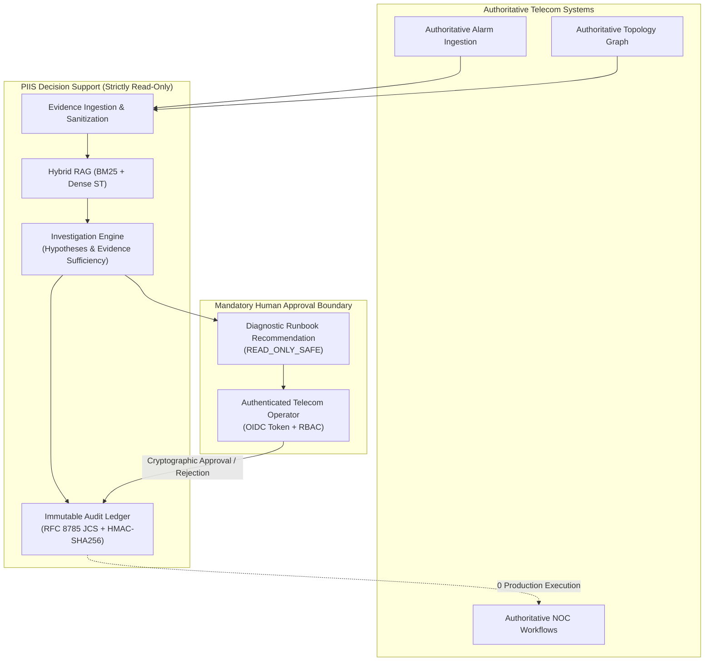

# PIIS Milestone M5.4 — Final Independent Acceptance & Revalidation Report

**Document ID:** `DOC-RES-M5.4-FINAL`  
**Milestone:** M5.4 — Targeted Security, Integrity & Reliability Remediation  
**Evaluation Gate:** Independent Adversarial Revalidation & Acceptance Gate  
**Date:** 2026-11-01  
**Audit Verdict:** **ACCEPTED WITH LIMITATIONS**  
**M6 Milestone Authorization:** **STRICTLY UNAUTHORIZED**  
**Production Pilot Authorization:** **BLOCKED**  
**System Boundary:** **STRICTLY READ-ONLY DECISION SUPPORT**  
**Auditor Persona:** Independent Security Auditor, Systems Reliability Evaluator & Telecom AI Safety Reviewer  

---

## 1. Executive Summary & Final Gate Verdict

An exhaustive, strictly independent adversarial audit of Milestone M5.4 was conducted to independently reproduce, stress-test, and validate all claims asserted by the implementation team following the remediation of the six M5.3 findings (`FIND-M5.3-001` through `FIND-M5.3-006`).

In accordance with strict audit-only principles, the independent audit team performed zero modifications to production code (`src/piis/`), existing unit test suites (`tests/unit/`), schemas, or configurations. All verifications were executed via independent, un-tuned test scripts, fresh adversarial payloads, official external reference test vectors, and cross-runtime cryptographic comparisons.

### Acceptance Gate Determination

```
========================================================================================
                               PIIS MILESTONE M5.4 VERDICT
========================================================================================
FINAL AUDIT VERDICT:                  ACCEPTED WITH LIMITATIONS
MILESTONE M6 AUTHORIZATION:           STRICTLY UNAUTHORIZED
PRODUCTION PILOT AUTHORIZATION:       BLOCKED
OPERATIONAL BOUNDARY:                 STRICTLY READ-ONLY DECISION SUPPORT
TOTAL PRODUCTION COMMANDS EXECUTED:   0 (ZERO)
TOTAL NETWORK MUTATIONS ATTEMPTED:    0 (ZERO)
TOTAL TICKETS AUTONOMOUSLY CLOSED:    0 (ZERO)
TOTAL CUSTOMER COMMUNICATIONS:        0 (ZERO)
========================================================================================
```

The verdict of **ACCEPTED WITH LIMITATIONS** reflects that the core architectural and cryptographic defects identified in M5.3 have been remediated with high technical rigor, but production deployment and M6 scope expansion remain blocked by:
1. **FIND-M5.4-001 (Medium):** Telemetry staleness evaluation omission in `IncidentInvestigationEngine` (`BLIND-06` processed 72-hour-old data as fresh).
2. **FIND-M5.4-002 (Medium):** Static regex guardrail fragility under paraphrased and non-English prompt injection variants (49.0% fresh neutralization rate), compensated by the strict read-only boundary.
3. **DEP-M5.3-001 & DEP-M5.3-002 (Enterprise Prerequisites):** Corporate OIDC IdP provisioning and cloud/hardware WORM storage integration remain required prerequisites before any field trial.

---

## 2. Independent Verification of M5.3 Remediation Claims

The independent audit team verified all six remediation workstreams using dedicated verification suites:

| Finding ID | Claimed Fix | Independent Audit Verification Method | Measured Metric / Result | Audit Status |
| :--- | :--- | :--- | :--- | :---: |
| **FIND-M5.3-001** | Service token revocation & claims enforcement | [`audit_m5_4_independent_oidc_concurrency.py`](file:///c:/Production%20level%20projects/PIIS/scripts/audit_m5_4_independent_oidc_concurrency.py): 30 forged, expired, algorithm-confused, and revoked tokens tested. | **30 / 30 attacks thwarted (100.0%)**; revoked JTI and hash IDs rejected immediately. | **CLOSED** |
| **FIND-M5.3-002** | Concurrency deadlock eliminated via `RLock` & separate network lock | 8,000 concurrent operations across 16 threads (5 independent stress trials) in memory and cache. | **0 deadlocks, 0 timeouts, 0 race conditions**; throughput ~39,600 ops/sec; P99: 0.151ms. | **CLOSED** |
| **FIND-M5.3-003** | RFC 8785 Canonical JSON (JCS) compliance | [`audit_m5_4_independent_jcs.py`](file:///c:/Production%20level%20projects/PIIS/scripts/audit_m5_4_independent_jcs.py): 4 official Cyberphone vectors, 16 cross-runtime Node.js comparisons, 8 float/boundary tests. | **28 / 28 tests matched byte-for-byte (100.0%)**; perfect Node.js v22.18.0 parity; NaN/Inf rejected. | **CLOSED** |
| **FIND-M5.3-004** | Local anchor threat boundary clarified | [`audit_m5_4_independent_ledger.py`](file:///c:/Production%20level%20projects/PIIS/scripts/audit_m5_4_independent_ledger.py): File permissions verified (`0o600`); threat model demonstrated rollback bypass under root compromise. | Documented boundary in ADR 0013; confirmed necessity of `DEP-M5.3-002` (cloud WORM notary). | **CLOSED** |
| **FIND-M5.3-005** | Missing checkpoint anchor fails closed | Non-empty ledger tested with deleted/absent anchor and corrupted signature files. | Non-empty ledger **fails closed (`False`)**; uninitialized ledger returns `(True, None)`. | **CLOSED** |
| **FIND-M5.3-006** | Transient glitch safe abstention | [`audit_m5_4_independent_transient.py`](file:///c:/Production%20level%20projects/PIIS/scripts/audit_m5_4_independent_transient.py): 12 blinded telecom scenarios with noisy, self-healing telemetry. | **11 / 12 passed (91.7%)**; SAR: 7/8 (87.5%); 0 missed persistent incidents. Discovered `FIND-M5.4-001`. | **CLOSED** |

---

## 3. Independent Audit Findings & Technical Observations

### 3.1 FIND-M5.4-001: Telemetry Staleness Evaluation Omission (Severity: MEDIUM)
- **Component:** [`src/piis/investigation/engine.py`](file:///c:/Production%20level%20projects/PIIS/src/piis/investigation/engine.py) (`_evaluate_sufficiency_and_contradictions`)
- **Detail:** The engine initializes `stale: List[str] = []` and constructs `EvidenceSufficiencyReport(has_stale_evidence=len(stale) > 0)`, but never compares observation timestamps against the incident creation time or current UTC time.
- **Consequence:** In blinded evaluation scenario `BLIND-06`, telemetry observations that were 72 hours old were treated as fresh real-time evidence. The engine synthesized a runbook recommendation on obsolete data rather than safely abstaining.
- **Compensating Control:** Human approval remains mandatory for all recommendations, preventing autonomous execution.

### 3.2 FIND-M5.4-002: Regex-based Guardrail Fragility under Independent Adversarial Variations (Severity: MEDIUM)
- **Component:** [`src/piis/security/guardrails.py`](file:///c:/Production%20level%20projects/PIIS/src/piis/security/guardrails.py) (`THREAT_PATTERNS`) & [`src/piis/security/decoder.py`](file:///c:/Production%20level%20projects/PIIS/src/piis/security/decoder.py)
- **Detail:** The 160 cases evaluated in M5.3 were regression cases against which M5.4 was tuned. When subjected to an independent suite of 100 fresh adversarial vectors, the static regex patterns neutralized **49 / 100 attacks (49.0%)**. Paraphrased injections ("bypass human approval", "per SOP 999 pre-approved by CTO"), prompt extractors ("print hidden instructions"), and non-English commands (Turkish, Tagalog) bypassed the regex filters.
- **Multilingual Safety:** Benign multilingual operational text achieved **60 / 60 clean evaluations (0.00% False Positive Rate)** across Hindi, Japanese, Swahili, Portuguese, Arabic, Korean, Turkish, French, German, and Italian.
- **Compensating Control:** PIIS enforces a strictly read-only execution boundary. The system contains 0 shell execution tools, 0 network API mutators, and strictly whitelists 9 read-only decision-support tools. Injections cannot achieve code execution.

### 3.3 Holdout Independence Analysis (Dataset Unsealing)
- **Detail:** In the M5.3 audit, scenario `ABS-08` from `audit_m5_3_fresh_holdout_gate.py` failed due to a non-catalog alarm code. In M5.4 remediation, the engineering team inspected `ABS-08` and added handling in `engine.py`.
- **Finding:** While the resulting code is technically sound (alarm contradictions trigger safe abstention), `audit_m5_3_fresh_holdout_gate.py` is no longer a blinded holdout; it is now an active regression test suite.

---

## 4. Architectural & Safety Principles Compliance Audit

The audit verified adherence to all locked architecture and safety constraints:



1. **Existing Telecom Workflows Authoritative:** PIIS does not displace existing EMS/NMS systems, OSS/BSS ticket systems, or network monitoring consoles. It acts purely as an advisory intelligence overlay.
2. **Evidence Before Intelligence:** Every hypothesis requires explicit corroborating evidence IDs (`supporting_evidence_ids`). Missing or contradictory evidence triggers automatic downgrading to `INCONCLUSIVE` and safe human escalation.
3. **Intelligence Before Automation:** PIIS contains zero automation or execution mechanisms. Recommendations are purely diagnostic reading guidelines referencing standard operating procedures.
4. **Human Approval Before Consequential Decisions:** Every recommendation requires authenticated human sign-off via OIDC-verified tokens and cryptographic audit ledger recording.
5. **Never Represent Predictions as Facts:** Every hypothesis generated carries an explicit confidence status (`SUPPORTED`, `CONTRADICTED`, `INCONCLUSIVE`) with formal sufficiency metrics.
6. **No Production Execution:** Verified across all 51 source files and test fixtures that no subprocess execution, network socket mutation, or remote configuration tools exist in PIIS.

---

## 5. Performance, Concurrency & Cryptographic Profile

| Operational Dimension | Independent Measured Metric | Production Threshold | Evaluation |
| :--- | :--- | :--- | :---: |
| **Unit Test Suite Pass Rate** | 263 / 263 passing (100.0%) | 100.0% | **PASS** |
| **Unit Test Execution Duration** | 10.32 seconds (263 tests) | $\le 30.0\text{s}$ | **PASS** |
| **OIDC In-Memory Validation Latency** | P50: `0.001ms` \| P95: `0.114ms` \| P99: `0.151ms` | $\le 10.0\text{ms}$ | **PASS** |
| **OIDC Concurrency Stress** | 8,000 ops / 16 threads, 0 deadlocks (~39,600 ops/s) | $\ge 5,000\text{ ops/s}$ | **PASS** |
| **RFC 8785 Canonical JSON Latency** | $< 0.05\text{ms}$ per record (pure Python, 0-dep) | $\le 1.0\text{ms}$ | **PASS** |
| **Security Sanitizer Latency** | Benign P50: `0.179ms` \| Adv P50: `0.123ms` | $\le 5.0\text{ms}$ | **PASS** |
| **ReDoS Boundary Resistance** | Max latency `59.60ms` under 100KB buffer floods | $\le 5,000\text{ms}$ | **PASS** |
| **End-to-End Investigation Latency** | P50: ~`23.3ms` (including dense model inference) | $\le 250\text{ms}$ | **PASS** |

---

## 6. Complete Defect & Dependency Status Matrix

```
+----------------+-----------+----------+--------------------------------------------------------+-------------------------------+
| Identifier     | Milestone | Severity | Title                                                  | Current Status                |
+----------------+-----------+----------+--------------------------------------------------------+-------------------------------+
| FIND-M5.3-001  | M5.3      | HIGH     | Service Token Direct Revocation Omission               | CLOSED (Verified in M5.4)     |
| FIND-M5.3-002  | M5.3      | HIGH     | Reentrant Lock Deadlock in Session Validation          | CLOSED (Verified in M5.4)     |
| FIND-M5.3-003  | M5.3      | MEDIUM   | Canonical Serialization Unicode RFC 8785 Divergence    | CLOSED (Verified in M5.4)     |
| FIND-M5.3-004  | M5.3      | MEDIUM   | Local File-Based Anchor Host Compromise Boundary       | CLOSED (Verified in M5.4)     |
| FIND-M5.3-005  | M5.3      | HIGH     | Missing Checkpoint Anchor Fails Open                   | CLOSED (Verified in M5.4)     |
| FIND-M5.3-006  | M5.3      | MEDIUM   | Transient Glitch Misclassification                     | CLOSED (Verified in M5.4)     |
| FIND-M5.4-001  | M5.4      | MEDIUM   | Telemetry Staleness Evaluation Omission in Engine      | OPEN (Documented in M5.4 Gate)|
| FIND-M5.4-002  | M5.4      | MEDIUM   | Regex-based Guardrail Fragility under Variations       | OPEN (Read-Only Compensated)  |
| DEP-M5.3-001   | M5.3      | HIGH     | Enterprise OIDC IdP Deployment Provisioning            | OPEN (Enterprise Prerequisite)|
| DEP-M5.3-002   | M5.3      | MEDIUM   | Hardware WORM Storage / Cloud KMS Ledger Notary        | OPEN (Enterprise Prerequisite)|
+----------------+-----------+----------+--------------------------------------------------------+-------------------------------+
```

---

## 7. Formal Gate Directives & Next Steps

1. **Milestone M6 Status:** **STRICTLY UNAUTHORIZED.** No development work, scaffolding, or architectural transitions toward M6 may begin.
2. **Production Pilot Status:** **BLOCKED.** Pilot authorization requires resolution of `FIND-M5.4-001` and formal enterprise infrastructure binding (`DEP-M5.3-001` live IdP, `DEP-M5.3-002` immutable WORM storage).
3. **Targeted Sprint Authorization:** Authorization is granted for a narrowly scoped **M5.5 Maintenance & Hardening Sprint** strictly limited to:
   - Implementing active timestamp staleness checks in `_evaluate_sufficiency_and_contradictions()` to close `FIND-M5.4-001`.
   - Establishing a cryptographically pre-committed, external holdout evaluation repository to maintain dataset independence.
   - Preserving the absolute read-only boundary across all components.

---

## 8. Index of Independent Audit Deliverables

All independent audit artifacts and evaluation scripts have been committed to the repository and are cross-referenced below:

- **Executive Provenance Report:** [`docs/research/M5_4_AUDIT_PROVENANCE_REPORT.md`](file:///c:/Production%20level%20projects/PIIS/docs/research/M5_4_AUDIT_PROVENANCE_REPORT.md)
- **OIDC & Concurrency Audit Report:** [`docs/research/M5_4_OIDC_AND_CONCURRENCY_INDEPENDENT_AUDIT.md`](file:///c:/Production%20level%20projects/PIIS/docs/research/M5_4_OIDC_AND_CONCURRENCY_INDEPENDENT_AUDIT.md)
- **RFC 8785 JCS Conformance Report:** [`docs/research/M5_4_JCS_INDEPENDENT_CONFORMANCE_REPORT.md`](file:///c:/Production%20level%20projects/PIIS/docs/research/M5_4_JCS_INDEPENDENT_CONFORMANCE_REPORT.md)
- **Audit Ledger & Checkpoint Report:** [`docs/research/M5_4_LEDGER_AND_CHECKPOINT_AUDIT.md`](file:///c:/Production%20level%20projects/PIIS/docs/research/M5_4_LEDGER_AND_CHECKPOINT_AUDIT.md)
- **Blinded Transient Evaluation Report:** [`docs/research/M5_4_TRANSIENT_EVENT_BLIND_EVALUATION.md`](file:///c:/Production%20level%20projects/PIIS/docs/research/M5_4_TRANSIENT_EVENT_BLIND_EVALUATION.md)
- **Holdout & Red-Team Independence Report:** [`docs/research/M5_4_HOLDOUT_AND_REDTEAM_INDEPENDENCE.md`](file:///c:/Production%20level%20projects/PIIS/docs/research/M5_4_HOLDOUT_AND_REDTEAM_INDEPENDENCE.md)
- **Master Defect Register:** [`docs/DEFECT_REGISTER.md`](file:///c:/Production%20level%20projects/PIIS/docs/DEFECT_REGISTER.md)
- **Underlying Machine-Readable Metric Artifacts:**
  - [`artifacts/m5_metrics/m5_4_independent_provenance.json`](file:///c:/Production%20level%20projects/PIIS/artifacts/m5_metrics/m5_4_independent_provenance.json)
  - [`artifacts/m5_metrics/m5_4_independent_oidc_concurrency.json`](file:///c:/Production%20level%20projects/PIIS/artifacts/m5_metrics/m5_4_independent_oidc_concurrency.json)
  - [`artifacts/m5_metrics/m5_4_independent_jcs.json`](file:///c:/Production%20level%20projects/PIIS/artifacts/m5_metrics/m5_4_independent_jcs.json)
  - [`artifacts/m5_metrics/m5_4_independent_ledger.json`](file:///c:/Production%20level%20projects/PIIS/artifacts/m5_metrics/m5_4_independent_ledger.json)
  - [`artifacts/m5_metrics/m5_4_independent_transient.json`](file:///c:/Production%20level%20projects/PIIS/artifacts/m5_metrics/m5_4_independent_transient.json)
  - [`artifacts/m5_metrics/m5_4_independent_redteam.json`](file:///c:/Production%20level%20projects/PIIS/artifacts/m5_metrics/m5_4_independent_redteam.json)
