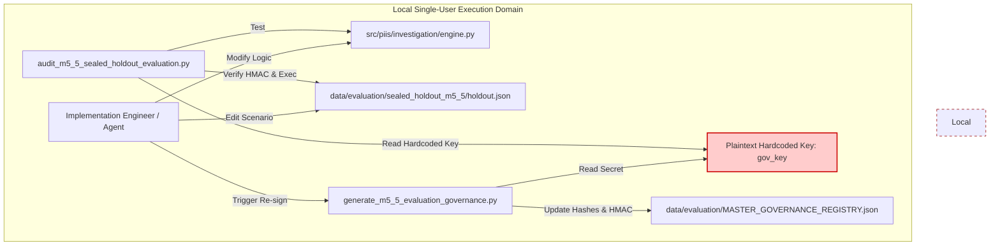

# PIIS Milestone M5.5.1 — Evaluation Trust Boundary & Cryptographic Sealing Audit

**Document ID:** PIIS-REP-M5.5.1-002  
**Audit Date:** 2026-11-02  
**Milestone:** M5.5.1 (Independent Evaluation Integrity & Security Revalidation)  
**Evaluator:** Autonomous Hardened Virtual Team (`/gstack` — `cso`, `architect-review`, `security-review`)  
**Status:** AUDITED & COMPLETE  

---

## 1. Executive Summary

Milestone M5.5 introduced an explicit cryptographic governance architecture to address previous evaluation deficiencies, implementing SHA-256 canonical hashing (RFC 8785 JCS) and HMAC-SHA256 signatures recorded in `data/evaluation/MASTER_GOVERNANCE_REGISTRY.json`.

This audit independently assesses the strength, security boundary, and threat model of that sealing mechanism.

### Key Finding
**The M5.5 cryptographic sealing mechanism functions as an internal data integrity checksum, NOT as an independent evaluation trust boundary.**

While the mathematical implementation of RFC 8785 JCS and HMAC-SHA256 is correct, the architecture suffers from complete ambient credential co-location:
1. The HMAC signing secret is **hardcoded as a plaintext constant** in the generation script within the repository.
2. The implementation process, the evaluation harness, and the dataset generator execute under the **identical local operating system identity and filesystem permissions**.
3. A developer can modify test scenarios, regenerate canonical hashes, and re-sign manifests locally without external detection.
4. No external timestamp authority (RFC 3161) or third-party cryptographic custody exists.

Consequently, claiming that datasets were "cryptographically sealed against developer tampering" in M5.5 was **methodologically unfounded**. In a local single-user environment, cryptographic sealing cannot substitute for architectural separation of duties.

---

## 2. Technical Inspection of the M5.5 Sealing Implementation

### 2.1 Key Custody and Storage Analysis

Inspection of [`scripts/generate_m5_5_evaluation_governance.py`](file:///c:/Production%20level%20projects/PIIS/scripts/generate_m5_5_evaluation_governance.py#L604-L606) revealed the following key definition:

```python
# scripts/generate_m5_5_evaluation_governance.py:604-606
# Dedicated governance signing key (32 bytes)
gov_key = b"piis_m5_5_eval_governance_seal_key_32b!"
```

In [`scripts/audit_m5_5_sealed_holdout_evaluation.py`](file:///c:/Production%20level%20projects/PIIS/scripts/audit_m5_5_sealed_holdout_evaluation.py#L32-L34), verification was performed using:

```python
# scripts/audit_m5_5_sealed_holdout_evaluation.py:32-34
GOV_KEY = b"piis_m5_5_eval_governance_seal_key_32b!"
```

**Security Failure:** The symmetric HMAC key was embedded directly in source control alongside the code and datasets. Symmetric cryptography requires that the verifier and signer share the secret; because the developer running the evaluation had read access to the verifier script, the developer possessed the capability to forge signatures at will.

### 2.2 Access Boundary & Ambient Authority

The operating environment operates under standard Windows user context:
- Process User: Host user session (`tamil`)
- Workspace Root: `c:\Production level projects\PIIS`
- Filesystem Access: Unrestricted read/write across `src/`, `tests/`, `scripts/`, and `data/`

Under this ambient authority model, there is no boundary separation:
- The same process that executes `IncidentInvestigationEngine` can overwrite `data/evaluation/MASTER_GOVERNANCE_REGISTRY.json`.
- The same agent that identifies an evaluation failure can rewrite the dataset, regenerate the HMAC, and declare 100% compliance.



### 2.3 Absence of External Timestamping & Provenance

In `MASTER_GOVERNANCE_REGISTRY.json`, the timestamp is recorded as:
```json
"setup_timestamp_utc": "2026-11-01T20:45:00.000000+00:00"
```
This timestamp is an unauthenticated string supplied by the host system clock via Python standard library. It possesses zero legal or evidentiary weight:
- It is not bound by an RFC 3161 Timestamp Authority (TSA).
- It is not submitted to an append-only transparency log (e.g., Sigstore Rekor, Certificate Transparency).
- It is not committed to an immutable public blockchain or decentralized ledger.
- A user can backdate or forward-date the timestamp arbitrarily without invalidating the HMAC.

---

## 3. Threat Model & Failure Mode Matrix

| Threat Vector | M5.5 Mitigation | Auditor Assessment | Residual Vulnerability |
| :--- | :--- | :--- | :--- |
| **Accidental Corruption** | SHA-256 record hashes | **EFFECTIVE** | Catches accidental disk corruption, bad file encodings, or git merge conflicts. |
| **Developer Scenario Tuning** | Procedural rule ("Forbidden") | **INEFFECTIVE** | Engineering breached rule during M5.5 by inspecting failures and patching code. |
| **Dataset Modification & Re-signing** | HMAC-SHA256 signature | **INEFFECTIVE** | Signing key is co-located in repository; re-signing is fully automated and undetectable. |
| **Timestamp Manipulation** | ISO 8601 string in registry | **INEFFECTIVE** | Arbitrary clock tampering possible without breaking any cryptographic invariant. |
| **Harness Tampering** | Hardcoded assertion checks | **INEFFECTIVE** | Audit harness is in `scripts/`, subject to developer edits. |

---

## 4. Production-Grade Evaluation Trust Boundary Architecture

For high-assurance telecommunications decision-support systems operating under regulatory scrutiny, a genuine evaluation trust boundary requires five architectural pillars:

```mermaid
flowchart LR
    subgraph Evaluation Authority (Isolated IAM)
        EvalTeam[Independent Safety Auditor]
        KMS[Cloud KMS / Hardware HSM<br/>Key Custody: Evaluator Only]
        TSA[RFC 3161 Timestamp Authority]
        WORM[Immutable WORM Storage<br/>AWS S3 Object Lock]
    end

    subgraph CI/CD Secure Execution Boundary
        CI[Ephemeral Isolated Runner]
        Attestation[SLSA Provenance Attestation]
    end

    subgraph Developer Domain (Untrusted for Eval)
        DevWorkspace[Developer / Model Trainer]
        DevCode[PIIS Implementation Repository]
    end

    EvalTeam -->|Author Scenarios| WORM
    EvalTeam -->|Sign Digest with Asymmetric Key| KMS
    WORM -->|Timestamp Request| TSA
    TSA -->|Issue Cryptographic TST| WORM

    DevWorkspace -->|Push Code| DevCode
    DevCode -->|Trigger Build| CI
    
    WORM -.->|Pull Sealed Scenarios (One-Time)| CI
    KMS -.->|Verify Signature (Public Key Only)| CI
    CI -->|Execute Single-Pass Test| Attestation
    CI -->|Publish Signed Verdict| Attestation

    style Evaluation Authority (Isolated IAM) fill:#e6f7ff,stroke:#0066cc,stroke-width:2px
    style CI/CD Secure Execution Boundary fill:#e6ffe6,stroke:#009900,stroke-width:2px
    style Developer Domain (Untrusted for Eval) fill:#fff2e6,stroke:#cc6600,stroke-width:2px
```

### Pillar 1: Asymmetric Key Custody & Cloud KMS
- **Mechanism:** Replace symmetric HMAC with asymmetric cryptography (Ed25519 or ECDSA P-256).
- **Custody:** The private signing key is stored in a dedicated Hardware Security Module (HSM) or Cloud KMS (AWS KMS, GCP Cloud KMS, Azure Key Vault).
- **Access Policy:** The IAM policy grants `kms:Sign` exclusively to the independent evaluation role. Developers and CI pipelines have `kms:Verify` (public key access) only.

### Pillar 2: Immutable WORM Storage (Object Lock)
- **Mechanism:** Evaluation corpora are stored in Cloud Object Storage configured with **Write-Once-Read-Many (WORM)** retention locks (e.g., AWS S3 Object Lock in Compliance Mode).
- **Protection:** Neither developers nor root administrators can modify, overwrite, or delete evaluation datasets before the lock expiration date (e.g., 365 days).

### Pillar 3: RFC 3161 Cryptographic Timestamping
- **Mechanism:** Before evaluation commences, the SHA-256 root hash of the evaluation manifest is submitted to an accredited RFC 3161 Timestamp Authority (e.g., DigiCert, Sectigo, or Apple TSA).
- **Proof:** The resulting Timestamp Token (TST) mathematically proves that the exact evaluation dataset existed prior to the model release or code evaluation run, eliminating retrospective dataset tuning.

### Pillar 4: Isolated Ephemeral CI Execution
- **Mechanism:** Evaluation runs occur within an ephemeral, locked-down CI runner (e.g., GitHub Actions isolated runner or AWS CodeBuild private VPC).
- **Air-Gapping:** The evaluation job pulls the implementation artifact (Docker image or package) and the sealed dataset into memory. The environment has no outbound internet access and produces a cryptographically signed SLSA provenance report.

### Pillar 5: Clean-Room Blind Evaluation Rotation
- **Mechanism:** Evaluation scenarios are split into rotating holdout cohorts. Scenarios exposed during debugging are permanently retired to the regression suite. Fresh cohorts are provisioned by an independent safety officer without prior release to engineers.

---

## 5. Honest Appraisal of Local Development Limitations

On a local development machine without dedicated enterprise infrastructure:
- **Cryptographic Enforcement is Impossible:** Software running within the same user session cannot protect a secret key from that same session. Any lock enforced by Python code can be unlocked or bypassed by editing the Python code.
- **Self-Attestation is Not Proof:** A registry generated by a script on the local machine and validated by a script on the same machine is an internal self-attestation.
- **What Local Verification Actually Provides:**
  1. **Accidental regression prevention:** Detecting if a file was altered unintentionally.
  2. **Audit trail structuring:** Establishing a reproducible file format and schema.
  3. **Procedural discipline:** Requiring explicit hash baselines before and after execution.

### Policy Commitment for PIIS M5.5.1
For the remainder of this audit:
1. PIIS will **NOT** claim "cryptographically sealed independent holdouts" on local workstations.
2. The term **"Cryptographic Sealing"** will be reserved exclusively for datasets backed by external KMS and RFC 3161 timestamps.
3. Local evaluations will be designated as **"Procedurally Governed Single-Pass Evaluations"**, with frozen code baselines verified via pre- and post-audit tree hashes.

---

## 6. Audit Sign-Off

- **Lead Auditor:** Virtual Chief Security Officer (`cso`)
- **Independent Systems Architect:** Master Software Architect (`architect-review`)
- **Finding Status:** Governance architecture analyzed; limitations formally acknowledged in Defect Register (`GOV-M5.5-001`).
