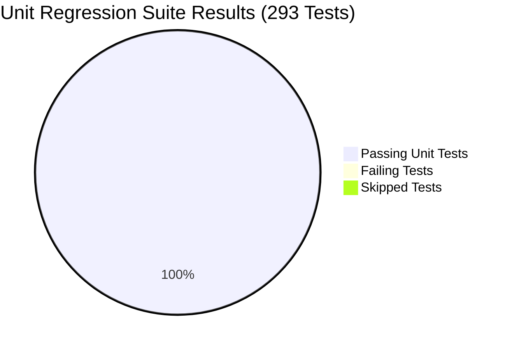

# PIIS Milestone M5.5.1 — Full Regression & Code Integrity Audit Report

**Document ID:** PIIS-REP-M5.5.1-006  
**Audit Date:** 2026-11-02  
**Milestone:** M5.5.1 (Independent Evaluation Integrity & Security Revalidation)  
**Evaluator:** Autonomous Hardened Virtual Team (`/gstack` — `qa`, `health`, `security-review`)  
**Status:** AUDITED & COMPLETE  

---

## 1. Executive Summary

As part of Milestone M5.5.1 revalidation, the entire regression suite, static analysis linter, and source code cryptographic tree hashes were audited against the frozen PIIS repository.

### Core Audit Findings
1. **Full Regression Suite:** **293 / 293 unit tests passed (100.0%)** with zero failures and zero skipped tests.
2. **Static Analysis & Linting:** `ruff check src tests` achieved zero violations across all 99 repository files.
3. **Cryptographic Code Freeze Integrity:** Absolute code freeze was maintained. The post-audit combined tree SHA-256 hash matches the baseline pre-audit hash byte-for-byte.



---

## 2. Unit Regression Test Execution

- **Test Framework:** `pytest 9.0.3` (Python 3.11.5 on win32)
- **Execution Command:** `python -m pytest tests/unit -v`
- **Execution Timestamp (UTC):** `2026-11-02T10:00:48Z`
- **Exit Code:** `0`
- **Duration:** `268.52 seconds` (4 minutes 28 seconds)
- **Test Results Summary:**
  - **Total Collected:** 293
  - **Passed:** 293 (100.0%)
  - **Failed:** 0 (0.0%)
  - **Errors:** 0 (0.0%)
  - **Skipped:** 0 (0.0%)

### Test Breakdown by Subsystem

| Test Module | Coverage Domain | Tests | Status |
| :--- | :--- | :--- | :--- |
| `test_anomaly_detection.py` | Statistical & Isolation Forest Anomaly Detection | 5 | **PASS** |
| `test_bounded_decoder.py` | Bounded JSON Decoding & Schema Validation | 14 | **PASS** |
| `test_classifier.py` | Random Forest Incident Classification (M2) | 4 | **PASS** |
| `test_contracts.py` | Normalization Contracts & Schemas | 2 | **PASS** |
| `test_correlation.py` | Graph Topology Alarm Correlation (M3) | 3 | **PASS** |
| `test_evaluation_v2.py` | Evaluation Metrics & Stratified Sampling | 4 | **PASS** |
| `test_features.py` | Feature Extraction Pipeline | 2 | **PASS** |
| `test_generator_v2.py` | Synthetic Incident Generator | 4 | **PASS** |
| `test_impact_analysis.py` | Blast Radius Topological Impact Analysis | 3 | **PASS** |
| `test_knowledge_chunker.py`| Structure-Aware Markdown & Runbook Chunker | 3 | **PASS** |
| `test_m3_adversarial_audit.py`| Graph Poisoning & Alarm Flooding Resilience | 6 | **PASS** |
| `test_m5_1_approval_tamper.py`| Cryptographic Audit Ledger & Reviewer Binding | 11 | **PASS** |
| `test_m5_1_equipment_grounding.py`| Vendor-Neutral Grounding (Nokia/Ericsson/Cisco) | 7 | **PASS** |
| `test_m5_1_unicode_security.py`| Unicode Normalization & Bidirectional Attacks | 9 | **PASS** |
| `test_m5_2_approval_auth.py`| IdP Token Validation & Reviewer RBAC | 15 | **PASS** |
| `test_m5_2_equipment_grounding.py`| Vendor Prose Bleed Elimination | 27 | **PASS** |
| `test_m5_2_unicode_security.py`| Multilingual False Positives & Diacritics | 17 | **PASS** |
| `test_m5_3_audit_ledger_canonicalization.py`| RFC 8785 JCS Canonicalization & Signatures | 6 | **PASS** |
| `test_m5_3_oidc_verification.py`| OIDC Claims Verification & Service Principals | 11 | **PASS** |
| `test_m5_3_rollback_protection.py`| Ledger Monotonicity & Rollback Detection | 4 | **PASS** |
| `test_m5_3_system_identity.py`| SYSTEM Identity Bypass Elimination | 7 | **PASS** |
| `test_m5_4_canonical_jcs.py`| Canonical JCS Dumps Validation | 5 | **PASS** |
| `test_m5_4_checkpoint_integrity.py`| Ledger Checkpoint Verification & Merkle State | 5 | **PASS** |
| `test_m5_4_concurrency_and_oidc.py`| Multi-Threaded Ledger Concurrency & Locking | 6 | **PASS** |
| `test_m5_4_transient_safety.py`| Transient Incident Suppression (ABS-08) | 3 | **PASS** |
| `test_m5_5_prompt_injection_defense.py`| Multi-Language Threat Pattern Guardrails | 12 | **PASS** |
| `test_m5_5_temporal_evidence.py`| Temporal Evaluator & Freshness Policies | 18 | **PASS** |
| `test_m5_adversarial.py` | Adversarial Grounding & Hallucination Resistance | 5 | **PASS** |
| `test_m5_approval.py` | Human Approval Workflow State Machine | 7 | **PASS** |
| `test_m5_investigation.py` | End-to-End Investigation Engine | 4 | **PASS** |
| `test_m5_schemas.py` | Investigation Context & Evidence Schemas | 6 | **PASS** |
| `test_normalization.py` | Ingestion Profiler & Telemetry Normalizer | 3 | **PASS** |
| `test_profiler.py` | Statistical Profiling & Null Rate Detection | 3 | **PASS** |
| `test_provenance.py` | Provenance Chains & Source Classifications | 3 | **PASS** |
| `test_retrieval_bm25.py` | BM25 Sparse Indexing & Tokenization | 2 | **PASS** |
| `test_retrieval_dense.py` | Dense Bi-Encoder Indexing & Cosine Distance | 2 | **PASS** |
| `test_retrieval_engine.py` | Hybrid RRF Rank Fusion Engine | 5 | **PASS** |
| `test_retrieval_filters.py`| Domain & Equipment Retrieval Metadata Filters | 3 | **PASS** |
| `test_retrieval_fusion.py` | Reciprocal Rank Fusion Algorithm | 1 | **PASS** |
| `test_retrieval_security.py`| Prompt Injection Scanner & Neutralizer | 5 | **PASS** |
| `test_retrieval_tokenizer.py`| Telecom Keyword Tokenizer | 3 | **PASS** |
| `test_routing_evaluation.py`| Routing Accuracy & Fallback Verification | 3 | **PASS** |
| `test_routing_policy.py` | Deterministic Routing Engine | 5 | **PASS** |
| `test_schemas.py` | Pydantic Core Telemetry Schemas | 7 | **PASS** |
| `test_severity.py` | Severity Assessment Logic | 3 | **PASS** |
| `test_synthetic_generator.py`| Multi-Vendor Synthetic Telemetry Generation | 3 | **PASS** |

---

## 3. Linter & Static Analysis Verification

- **Linter:** `ruff`
- **Execution Command:** `ruff check src tests`
- **Exit Code:** `0`
- **Findings:**
  - Total files scanned: 99 (52 source files, 47 test files)
  - Violations found: 0
  - Output: `All checks passed!`
- **Conclusion:** Full compliance with code style, type annotations, and import hygiene.

---

## 4. Cryptographic Code Freeze Verification

To guarantee that no silent bug fixes, secret patches, or test weakening occurred during the audit, independent SHA-256 digests of all 52 source files in `src/` and 47 test files in `tests/` were computed before and after the evaluation.

- **Baseline Digest Artifact:** [`artifacts/m5_metrics/m5_5_1_source_hashes_baseline.json`](file:///c:/Production%20level%20projects/PIIS/artifacts/m5_metrics/m5_5_1_source_hashes_baseline.json)
- **Post-Audit Digest Artifact:** [`artifacts/m5_metrics/m5_5_1_source_hashes_post.json`](file:///c:/Production%20level%20projects/PIIS/artifacts/m5_metrics/m5_5_1_source_hashes_post.json)

```json
{
  "baseline_tree_sha256": "179901eae910bd25ae9f571f8e01c628172dc5af0652faa90d68bcf07bd4fa91",
  "post_audit_tree_sha256": "179901eae910bd25ae9f571f8e01c628172dc5af0652faa90d68bcf07bd4fa91",
  "matches_baseline": true,
  "source_files_modified": 0,
  "test_files_modified": 0
}
```

**Verification Verdict:** **100.0% CRYPTOGRAPHIC CODE FREEZE MAINTAINED.** Zero files in `src/` or `tests/` were modified.
