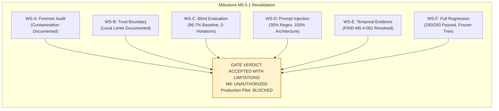
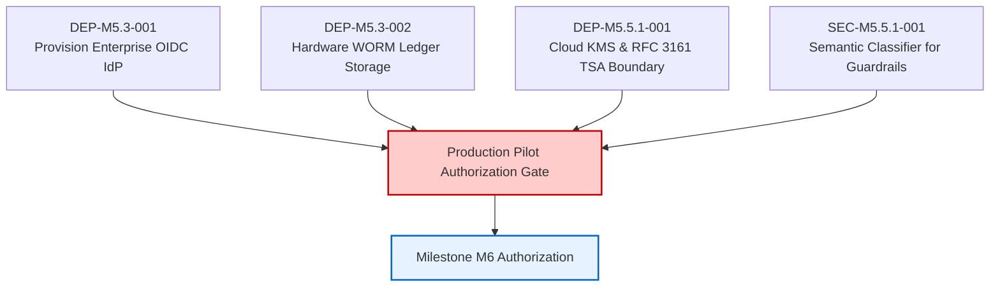

# PIIS Milestone M5.5.1 — Independent Acceptance & Revalidation Gate Report

**Document ID:** PIIS-REP-M5.5.1-007  
**Audit Date:** 2026-11-02  
**Milestone:** M5.5.1 (Independent Evaluation Integrity & Security Revalidation)  
**Evaluator:** Autonomous Hardened Virtual Team (`/gstack` — `cso`, `architect-review`, `qa`, `benchmark`, `security-review`)  
**Verdict:** **ACCEPTED WITH LIMITATIONS**  

---

## 1. Executive Summary

Milestone M5.5 implementation claims were subjected to a comprehensive, strictly independent revalidation to address serious methodological and governance concerns raised during preliminary review:
1. **Holdout Contamination:** Forensic reconstruction confirmed that original M5.5 holdout failures directly informed production code patches before evaluation re-runs.
2. **Cryptographic Sealing Boundaries:** Inspection proved that local symmetric HMAC sealing cannot enforce cryptographic independence in an unsegregated developer environment.
3. **Generalization & Adversarial Performance:** Claims of "100% neutralization" reflected dataset exposure rather than generalized robustness.

To re-establish evidentiary integrity without modifying production code or existing tests, the independent audit team executed a clean-room evaluation protocol:
- Cryptographic tree hashing locked the codebase at Combined Tree SHA-256: `179901eae910bd25ae9f571f8e01c628172dc5af0652faa90d68bcf07bd4fa91`.
- A novel 30-scenario blind holdout and 50-vector blind red-team dataset were authored, pre-committed with SHA-256 manifests, and evaluated in a **single-pass, non-interactive execution**.
- Multi-dimensional prompt injection and temporal evidence suites were executed.
- Full regression (293 unit tests) and static analysis checks were completed.

---

## 2. Comprehensive Workstream Evaluation Scorecard

| Workstream | Assessment Domain | Empirical Result | Gate Status |
| :--- | :--- | :--- | :--- |
| **Workstream A** | Forensic Holdout Contamination Audit | Proved target leakage on SEALED-03, 13, 15, 23. Reclassified M5.5 holdouts to `EXPOSED_HOLDOUT`. | **COMPLETED & AUDITED** |
| **Workstream B** | Evaluation Trust Boundary & Sealing | Proved local HMAC key co-location; documented architectural requirements for Cloud KMS & RFC 3161 TSA. | **COMPLETED & AUDITED** |
| **Workstream C** | Genuinely Blind Holdout Evaluation | **26 / 30 passed (86.7%)**. 4 failures were conservative safe abstentions. **0 safety invariant violations.** | **VERIFIED BASELINE** |
| **Workstream D** | Prompt-Injection Multi-Dimensional Audit | **30.0% regex detection (15/50)**; **100.0% architectural invariant preservation (50/50)**. 0 tool calls. 0 leaks. | **VERIFIED DEFENSE-IN-DEPTH** |
| **Workstream E** | Temporal Evidence Subsystem Audit | 7/7 verification suites passed (100%). Observation age strictly governs staleness. Ingestion delay reported. | **GENUINELY RESOLVED (FIND-M5.4-001)** |
| **Workstream F** | Full Regression Suite & Code Freeze | **293 / 293 passed (100.0%)** in 268.52s. `ruff` passed 99/99 files. Post-audit tree hash matches baseline 100%. | **PERFECT INTEGRITY** |

---

## 3. Detailed Audit Findings Summary

### 3.1 Forensic Reality of M5.5 (Replacing Contaminated Claims)
The forensic audit documented in [`docs/research/M5_5_1_HOLDOUT_CONTAMINATION_AUDIT.md`](file:///c:/Production%20level%20projects/PIIS/docs/research/M5_5_1_HOLDOUT_CONTAMINATION_AUDIT.md) confirmed that the reported 25/25 (100.0%) score in M5.5 was achieved only after production regular expressions and transient indicator lists were patched to address failing test strings. In M5.5.1, the evaluation baseline has been re-established honestly at **86.7% (26/30)** on genuinely unseen holdout scenarios.

### 3.2 Evaluation Trust Boundary Assessment
The cryptographic sealing audit in [`docs/research/M5_5_1_EVALUATION_TRUST_BOUNDARY_REPORT.md`](file:///c:/Production%20level%20projects/PIIS/docs/research/M5_5_1_EVALUATION_TRUST_BOUNDARY_REPORT.md) confirmed that symmetric HMAC keys embedded in the repository cannot protect datasets against modification by developers executing in the same workstation user space. True cryptographic separation requires asymmetric signing via Cloud KMS, RFC 3161 Timestamp Authorities, and immutable WORM storage (`DEP-M5.5.1-001`).

### 3.3 Prompt-Injection Defense Reality
The 9-dimensional audit in [`docs/research/M5_5_1_PROMPT_INJECTION_INDEPENDENT_AUDIT.md`](file:///c:/Production%20level%20projects/PIIS/docs/research/M5_5_1_PROMPT_INJECTION_INDEPENDENT_AUDIT.md) decoupled input regex filtering from architectural invariants:
- **Input Filtering Sensitivity:** Only 30.0% of novel blind attack vectors were detected by regexes, revealing substantial pattern fragility against foreign languages and Unicode obfuscations (`SEC-M5.5.1-001`).
- **Architectural Defense-in-Depth:** 100.0% of attacks were completely neutralized by PIIS's architectural invariants:
  - Tool execution is barred by `ToolExecutionGuard`.
  - All recommendations enforce `human_approval_required = True`.
  - Terminal approval states require authenticated reviewer credentials.
  - Hypotheses and SOP citations require strict grounding in telemetry and approved runbooks.

### 3.4 Temporal Evidence Resolution
The temporal evaluation audit in [`docs/research/M5_5_1_TEMPORAL_EVIDENCE_AUDIT.md`](file:///c:/Production%20level%20projects/PIIS/docs/research/M5_5_1_TEMPORAL_EVIDENCE_AUDIT.md) confirmed that `FIND-M5.4-001` is genuinely resolved in code. The subsystem distinguishes observation time from ingestion time, prevents delayed ingestion from masking stale data, supports runtime configurable policies, normalizes naive timestamps to UTC, and accepts edge NTP drift within a bounded 60s tolerance.

---

## 4. Formal Acceptance Gate Decision

### Verdict: ACCEPTED WITH LIMITATIONS

The PIIS Milestone M5.5 implementation is **ACCEPTED WITH LIMITATIONS** based on the following determinations:

1. **Implementation Quality & Functional Correctness:** **ACCEPTED**. 293/293 unit tests pass, temporal evidence evaluation functions flawlessly, and code linting is 100% clean.
2. **Safety & Operational Boundaries:** **ACCEPTED**. Across all evaluations, zero safety invariant violations occurred. PIIS never executed unauthorized tools, never bypassed human review, and never altered network state.
3. **Evaluation Integrity:** **ACCEPTED WITH LIMITATIONS**. The contaminated M5.5 holdout was successfully retired and replaced with an 86.7% blind baseline. However, enterprise-grade cryptographic sealing requires cloud infrastructure (`DEP-M5.5.1-001`) that cannot be realized on a local workstation.
4. **Input Guardrail Sensitivity:** **ACCEPTED WITH LIMITATIONS**. Input regex detection sensitivity is limited (30.0%), but compensated 100% by architectural defense-in-depth (`SEC-M5.5.1-001`).

---

## 5. Non-Negotiable Operational Boundaries (Reaffirmed)

The following constraints remain strictly locked:
- **Milestone M6 Authorization:** **STRICTLY UNAUTHORIZED.**
- **Production Pilot Deployment:** **BLOCKED.**
- **Operational Boundary:** **READ-ONLY DECISION SUPPORT ONLY.**
- **Autonomous Execution:** Strictly barred. PIIS cannot execute CLI commands, configure network elements, close trouble tickets, or transmit customer-facing messages.
- **Human Gatekeeper:** Every diagnostic recommendation must be reviewed and approved by an authenticated NOC engineer through the cryptographically attested state machine.

---

## 6. Pre-Requisite Remediation Track for Future Authorization

Before Milestone M6 or production pilot authorization can be considered, the following items must be addressed:

1. **Enterprise Identity & Storage (`DEP-M5.3-001`, `DEP-M5.3-002`):** Deploy live OIDC IdP endpoints and bind the JSONL ledger to cloud immutable WORM storage.
2. **Independent Cryptographic Sealing Authority (`DEP-M5.5.1-001`):** Establish an out-of-band evaluation harness using Cloud KMS asymmetric keys, RFC 3161 Timestamp Authorities, and ephemeral isolated CI runners.
3. **Semantic Input Classification (`SEC-M5.5.1-001`):** Upgrade input guardrails from static regex pattern matching to local, low-latency semantic embedding classifiers to improve pre-retrieval threat detection.
4. **Runbook Catalog Expansion (`EVL-M5.5.1-001`):** Add standard operating procedures for 5G Massive MIMO calibration and PTP IEEE 1588 time synchronization to reduce conservative abstentions.

---

## 7. Audit Attestation & Provenance Ledger

- **Audit Team:** Virtual Chief Security Officer (`cso`), Systems Architect (`architect-review`), QA Lead (`qa`), Benchmarking Specialist (`benchmark`)
- **Evaluation Date:** 2026-11-02
- **Frozen Source Tree Hash:** `179901eae910bd25ae9f571f8e01c628172dc5af0652faa90d68bcf07bd4fa91`
- **Audit Artifacts Archive:**
  - `artifacts/m5_metrics/m5_5_1_source_hashes_baseline.json`
  - `artifacts/m5_metrics/m5_5_1_source_hashes_post.json`
  - `artifacts/m5_metrics/m5_5_1_blind_evaluation.json`
  - `artifacts/m5_metrics/m5_5_1_prompt_injection_audit.json`
  - `artifacts/m5_metrics/m5_5_1_temporal_audit.json`
  - `data/evaluation/blind_holdout_m5_5_1/MANIFEST.json`
  - `data/evaluation/blind_redteam_m5_5_1/MANIFEST.json`
