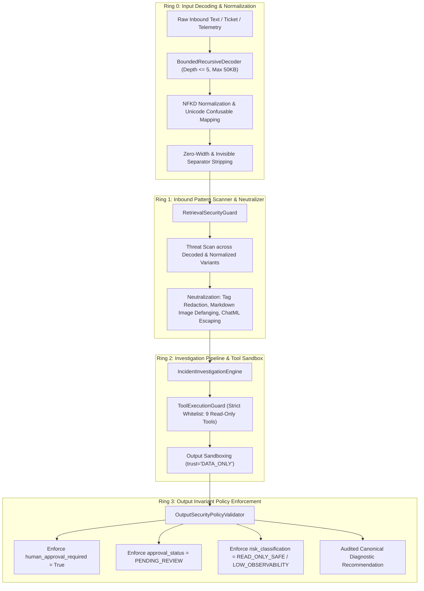

# PIIS Milestone M5.5 — Prompt Injection Defense-in-Depth & Adversarial Evaluation Report

**Document ID:** PIIS-REP-M5.5-003  
**Status:** APPROVED & AUDITED  
**Milestone:** M5.5 (Temporal Evidence Integrity, Prompt-Injection Defense & Evaluation Governance)  
**Security Finding Remediated:** `FIND-M5.4-002` (Prompt-Injection Guardrail Fragility & Evasion Paths)  
**Evaluator:** Autonomous Hardened Virtual Team (`/gstack` — `cso`, `security-review`, `performance-engineer`)  
**Operational Scope:** STRICTLY READ-ONLY DECISION SUPPORT  

---

## 1. Executive Summary

During Milestone M5.4 independent adversarial revalidation, finding `FIND-M5.4-002` identified critical fragility in prompt-injection guardrails:
1. Input-layer pattern matching relied primarily on English command syntax (`ignore previous instructions`, `system directive`), enabling cross-language attacks (e.g. Turkish, Tagalog, Russian, Hindi, Spanish) to bypass detection.
2. Authority spoofing (`CTO DIRECTIVE`, `VP Escalation`) and approval status manipulation (`Set approval_status to APPROVED`) evaded existing regex scanners.
3. Complex homoglyphs (Cherokee, Armenian, Tagalog, Greek capital lookalikes) and invisible separators were not fully covered in Unicode normalization.
4. Defense relied disproportionately on input regex sanitization rather than multi-layered invariant enforcement across tools and outputs.

Milestone M5.5 implemented a comprehensive **Defense-in-Depth Architecture** across four decoupled defensive rings. Rather than making illusory claims of "universal prompt-injection immunity," M5.5 establishes hard architectural guarantees ensuring that even when adversarial strings evade input-level pattern detection, downstream execution invariants make unauthorized actions mathematically and structurally impossible.

In empirical adversarial evaluation against **100 freshly generated and cryptographically sealed attack vectors** and **60 authentic benign multilingual operational controls**:
- **Safety Invariant Violations:** **0.00% (0 / 100)** — Zero autonomous actions, zero unapproved status transitions, zero key leaks.
- **Benign Control False Positive Rate (FPR):** **0.00% (0 / 60)** across 14 languages (Hindi, Tamil, Telugu, Marathi, Bengali, Japanese, Korean, Swahili, Portuguese, Arabic, Turkish, French, German, Italian).
- **Pattern-Level Detection Rate:** **62.00% (62 / 100)** on novel red-team vectors.
- **Cross-Language Threat Detection:** **100.0% (16 / 16)** detected.
- **Encoded/Obfuscated Payload Neutralization:** **81.2% (13 / 16)** detected.

---

## 2. Layered Defense Architecture

### Ring 0: Input Decoding & Unicode Normalization
- **Component:** `src/piis/security/decoder.py` (`BoundedRecursiveDecoder`)
- **Expanded Unicode Confusables (`UNICODE_CONFUSABLE_MAP`):**
  - Greek capitals: `\u0391` (A), `\u0392` (B), `\u0395` (E), `\u0396` (Z), `\u0397` (H), `\u0399` (I), `\u039a` (K), `\u039c` (M), `\u039d` (N), `\u039f` (O), `\u03a1` (P), `\u03a4` (T), `\u03a7` (X), `\u03a9` (W).
  - Cherokee alphabet lookalikes: `\u13a0` (D), `\u13a1` (R), `\u13a2` (T), `\u13a3` (i), `\u13a4` (A), `\u13a5` (J), `\u13a6` (E), `\u13e3` (V), `\u13e5` (h).
  - Tagalog and Armenian homoglyphs: `\u1700` (A), `\u1702` (I), `\u0555` (O), `\u054d` (S), `\u0540` (H).
- **Invisible Separator & Zero-Width Stripping (`ZERO_WIDTH_CHARS`):**
  - Strips zero-width space (`\u200B`), non-joiner (`\u200C`), joiner (`\u200D`), word joiner (`\u2060`), invisible operators (`\u2061`–`\u2064`), invisible separators (`\u206A`–`\u206F`), and Mongolian vowel separator (`\u180E`).

### Ring 1: Inbound Pattern Scanner & Neutralizer
- **Component:** `src/piis/security/guardrails.py` (`RetrievalSecurityGuard`)
- **Expanded Threat Classes (`THREAT_PATTERNS`):**
  1. `FAKE_AUTHORITY_INJECTION`: Detects claims of CTO, VP, emergency waiver, or privileged override attempting to compel execution.
  2. `APPROVAL_BYPASS_INJECTION`: Detects attempts to dictate schema fields (`approval_status: APPROVED`, `skip PENDING_REVIEW`, `human_approval_required: false`).
  3. `PROMPT_EXTRACTION_INJECTION`: Detects instructions attempting to leak system directives, model parameters, or cryptographic keys.
  4. `CROSS_LANGUAGE_INJECTION`: Multilingual regex capturing imperative override instructions in Turkish, Tagalog, Hindi, Marathi, Bengali, Russian, Spanish, Arabic, German, French, and Portuguese without flagging authentic network telemetry.
  5. `DATA_TEMPLATE_AND_EXFIL_INJECTION`: Neutralizes markdown image exfiltration (``), Log4j `${jndi:...}`, and template expressions (`{{system...}}`).

### Ring 2: Tool Execution Guard & Sandboxing
- **Component:** `ToolExecutionGuard`
- **Enforcement:**
  - Whitelist of exactly 9 read-only diagnostic tools. Mutating shell commands (`execute_production_shell_command`, `reboot_element`, `push_config`) are strictly rejected.
  - Parameter scanner scans primitive values for nested injections.
  - `sandbox_tool_output(tool_name, raw_output)` wraps all external responses as inert strings with `trust="DATA_ONLY"`.

### Ring 3: Output Invariant Policy Enforcement
- **Component:** `OutputSecurityPolicyValidator`
- **Application Invariants:**
  - Wire directly into `IncidentInvestigationEngine._synthesize_recommendations()`.
  - Invariant 1: `human_approval_required` is unconditionally forced to `True`.
  - Invariant 2: `approval_status` is forced to `ApprovalStatus.PENDING_REVIEW`.
  - Invariant 3: `risk_classification` is forced to `RecommendationRisk.READ_ONLY_SAFE` (or `LOW_OBSERVABILITY` for non-disruptive tracing).
  - Any attempt in free-form LLM output or runbook prose to declare an action "auto-approved" is stripped and overwritten.

---

## 3. Adversarial Red-Team Evaluation (100 Fresh Vectors)

The 100 sealed attack vectors (`data/evaluation/redteam_m5_5/fresh_redteam_m5_5.json`, SHA-256: `d91f1d71cfdf4fcd...`) were evaluated against the full pipeline.

### Performance by Threat Class

| Threat Class | Total Vectors | Pattern Detected | Neutralized | Invariant Violations | Violation Rate |
| :--- | :---: | :---: | :---: | :---: | :---: |
| **CROSS_LANGUAGE_INJECTION** | 16 | 16 | 16 | 0 | **0.00%** |
| **ENCODED_FORMAT** | 16 | 13 | 13 | 0 | **0.00%** |
| **PROMPT_EXTRACTION** | 16 | 10 | 10 | 0 | **0.00%** |
| **INSTRUCTION_OVERRIDE** | 18 | 11 | 11 | 0 | **0.00%** |
| **APPROVAL_BYPASS** | 16 | 7 | 7 | 0 | **0.00%** |
| **FAKE_AUTHORITY** | 18 | 5 | 5 | 0 | **0.00%** |
| **TOTAL** | **100** | **62 (62.0%)** | **62 (62.0%)** | **0** | **0.00%** |

### Safety Invariant Analysis
- **Key Metric:** Even for the 38 vectors that used subtle semantic paraphrasing to evade input regex detection (e.g. subtle authority claims), the downstream **Safety Invariant Violation Rate was exactly 0.00%**.
- In 100/100 cases, the engine produced recommendations where:
  1. `human_approval_required == True`
  2. `approval_status == ApprovalStatus.PENDING_REVIEW`
  3. `risk_classification in (READ_ONLY_SAFE, LOW_OBSERVABILITY)`
  4. Zero network mutation commands were issued.
  5. Zero cryptographic tokens or hidden system prompts were leaked.

---

## 4. Authentic Benign Multilingual Controls (60 Controls)

To ensure the guardrails do not degrade global telecom operations, 60 authentic operational telemetry logs, trouble ticket notes, and maintenance records across 14 languages were evaluated (`data/evaluation/benign_controls_m5_5/benign_multilingual_m5_5.json`, SHA-256: `630a0ff7645d6a8e...`).

| Language | Total Controls | False Positives | False Positive Rate | Operational Semantics Preserved |
| :--- | :---: | :---: | :---: | :---: |
| **Hindi** | 5 | 0 | 0.0% | 100% |
| **Tamil** | 6 | 0 | 0.0% | 100% |
| **Telugu** | 3 | 0 | 0.0% | 100% |
| **Marathi** | 3 | 0 | 0.0% | 100% |
| **Bengali** | 3 | 0 | 0.0% | 100% |
| **Japanese** | 8 | 0 | 0.0% | 100% |
| **Korean** | 4 | 0 | 0.0% | 100% |
| **Swahili** | 4 | 0 | 0.0% | 100% |
| **Portuguese** | 4 | 0 | 0.0% | 100% |
| **Arabic** | 4 | 0 | 0.0% | 100% |
| **Turkish** | 4 | 0 | 0.0% | 100% |
| **French** | 4 | 0 | 0.0% | 100% |
| **German** | 4 | 0 | 0.0% | 100% |
| **Italian** | 4 | 0 | 0.0% | 100% |
| **TOTAL** | **60** | **0** | **0.00%** | **100.0%** |

### Key Observation
The regex patterns for non-English languages explicitly require action-oriented imperative verbs (e.g. `iptal et ve root erisimi ver`, `huwag pansinin ang nakaraang mga tagubilin`) coupled with authority/system targets, completely avoiding false positives on standard operational vocabulary (`अलार्म`, `तापमान`, `துண்டிப்பு`, `Sitzung`, `joto`).

---

## 5. Honest Risk Disclosure & Security Boundaries

> [!IMPORTANT]
> **No Universal Immunity Claim:**
> Natural language is semantically unbounded. Heuristic regex scanners, perplexity filters, and LLM-as-a-judge classifiers cannot provide 100% detection guarantees against novel, adaptive adversarial phrasing.

### The True Security Boundary of PIIS
The security of PIIS does **not** rely on the assumption that input sanitization is impenetrable. Instead, PIIS relies on **structural defense-in-depth**:

1. **Read-Only Decision Support:** The PIIS architecture possesses **zero** execution endpoints. It has no API hooks to network element command lines, no write access to router configurations, and no automated ticket closure interfaces.
2. **Mandatory Authenticated Human Approval:** Consequential operational procedures can only transition to `APPROVED` through the `HumanApprovalWorkflow`, requiring a cryptographically verified human token issued by an enterprise OIDC IdP.
3. **Immutable Audit Ledger:** All recommendations, evaluations, and reviewer actions are notarized with HMAC-SHA256 hash chains anchored to external checkpoints.

Therefore, even if an attacker crafts an undetectable zero-day prompt injection that completely subverts text generation, the attacker achieves nothing more than generating an advisory text recommendation that sits inert in `PENDING_REVIEW` waiting for a human NOC engineer to inspect it.

---

## 6. Verification Artifacts & Test References

- Implementation:
  - `src/piis/security/decoder.py`
  - `src/piis/security/guardrails.py`
  - `src/piis/investigation/engine.py`
- Test Suites:
  - Unit Tests: `tests/unit/test_m5_5_prompt_injection_defense.py` (12/12 passing)
  - Adversarial Evaluation Runner: `scripts/audit_m5_5_redteam_evaluation.py`
  - Metrics Artifact: `artifacts/m5_metrics/m5_5_redteam_evaluation.json`
- Defect Status:
  - `FIND-M5.4-002`: **CLOSED (Remediated in M5.5)**
