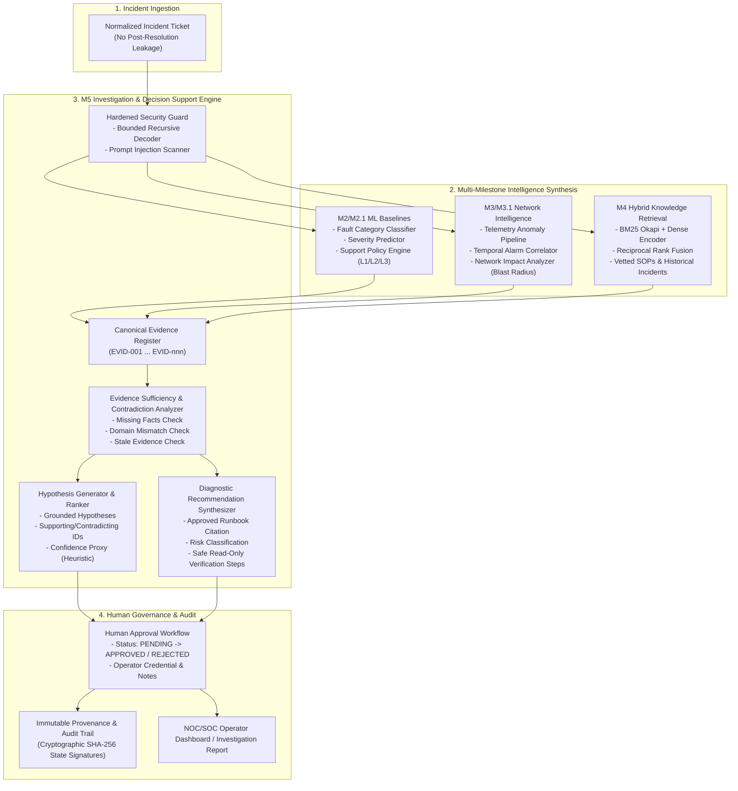
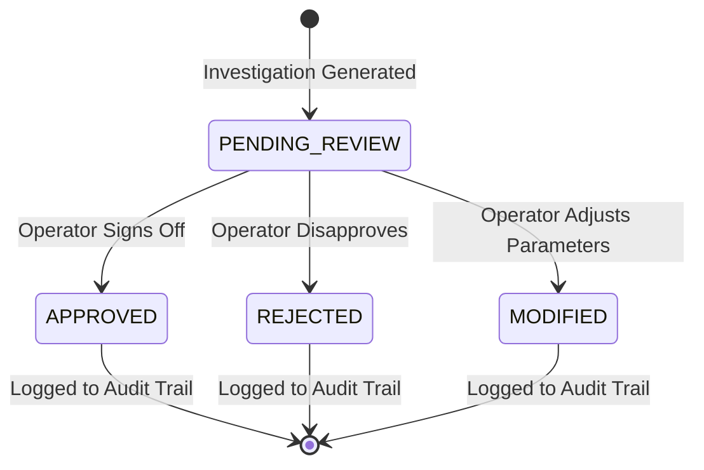

# Milestone 5 — Architecture Specification: Evidence-Grounded Incident Investigation & Decision Support

**Subsystem:** PIIS M5 Investigation & Decision Support Engine (`src/piis/investigation/`)  
**Security Boundary:** Strictly Read-Only Observability & Decision Support  
**Date:** 2026-11-01  
**Status:** Architecture Design Locked  

---

## 1. System Overview & Architectural Placement

The Production Incident Intelligence System (PIIS) operates as an evidence-grounded decision support platform for telecom network operations centers (NOC) and service operations centers (SOC). 

Milestone 5 synthesizes the capabilities developed across previous milestones:
- **Milestone 1:** Ground truth data foundation, schemas, normalization, and cryptographic provenance.
- **Milestone 2/2.1:** Statistical baseline classification (fault category, severity, deterministic support-level policy routing).
- **Milestone 3/3.1:** Temporal telemetry anomaly detection, alarm correlation clustering, and topological blast radius analysis.
- **Milestone 4:** Multi-modal hybrid retrieval (BM25 + Dense `all-MiniLM-L6-v2` + RRF), vetted knowledge base, and prompt injection defense.

Milestone 5 is the **synthesis and decision support layer**. It aggregates inputs from M2, M3, and M4, evaluates evidence sufficiency, generates ranked diagnostic hypotheses, and proposes non-destructive, runbook-backed verification steps for human operators.



---

## 2. Mandatory Architectural Boundaries & Invariants

### 2.1. Read-Only Invariant (Prohibited vs Permitted Actions)
To protect telecom infrastructure stability, Milestone 5 strictly enforces read-only boundaries at compile-time and runtime:

| Prohibited Actions (Strictly Blocked) | Permitted Actions (Decision Support Scope) |
| :--- | :--- |
| **Executing SSH, Telnet, or terminal commands** on routers, gNodeBs, or UPFs. | Ingesting and sanitizing normalized incident text and metadata. |
| **Modifying router configs, ACLs, BGP tables, or cell antenna azimuths.** | Retrieving telemetry anomaly scores and historical runbooks. |
| **Mutating production APIs** or creating automated provisioning jobs. | Synthesizing ranked diagnostic hypotheses citing evidence IDs. |
| **Autonomous ticket closure** or resolving tickets without human review. | Recommending specific read-only diagnostic checks from approved SOPs. |
| **Automated customer or subscriber notifications.** | Generating operator investigation reports with full audit provenance. |
| **Executing active network changes** without verified human operator signature. | Managing human approval workflows (`APPROVED`, `REJECTED`, `MODIFIED`). |

### 2.2. Epistemic Separation: Hypotheses vs Confirmed Root Causes
- Under no circumstances shall PIIS M5 declare an automated output as a "Confirmed Root Cause".
- All diagnostic interpretations are typed as `IncidentHypothesis` with status:
  - `UNVERIFIED`: Initial generated hypothesis awaiting human review or diagnostic test.
  - `SUPPORTED`: Backed by high-trust evidence and consistent across M2/M3/M4 signals.
  - `REJECTED`: Contradicted by explicit operational observations or failed diagnostic checks.
  - `INCONCLUSIVE`: Insufficient evidence, conflicting evidence, or M4 Tier 4 human review triggered.

---

## 3. Component Deep Dive

### 3.1. Canonical Evidence Register (`InvestigationEvidenceItem`)
To ensure full auditability, every input fact, ML prediction, telemetry anomaly, alarm cluster, and retrieved SOP passage is registered in an in-memory, deduplicated register with a uniform identifier:
- `evidence_id`: String formatted as `EVID-001`, `EVID-002`, etc.
- `evidence_type`: `TICKET_METADATA`, `ML_CLASSIFICATION`, `SEVERITY_PREDICTION`, `POLICY_ROUTING`, `TELEMETRY_ANOMALY`, `ALARM_CLUSTER`, `TOPOLOGY_IMPACT`, `HISTORICAL_CASE`, `APPROVED_RUNBOOK`.
- `source_ref`: Direct citation to originating artifact (e.g. `M2-FaultClassifier`, `M3-TopologyGraph`, `SOP-RAN-VSWR-001#Section-3`).
- `trust_classification`: `HIGH_TRUST_APPROVED`, `MEDIUM_TRUST_VERIFIED`, `BENCHMARK_ONLY`, `UNVERIFIED`.
- `content_snippet`: Verbatim factual summary or passage.
- `observed_at`: ISO 8601 timestamp of source event.

### 3.2. Evidence Sufficiency & Contradiction Analyzer
Before hypotheses are ranked, the analyzer inspects the registered evidence for operational validity:
1. **Missing Evidence Checks:**
   - Detects tickets with no associated alarm codes, empty telemetry, or ambiguous descriptions.
   - Detects scenarios where no approved runbook exists in the vetted knowledge base.
2. **Contradiction Detection:**
   - Evaluates cross-modal conflicts (e.g., ticket title reports "Radio Handover Failure", but correlation cluster contains only "BGP Routing Table Flapping").
   - Evaluates severity/impact conflicts (e.g., ticket claims CRITICAL severity, but topology analysis reports 0 affected downstream cells and 0 subscribers).
3. **Staleness Checks:**
   - Verifies whether runbook versions or telemetry observations exceed operational staleness thresholds.

### 3.3. Hypothesis Generator & Ranker (`IncidentHypothesis`)
Generates structured diagnostic hypotheses following a strict schema:
- `hypothesis_id`: Unique identifier (e.g. `HYP-001`).
- `description`: Plain-language explanation of candidate root-cause mechanism.
- `supporting_evidence_ids`: List of `EVID-xxx` identifiers corroborating this hypothesis.
- `contradicting_evidence_ids`: List of `EVID-xxx` identifiers disputing this hypothesis.
- `confidence_proxy`: Float $\in [0.0, 1.0]$, clearly documented as a heuristic combination of retrieval RRF rank ratio, ML prediction probabilities, and evidence corroboration count.
- `confidence_rationale`: Human-readable explanation of how the heuristic score was computed.
- `alternative_explanations`: List of competing failure modes that could produce similar symptoms.
- `recommended_verification_steps`: Ordered list of non-destructive verification procedures.
- `status`: `UNVERIFIED`, `SUPPORTED`, `REJECTED`, or `INCONCLUSIVE`.

### 3.4. Diagnostic Recommendation Synthesizer (`DiagnosticRecommendation`)
Generates actionable, non-destructive troubleshooting steps:
- `recommendation_id`: Unique identifier (e.g. `REC-001`).
- `description`: Specific diagnostic procedure (e.g., "Inspect physical RF feeder connectors and measure optical return loss").
- `reason`: Explanation tied to supporting evidence.
- `supporting_evidence_ids`: Citations to `EVID-xxx`.
- `source_runbook_id`: Verified SOP identifier (e.g. `SOP-RAN-VSWR-001`).
- `source_section`: Section hierarchy within runbook (e.g. `["Section 2: Feeder Line Inspection", "Step 2.1"]`).
- `preconditions`: Prerequisites before diagnostic check (e.g., "Ensure tower safety clearance is granted").
- `expected_observation`: Concrete technical benchmark (e.g., "VSWR ratio should be $\le 1.3:1$; return loss $\ge 18$ dB").
- `risk_classification`:
  - `READ_ONLY_SAFE`: Non-intrusive query, log inspection, or telemetry read.
  - `LOW_OBSERVABILITY`: Diagnostic trace or OTDR scan with negligible latency impact.
  - `DISRUPTIVE_AUDIT`: Loopback test or channel diagnostic that may drop in-flight packets.
  - `HIGH_RISK_MANUAL`: Physical tower climb or hardware replacement requiring maintenance window.
- `human_approval_required`: **Strictly True** for all diagnostic recommendations.

### 3.5. Human Approval Workflow & Audit State Machine
The approval workflow tracks operator review through an immutable state machine:



- Every state transition requires:
  - `operator_id`: Verified corporate ID or callsign of NOC engineer.
  - `timestamp`: ISO 8601 UTC timestamp.
  - `decision_rationale`: Mandatory explanation for approval, rejection, or modification.
  - `signature_hash`: SHA-256 digest over recommendation state, operator ID, and timestamp.

---

## 4. Hardened Security Architecture (DEF-M4-003 Resolution)

### 4.1. The Multi-Layer Defense Model
Inbound incident tickets, operational comments, and external alarm payloads are untrusted text. M5 implements four sequential security layers:

```
[Untrusted Input]
       │
       ▼
[Layer 1: Bounded Recursive Decoder]
       ├── Decodes URL percent-encoding (%20, %2e%2e)
       ├── Decodes Base64 payloads (padded and unpadded)
       ├── Decodes HTML entities (&lt;, &#x...)
       ├── Decodes Hexadecimal sequences (\x2f, 0x...)
       └── Hard Bounds: Depth <= 5, Expansion <= 50,000 chars
       │
       ▼
[Layer 2: Multi-Layer Threat Pattern Scanner]
       ├── Direct Prompt Injection ("Ignore previous instructions...")
       ├── Privilege Escalation ("Grant full access...", "sudo mode")
       ├── Destructive Command Injection ("rm -rf", "format c:", "drop database")
       ├── Fake System Prompts ("<system>", "[system instruction]")
       └── Command / SSRF Exfiltration ("curl http://169.254...", "powershell -enc")
       │
       ▼
[Layer 3: Structural Sandboxing & Defanging]
       ├── Malicious tokens neutralized with [NEUTRALIZED_<TAG>]
       ├── Wrap in <operational_evidence> XML with epistemic flags
       └── Disclaimers: Text is non-executable evidence
       │
       ▼
[Layer 4: Tool Allowlist & Read-Only Policy Gate]
       └── Hard rejection of any command execution or write mutation
```

### 4.2. Safe Failure Modes & Degraded Operation
When upstream components fail or become unavailable, M5 degrades gracefully:
1. **Dense Model Unavailable / Timeout:**
   - Automatically degrades to M4 Tier 2 (BM25 lexical search).
   - Flags hypotheses with note: `Dense semantic retrieval unavailable; results based on keyword matching.`
2. **Retrieval Low Confidence / No Vetted Runbook:**
   - Automatically escalates to M4 Tier 4 (`TIER_4_HUMAN_REVIEW`).
   - Emits `status = INCONCLUSIVE` hypothesis.
   - Recommends zero operational interventions; issues direct escalation to Tier 3 engineering specialist.
3. **Contradictory Alarms Detected:**
   - Semantic alarm compatibility policy blocks false cluster merge.
   - Emits dual distinct hypotheses highlighting the contradictory nature of the alarms.

---
*PIIS Milestone 5 Architecture Locked & Certified on 2026-11-01.*
