# PIIS M5 Final Evaluation Governance & Cryptographic Integrity Architecture

> **Milestone Status**: M5 FINAL CONSOLIDATED REMEDIATION  
> **Governance Authority**: Telecom AI Safety & Security Review Board  
> **Cryptographic Standard**: RFC 8785 Canonical JSON (JCS) + SHA-256 Manifest Binding  
> **Trust Boundary Enforcement**: Pluggable Enterprise Providers with Fail-Closed Production Gate  

---

## 1. Executive Overview & Governance Principles

The integrity of AI decision-support evaluation depends entirely on **evaluation governance**: ensuring that benchmarks reflect genuine out-of-sample operational generalization rather than iterative test-set overfitting or ambient developer tampering.

Milestone M5 established an immutable evaluation governance framework that resolves the deficiencies identified in M5.4 and M5.5.1:
1. **Separation of Evaluation Datasets**: Strict classification and physical directory separation between development corpora, historical regressions, and sealed holdout benchmarks.
2. **Elimination of Ambient Authority & Hardcoded Secrets**: Removal of all static cryptographic keys from source code, replacing them with structured provider interfaces.
3. **Enterprise Trust Boundaries**: Formal integration abstractions for Cloud KMS (AWS KMS, Azure Key Vault), RFC 3161 Timestamp Authorities (TSA), and Write-Once-Read-Many (WORM) storage.
4. **Fail-Closed Production Safety**: Hard runtime constraints that prohibit development fallbacks and unauthenticated ambient authority in production deployments.

---

## 2. Dataset Classification & Contamination History

### Classification Taxonomy
To prevent data leakage and benchmark contamination, evaluation artifacts are categorized into five mutually exclusive tiers:

| Dataset Classification | Purpose & Access Boundary | Lifecycle Rule | Storage Path |
| :--- | :--- | :--- | :--- |
| **`SEALED_HOLDOUT`** | Cryptographically sealed operational scenarios reserved exclusively for independent verification. | Strictly untouched; zero developer access prior to audit execution. | `data/evaluation/blind_holdout_m5_5_1/` |
| **`FRESH_REDTEAM`** | Adversarial prompt-injection and evasion payloads evaluated in single-pass audits. | Periodically rotated; never included in unit test suites. | `data/evaluation/blind_redteam_m5_5_1/` |
| **`BENIGN_CONTROLS`** | Multilingual operational incident tickets (Spanish, French, German, Turkish, Japanese, Portuguese). | Ground truth validation for false-positive avoidance. | `data/evaluation/benign_controls_m5_5/` |
| **`EXPOSED_HOLDOUT`** | Historical holdouts that suffered iterative exposure during engineering runs. | Permanently demoted from evaluation gates; archived for regression analysis. | `data/evaluation/archived_contaminated_m5_5/` |
| **`REGRESSION_CORPUS`** | Known incident scenarios and fixed defect reproductions used for daily continuous integration. | Open access; continuously executed in unit tests. | `tests/unit/` & `data/test_cases/` |

### Evaluation History, Contamination Chronology & Reconciled Classifications

The project maintains an uncompromised historical ledger of evaluation runs, explicitly classifying the nature of each result:

1. **M5.5 Initial Holdout (Contaminated — `EXPOSED_HOLDOUT`)**:
   - *History*: During the initial M5.5 run, four scenarios in the 25-case holdout failed (`SEALED-03`, `SEALED-13`, `SEALED-15`, `SEALED-23`). Implementation engineers inspected failure logs and modified `engine.py` and `guardrails.py` before rerunning to claim a 100% pass rate.
   - *Governance Action*: The M5.5.1 audit identified this test-set exposure. The entire 25-case dataset was permanently reclassified as **`EXPOSED_HOLDOUT`** and moved to `data/evaluation/archived_contaminated_m5_5/`. It is prohibited from serving as generalization evidence.

2. **M5.5.1 Blind Holdout Baseline (`HISTORICAL_BASELINE`)**:
   - *History*: To establish genuine out-of-sample performance, an independent 30-case dataset was created in `data/evaluation/blind_holdout_m5_5_1/` and evaluated in a strictly single-pass audit without code modifications.
   - *Result*: Achieved **26 / 30 (86.7%)** pass rate with 0 safety invariant violations.
   - *Classification*: Preserved as **`HISTORICAL_BASELINE`** evidence in `artifacts/m5_metrics/m5_5_1_blind_evaluation.json`.

3. **M5 Final Remediation Evaluation (`REMEDIATION_REGRESSION_EVALUATION`)**:
   - *History*: During the final engineering closure sprint, code was modified to resolve query construction defects (`engine.py`) and regex guardrail omissions (`guardrails.py`), and the 30-case evaluation was rerun.
   - *Result*: Achieved **27 / 30 (90.0%)** with 0 safety invariant violations.
   - *Governance Classification*: Classified strictly as **`REMEDIATION_REGRESSION_EVALUATION`**. Because implementation code was modified with knowledge of earlier scenario patterns, this result **must not be described as an untouched independent blind validation**. It confirms that bug fixes resolved specific defects without regressing safety invariants.

---

## 3. Cryptographic Sealing Protocol

All evaluation datasets and results are sealed using RFC 8785 Canonical JSON (JCS) and SHA-256 cryptographic digests:

```
[Dataset Records] -> [RFC 8785 Canonical JCS] -> [SHA-256 Hash]
                                                       |
[Manifest Metadata] -----------------------------------+
        |
[RFC 8785 Canonical JCS] -> [HMAC-SHA256 with Managed Key] -> [MANIFEST.json]
```

### 1. RFC 8785 Canonical Serialization
Serialization follows strict canonical rules:
- **Lexicographical Key Sorting**: Object keys sorted by UTF-16 code units.
- **Literal UTF-8 Representation**: Code points $\ge$ U+0020 emitted directly as UTF-8 bytes (no `\uXXXX` escaping for non-ASCII text).
- **Whitespace Elimination**: Zero superfluous whitespace (`separators=(',', ':')`).
- **IEEE 754 Floating-Point Normalization**: Negative zero (`-0.0`) normalized to `0`; integer values formatted without trailing decimals (`1.0` $\to$ `1`).

### 2. Manifest Verification Flow
Before any evaluation script executes a single scenario:
1. It computes the SHA-256 digest of the dataset file on disk.
2. It verifies that this digest matches the `data_file_sha256` recorded in `MANIFEST.json`.
3. It validates that the record count matches the manifest assertion.
4. If any mismatch or tampering is detected, the runner **halts execution immediately**.

---

## 4. Trust Boundary Architecture (`src/piis/audit/trust_boundary.py`)

In M5.5.1, an audit finding (`GOV-M5.5-001`) highlighted that evaluation sealing relied on an ambient authority model with a hardcoded symmetrical secret (`b"piis_m5_5_eval_governance_seal_key_32b!"`).

In this final remediation sprint, that defect was completely eradicated by creating [`src/piis/audit/trust_boundary.py`](file:///c:/Production%20level%20projects/PIIS/src/piis/audit/trust_boundary.py), which defines clean enterprise provider abstractions:

```mermaid
classDiagram
    class SigningKeyProvider {
        <<interface>>
        +get_signing_key() bytes
        +get_key_id() str
        +rotate_key() Tuple~str, bytes~
    }
    class LocalDevKeyProvider {
        -bytes _key_material
        -str _key_id
        +rotate_key()
    }
    class ExternalKMSProvider {
        -str _key_arn
        -str _region
        +rotate_key()
    }
    SigningKeyProvider <|-- LocalDevKeyProvider
    SigningKeyProvider <|-- ExternalKMSProvider

    class TimestampAuthorityProvider {
        <<interface>>
        +generate_timestamp_token(data_hash) Dict
        +verify_timestamp_token(token, data_hash) bool
    }
    class LocalDevTimestampProvider {
        +generate_timestamp_token()
        +verify_timestamp_token()
    }
    class RFC3161TimestampProvider {
        -str _tsa_url
        +generate_timestamp_token()
        +verify_timestamp_token()
    }
    TimestampAuthorityProvider <|-- LocalDevTimestampProvider
    TimestampAuthorityProvider <|-- RFC3161TimestampProvider

    class WORMStorageProvider {
        <<interface>>
        +store_immutable_record(key, data, retention_days) Dict
        +verify_immutability(key) Dict
    }
    class LocalDevWORMProvider {
        +store_immutable_record()
        +verify_immutability()
    }
    class ExternalS3ObjectLockProvider {
        -str _bucket_name
        +store_immutable_record()
        +verify_immutability()
    }
    WORMStorageProvider <|-- LocalDevWORMProvider
    WORMStorageProvider <|-- ExternalS3ObjectLockProvider

    class TrustBoundaryManager {
        -TrustBoundaryConfig config
        +SigningKeyProvider key_provider
        +TimestampAuthorityProvider tsa_provider
        +WORMStorageProvider worm_provider
        +notarize_evaluation_manifest(manifest_jcs) Dict
    }
```



### Provider Responsibilities & Enforcement

1. **`SigningKeyProvider`**:
   - `LocalDevKeyProvider`: Used for unit testing and local development. Issues explicit `UserWarning` regarding non-production status. Supports key rotation via `rotate_key()`. Automatically raises `ProductionTrustViolationError` if `PIIS_ENVIRONMENT=production`.
   - `ExternalKMSProvider`: Connects to AWS KMS, Azure Key Vault, or HashiCorp Vault. In production, validates that KMS Key ARNs are non-test ARNs.
2. **`TimestampAuthorityProvider`**:
   - `LocalDevTimestampProvider`: Generates local HMAC-backed tokens for offline testing. Fails closed in production.
   - `RFC3161TimestampProvider`: Generates RFC 3161 ASN.1 TimeStampResp tokens over HTTPS. Fails closed in production if insecure HTTP is configured.
3. **`WORMStorageProvider`**:
   - `LocalDevWORMProvider`: Simulates immutable append-only memory/file storage; prevents key overwrite. Fails closed in production.
   - `ExternalS3ObjectLockProvider`: Targets AWS S3 Object Lock in `COMPLIANCE` retention mode with explicit retention windows.
4. **`TrustBoundaryManager`**:
   - Central orchestration facade that inspects `PIIS_ENVIRONMENT`.
   - In production, mandates that KMS Key ARN, RFC 3161 TSA URL, and S3 Object Lock bucket are explicitly configured, failing closed if any are missing.

---

## 5. Separation of Local Development and Production Prerequisites

| Capability | Local Development & CI Tier | Production Deployment Tier (Enterprise Prerequisite) |
| :--- | :--- | :--- |
| **Key Management** | `LocalDevKeyProvider` (256-bit ephemeral or `PIIS_AUDIT_HMAC_KEY`) | `ExternalKMSProvider` backed by HSM / Cloud KMS (AWS KMS ARN / Azure KV) |
| **Timestamping** | `LocalDevTimestampProvider` (Local ISO-8601 + HMAC token) | `RFC3161TimestampProvider` backed by accredited RFC 3161 TSA (DigiCert / Sectigo) |
| **Audit Storage** | `LocalDevWORMProvider` & `FileBasedCheckpointAnchor` | `ExternalS3ObjectLockProvider` with S3 Object Lock Compliance Mode |
| **Identity Provider** | `IsolatedTestTokenVerifier` (Local asymmetric key-pairs) | `ProductionOIDCVerifier` connected to Corporate Okta / Entra ID with JWKS caching |
| **Runtime Boundary** | Allows non-production warnings | Strict Fail-Closed (`ProductionTrustViolationError` halts initialization) |

---

## 6. Verification & Canonical Governance Status

The evaluation governance architecture was tested and verified:
- `tests/unit/test_trust_boundary.py`: **7 / 7 PASSED** (validating key lifecycle, rotation, RFC 3161 tokens, WORM immutability, and production fail-closed behavior).
- `scripts/generate_m5_5_evaluation_governance.py`: Hardcoded secret constant removed; wired cleanly into `LocalDevKeyProvider`.
- Source tree integrity verified and frozen.

> [!IMPORTANT]
> **Enterprise Dependency Status**: While provider interfaces and fail-closed runtime boundaries are implemented and tested in code, live corporate external services (Corporate OIDC IdP, AWS KMS / Azure KV, RFC 3161 TSA, S3 Object Lock) remain **unprovisioned external prerequisites** (`DEP-M5.3-001`, `DEP-M5.3-002`, `DEP-M5.5.1-001`). Production pilot deployment remains strictly **BLOCKED**.

```json
{
  "governance_status": "VERIFIED_COMPLIANT",
  "hardcoded_secrets_count": 0,
  "production_fail_closed": true,
  "rfc8785_jcs_verified": true,
  "trust_boundary_tests_passing": "7/7",
  "external_enterprise_dependencies": "OPEN_UNPROVISIONED",
  "production_pilot": "BLOCKED"
}
```
}
```
