# Milestone 5 — Implementation Plan: Evidence-Grounded Incident Investigation & Decision Support

**Milestone:** PIIS M5  
**Title:** Evidence-Grounded Incident Investigation and Decision Support  
**Safety Classification:** Strictly Read-Only Decision Support / Zero Autonomous Production Mutation  
**Date:** 2026-11-01  
**Status:** Approved for Implementation  

---

## 1. Executive Summary & Architectural Scope

Milestone 5 synthesizes the machine learning intelligence (M2/M2.1), temporal network telemetry and topology intelligence (M3/M3.1), and historical hybrid knowledge retrieval (M4) of the Production Incident Intelligence System (PIIS) into an integrated, **operator-facing incident investigation and decision support engine**.

### 1.1. Core Architectural Mandate
- **Read-Only Invariant:** PIIS M5 is strictly a decision-support and observability system. It is **PROHIBITED** from executing SSH/CLI commands on live network elements, modifying configurations, triggering automated ticket closures, or mutating external production APIs.
- **Evidence Before Intelligence:** Every diagnostic hypothesis and recommendation must cite specific, cryptographically traceable evidence IDs (`EVID-xxx`).
- **No Hallucinated Procedures:** Recommendations must strictly reference approved standard operating procedures (SOPs) or technical specifications from the verified knowledge base.
- **Human in the Loop:** Any consequential diagnostic verification requires explicit human approval via the `HumanApprovalWorkflow`.
- **Safe Abstention:** When evidence is missing, contradictory, or below safety thresholds (M4 Tier 4 Human Review), the system must explicitly abstain and declare an `INCONCLUSIVE` hypothesis rather than speculating.

---

## 2. Carried-Forward M4 Defects & Remediations

```
+----------------------------------------------------------------------------------------------------+
|                                    CARRIED-FORWARD M4 DEFECTS                                      |
+------------+----------+-------------------------------------------------------+--------------------+
| Defect ID  | Severity | Finding & Root Cause                                  | M5 Action Required |
+------------+----------+-------------------------------------------------------+--------------------+
| DEF-M4-001 | MEDIUM   | Paraphrase-Family Leakage Across Benchmark Splits      | Full Denominator   |
|            |          | 12 document families crossed Dev/Val/Test in M4.      | Reconciliation &   |
|            |          | Grouped evaluation had 47 total / 39 valid queries.   | Exclusion Ledger   |
| DEF-M4-002 | LOW      | Overclaiming Heuristic Score as Calibrated Probability| Rename to          |
|            |          | Labeled 'calibrated_confidence' but was an empirical  | 'confidence_proxy' |
|            |          | RRF saturation formula.                               | across all schemas |
| DEF-M4-003 | LOW      | Lack of Recursive Base64/URL Decoding in Guardrails    | Implement Bounded  |
|            |          | Regexes missed encoded payloads in raw text.          | Recursive Decoder  |
|            |          | Inert in M4, but critical for M5 text processing.     | in Security Guard  |
+------------+----------+-------------------------------------------------------+--------------------+
```

---

## 3. Sub-Milestone Phasing & Work Breakdown

```mermaid
flowchart TD
    subgraph Phase1["Phase 1: Remediation of Carried-Forward Defects"]
        D1["DEF-M4-001: Denominator Reconciliation Ledger"]
        D2["DEF-M4-002: Refactor to confidence_proxy"]
        D3["DEF-M4-003: Bounded Recursive Decoder & Tests"]
    end

    subgraph Phase2["Phase 2: M5 Data Contracts & Schemas"]
        S1["Hypothesis Schema (IncidentHypothesis)"]
        S2["Recommendation Schema (DiagnosticRecommendation)"]
        S3["Evidence Register Schema (InvestigationEvidenceItem)"]
        S4["Investigation Context & Report Schemas"]
    end

    subgraph Phase3["Phase 3: Core Investigation Engine"]
        E1["Evidence Aggregator (M2 + M3 + M4)"]
        E2["Evidence Sufficiency & Contradiction Analyzer"]
        E3["Hypothesis Generator & Ranker"]
        E4["Grounded Recommendation Synthesizer"]
        E5["Tier 4 Safe Abstention Handler"]
    end

    subgraph Phase4["Phase 4: Human Approval & Audit Provenance"]
        A1["HumanApprovalWorkflow State Machine"]
        A2["Cryptographic Audit Trail & Action Ledger"]
    end

    subgraph Phase5["Phase 5: Evaluation & Verification"]
        T1["Unit & Integration Tests (Target: 110+ passing)"]
        T2["Adversarial Prompt & Payload Injection Tests"]
        T3["Scenario Evaluation Harness (evaluate_investigation.py)"]
        T4["Ruff Clean & Regression Verification"]
        T5["M5 Completion Report"]
    end

    Phase1 --> Phase2 --> Phase3 --> Phase4 --> Phase5
```



---

## 4. Sub-Milestone Specifications

### Sub-Milestone 5.1: Defect Remediation & Security Hardening
- **Deliverable 1:** `docs/research/M5_BENCHMARK_DENOMINATOR_RECONCILIATION.md` detailing the 47-query, 39-query, and 32-query denominators, with a query-by-query exclusion ledger.
- **Deliverable 2:** Update `src/piis/retrieval/contracts.py`, `fusion.py`, `engine.py` to establish `confidence_proxy: float` as primary field with `calibrated_confidence` backwards-compatible alias.
- **Deliverable 3:** Implement `src/piis/security/decoder.py` (`BoundedRecursiveDecoder`):
  - Maximum recursion depth limit ($d_{\max} = 5$).
  - Maximum output byte length limit ($L_{\max} = 50,000$ characters).
  - Handles URL percent-encoding, Base64 (padded and unpadded), HTML entities, and hexadecimal strings.
  - Returns decoded layers and intermediate inspection traces without unhandled exceptions on malformed input.
- **Deliverable 4:** Integrate recursive decoder into `RetrievalSecurityGuard.scan_content` and add unit tests in `tests/unit/test_bounded_decoder.py`.

### Sub-Milestone 5.2: Contracts and Schemas
- **Deliverable:** `src/piis/investigation/schemas.py`:
  - `InvestigationEvidenceItem`: Normalized evidence item with unique `evidence_id`, `evidence_type`, `source_ref`, `observed_at`, `trust_classification`, `content_snippet`, and `metadata`.
  - `IncidentHypothesis`: Hypothesis contract matching Section 4 requirements (`hypothesis_id`, `description`, `supporting_evidence_ids`, `contradicting_evidence_ids`, `confidence_proxy`, `alternative_explanations`, `verification_steps`, `status`).
  - `DiagnosticRecommendation`: Recommendation contract matching Section 4 requirements (`recommendation_id`, `description`, `reason`, `supporting_evidence_ids`, `source_runbook_id`, `source_section`, `preconditions`, `expected_observation`, `risk_classification`, `human_approval_required`).
  - `EvidenceSufficiencyReport`: Assessment of missing, contradictory, stale, or conflicting facts.
  - `InvestigationContext`: Complete structured context holding aggregated evidence, ML predictions, topology impact, hypotheses, and recommendations.
  - `OperatorInvestigationReport`: User-facing markdown and structured report for NOC/SOC operations.

### Sub-Milestone 5.3: Evidence-Grounded Investigation Pipeline
- **Deliverable:** `src/piis/investigation/engine.py` (`IncidentInvestigationEngine`):
  - Ingests normalized incident records (`NormalizedIncident` or dictionary).
  - Queries M2 baselines for predicted fault category, severity, and support routing tier.
  - Queries M3 network intelligence: detects metric anomalies on affected network elements, retrieves correlated alarm clusters, and queries blast radius.
  - Queries M4 hybrid retrieval: searches historical incidents and approved runbooks with confidence gating.
  - Compiles canonical evidence register with zero outcome/resolution leakage.
  - Evaluates evidence sufficiency and identifies contradictions (e.g. alarm incompatible with domain, high severity with zero affected subscribers, or unverified public web sources).
  - Generates ranked hypotheses strictly referencing evidence IDs.
  - Generates diagnostic recommendations strictly citing approved SOP IDs and section names.
  - Implements Tier 4 Abstention: if retrieval confidence is low and no deterministic SOP matches, declares `INCONCLUSIVE` hypothesis and abstains from proposing operational actions.

### Sub-Milestone 5.4: Human Approval Workflow & Audit Trail
- **Deliverable:** `src/piis/investigation/approval.py` (`HumanApprovalWorkflow`):
  - State machine enforcing `PENDING_REVIEW -> APPROVED | REJECTED | MODIFIED`.
  - Prohibits executing or marking diagnostic recommendations as complete without explicit operator credentials.
  - Emits immutable `AuditTrailRecord` with SHA-256 state hashes and operator feedback notes.

### Sub-Milestone 5.5: Evaluation, Adversarial Testing & Completion
- **Deliverable 1:** `tests/unit/test_m5_schemas.py`, `tests/unit/test_m5_investigation.py`, `tests/unit/test_m5_approval.py`, `tests/unit/test_m5_adversarial.py`.
- **Deliverable 2:** `scripts/evaluate_investigation.py`: Scenario evaluation harness assessing:
  - Evidence citation precision (100% of supporting IDs exist in evidence register).
  - SOP citation accuracy (100% of recommendations cite registered runbooks).
  - Unsupported claim rate ($0.0\%$).
  - Negative control and missing evidence abstention ($100\%$).
  - Adversarial prompt injection neutralization.
- **Deliverable 3:** `artifacts/m5_metrics/investigation_evaluation_results.json`.
- **Deliverable 4:** `docs/research/M5_COMPLETION_REPORT.md`.

---

## 5. Acceptance Criteria & Quality Gates

| Gate # | Quality Gate Target | Required Standard |
| :---: | :--- | :--- |
| **QG-1** | Regression Test Suite | $\ge 110$ passing pytest tests; 0 failures; 0 regressions on M1..M4 suites. |
| **QG-2** | Linter & Code Quality | `ruff check src tests scripts` exits with code 0 (All checks passed!). |
| **QG-3** | Evidence Traceability | $100\%$ of generated hypotheses and recommendations cite valid `evidence_id`s. |
| **QG-4** | Zero Hallucinated Runbooks | $100\%$ of recommendations reference verified runbooks in `KnowledgeSourceRegistry`. |
| **QG-5** | Safe Abstention | $100\%$ abstention on negative controls or insufficient evidence scenarios. |
| **QG-6** | Bounded Decoding Safety | Encoded injections (Base64, URL, nested) detected and neutralized; recursion bounded $\le 5$. |
| **QG-7** | Human in the Loop | $100\%$ of diagnostic recommendations enforce `human_approval_required = True`. |

---
*Authored and Approved for PIIS Milestone 5 on 2026-11-01.*
