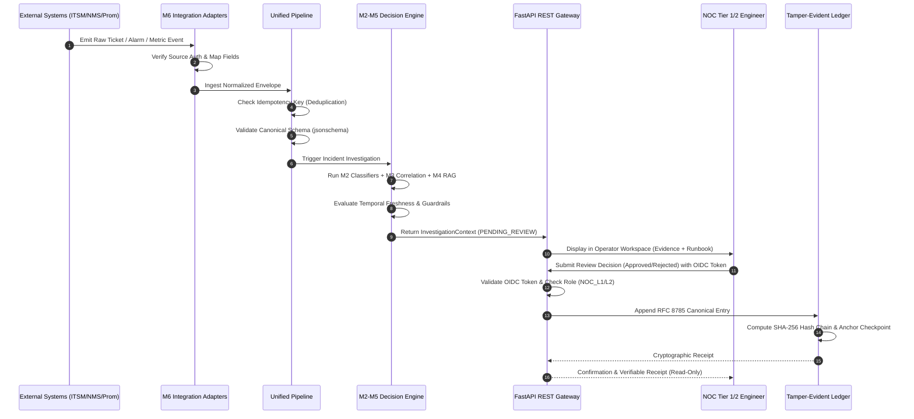

# PIIS Milestone M6 — Architecture & Gap Analysis

> [!IMPORTANT]
> ### Milestone M6 Status
> - **MILESTONE:** M6 — ENTERPRISE INTEGRATION & OPERATIONAL READINESS
> - **STATUS:** IN EXECUTION (Architecture & Gap Analysis Complete)
> - **BASELINE STATE:** M5 Engineering CLOSED; 312/312 Unit Tests Passing; Frozen Source Tree Digest `ebe6d3a23ac62502bfd0689e35c03ac815321d47d4ab4d8cb7d764784cd236d6` (116 files)
> - **OPERATIONAL SCOPE:** STRICTLY READ-ONLY TELECOM DECISION SUPPORT
> - **PRODUCTION PILOT:** BLOCKED PENDING ENTERPRISE PREREQUISITES & EXPLICIT AUTHORIZATION

---

## 1. Executive Summary & Context

Milestones M1 through M5 established and sealed the core intelligence, anomaly detection, topological correlation, hybrid retrieval, and evidence-grounded investigation capabilities of the **Production Incident Intelligence System (PIIS) — Telecom Edition**. 

The purpose of **Milestone M6** is to evolve PIIS from a self-contained decision engine into an enterprise-integrable telecom operations platform without replacing existing systems. PIIS acts as an augmentative intelligence, observability, and decision-support layer integrated with existing:
- **ITSM Platforms** (ServiceNow, Jira Service Management, Generic REST).
- **Network Monitoring & Telemetry Platforms** (Prometheus, OpenTelemetry OTLP).
- **Alarm Management & OSS/NMS Systems** (Fault management, alarm lifecycle, multi-vendor 3GPP codes).
- **Enterprise Identity & Access Management** (OIDC, OAuth 2.0, JWKS, Role-Based Access Control).

The system strictly adheres to the principle:
$$\text{Existing Telecom Workflow} + \text{PIIS} = \text{Augmented Intelligence, Observability \& Decision Support}$$

---

## 2. Current Architecture & Baseline Capabilities (M1–M5)

PIIS is implemented as a modular Python package ([`src/piis/`](file:///c:/Production%20level%20projects/PIIS/src/piis/)) adhering to ADR 0001 (Modular Monolith) with strict causal separation and tamper-evident audit trails.

```mermaid
flowchart TD
    subgraph Data & Schema Layer
        Schemas["Canonical JSON Schemas (schemas/)"]
        Norm["Normalization Pipelines (piis.normalization)"]
        Contracts["Feature Leakage Guards (piis.normalization.contracts)"]
    end

    subgraph Intelligence Core (M2-M3)
        M2["Classifiers & Severity Models (piis.models)"]
        M3_Anom["Telemetry Anomaly Detector (piis.anomaly)"]
        M3_Topo["Directed Graph Blast Radius (piis.correlation)"]
    end

    subgraph Grounding & Retrieval (M4)
        Retriever["Hybrid BM25 + Dense RAG (piis.retrieval)"]
        Ontology["Vendor/Generation Filter (piis.knowledge)"]
    end

    subgraph Investigation & Security (M5)
        Engine["IncidentInvestigationEngine (piis.investigation.engine)"]
        Temporal["TemporalEvidenceEvaluator (piis.investigation.temporal)"]
        Guard["4-Ring Security Guardrails (piis.security)"]
        Audit["RFC 8785 JCS Audit Chain (piis.investigation.approval)"]
        Anchor["Monotonic Checkpoint Anchor (piis.audit.trust_boundary)"]
    end

    Schemas --> Norm --> Contracts
    Contracts --> M2 & M3_Anom & M3_Topo
    M2 & M3_Anom & M3_Topo --> Engine
    Retriever & Ontology --> Engine
    Engine --> Temporal --> Guard --> Audit --> Anchor
```

### Existing Working Capabilities:
1. **Schema Validation & Normalization:** `jsonschema` Draft 2020-12 validation for incident, telemetry, alarm, evidence, recommendation, and resolution schemas.
2. **Causal Time-Series Feature Engineering:** Backward-looking rolling windows (`causal_rolling_mean`, `causal_rolling_std`) with strict anti-leakage guards preventing post-resolution contamination.
3. **Multi-Domain Triage Models:** Logistic regression and Random Forest baselines for fault category classification, severity prediction, and L1/L2 routing.
4. **Topological Correlation:** Directed acyclic graph (DAG) traversal from alarm root to downstream subscribers, determining blast radius without non-causal feedback loops.
5. **Hybrid Semantic Retrieval:** Fusion of BM25 lexical keyword matching and dense bi-encoder vector embeddings with cross-generation and vendor-neutral filtering.
6. **Investigation Synthesis:** `IncidentInvestigationEngine` generating structured `InvestigationContext` with evidence sufficiency evaluation, hypothesis ranking, and runbook grounding.
7. **Temporal Freshness Evaluation:** `TemporalEvidenceEvaluator` rejecting telemetry older than 3600 seconds as stale to prevent outdated diagnostic recommendations.
8. **Tamper-Evident Audit Chains:** RFC 8785 JSON Canonicalization Scheme (JCS), SHA-256 hash chaining, OIDC session validation, and monotonic checkpoint anchors.

---

## 3. Comprehensive Gap Analysis for M6

| Workstream | Existing Foundation | Gaps & Missing Capabilities | Target Architecture in M6 |
| :--- | :--- | :--- | :--- |
| **A: Enterprise Integrations** | Normalizers for synthetic/TelecomTS files only (`incidents.py`, `telemetry.py`). Schema definitions exist. | • No ITSM connectors (ServiceNow, Jira SM).<br/>• No Telemetry scrapers (Prometheus, OpenTelemetry OTLP).<br/>• No OSS/NMS alarm adapters or vendor lifecycle handlers.<br/>• No rate-limiting, pagination, retry/backoff, or dead-letter queue. | Pluggable `IntegrationAdapter` framework with concrete implementations for ServiceNow, Jira SM, Prometheus, OTLP, and generic OSS/NMS alarms, accompanied by realistic external simulators. |
| **B: Ingestion Pipeline** | File-based loaders and isolated schema validators. | • No unified multi-source ingestion pipeline.<br/>• No event deduplication cache / idempotency keying.<br/>• No partial failure handling or dead-letter queue (DLQ).<br/>• No explicit data lineage linking raw event to investigation. | `UnifiedIngestionPipeline` with content-addressable deduplication, transactional schema validation, error isolation, DLQ, and provenance tracking. |
| **C: Production API Layer** | `pyproject.toml` references `fastapi` and `uvicorn`, but zero API routers or FastAPI code exist. | • No HTTP API endpoints for ingestion, investigation, retrieval, reviews, or audit.<br/>• No Pydantic API contracts, pagination, or correlation IDs.<br/>• No OpenAPI documentation or server-side error handling. | Production-grade FastAPI v1 application (`src/piis/api/`) providing versioned, documented, paginated REST endpoints with request correlation IDs and structured JSON errors. |
| **D: Identity & Access** | `ProductionOIDCVerifier` and JWT parser in `approval.py`. | • No FastAPI security dependencies (`Depends(get_current_user)`).<br/>• No formal role hierarchy (`NOC_L1`, `NOC_L2`, `NOC_L3`, `INCIDENT_MANAGER`, `SECURITY_AUDITOR`, `PIIS_ADMIN`).<br/>• No server-side RBAC enforcement on endpoints. | Declarative FastAPI RBAC security scheme enforcing role-based permissions, token revocation checks, and strict prohibition of service-principal review approvals. |
| **E: Audit & Observability** | Audit chain in `approval.py`, but no application telemetry or metrics. | • No OpenTelemetry tracing spans across pipeline steps.<br/>• No Prometheus operational metrics endpoint (`/metrics`).<br/>• No structured JSON logging with correlation IDs. | Standardized observability package (`src/piis/observability/`) with structured logging, OpenTelemetry instrumentation, and Prometheus metric exporters. |
| **F: Operator Experience** | Zero frontend assets exist in the repository. | • No user interface for NOC engineers.<br/>• No visual inspection of evidence, hypotheses, or blast radius.<br/>• No interactive human review or approval sign-off. | Embedded, responsive Operator Experience (SPA) served directly by FastAPI: Operations Overview, Investigation Workspace, Human Review Workspace, and Integration Management. |
| **G: Deployment & Reliability** | Basic placeholder Dockerfile and postgres compose. | • No multi-stage production Dockerfile.<br/>• No end-to-end local demonstration environment.<br/>• No health/readiness probes (`/healthz`, `/readyz`).<br/>• No graceful shutdown handlers. | Hardened Dockerfile, compose orchestration with mock telecom systems, automated configuration validation, and an interactive end-to-end demo script. |
| **H: Integration Testing** | 312 unit tests in `tests/unit/`. Zero integration tests. | • No end-to-end integration tests for multi-source ingestion, API timeouts, rate limiting, token expiration, or recovery. | Comprehensive integration suite in `tests/integration/` verifying all 20 required failure, recovery, and boundary scenarios. |

---

## 4. Proposed M6 Architecture & Component Interactions

```mermaid
flowchart TD
    subgraph External Telecom Infrastructure [Simulated / Connected Systems]
        SNOW["ServiceNow / Jira SM (ITSM)"]
        PROM["Prometheus / OTLP (Metrics)"]
        NMS["OSS / NMS Broker (Alarms)"]
        IdP["Corporate OIDC IdP (Okta / AAD)"]
    end

    subgraph M6 Integration Layer [src/piis/integrations/]
        ITSM_Adap["ITSMAdapter (ServiceNow/Jira/Generic)"]
        Telem_Adap["TelemetryAdapter (Prometheus/OTLP)"]
        Alarm_Adap["AlarmAdapter (3GPP/Vendor OSS)"]
        DLQ["Dead-Letter Queue & Retry Engine"]
    end

    subgraph M6 Pipeline & Core [src/piis/pipeline/]
        Pipeline["UnifiedIngestionPipeline"]
        Dedup["Idempotency & Dedup Engine"]
        CanonStore["Canonical In-Memory / Relational Store"]
        M5_Engine["M5 IncidentInvestigationEngine"]
    end

    subgraph M6 API & Security Layer [src/piis/api/]
        FastAPI_App["FastAPI REST Application (/api/v1)"]
        RBAC["Server-Side RBAC & OIDC Auth"]
        Obs["Structured Logging & Prometheus Metrics"]
        UI["Embedded NOC Operator Workspace (SPA)"]
    end

    subgraph M5 Audit & Trust Boundary [src/piis/audit/]
        Approval["HumanApprovalWorkflow"]
        JCS_Audit["RFC 8785 JCS Audit Chain"]
        Anchor["Checkpoint Anchor"]
    end

    SNOW --> ITSM_Adap
    PROM --> Telem_Adap
    NMS --> Alarm_Adap

    ITSM_Adap & Telem_Adap & Alarm_Adap --> Pipeline
    Pipeline --> Dedup --> CanonStore
    Pipeline -.->|Malformed / Rate-Limited| DLQ

    CanonStore --> M5_Engine
    M5_Engine --> FastAPI_App

    IdP --> RBAC
    FastAPI_App --> RBAC
    FastAPI_App --> Obs
    FastAPI_App --> UI

    FastAPI_App --> Approval
    Approval --> JCS_Audit --> Anchor

    style External Telecom Infrastructure fill:#f3e5f5,stroke:#7b1fa2
    style M6 Integration Layer fill:#e8eaf6,stroke:#3f51b5
    style M6 Pipeline & Core fill:#e0f2f1,stroke:#00796b
    style M6 API & Security Layer fill:#e1f5fe,stroke:#0288d1
    style M5 Audit & Trust Boundary fill:#e8f5e9,stroke:#2e7d32
```

---

## 5. End-to-End Operational Data Flow



---

## 6. Security Boundaries & Authorization Model

```mermaid
flowchart LR
    subgraph Public / Untrusted Boundary
        ExtEvent["External Webhooks / Pollers"]
    end

    subgraph Ingestion Security Ring
        Dec["Ring 1: Bounded Recursive Decoder"]
        SecGuard["Ring 2: Retrieval Security Guard"]
        Val["Ring 3: Strict Schema Validation"]
    end

    subgraph Service Access & API Gateway
        OIDC_Gate["JWT / OIDC Bearer Token Validation"]
        Role_Gate["Role-Based Access Control Gate"]
        Correlation["Request Correlation ID Injection"]
    end

    subgraph Application Core
        Engine_Safe["Read-Only Decision Engine"]
        Tool_Safe["Ring 4: Prohibited Tool Execution Denylist"]
    end

    subgraph Human Review & Audit Trust
        HumanOnly["Human Operator Requirement (Service Principals Banned)"]
        JCS_Ledger["RFC 8785 JCS Hash Chain"]
    end

    ExtEvent --> Dec --> SecGuard --> Val
    Val --> OIDC_Gate --> Role_Gate --> Correlation
    Correlation --> Engine_Safe --> Tool_Safe
    Tool_Safe --> HumanOnly --> JCS_Ledger

    style Public / Untrusted Boundary fill:#ffebee,stroke:#c62828
    style Ingestion Security Ring fill:#fff3e0,stroke:#ef6c00
    style Service Access & API Gateway fill:#e1f5fe,stroke:#0288d1
    style Application Core fill:#e8f5e9,stroke:#2e7d32
    style Human Review & Audit Trust fill:#f3e5f5,stroke:#7b1fa2
```

### Application Role Hierarchy:
- **`NOC_L1`**: Ingest tickets, view incident investigations, view runbook recommendations, approve Low-Risk / Read-Only diagnostic checks.
- **`NOC_L2`**: All L1 permissions + approve Medium-Risk diagnostics, view advanced topology correlations, manage alarm mappings.
- **`NOC_L3`**: All L2 permissions + view cross-domain blast radius models, review complex multi-element failures.
- **`INCIDENT_MANAGER`**: View all investigations, audit trails, and operator response times; manage escalation workflows.
- **`SECURITY_AUDITOR`**: Read-only access to cryptographic audit trails, verification of hash chains and checkpoint anchors, security log inspection.
- **`PIIS_ADMIN`**: Configure integration adapters, rotate local development keys, inspect system health and metrics.
- **`SERVICE_PRINCIPAL`**: Ingest tickets and telemetry; **strictly prohibited from approving recommendations or closing reviews**.

---

## 7. Implementation Sequence

The implementation of Milestone M6 will proceed in 8 synchronized workstreams:

```
[Phase 1] Workstream A: Enterprise Integration Adapters (ITSM, Telemetry, Alarms, Simulators)
    ↓
[Phase 2] Workstream B: Unified Incident Integration Pipeline (Deduplication, DLQ, Lineage)
    ↓
[Phase 3] Workstream C: Production-Grade FastAPI Layer (Endpoints, Schemas, Errors)
    ↓
[Phase 4] Workstream D: Enterprise Identity & RBAC (OIDC Dependencies, Role Guards)
    ↓
[Phase 5] Workstream E: Observability & Metrics (Structured Logs, OpenTelemetry, Prometheus)
    ↓
[Phase 6] Workstream F: Operator Experience (NOC SPA Workspace served via API)
    ↓
[Phase 7] Workstream G: Deployment & Local Demo (Dockerfile, Compose, Demonstration Script)
    ↓
[Phase 8] Workstream H: Comprehensive Integration & Reliability Testing (20 Scenarios)
```

---

## 8. M6 Acceptance Criteria Matrix

| Domain | Mandatory Acceptance Condition | Verification Method |
| :--- | :--- | :--- |
| **Integration Framework** | Working adapter architecture for ITSM, Telemetry, and OSS/NMS alarms with explicit vendor handling. | Unit and adapter mock test suite. |
| **ITSM Integration** | End-to-end ingestion from simulated ServiceNow and Jira SM platforms without data corruption. | End-to-end integration test. |
| **Telemetry Integration** | Metric ingestion with separated observation/ingestion timestamps and unit conversions. | Prometheus/OTLP simulated ingestion test. |
| **OSS/NMS Integration** | Normalized alarm lifecycle (active, acknowledged, cleared) with vendor code preservation. | Alarm adapter test with 3GPP and vendor codes. |
| **Pipeline Ingestion** | Idempotent multi-source ingestion with duplicate detection, schema enforcement, and DLQ. | Ingestion pipeline stress and duplicate test. |
| **API Layer** | Versioned, paginated, and OpenAPI-documented REST API with standard JSON error formats. | TestClient API contract test suite. |
| **Identity & RBAC** | Server-side token validation, role hierarchy enforcement, and service-principal review lockout. | Security test suite with forged/expired/unauthorized tokens. |
| **Observability** | Structured logging with correlation IDs, OpenTelemetry tracing spans, and Prometheus metrics. | Metric scraping and log correlation verification. |
| **Operator Experience** | Interactive NOC UI displaying incident details, telemetry, hypotheses, and human review actions. | UI route rendering and simulated browser workflow test. |
| **Deployment** | Multi-stage Docker build, health/readiness endpoints, and executable local demonstration environment. | Container verification and demo script execution. |
| **Reliability** | Successful execution of all 20 required integration failure and recovery scenarios. | Automated integration test suite (`tests/integration/`). |
| **Safety Invariants** | Zero autonomous command execution, read-only decision support preserved, human approval mandatory. | Static and dynamic safety gate assertions. |
