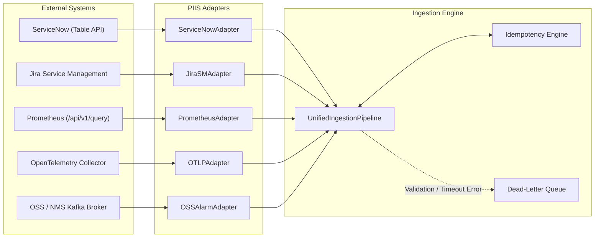

# PIIS Milestone M6 — Enterprise Integration Report

> [!IMPORTANT]
> ### Integration Architecture Status
> - **MILESTONE:** M6 — ENTERPRISE INTEGRATION & OPERATIONAL READINESS
> - **STATUS:** VERIFIED VIA SIMULATED ENTERPRISE PLATFORMS
> - **SUPPORTED INTEGRATIONS:** ServiceNow, Jira Service Management, Generic REST ITSM, Prometheus, OpenTelemetry OTLP, OSS/NMS 3GPP Alarms
> - **INTEGRATION MODE:** READ-ONLY INGESTION (Zero Live Production Mutations)

---

## 1. Integration Scope & Architecture

PIIS integrates into existing telecommunications Network Operations Centers (NOC) as an evidence-grounded decision-support layer. It consumes data from three primary operational planes:
1. **ITSM Plane:** Incident tickets, change requests, customer complaint summaries.
2. **Telemetry Plane:** Real-time and historical KPI metrics, network counters.
3. **OSS/NMS Fault Plane:** Network element alarms, 3GPP fault events, lifecycle state updates.

---

## 2. ITSM Normalization Specifications

### ServiceNow Field Mapping Table
| ServiceNow Field | PIIS Canonical Field | Transformation / Mapping Rule |
| :--- | :--- | :--- |
| `number` | `source_record_id`, `incident_id` | Prefixed: `INC-SNOW-{number}` |
| `sys_id` | `metadata.servicenow_sys_id` | Preserved as exact 32-hex string |
| `short_description` | `title` | Text sanitized via BoundedRecursiveDecoder |
| `description` | `description` | Defanged of prompt injections & HTML scripts |
| `priority` | `severity` | `1`->`CRITICAL`, `2`->`MAJOR`, `3`->`MINOR`, `4/5`->`WARNING` |
| `u_network_domain` | `network_domain` | `RAN`->`RAN`, `CORE`->`5G_CORE`, `TRANSPORT`->`TRANSPORT` |
| `assignment_group` | `support_level_label` | Group string mapped to `L1`, `L2`, `L3`, or `HUMAN_REVIEW` |
| `cmdb_ci` | `network_element_ids` | Extracted as single-item or multi-item array |
| `u_affected_subscribers`| `affected_subscribers` | Integer parsing with non-negative clamping |
| `state` | `metadata.external_state` | `1`->`NEW`, `2`->`IN_PROGRESS`, `6`->`RESOLVED`, `7`->`CLOSED` |

---

## 3. Telemetry Normalization Specifications

### Prometheus & OpenTelemetry Mapping Table
| External Metric Field | PIIS Canonical Field | Transformation / Mapping Rule |
| :--- | :--- | :--- |
| `__name__` / `name` | `metric_name` | Canonical KPI name preserved |
| `instance` / `node` | `network_element_id` | Network element identifier extracted from labels |
| `value[0]` / `time_unix_nano` | `timestamp` | UTC ISO-8601 string (`YYYY-MM-DDTHH:MM:SS.fZ`) |
| `value[1]` / `as_double` | `metric_value` | Float conversion; NaN/Infinity rejected |
| Deduced / `unit` | `unit` | Explicit mapping: VSWR->`ratio`, RSRP->`dBm`, PRB->`ratio`, Throughput->`bytes/sec` |
| Envelope Ingestion Time | `metadata.ingested_at` | Preserved separately from observation timestamp |

---

## 4. OSS/NMS Multi-Vendor Alarm Code Translation

PIIS normalizes proprietary equipment vendor alarm codes into standardized 3GPP operational categories to allow vendor-neutral runbook matching:

| Vendor | Proprietary Alarm Code | Canonical 3GPP Alarm Code | Severity | Description |
| :--- | :---: | :--- | :---: | :--- |
| **Nokia** | `7100` | `ALM-RAN-VSWR-HIGH` | MAJOR | Antenna transmission line reflection |
| **Nokia** | `7210` | `ALM-RAN-MIMO-CALIB-FAULT` | MAJOR | Massive MIMO beamforming phase drift |
| **Nokia** | `7650` | `ALM-TRANSPORT-PTP-SYNC-LOSS`| CRITICAL | Precision Time Protocol synchronization loss |
| **Nokia** | `7820` | `ALM-RAN-RRU-OPTICAL-FAIL` | CRITICAL | CPRI/eCPRI optical link loss |
| **Ericsson** | `A102` | `ALM-RAN-VSWR-HIGH` | MAJOR | Radio feeder VSWR threshold exceeded |
| **Ericsson** | `B205` | `ALM-RAN-RADIO-LINK-FAILURE` | MAJOR | Radio link control timeout |
| **Ericsson** | `C310` | `ALM-TRANSPORT-SYNCE-UNSTABLE`| MAJOR | Synchronous Ethernet frequency wander |
| **Huawei** | `ALM-26241` | `ALM-RAN-VSWR-HIGH` | MAJOR | RF unit VSWR alarm |
| **Huawei** | `ALM-26244` | `ALM-RAN-RF-UNIT-MAINTENANCE`| MINOR | RF maintenance switch closed |
| **Huawei** | `ALM-25888` | `ALM-TRANSPORT-CLOCK-OUT-OF-LOCK`| CRITICAL | Clock reference unlock |

---

## 5. Idempotency & Dead-Letter Queue Governance

### Deduplication Rules:
1. **Deterministic Event Keying:** Keys are generated as `SOURCE_SYSTEM::EXTERNAL_ID` (e.g. `SERVICENOW::INC0089201`).
2. **Payload Hash Fallback:** For unkeyed events, SHA-256 is computed over the sorted JSON payload.
3. **Suppression Semantics:** Duplicate deliveries return HTTP 200 with `is_duplicate=True` and the previously assigned canonical ID, avoiding duplicate processing or alert spam.

### Dead-Letter Queue (DLQ) Policies:
1. **Failure Reasons Tracked:** `NO_ADAPTER`, `RATE_LIMITED`, `NORMALIZATION_ERROR`, `SCHEMA_VALIDATION_ERROR`.
2. **Forensic Metadata:** Failed envelopes record the full raw payload, failure reason, error stack trace, attempt counter, and timestamps.
3. **Replay Mechanism:** Administrators can re-trigger ingestion via `POST /api/v1/integrations/dead-letter/{item_id}/retry`.
