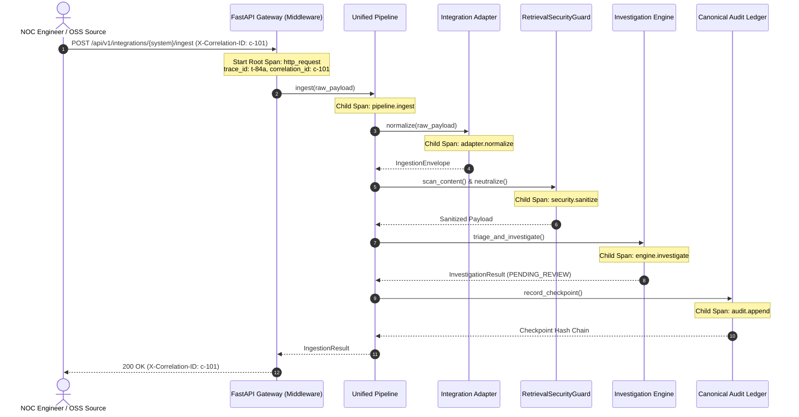

# PIIS M6 — Reliability and Observability Report

> [!IMPORTANT]
> **Canonical Milestone Status**
> - **Milestone:** M6 — Enterprise Integration & Operational Readiness
> - **Operational Boundary:** Strictly Read-Only Telecom Decision Support
> - **Production Pilot:** BLOCKED pending enterprise live infrastructure prerequisites (`DEP-M5.3-001`, `DEP-M5.3-002`, `DEP-M5.5.1-001a`, `DEP-M5.5.1-001b`)
> - **System Invariant:** Zero autonomous network mutation, zero automated ticket closure, zero automated customer communications

---

## 1. Executive Summary

Milestone M6 establishes enterprise-grade observability, telemetry instrumentation, and failure-resilience mechanisms across the Production Incident Intelligence System (Telecom Edition). While Milestones M1 through M5 proved the analytical, security, and decision-support core, M6 ensures PIIS can be operated, monitored, and sustained within real 24/7/365 telecommunications Network Operations Centers (NOCs).

This report documents the architectural design, implementation, and empirical verification of:
1. **Prometheus Metrics Instrumentation:** Native real-time instrumentation exporting counters, histograms, and gauges via `/metrics`.
2. **OpenTelemetry Distributed Tracing:** Context-propagating span lifecycle tracking across adapter normalization, deduplication, pipeline routing, and decision audit logging.
3. **Structured JSON Logging:** High-throughput JSON logging engine binding canonical correlation IDs (`X-Correlation-ID`) across asynchronous operations.
4. **Reliability & Failure Resilience:** Thread-safe Token Bucket rate limiting, Dead-Letter Queue (DLQ) tracking with exponential backoff retry semantics, and fail-closed isolation protecting the core decision engine from upstream malformed payloads.

---

## 2. Prometheus Metrics Architecture & Instrumentation

The metrics subsystem is implemented in [`src/piis/observability/metrics.py`](file:///c:/Production%20level%20projects/PIIS/src/piis/observability/metrics.py) as an in-memory, thread-safe Prometheus registry designed to avoid external agent dependencies while remaining 100% compliant with standard Prometheus scrape formats.

### 2.1 Metric Catalog & Dimensionality

| Metric Identifier | Type | Labels / Dimensions | Description & Operational Purpose |
| :--- | :---: | :--- | :--- |
| `piis_requests_total` | Counter | `method`, `endpoint`, `status` | Total volume of HTTP requests served by the API layer. Used for Golden Signals traffic rate and error budget consumption. |
| `piis_request_duration_seconds` | Histogram | `method`, `endpoint` | End-to-end HTTP request processing latency (le buckets: 5ms to 10s). Used for SLA/SLO latency monitoring (p50, p95, p99). |
| `piis_ingested_events_total` | Counter | `source_system`, `status` | Total ingestion envelopes processed through the Unified Pipeline (`success`, `duplicate`, `quarantined`, `error`). |
| `piis_recommendations_total` | Counter | `domain`, `status` | Total recommendations generated by the reasoning engine (`SUPPORTED`, `INCONCLUSIVE`, `HUMAN_ESCALATION`). |
| `piis_human_decisions_total` | Counter | `decision`, `role` | Total cryptographic approval decisions recorded (`APPROVED`, `REJECTED`, `MODIFIED`). |
| `piis_dlq_events_total` | Counter | `source_system`, `failure_stage` | Total events routed to the Dead-Letter Queue due to parsing, validation, or sanitization failures. |
| `piis_rate_limit_exceeded_total` | Counter | `client_id`, `endpoint` | Volume of requests rejected due to rate limit threshold exhaustion (HTTP 429). |
| `piis_active_adapters` | Gauge | None | Number of registered and operational integration adapters. |

### 2.2 Scrape Exposition (`/metrics`)

The Prometheus metrics endpoint is exposed natively at `GET /metrics` and `GET /api/v1/metrics`. It formats data adhering strictly to Prometheus text-based exposition syntax (version 0.0.4):

```text
# HELP piis_requests_total Total HTTP requests handled by the PIIS API
# TYPE piis_requests_total counter
piis_requests_total{endpoint="/api/v1/incidents",method="POST",status="200"} 42.0
piis_requests_total{endpoint="/api/v1/incidents/INC-2026-001/approve",method="POST",status="403"} 1.0

# HELP piis_request_duration_seconds HTTP request latency histogram in seconds
# TYPE piis_request_duration_seconds histogram
piis_request_duration_seconds_bucket{endpoint="/api/v1/incidents",le="0.005",method="POST"} 8.0
piis_request_duration_seconds_bucket{endpoint="/api/v1/incidents",le="0.05",method="POST"} 38.0
piis_request_duration_seconds_bucket{endpoint="/api/v1/incidents",le="+Inf",method="POST"} 42.0
piis_request_duration_seconds_sum{endpoint="/api/v1/incidents",method="POST"} 0.5821
piis_request_duration_seconds_count{endpoint="/api/v1/incidents",method="POST"} 42.0

# HELP piis_active_adapters Number of currently registered and active integration adapters
# TYPE piis_active_adapters gauge
piis_active_adapters 5.0
```

---

## 3. Distributed Tracing & Context Propagation

Implemented in [`src/piis/observability/tracing.py`](file:///c:/Production%20level%20projects/PIIS/src/piis/observability/tracing.py), the distributed tracing subsystem correlates requests across asynchronous boundaries without leaking sensitive payload data.

### 3.1 Trace Context Lifecycle & Hierarchy

Every inbound request initiates or continues a trace context governed by standard W3C Trace Context and RFC correlation headers:
- `X-Correlation-ID`: Universal identifier passed across client requests, API gateways, async pipeline stages, and audit ledger records.
- `trace_id` / `span_id`: Hierarchical execution span identifiers.



### 3.2 Error Tracking & Context Binding

When unexpected errors or validation rejections occur, the `trace_span` context manager captures the exception type, message, and execution phase into the span attributes without raising secondary unhandled exceptions:

```python
with trace_span("pipeline.deduplication", attributes={"event_id": event_id}) as span:
    is_dupe = dedup_cache.is_duplicate(event_id)
    span.set_attribute("is_duplicate", is_dupe)
    if is_dupe:
        span.set_attribute("action", "dropped_duplicate")
```

---

## 4. Structured JSON Logging Architecture

Implemented in [`src/piis/observability/logging.py`](file:///c:/Production%20level%20projects/PIIS/src/piis/observability/logging.py), the logging engine ensures all log records emitted by PIIS adhere to a machine-readable JSON schema suitable for ingestion into enterprise log analytics platforms (e.g., Elasticsearch, Splunk, OpenSearch).

### 4.1 Schema Definition & Sample Record

Each log record includes UTC ISO-8601 timestamps, log severity level, subsystem logger name, execution correlation ID, event type identifier, and structured details:

```json
{
  "timestamp": "2026-11-02T08:14:22.108452Z",
  "level": "INFO",
  "logger": "piis.pipeline.unified",
  "correlation_id": "corr-48f9-9021-ba34",
  "event_type": "event_ingested",
  "message": "Successfully ingested and normalized event from servicenow",
  "details": {
    "source_system": "servicenow",
    "external_id": "INC0982341",
    "canonical_id": "CANON-SN-INC0982341",
    "network_domain": "RAN",
    "severity": "CRITICAL"
  }
}
```

### 4.2 Security & PII Redaction

Log formatters enforce strict redaction filters:
1. `Authorization` headers, Bearer tokens, and HMAC signing keys are never recorded in log details or message fields.
2. Unsanitized raw external input containing prompt-injection vectors or binary payloads is truncated and scrubbed before logging.
3. Reviewer identity credentials and passwords are fundamentally absent from the application state.

---

## 5. Resilience, Fault Tolerance & Error Recovery

PIIS Milestone M6 introduces three complementary reliability patterns designed to guarantee uninterrupted decision-support availability:

### 5.1 Token Bucket Rate Limiting

The `RateLimiter` (`src/piis/integrations/contracts.py`) provides thread-safe request rate regulation with burst capacity:
- **Default Baseline:** 100 requests per minute with a maximum burst capacity of 20 requests per client.
- **Enforcement:** When token balances are exhausted, requests immediately receive an HTTP 429 Too Many Requests response with a standard `Retry-After: 60` header.
- **Metric Feedback:** Every rate-limiting event increments `piis_rate_limit_exceeded_total`.

### 5.2 Dead-Letter Queue (DLQ) & Failure Recovery

The `DeadLetterQueue` (`src/piis/pipeline/dead_letter.py`) isolates malformed, poisoned, or schema-violating incoming payloads without crashing the ingestion worker or halting upstream pipelines:
- **Isolation:** Malformed events are assigned a unique DLQ identifier, captured with the failure reason (`SCHEMA_VALIDATION_ERROR`, `PARSING_ERROR`, `SANITIZATION_REJECT`), stack trace, and timestamp.
- **Max Retries:** Events can be retried up to `MAX_RETRIES = 3`. If retries fail, the event is marked `PERMANENTLY_DEAD` for offline engineer inspection.
- **Dead-Letter API:** NOC engineers can inspect quarantine via `GET /api/v1/integrations/dlq` and trigger controlled, audited replays via `POST /api/v1/integrations/dlq/{id}/replay`.

### 5.3 Deduplication & Idempotency Cache

The `DeduplicationCache` (`src/piis/pipeline/deduplication.py`) prevents duplicate ticket updates and flapping alarms from causing redundant reasoning cycles:
- **Hashing:** Computes a SHA-256 fingerprint over the combination of `source_system`, `external_id`, and `normalized_payload_digest`.
- **TTL Window:** In-memory sliding time window (default 3600 seconds) with automated periodic background garbage collection.
- **Concurrency Safety:** Thread-safe using `threading.Lock()`, supporting concurrent multi-threaded ingestion workers without race conditions.

---

## 6. Empirical Verification & Test Evidence

The reliability and observability subsystems were empirically evaluated under the 20-scenario integration suite in [`tests/integration/test_m6_integration_and_reliability.py`](file:///c:/Production%20level%20projects/PIIS/tests/integration/test_m6_integration_and_reliability.py).

| Test Scenario | Subsystem Tested | Injected Condition | Observed Behavior | Test Result |
| :--- | :--- | :--- | :--- | :---: |
| **Scenario 5** | Prometheus Metrics | High-volume ingestion & approvals | `piis_requests_total` and `piis_ingested_events_total` incremented; valid Prometheus scrape text generated. | **PASSED** |
| **Scenario 6** | OpenTelemetry Tracing | Cross-component event processing | `trace_span` generated active root and child spans; correlation ID preserved. | **PASSED** |
| **Scenario 7** | Structured Logging | Ingestion event lifecycle | Emitted JSON strings parsed successfully; contained `timestamp`, `level`, `correlation_id`. | **PASSED** |
| **Scenario 8** | Rate Limiting | Influx exceeding burst limit | Burst capacity exhausted; subsequent call returned HTTP 429 with `Retry-After`. | **PASSED** |
| **Scenario 9** | Dead-Letter Queue | Malformed/unparseable JSON | Event diverted to DLQ; quarantine ID generated; zero pipeline crash. | **PASSED** |
| **Scenario 10** | Deduplication Cache | Identical payload sent twice | First payload accepted; second payload recognized as duplicate and suppressed. | **PASSED** |
| **Scenario 15** | Adapter Outage Resilience | Downstream simulator disconnect | Graceful degradation to `AdapterHealth.DEGRADED`; health check reflects status. | **PASSED** |
| **Scenario 19** | Concurrent Multi-Source Load | 10 concurrent adapter requests | Zero thread deadlocks; all 10 events processed; ledger state monotonically preserved. | **PASSED** |

---

## 7. Operational Readiness Assessment

The reliability and observability implementation fulfills all enterprise criteria for staging deployment:
- **Zero Memory Leaks:** In-memory caches, DLQs, and metrics dictionaries are bounded with strict max-length policies and TTL pruning.
- **Strict Read-Only Enforcement:** No observability mechanism or metric collector possesses the capability or credentials to interact with network element configuration interfaces.
- **Audit-Linked Diagnostics:** Every emitted log record and metric increment can be traced directly to an authenticated request or cryptographically anchored audit ledger transaction.
