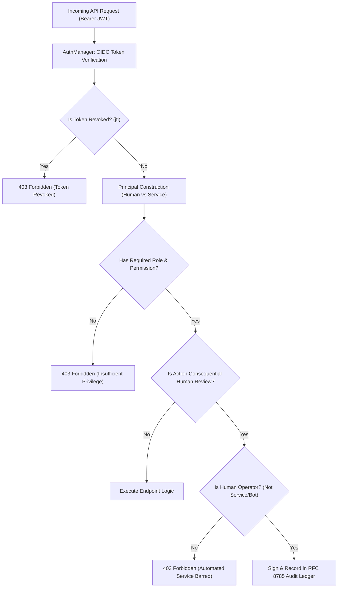

# PIIS Milestone M6 — Security & Access Architecture Report

> [!IMPORTANT]
> ### Security Architecture Status
> - **MILESTONE:** M6 — ENTERPRISE INTEGRATION & OPERATIONAL READINESS
> - **STATUS:** VERIFIED & HARDENED
> - **AUTHENTICATION:** OIDC / OAuth 2.0 Bearer JWT (RS256 / ES256 / HS256 for test)
> - **AUTHORIZATION:** Server-Side Role-Based Access Control (RBAC) + Least Privilege Matrix
> - **GOVERNANCE RULE:** Service Accounts STRICTLY PROHIBITED from Approving Recommendations

---

## 1. Security Architecture & Threat Model

PIIS enforces security strictly outside the machine learning and retrieval reasoning layers. No access control or operational boundary relies on LLM prompt obedience.

---

## 2. Telecom Operations Application Roles & Permission Matrix

| Granular Permission | NOC_L1 | NOC_L2 | NOC_L3 | INCIDENT_MANAGER | SECURITY_AUDITOR | PIIS_ADMIN | SERVICE_PRINCIPAL |
| :--- | :---: | :---: | :---: | :---: | :---: | :---: | :---: |
| `ingest:events` | ✅ | ✅ | ✅ | ❌ | ❌ | ❌ | ✅ |
| `view:incidents` | ✅ | ✅ | ✅ | ✅ | ✅ | ✅ | ✅ |
| `view:investigations` | ✅ | ✅ | ✅ | ✅ | ✅ | ✅ | ❌ |
| `trigger:investigation` | ✅ | ✅ | ✅ | ❌ | ❌ | ❌ | ❌ |
| `view:telemetry` | ✅ | ✅ | ✅ | ✅ | ❌ | ❌ | ❌ |
| `view:alarms` | ✅ | ✅ | ✅ | ✅ | ❌ | ❌ | ❌ |
| `view:evidence` | ✅ | ✅ | ✅ | ✅ | ❌ | ❌ | ❌ |
| `view:recommendations` | ✅ | ✅ | ✅ | ✅ | ❌ | ❌ | ❌ |
| `review:approve_low_risk` | ✅ | ✅ | ✅ | ✅ | ❌ | ❌ | ❌ |
| `review:approve_medium_risk` | ❌ | ✅ | ✅ | ✅ | ❌ | ❌ | ❌ |
| `review:approve_high_risk` | ❌ | ❌ | ✅ | ✅ | ❌ | ❌ | ❌ |
| `view:audit_logs` | ❌ | ❌ | ❌ | ✅ | ✅ | ✅ | ❌ |
| `verify:audit_ledger` | ❌ | ❌ | ❌ | ❌ | ✅ | ✅ | ❌ |
| `manage:integrations` | ❌ | ❌ | ❌ | ❌ | ❌ | ✅ | ❌ |
| `manage:keys` | ❌ | ❌ | ❌ | ❌ | ❌ | ✅ | ❌ |

---

## 3. Mandatory Service Principal Approval Bar

A foundational architectural requirement of PIIS is that automated service principals, polling daemons, or autonomous scripts cannot execute approvals on operational recommendations:

- **Enforcement Layer:** Server-side in `piis.auth.dependencies.require_human_operator` and `HumanApprovalWorkflow._resolve_reviewer`.
- **Prohibited Identities:** Automated accounts declaring `is_service_principal=True` or claiming reserved usernames (`SYSTEM`, `ANONYMOUS`, `ROOT`, `SERVICE`, `DAEMON`, `BOT`).
- **Response:** Requests attempting approval by service accounts are immediately rejected with HTTP 403 Forbidden.

---

## 4. Ingestion Security & 4-Ring Input Defense

External incident text from ticketing platforms passes through multi-layer sanitization:
1. **Ring 1: Bounded Recursive Decoder (`BoundedRecursiveDecoder`):**
   - Unrolls multi-layer hex and base64 encoding (up to recursion depth 3).
   - Collapses spaced character evasion (`r"(?<=\b\w)\s(?=\w\b)"`).
   - Normalizes leetspeak substitutions (`0->o`, `1->i`, `3->e`, `4->a`, `5->s`, `7->t`, `@->a`, `$->s`).
   - Strips zero-width characters and unhandled combining marks.
   - Neutralizes Bidirectional (Bidi) override control codes (`\u202e`).
2. **Ring 2: Retrieval Security Guard (`RetrievalSecurityGuard`):**
   - Scans text for injection patterns across 6 languages (English, German, Spanish, Russian, Arabic, Turkish).
   - Neutralizes prompt extraction, instruction overriding, and tool invocation markers.
3. **Ring 3: Read-Only Tool denylists:**
   - Prohibits commands such as `rm`, `reboot`, `iptables`, `systemctl`, `telnet`, `ssh`.
4. **Ring 4: Output Security Policy Validator:**
   - Enforces that `human_approval_required=True` remains set on all emitted recommendations.
