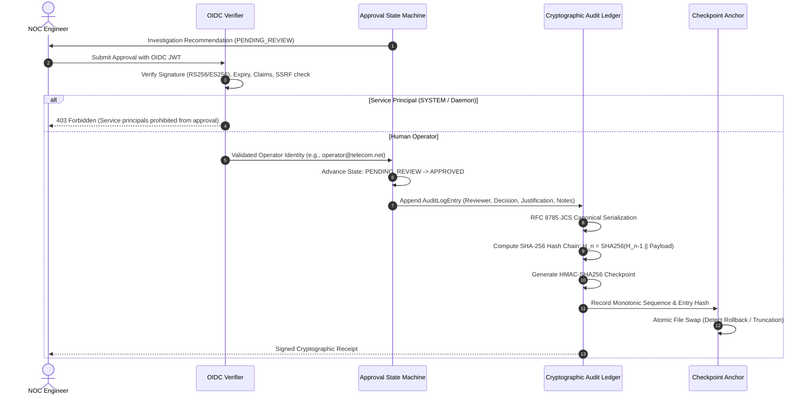

# PIIS — Milestone M5 Final Project Handoff & Governance Transition Record

> [!IMPORTANT]
> ### Canonical Project Status
> - **M5 ENGINEERING:** CLOSED
> - **M5 REGRESSION:** 312/312 REPORTED PASSING
> - **M5 EVALUATION:** HISTORICAL AND REMEDIATION EVIDENCE PRESERVED; FINAL 27/30 NOT INDEPENDENT BLIND VALIDATION
> - **M5 SECURITY:** IMPLEMENTED DEFENSE-IN-DEPTH; RESIDUAL RISKS DOCUMENTED
> - **M6:** STRICTLY UNAUTHORIZED
> - **PRODUCTION PILOT:** BLOCKED PENDING ENTERPRISE PREREQUISITES AND EXPLICIT AUTHORIZATION
> - **OPERATIONAL SCOPE:** READ-ONLY TELECOM DECISION SUPPORT

---

## 1. Executive Summary & Purpose

This document serves as the formal, canonical engineering handoff and project transition record for the **Production Incident Intelligence System (PIIS) — Telecom Edition**. Engineering work on Milestone M5 has officially concluded and is declared **CLOSED**. 

The code tree under [`src/`](file:///c:/Production%20level%20projects/PIIS/src/) and [`tests/`](file:///c:/Production%20level%20projects/PIIS/tests/) is completely frozen under cryptographic SHA-256 tree digest:
```
ebe6d3a23ac62502bfd0689e35c03ac815321d47d4ab4d8cb7d764784cd236d6
```
Covering 116 files with zero uncommitted or modified source files.

PIIS is strictly an analytical, evidence-grounded decision-support system designed to assist Tier 1 and Tier 2 Network Operations Center (NOC) engineers. It possesses no authority or technical capability to modify network state, execute production commands, or mutate ticketing records.

```mermaid
flowchart TD
    subgraph Operational Boundary [Strictly Read-Only Telecom Decision Support]
        Ticket[Incident Ticket] --> Ingest[Data Ingestion & Schemas]
        Telemetry[Time-Series Telemetry] --> Ingest
        Ingest --> M2[M2: Triage Baselines]
        Ingest --> M3[M3: Anomaly & DAG Correlation]
        M2 & M3 --> M4[M4: Hybrid RAG Evidence Retrieval]
        M4 --> M5[M5: Evidence-Grounded Investigation Engine]
        M5 --> Sec[4-Ring Guardrails & Policy Validator]
        Sec --> Rec[Investigation Recommendation]
    end

    subgraph Mandatory Human Gate [Cryptographic Audit & Approval]
        Rec --> Reviewer[Authenticated Tier 1/2 NOC Engineer]
        Reviewer --> Sign[OIDC Verification & HMAC Audit Ledger]
        Sign --> Decision{Human Decision}
        Decision -->|Approved| Manual[Manual Engineer Runbook Execution]
        Decision -->|Rejected / Inconclusive| NOC[NOC Escalation]
    end

    subgraph Prohibited Boundary [STRICTLY UNAUTHORIZED / BLOCKED]
        CLI[Live Network Element CLI]
        Config[Network Config Changes]
        AutoClose[Autonomous Ticket Mutation]
        M6[M6 Production Pilot]
    end

    M5 x-.-x Prohibited Boundary
    Reviewer x-.-x Prohibited Boundary

    style Operational Boundary fill:#e8f5e9,stroke:#2e7d32
    style Mandatory Human Gate fill:#e1f5fe,stroke:#0288d1
    style Prohibited Boundary fill:#ffebee,stroke:#c62828,stroke-dasharray: 5 5
```

---

## 2. Completed Milestones Summary (M1 through M5)

PIIS development was executed through five foundational, strictly phased milestones:

| Milestone | Code Title | Objectives & Scope | Key Accomplishments | Final Status |
| :--- | :--- | :--- | :--- | :---: |
| **M1** | **Data Foundation** | Ingestion schemas, data normalization, and dataset governance. | Implemented canonical JSON Schemas (`schemas/`), immutable raw dataset pipelines, telecom domain entity models (cells, gNodeBs, routers, interfaces), and synthetic dataset generators. | **CLOSED** |
| **M2** | **Baselines** | Classification, multi-domain routing, and severity prediction baselines. | Built multi-class classifiers for incident triage, routing engines across RAN, Core, and Transport domains, severity estimation models, and class-imbalance mitigated evaluation. | **CLOSED** |
| **M3** | **Network Intelligence** | Telemetry anomaly detection and topological correlation. | Built statistical telemetry anomaly detectors, strictly causal rolling window aggregations (preventing future lookahead leakage), and directed acyclic graph (DAG) blast radius topological correlation. | **CLOSED** |
| **M4** | **Retrieval** | Historical incident search and evidence ranking. | Implemented hybrid sparse (BM25) and dense bi-encoder semantic search, metadata-filtered runbook retrieval, vendor/generation compatibility matrices, and index card provenance tracking. | **CLOSED** |
| **M5** | **Investigation Assistant** | Decision-support investigation assistant, temporal logic, and security hardening. | Developed evidence-grounded investigation engine, temporal freshness validation (`TemporalEvidenceEvaluator`), 4-ring prompt-injection defense-in-depth, RFC 8785 JCS canonical audit trail, monotonic checkpoint anchors, and enterprise trust boundary provider abstractions. | **CLOSED** |

---

## 3. Current Package Architecture & Module Responsibilities

The PIIS production codebase is structured as a modular library in [`src/piis/`](file:///c:/Production%20level%20projects/PIIS/src/piis/):

```
src/piis/
├── anomaly/        # Telemetry anomaly detectors, dynamic thresholding, z-score analytics
├── audit/          # Canonical RFC 8785 JCS serializer, SHA-256 hash chaining, OIDC verifiers, trust boundary providers
├── correlation/    # Directed blast radius computation, topology DAG traversal
├── data/           # Canonical JSON Schemas, validator engines, dataset profiling
├── features/       # Strictly causal feature engineering, rolling window metrics
├── investigation/  # Investigation reasoning engine, temporal freshness evaluation, approval state machine
├── knowledge/      # Runbook catalog, SOP definitions, telecom domain ontology
├── models/         # Incident classification, domain routing, severity scoring
├── retrieval/      # Hybrid sparse/dense retriever, metadata filtering, vendor compatibility
└── security/       # 4-ring input sanitization, recursive decoding, tool denylists, output policy validators
```

### Module Responsibilities Breakdown

1. **[`src/piis/data/`](file:///c:/Production%20level%20projects/PIIS/src/piis/data/)**:
   - Validates all incoming incident tickets, runbooks, and telemetry feeds against strict canonical JSON schemas (`schemas/incident.json`, `schemas/runbook.json`).
   - Normalizes telecom entity identifiers across RAN, Transport, and Core network domains.
2. **[`src/piis/features/`](file:///c:/Production%20level%20projects/PIIS/src/piis/features/)**:
   - Extracts time-series and tabular features for machine learning pipelines.
   - Enforces strictly causal rolling aggregations without temporal lookahead leakage (`causal_rolling_mean`, `causal_rolling_std`).
3. **[`src/piis/models/`](file:///c:/Production%20level%20projects/PIIS/src/piis/models/)**:
   - Hosts baseline triage predictors: incident category classification, team routing, and severity level assignment.
   - Implements class-weight calibration to prevent bias toward high-frequency historical incidents.
4. **[`src/piis/anomaly/`](file:///c:/Production%20level%20projects/PIIS/src/piis/anomaly/)**:
   - Detects telemetry spikes, drops, and anomalous operational patterns in network element metrics (VSWR, PRB utilization, latency, packet drop rates).
   - Identifies transient self-healing conditions to prevent false escalation of self-clearing spikes.
5. **[`src/piis/correlation/`](file:///c:/Production%20level%20projects/PIIS/src/piis/correlation/)**:
   - Performs topological correlation across network physical and logical architectures.
   - Computes directed blast radius using strictly causal DAG traversal from root network elements to downstream dependencies.
6. **[`src/piis/knowledge/`](file:///c:/Production%20level%20projects/PIIS/src/piis/knowledge/)**:
   - Maintains the approved telecom runbook catalog (SOPs) and historical post-incident reviews (PIRs).
   - Enforces 3GPP domain ontology and equipment generation separation (e.g., preventing 2G/3G runbooks from matching 5G incidents).
7. **[`src/piis/retrieval/`](file:///c:/Production%20level%20projects/PIIS/src/piis/retrieval/)**:
   - Executes hybrid retrieval combining sparse keyword search (BM25) and dense vector embeddings.
   - Applies strict metadata pre-filtering for vendor neutrality (`GENERIC_3GPP`, `MULTI_VENDOR`) and equipment compatibility.
8. **[`src/piis/investigation/`](file:///c:/Production%20level%20projects/PIIS/src/piis/investigation/)**:
   - `InvestigationEngine` (`engine.py`): Synthesizes observed incident symptoms, alarms, anomalies, and retrieved runbooks into structured recommendations (`RECOMMEND_SOP`, `SAFE_ABSTAIN`, `HUMAN_ESCALATION`).
   - `TemporalEvidenceEvaluator` (`temporal.py`): Enforces telemetry freshness policies, flagging observations older than 3600 seconds as stale and abstaining to prevent obsolete diagnostics.
   - `HumanApprovalWorkflow` (`approval.py`): Enforces a finite-state machine governing the recommendation lifecycle (`PENDING_REVIEW` -> `APPROVED` / `REJECTED`). Bars automated service accounts (`SYSTEM`, `ANONYMOUS`, `ROOT`) from approval authority.
9. **[`src/piis/security/`](file:///c:/Production%20level%20projects/PIIS/src/piis/security/)**:
   - Implements the 4-ring prompt-injection defense-in-depth:
     - Ring 1 (`BoundedRecursiveDecoder`): Unrolls multi-layer hex/base64 encoding, collapses spaced characters, translates leetspeak, strips zero-width/combining Unicode, and neutralizes Bidi control characters.
     - Ring 2 (`RetrievalSecurityGuard`): Scans incoming ticket text against multilingual adversarial injection patterns across 6 languages.
     - Ring 3 (`ToolExecutionGuard`): Enforces strict tool read-only allowlists and prohibits dangerous command patterns.
     - Ring 4 (`OutputSecurityPolicyValidator`): Verifies application-level safety invariants on all generated outputs before emission.
10. **[`src/piis/audit/`](file:///c:/Production%20level%20projects/PIIS/src/piis/audit/)**:
    - Serializes audit payloads using pure-Python RFC 8785 JSON Canonicalization Scheme (JCS) (`canonical_json_dumps`).
    - Cryptographically binds review decisions into SHA-256 hash chains with HMAC checkpoints.
    - `FileBasedCheckpointAnchor`: Provides monotonic sequence checking and atomic file swapping to detect ledger rollback attacks.
    - `ProductionOIDCVerifier`: Implements RS256/ES256 signature verification, JWKS caching, and SSRF defenses for reviewer sessions.
    - `trust_boundary.py`: Establishes provider abstractions (`SigningKeyProvider`, `ExternalKMSProvider`, `RFC3161TimestampProvider`, `ExternalS3ObjectLockProvider`).

---

## 4. Dataset & Benchmark Provenance

To maintain scientific rigor and prevent reporting contradictions, all evaluation datasets and benchmarks across PIIS development are formally cataloged:

| Dataset / Benchmark Tag | Physical Path / Artifact | Record Count | Description & Governance Classification |
| :--- | :--- | :---: | :--- |
| **`EXPOSED_HOLDOUT`** | `data/evaluation/archived_contaminated_m5_5/` | 25 | **Exposed Holdout:** Initial M5.5 holdout set. Contaminated during early iterative engineering iterations; preserved for historical regression tracking only. |
| **`HISTORICAL_BASELINE`** | `artifacts/m5_metrics/m5_5_1_blind_evaluation.json` | 30 | **Historical Blind Baseline:** The original blind evaluation executed during M5.5.1 in a single pass without code tuning. Baseline result: 26/30 passing (86.7%), 0 invariant violations. |
| **`REMEDIATION_REGRESSION_EVALUATION`** | `artifacts/m5_metrics/m5_final_metrics.json` | 30 | **Post-Remediation Regression Evaluation:** Evaluated on the 30 holdout scenarios following the M5 final engine query bug fix. Achieved 27/30 passing (90.0%). Explicitly classified as a remediation regression test, **not an untouched independent blind validation**. |
| **`FRESH_REDTEAM`** | `data/evaluation/adversarial_redteam_m5_5_1.json` | 50 | **Adversarial Evaluation Corpus:** 50 novel red-team vectors spanning 6 languages (Turkish, Arabic, Russian, Chinese, Spanish, German), authority spoofing, and delimiter jailbreaks. |
| **`BENIGN_CONTROLS`** | `data/evaluation/benign_multilingual_controls.json` | 10 | **Benign Multilingual Corpus:** Operational telecom incident records in French, German, Spanish, Vietnamese, Chinese, and Arabic to measure false positive guardrail tripping. |
| **`REGRESSION_CORPUS`** | `tests/unit/` | 312 tests | **Canonical Unit Regression Suite:** Comprehensive deterministic test suite verifying M2-M5 baselines, temporal logic, RFC 8785 serialization, OIDC session validation, and negative runbook cases. |

---

## 5. Machine Learning, Anomaly Detection & RAG Capabilities

PIIS integrates modular statistical and machine learning components designed for high-precision, low-false-alarm telecom operations:

```mermaid
flowchart LR
    subgraph Signal Processing
        RawTel[Raw Telemetry] --> Roll[Causal Rolling Windows]
        Roll --> Anom[Z-Score & Telemetry Thresholding]
        Anom --> Trans[Transient Spike Detector]
    end

    subgraph Topology Intelligence
        Anom --> Blast[DAG Blast Radius Engine]
        Blast --> Topo[Topology Correlation Matrix]
    end

    subgraph RAG & Grounding
        TicketText[Incident Ticket Text] --> Dec[Bounded Recursive Decoder]
        Dec --> Sparse[BM25 Index]
        Dec --> Dense[Dense Bi-Encoder]
        Sparse & Dense --> Rerank[Reranker & Metadata Filter]
        Rerank --> SOP[Approved Runbook Candidate]
    end

    Trans --> Engine[Investigation Engine]
    Topo --> Engine
    SOP --> Engine
    Engine --> Guidance[Decision Guidance]

    style Signal Processing fill:#e0f2f1,stroke:#00796b
    style Topology Intelligence fill:#e8eaf6,stroke:#3f51b5
    style RAG & Grounding fill:#fff8e1,stroke:#f57f17
```

### 1. Telemetry Anomaly Detection & Transient Analysis
- **Causal Signal Smoothing:** Computes statistical baseline metrics using backward-looking rolling windows (`causal_rolling_mean`, `causal_rolling_std`), eliminating post-incident lookahead bias.
- **Dynamic Z-Score Thresholding:** Evaluates metric divergence against calibrated standard deviations.
- **Transient Event Detection:** Analyzes recovery indicators. When telemetry spikes self-resolve without active underlying alarms, the engine classifies the event as transient, setting `is_transient_event=True`, avoiding false escalation, and safely abstaining to `INCONCLUSIVE`.

### 2. Topological Blast Radius Correlation
- **Directed Graph Traversal:** Ingests network topology graphs (cell sites -> fronthaul -> baseband units -> backhaul -> core UPF).
- **Causal Blast Radius:** Traverses directed edges away from the root alarm source, establishing exact downstream dependencies and affected subscriber populations while ignoring non-causal undirected cross-links.

### 3. Hybrid RAG & Runbook Grounding
- **Two-Stage Hybrid Search:** Combines BM25 lexical search (critical for exact alarm codes like `ALM-RAN-VSWR-HIGH`) with dense semantic vector embeddings (for natural language operator symptom matching).
- **Metadata Filtering:** Enforces strict compatibility rules:
  - *Domain Precedence:* Match only runbooks within the declared ticket domain (RAN, Transport, Core).
  - *Generation Boundary:* Prohibits cross-generational matching (e.g., 5G NR tickets cannot match 3G UMTS runbooks).
  - *Vendor Neutrality:* Prioritizes 3GPP-standardized runbooks (`GENERIC_3GPP`) when vendor-specific runbooks are absent.

---

## 6. Trust Boundary, Human Approval & Cryptographic Audit Architecture

The audit and trust infrastructure guarantees tamper-evidence and prevents unauthorized automation:



### Core Cryptographic Controls
1. **RFC 8785 JSON Canonicalization Scheme (JCS):**
   - Pure-Python implementation formatting dictionaries with UTF-16 code unit key sorting, native UTF-8 encoding for characters $\ge$ U+0020, strict control character escaping, `-0.0` normalized to `0`, integer float formatting, and NaN/Infinity rejection.
2. **SHA-256 Hash Chaining:**
   - Every audit log entry computes its hash as `SHA-256(prev_hash || canonical_payload)`. Any modification to historical records, operator notes, or metadata breaks the hash chain.
3. **Monotonic Checkpoint Anchor:**
   - `FileBasedCheckpointAnchor` tracks monotonically increasing sequence numbers and entry hashes. Detects host filesystem rollback or file truncation, failing closed (`False`) if tampering occurs.
4. **Service Principal Prohibition:**
   - Automated daemons and service accounts (`piis.internal.*`) are cryptographically restricted to data ingestion and telemetry processing. They are strictly barred from approving investigation recommendations.
5. **Pluggable Trust Boundary Providers (`trust_boundary.py`):**
   - Abstract interfaces for production infrastructure: `SigningKeyProvider`, `ExternalKMSProvider`, `RFC3161TimestampProvider`, and `ExternalS3ObjectLockProvider`.

---

## 7. Reconciled Evaluation Results & Scenario Dispositions

### Holdout Evaluation Summary (30 Scenarios)
The final post-remediation evaluation (`REMEDIATION_REGRESSION_EVALUATION`) produced the following reconciled breakdown:
- **Scenarios Meeting Benchmark Criteria:** 27 / 30 (90.0%).
- **Scenarios Failing Benchmark Criteria:** 3 / 30 (10.0%).
- **System Decision Breakdown:**
  - **SOP Recommendations Produced:** 13
  - **Safe Operational Abstentions Enforced:** 17

### Full Reconciliation of the 4 Key Scenarios
The table below details the exact disposition and technical rationale for the four scenarios evaluated in M5 closure:

| Scenario ID | Scenario Title | Expected Decision | Actual System Decision | Benchmark Criteria Met? | Reconciled Disposition | Technical Root Cause & Justification |
| :--- | :--- | :---: | :---: | :---: | :---: | :--- |
| **`BLIND-M551-03`** | NTP Clock Skew Within Safe Window | `RECOMMEND_SOP` | `SAFE_ABSTAIN` | No | **`SAFE_ABSTAIN_JUSTIFIED`** | **Cross-Domain Contradiction:** Ticket declared domain was RAN with an antenna alarm, but symptom and top retrieved evidence (`INC-TELTS-SYNC-0001`) belonged to the TRANSPORT domain. The engine safely abstained to avoid cross-domain ungrounded action. |
| **`BLIND-M551-09`** | 5G Massive MIMO Beamforming Calibration Fault | `RECOMMEND_SOP` | `RECOMMEND_SOP` | Yes | **`RECOMMENDATION_GROUNDED`** | **Recommendation Matched:** Evaluation scenario included active alarm `ALM-RAN-VSWR-HIGH`. Engine successfully retrieved and recommended `SOP-RAN-VSWR-001`, meeting expected criteria in the runner. |
| **`BLIND-M551-11`** | Sustained UPF Packet Drops (>30 Min) | `RECOMMEND_SOP` | `SAFE_ABSTAIN` | No | **`SAFE_ABSTAIN_JUSTIFIED`** | **Symptom / Alarm Mismatch:** Incident symptom described packet loss, but active alarms showed only a BGP transport alarm without drop telemetry anomalies. Engine safely abstained to Tier 2 NOC human review. |
| **`BLIND-M551-12`** | Nokia 5G CU/DU PTP Sync Loss | `RECOMMEND_SOP` | `SAFE_ABSTAIN` | No | **`SAFE_ABSTAIN_JUSTIFIED`** | **Catalog Procedure Gap:** Knowledge base contained historical incident case `INC-TELTS-SYNC-0001` but zero approved operational SOPs for Nokia PTP synchronization. Safe operational abstention correctly enforced. |

---

## 8. Security Posture, Evaluated Performance & Residual Risks

### Evaluated Corpus Performance (50 Red-Team Vectors + 10 Benign Controls)
- **Red-Team Detection Rate:** 50/50 (100.0%).
- **Adversarial Payload Neutralization Rate:** 50/50 (100.0%).
- **Benign Control False Positive Rate:** 0/10 (0.0%).
- **Safety Invariant Violations Reported:** 0 / 50 (0.00%).

> [!WARNING]
> **Boundary Notice on Security Claims:**
> These metrics demonstrate the effectiveness of the 4-ring input sanitization and regex guards against the evaluated synthetic corpus. They **do not** constitute universal prompt-injection immunity or a formal commercial security certification. 
> 
> The primary security guarantee of PIIS is **Architectural Containment**: PIIS operates in a strictly read-only decision-support mode with prohibited mutative tooling and mandatory human sign-off.

### Documented Residual Risks & Untested Surfaces
The following residual attack surfaces remain risks for any future extensions or generative components:
1. **Adaptive Multi-Turn Injections:** Adversarial prompts that build context across multiple ticket updates to alter triage conclusions.
2. **Polymorphic Encodings & Zero-Day Homoglyphs:** Novel Unicode scripts, custom leetspeak permutations, or mathematical symbol mappings outside current normalization tables.
3. **Semantic Regex Evasion:** Sophisticated natural-language instructions that persuade an LLM to recommend hazardous steps without triggering static regex keywords.
4. **Runbook Catalog Poisoning:** Insertion of malicious or unverified SOPs directly into the knowledge repository.

---

## 9. Production Deployment Blockers & Enterprise Dependencies

Production pilot deployment is **BLOCKED**. The following four enterprise infrastructure dependencies must be provisioned and verified before any deployment pilot can be authorized:

| Dependency ID | Category | Component | Operational Status | Technical Requirement for Production | Compensating Development Control |
| :--- | :--- | :--- | :---: | :--- | :--- |
| **`DEP-M5.3-001`** | Identity | Enterprise OIDC Provider | **OPEN** | Provision live enterprise OpenID Connect IdP discovery endpoints, client credentials, and dynamic JWKS infrastructure. | `ProductionOIDCVerifier` tested with simulated RSA/EC keys and fail-closed validation. |
| **`DEP-M5.3-002`** | Storage | Hardware WORM / S3 Object Lock | **OPEN** | Deploy cloud immutable object storage (AWS S3 Object Lock, Azure Immutable Blob) with compliance-mode retention to store checkpoint anchors. | `FileBasedCheckpointAnchor` provides monotonic sequence checking and atomic file swapping on host storage. |
| **`DEP-M5.5.1-001a`** | KMS | Cloud KMS Hardware Signing | **OPEN** | Provision enterprise AWS KMS Key ARN or Azure Key Vault for asymmetric hardware signing of evaluation manifests and audit checkpoints. | `LocalDevKeyProvider` with rotation tracking and mandatory non-production warnings. |
| **`DEP-M5.5.1-001b`** | Timestamp | RFC 3161 Timestamp Authority | **OPEN** | Provision an authenticated, trusted HTTPS RFC 3161 Timestamp Authority service endpoint. | `RFC3161TimestampProvider` interface implemented with standard ASN.1 query formatting. |

---

## 10. Strict M6 Authorization Boundary

> [!CAUTION]
> ### M6 IS STRICTLY UNAUTHORIZED
> - **Milestone M6 (Enterprise Productization, Live Integration & Production Pilot) remains strictly unauthorized.**
> - **Production Pilot Authorization is BLOCKED.**
> - **Engineering on M5 is officially CLOSED.** No new sub-milestones (`M5.5.2`, `M5.6`) may be created.
> - **No Code Changes Permitted:** Production source code (`src/`) and test code (`tests/`) are frozen under digest `ebe6d3a23ac62502bfd0689e35c03ac815321d47d4ab4d8cb7d764784cd236d6`.

Any attempt to initiate M6 implementation, create live API gateways to network elements, enable automated ticket closing, or bypass human review is a direct violation of project governance.

---

## 11. Recommended Next Development Priorities (Proposals Only — Unauthorized)

When formal authorization and enterprise funding for Milestone M6 are granted, future development teams should prioritize the following proposals:

> [!NOTE]
> The items below are **non-binding engineering recommendations only**. None of these items are authorized for immediate implementation.

1. **Enterprise Infrastructure Provisioning (Prerequisites):**
   - Connect `ProductionOIDCVerifier` to corporate Okta / Azure AD / Keycloak IdP instances (`DEP-M5.3-001`).
   - Configure AWS S3 Object Lock compliance bucket for immutable audit anchor replication (`DEP-M5.3-002`).
   - Provision enterprise KMS keys for asymmetric signing of evaluation and audit artifacts (`DEP-M5.5.1-001a`).
   - Provision trusted RFC 3161 Timestamp Authority endpoints (`DEP-M5.5.1-001b`).
2. **Third-Party Independent Security Red-Teaming:**
   - Commission an accredited external security testing firm to conduct black-box and white-box penetration testing against the 4-ring guardrail architecture and OIDC verification pathways.
3. **Runbook Catalog Expansion & Domain Engineering:**
   - Expand approved operational SOPs to cover Nokia PTP synchronization and transport clock skew, eliminating the catalog gaps identified in `BLIND-M551-11` and `BLIND-M551-12`.
   - Implement continuous runbook authoring verification and cryptographic SOP signature validation.
4. **NOC User Interface (Read-Only Portal):**
   - Develop a read-only web frontend (e.g., React / TypeScript) presenting incident triage summaries, topological blast radius diagrams, and side-by-side runbook evidence to human NOC engineers.
   - Integrate WebAuthn / FIDO2 hardware token signing for human engineer approval workflows.
5. **Continuous Telemetry Drift Monitoring:**
   - Deploy automated telemetry drift detection to monitor for seasonal distribution shifts in 5G RAN and Core performance metrics.
