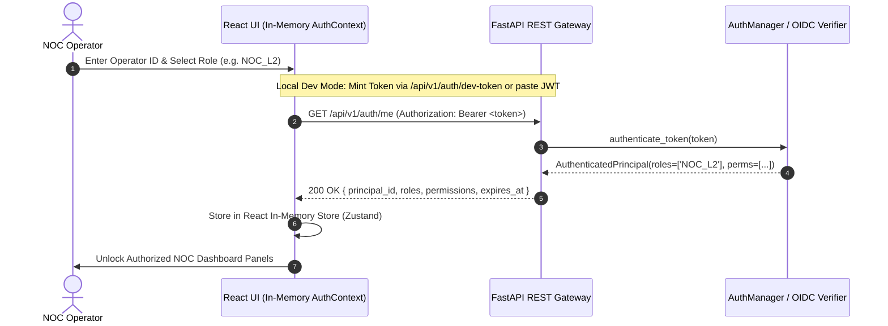

# PIIS UI-0 — Authentication & Security Assessment

> [!IMPORTANT]
> **Core Architectural Security Invariant:**
> The frontend is **never** an authorization boundary.
> All access controls, cryptographic sign-offs, role permissions, and separation-of-duty boundaries must be verified and enforced server-side by the FastAPI backend on every request.

---

## 1. Threat Modeling & Authentication Architecture Comparison

We evaluate three potential web client authentication architectures for integrating the React frontend with the PIIS FastAPI backend:

| Dimension | 1. Browser Bearer-Token (Local/Session Storage) | 2. HttpOnly Cookie Sessions | 3. Backend-For-Frontend (BFF) Session Proxy |
| :--- | :--- | :--- | :--- |
| **Storage Mechanism** | `sessionStorage` or React memory state | `Set-Cookie` with `HttpOnly; Secure; SameSite=Strict` | Secure Session Cookie between Client & BFF; BFF signs upstream JWT |
| **XSS Vulnerability** | **High Risk if stored on disk.** Scripts with DOM access can exfiltrate tokens. (Mitigated if in-memory only). | **Immune to Exfiltration.** JavaScript cannot read `HttpOnly` cookies. | **Immune to Exfiltration.** JavaScript cannot read session cookie. |
| **CSRF Vulnerability** | **Zero CSRF Risk.** Browsers do not automatically attach Bearer headers. | **Requires CSRF Defense.** Requires `SameSite=Strict` and Double-Submit CSRF tokens. | **Requires CSRF Defense.** SameSite cookies and Anti-CSRF header checks. |
| **CORS Overhead** | Standard `Authorization` header allowed in `CORSMiddleware`. | Requires `credentials: 'include'` and strict origin whitelisting (`Access-Control-Allow-Credentials: true`). | Single origin (BFF serves frontend static assets and proxies API calls). |
| **Compatibility with Current PIIS** | **100% Native.** Existing backend expects `Authorization: Bearer <JWT>` ([`dependencies.py`](file:///c:/Production%20level%20projects/PIIS/src/piis/auth/dependencies.py)). | Requires modifying backend to parse cookies or adding middleware. | Requires deploying an intermediate proxy gateway. |
| **Local Reproducibility** | Immediate. No extra services, reverse proxies, or external IdP bridges needed. | Requires cookie configuration and HTTPS local certs for `Secure` flag. | Requires running an additional proxy daemon process. |

---

## 2. Documented Threat Analysis

### 2.1 Threat 1: Cross-Site Scripting (XSS) Token Exfiltration
- **Vector:** An adversarial payload injected into an incident description or runbook chunk executes inline JavaScript in the operator's browser, attempting to read stored credentials.
- **Backend Defense:**
  - The backend already applies a 4-ring input sanitization pipeline ([`src/piis/security/sanitizer.py`](file:///c:/Production%20level%20projects/PIIS/src/piis/security/sanitizer.py)) using `BoundedRecursiveDecoder` to neutralize recursive Base64 and HTML tags.
- **Frontend Defense:**
  - React's JSX automatically escapes string bindings in the DOM, preventing direct innerHTML script execution.
  - The React application must **never** store raw tokens in `localStorage`.
  - The token is held in an in-memory React `AuthContext` (managed by a Zustand store). For refresh across page reloads in development, it is restricted to `sessionStorage` (cleared automatically on tab close) and never written to persistent disk storage.

### 2.2 Threat 2: Service Principal Review Forgery
- **Vector:** An automated bot or external polling service attempts to sign an operational recommendation using a valid service principal token.
- **Backend Defense:**
  - Enforced server-side via `require_human_operator` in [`src/piis/auth/dependencies.py#L77-L90`](file:///c:/Production%20level%20projects/PIIS/src/piis/auth/dependencies.py#L77-L90).
  - The backend explicitly checks `principal.is_service_principal` and throws HTTP 403 Forbidden.
- **Frontend Presentation:**
  - If an authenticated session has `is_service_principal: true`, the React UI visibly disables the "Approve" button, replaces it with a warning lock badge (`[SERVICE PRINCIPAL: HUMAN REVIEW LOCKED]`), and displays a descriptive tooltip explaining that human operator sign-off is mandatory.

### 2.3 Threat 3: Credential & Secret Leaks in Frontend Bundle
- **Invariant:** The frontend bundle must contain zero private keys, HMAC secrets, KMS ARNs, or OIDC client secrets.
- **Static Verification:**
  - Vite environment variables prefixed with `VITE_` are strictly limited to non-sensitive runtime flags (e.g. `VITE_API_BASE_URL`, `VITE_APP_TITLE`).
  - All cryptographic notarization, RFC 8785 canonical hashing, and HMAC generation occur exclusively within `HumanApprovalWorkflow` on the FastAPI server.

---

## 3. Recommended Authentication Architecture for UI-1

For Milestone UI-1, we recommend a **Hybrid In-Memory Bearer Token Architecture with Clean Local Dev OIDC Bridge**:

### 3.1 Token Expiration & Revocation Handling
1. **Periodic Refresh Check:** A lightweight timer hook checks JWT `exp` claims every 60 seconds.
2. **Graceful Warning:** When remaining validity drops below 5 minutes, an amber status badge notifies the operator: `Session Expiring in 4m 30s`.
3. **Fail-Closed on Expiration:** Upon token expiration or an HTTP 401 response from any API endpoint:
   - TanStack Query automatically aborts background retries.
   - The in-memory session is cleared.
   - A modal prompt invites the operator to re-authenticate without losing current filter or workspace state.
