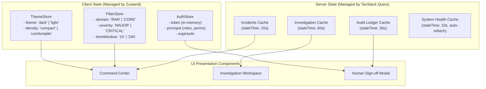

# PIIS UI-0 — Frontend Architecture Specification

> [!IMPORTANT]
> **Technical Stack Decision Record:**
> - **Framework:** React 19 with TypeScript 5.8 (Strict Mode enabled)
> - **Build System:** Vite 6 (Fast ESM bundling, HMR, optimized roll-up production distribution)
> - **Routing:** React Router v7 (Data routers with type-safe route parameters)
> - **Server State & Caching:** TanStack Query v5 (`@tanstack/react-query`)
> - **Client State:** Zustand 5 (Lightweight in-memory session, active filters, UI preferences)
> - **Form Validation:** React Hook Form + Zod (Type-safe runtime schema validation)
> - **UI Primitives:** Radix UI Primitives (Unstyled accessible dialogs, tooltips, dropdowns, selects)
> - **Styling:** Tailwind CSS v4 (Design tokens via CSS custom variables)
> - **Charts & Visualization:** Recharts 2 (Responsive SVG charts) + Custom Canvas/SVG for Network DAG

---

## 1. Directory Structure Proposal (`frontend/`)

```text
frontend/
├── index.html                       # Entry HTML with zero external CDN scripts
├── package.json                     # Dependency manifest and build scripts
├── tsconfig.json                    # TypeScript strict mode compiler configuration
├── tsconfig.node.json               # Vite node configuration
├── vite.config.ts                   # Vite bundler configuration & /api proxy setup
├── tailwind.config.ts               # Theme tokens & typography plugin config
└── src/
    ├── main.tsx                     # React application root mounting
    ├── App.tsx                      # QueryClientProvider, RouterProvider, ThemeProvider
    │
    ├── app/                         # Core application configuration
    │   ├── router.tsx               # Route definitions and layout hierarchy
    │   └── queryClient.ts           # TanStack Query defaults (retries, stale time)
    │
    ├── layouts/                     # High-level shell layouts
    │   ├── RootLayout.tsx           # Global shell: Header, Nav, Status Banner, Toasts
    │   ├── OperatorLayout.tsx       # Standard NOC workspace layout with sidebar/subnav
    │   └── AuthLayout.tsx           # Minimalist authentication / token-entry layout
    │
    ├── pages/                       # Route-level view components
    │   ├── CommandCenterPage.tsx    # 7.1 Real-time operations overview & metrics
    │   ├── IncidentExplorerPage.tsx # 7.2 Filterable incident catalog & table
    │   ├── InvestigationPage.tsx    # 7.3 Multi-stage investigation & evidence register
    │   ├── NetworkIntelligencePage.tsx # 7.4 Topology graph, anomalies & RF telemetry
    │   ├── HumanReviewPage.tsx      # 7.5 Pending review queue & cryptographic sign-off
    │   ├── AuditLedgerPage.tsx      # 7.6 Tamper-evident audit timeline & verification
    │   ├── IntegrationsPage.tsx     # 7.7 Adapter connectivity, health & DLQ management
    │   ├── SystemHealthPage.tsx     # 7.8 Pipeline, model & subsystem readiness
    │   └── SettingsPage.tsx         # 7.9 Operator profile, theme & display preferences
    │
    ├── components/                  # Reusable presentation components
    │   ├── ui/                      # Primitive accessible controls (Radix-backed)
    │   │   ├── Button.tsx
    │   │   ├── Card.tsx
    │   │   ├── Badge.tsx
    │   │   ├── Dialog.tsx
    │   │   ├── Table.tsx
    │   │   ├── Tabs.tsx
    │   │   └── Tooltip.tsx
    │   ├── epistemic/               # The 6 visual epistemic tag components
    │   │   ├── EpistemicBadge.tsx   # [OBSERVED FACT], [HYPOTHESIS], etc.
    │   │   └── EpistemicLegend.tsx  # Global standards legend bar
    │   ├── feedback/                # Banners, alerts, loading skeletons
    │   │   ├── AlertBox.tsx
    │   │   ├── SkeletonLoader.tsx
    │   │   └── ErrorBoundary.tsx
    │   └── visualization/           # Chart wrappers
    │       ├── MetricCard.tsx
    │       ├── TelemetryChart.tsx
    │       ├── AnomalyTimeline.tsx
    │       └── TopologyGraphView.tsx
    │
    ├── features/                    # Domain-scoped feature modules
    │   ├── incidents/               # Incident list, filtering, status badges
    │   ├── investigation/           # Hypotheses ranking, evidence register, RAG cards
    │   ├── approval/                # Human sign-off modal, cryptographic receipt viewer
    │   ├── network/                 # Element inspector, alarm list, blast radius
    │   ├── audit/                   # Hash chain visualizer, sequence tracker
    │   └── dlq/                     # Dead-letter inspector, replay trigger
    │
    ├── api/                         # Typed API client layer
    │   ├── client.ts                # Fetch wrapper with Bearer token injection
    │   ├── endpoints.ts             # API route constants
    │   └── types.ts                 # TypeScript types matching Pydantic backend models
    │
    ├── hooks/                       # Custom React & Query hooks
    │   ├── useIncidents.ts          # TanStack query for incident list & filtering
    │   ├── useInvestigation.ts      # Query & mutation for incident investigation
    │   ├── useHumanReview.ts        # Mutation for approving/rejecting recommendations
    │   ├── useAuditLedger.ts        # Query for audit trail & verify endpoint
    │   └── useSystemHealth.ts       # Polling query for /api/v1/ready and adapters
    │
    ├── auth/                        # Authentication state & guard wrappers
    │   ├── AuthContext.tsx          # In-memory authentication provider
    │   ├── authStore.ts             # Zustand store for active token & principal
    │   ├── ProtectedRoute.tsx       # Route guard checking role/permissions
    │   └── TokenEntryModal.tsx      # Modal drawer for token input / role selection
    │
    ├── theme/                       # Dark/Light theme manager & tokens
    │   ├── ThemeContext.tsx         # Dark / Light theme provider
    │   ├── themeStore.ts            # Local preference store
    │   └── tokens.ts                # Semantic color & spacing tokens
    │
    └── utils/                       # Shared utility functions
        ├── formatters.ts            # Date formatting (UTC), latency, packet units
        ├── crypto.ts                # Short hash helpers (e.g. RCPT-16HEX)
        └── validators.ts            # Client-side input validation helpers
```

---

## 2. State Management Architecture



---

## 3. Dependency Recommendations & Trade-Off Analysis

| Package | Recommended Version | Architectural Purpose | Justification vs. Alternatives |
| :--- | :--- | :--- | :--- |
| **react / react-dom** | `^19.0.0` | Core UI Component Framework | Standard enterprise ecosystem; high performance; native hooks. |
| **typescript** | `^5.8.0` | Static Typing & Type Safety | Eliminates runtime type errors across API contract boundaries. |
| **vite** | `^6.2.0` | Build Tool & Dev Server | Sub-second HMR, native ES modules, lightweight footprint compared to Webpack. |
| **@tanstack/react-query** | `^5.66.0` | Server State & Caching | Solves caching, deduping, background polling, and mutation rollbacks cleanly. |
| **zustand** | `^5.0.3` | Lightweight Client Store | Simple in-memory store (<2kB), zero boilerplate, avoids Redux bloat. |
| **react-router-dom** | `^7.2.0` | Client-Side Routing | Standard React routing, nested layouts, loader hooks. |
| **@radix-ui/react-*** | Latest primitives | Accessible UI Primitives | 100% WAI-ARIA compliant dialogs, tooltips, dropdowns without opinionated styling. |
| **tailwindcss** | `^4.0.0` | Atomic CSS Styling | High information density, predictable class names, CSS variable theming. |
| **recharts** | `^2.15.0` | Data Visualization | Clean SVG rendering, responsive containers, dark/light theme compatible. |
| **lucide-react** | `^0.475.0` | Iconography | Tree-shakeable SVG icons, consistent optical weight, zero external fonts. |
| **zod** | `^3.24.0` | Schema Validation | Runtime validation for review justifications and filter inputs matching Pydantic. |
