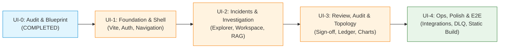

# PIIS UI-0 — Frontend Implementation Roadmap

> [!IMPORTANT]
> **Implementation Sequence Guidelines:**
> Following the acceptance of Milestone UI-0, frontend development proceeds in four sequential, bite-sized, independently testable phases: **UI-1, UI-2, UI-3, and UI-4**.
> At no point will existing backend APIs or test fixtures be broken.

---

## 1. Roadmap Overview & Phasing

---

## 2. Detailed Milestone Breakdown

### 2.1 Milestone UI-1 — Foundation, Build System & Core Shell
- **Objective:** Scaffold the `frontend/` directory with Vite, TypeScript strict mode, Tailwind CSS v4 design tokens, React Router v7, in-memory auth state, and the global application shell.
- **Key Deliverables:**
  1. `frontend/` scaffolding with `package.json`, `vite.config.ts`, `tsconfig.json`, `tailwind.config.ts`.
  2. Vite development proxy configuring `/api` -> `http://127.0.0.1:8000`.
  3. `RootLayout.tsx` featuring NOC Header, Status Banner (`STRICTLY READ-ONLY`), Epistemic Standards Legend, and 9-item Navigation Bar.
  4. In-memory `AuthContext` and Zustand store with Token Input Modal and mock OIDC role picker (`NOC_L1`, `NOC_L2`, `NOC_L3`, `INCIDENT_MANAGER`, `PIIS_ADMIN`).
  5. Dark / Light theme toggle with local preference persistence.
  6. Backend endpoint addition: `GET /api/v1/auth/me` returning verified principal claims.
- **Exit Criteria:** `pnpm build` succeeds with zero TypeScript or lint errors; browser loads shell with working dark/light theme and authenticated header.

---

### 2.2 Milestone UI-2 — Incident Explorer & Investigation Workspace
- **Objective:** Implement the operational core for incident browsing, searching, and evidence-grounded investigation analysis.
- **Key Deliverables:**
  1. `IncidentExplorerPage.tsx`: Dense data table with domain/severity badge filters, free-text search, pagination, and sorting.
  2. `InvestigationPage.tsx`:
     - Evidence sufficiency indicator (`is_sufficient: true/false`) with amber warnings for missing or stale evidence.
     - Ranked candidate hypotheses horizontal bar chart with confidence scores and explicit `[HYPOTHESIS — NOT CONFIRMED ROOT CAUSE]` labeling.
     - Correlated network evidence register displaying telemetry metrics, OSS alarm codes, and topological links.
     - Retrieved runbook cards detailing source runbook ID, version, and match score.
     - Actionable diagnostic recommendations queue.
- **Exit Criteria:** Operator can navigate from incident list to full investigation workspace; all data models render without TypeScript errors; unit and component tests pass.

---

### 2.3 Milestone UI-3 — Human Review, Cryptographic Audit & Network Intelligence
- **Objective:** Implement governance workflows, cryptographic receipt displays, hash chain visualizers, and network topology charts.
- **Key Deliverables:**
  1. `HumanReviewPage.tsx`: Pending recommendation queue with risk classification tiers (`READ_ONLY_SAFE`, `LOW`, `MEDIUM`, `HIGH`).
  2. `ReviewSignOffModal.tsx`:
     - Secure approval/rejection submission with mandatory operator technical justification.
     - Server-side RBAC validation and strict service principal lockout with red lock icon.
     - Interactive cryptographic receipt viewer displaying entry SHA-256 digest, monotonic sequence number, and `RCPT-<HEX16>`.
  3. `AuditLedgerPage.tsx`: Tamper-evident hash chain sequence tracker with visual block linkage and real-time `/api/v1/audit/verify` integrity badge.
  4. `NetworkIntelligencePage.tsx`:
     - Directed acyclic graph topology view rendering physical/logical links and blast-radius estimations.
     - Recharts multi-line RF telemetry chart plotting observed values against threshold limits.
- **Exit Criteria:** End-to-end human approval workflow notarizes decision into audit ledger and updates UI immediately; service principal lockout verified.

---

### 2.4 Milestone UI-4 — Platform Operations, Integrations, Hardening & Final E2E
- **Objective:** Complete platform administration views, bundle static assets into FastAPI production serving, and execute full browser-level verification.
- **Key Deliverables:**
  1. `IntegrationsPage.tsx`: Adapter connectivity matrix with honest status labels (`LOCALLY VERIFIED`, `SIMULATED`, `CONTRACT TESTED`, `EXTERNALLY UNVERIFIED`).
  2. Dead-letter queue (DLQ) inspector and replay trigger.
  3. `SystemHealthPage.tsx`: Platform probes, component readiness matrix, and Prometheus metrics display.
  4. `SettingsPage.tsx`: Operator profile and session lifecycle manager.
  5. Production Build Integration: Configure FastAPI `StaticFiles` in `src/piis/api/app.py` to serve `frontend/dist` on `/ui` with SPA fallback routing.
  6. Comprehensive Playwright E2E test suite running all 18 portfolio demonstration stages in headless Chromium.
- **Exit Criteria:** 100% test passage across backend (388 tests) and frontend (E2E + unit); single-command startup runs full stack locally.
