# PIIS UI-0 — Product Information Architecture Specification

> [!IMPORTANT]
> **Information Architecture Principles:**
> 1. **High Information Density:** Designed for Tier 1, 2, and 3 telecom NOC operators handling simultaneous multi-domain network degradations.
> 2. **Epistemic Discipline:** Clear visual distinction between what is directly observed, what is statistically inferred, and what requires human validation.
> 3. **Non-Invasive Decision Support:** The UI serves recommendations to the human operator; it never attempts autonomous production mutations.

---

## 1. Global Navigation & Screen Hierarchy

```mermaid
flowchart TD
    Shell["PIIS Global Application Shell<br/>(Header, Status Banner, Epistemic Legend, Nav Bar)"]
    
    Shell --> CC["1. Command Center (/)<br/>- Fleet KPI Cards<br/>- Active Outages<br/>- Alarm Spikes<br/>- Review Queue Summary"]
    Shell --> IE["2. Incident Explorer (/incidents)<br/>- Filterable Incident Table<br/>- Domain & Severity Facets<br/>- Time Window Selector<br/>- Lineage Inspector"]
    Shell --> IW["3. Investigation Workspace (/incidents/:id/investigate)<br/>- Sufficiency & Contradictions<br/>- Ranked Hypotheses<br/>- Evidence Register<br/>- Diagnostic Recommendations"]
    Shell --> NI["4. Network Intelligence (/network)<br/>- Directed Topology Graph<br/>- Anomaly Time Series<br/>- Correlated OSS Alarms<br/>- Blast Radius Inspector"]
    Shell --> HR["5. Human Review Queue (/reviews)<br/>- Pending Review Queue<br/>- Cryptographic Sign-Off Modal<br/>- Service Principal Lockout<br/>- Historical Receipts"]
    Shell --> AP["6. Audit & Provenance (/audit)<br/>- RFC 8785 Hash Chain Timeline<br/>- Sequence Verifier<br/>- Checkpoint Anchor Inspector<br/>- Timestamp Authority Status"]
    Shell --> INT["7. Enterprise Integrations (/integrations)<br/>- Adapter Connectivity Matrix<br/>- Verification Status Labels<br/>- Dead-Letter Queue (DLQ)<br/>- Ingestion Retry Trigger"]
    Shell --> SH["8. System Health (/system)<br/>- Liveness & Readiness Probes<br/>- Model & Retrieval Latencies<br/>- Prometheus Metric Exporters<br/>- Error Telemetry"]
    Shell --> SET["9. Settings & Profile (/settings)<br/>- Authenticated Operator Claims<br/>- Assigned Role & Permissions<br/>- Theme (Dark/Light)<br/>- Session Token Refresh"]
```

---

## 2. Detailed Screen Specifications

### 2.1 Command Center (`/`)
- **Primary Objective:** Provide Tier 1/2 NOC supervisors with an immediate situational overview of network health, active incidents, and pending approval bottlenecks.
- **Key Visual Elements:**
  - **4 Top KPI Cards:**
    1. *Active Canonical Incidents* (Observed Fact, source: `/api/v1/incidents`).
    2. *Major / Critical Outages* (Model Prediction, color: Amber/Red).
    3. *Pending Human Reviews* (Action Required, color: Cyan/Blue).
    4. *Integration Adapters Active* (Observed Fact, e.g. `6 / 6 Healthy`).
  - **Recent Incidents Feed:** Condensed 5-column table displaying incident ID, domain, severity badge, title, and "Investigate" quick-action button.
  - **Integration Status Banner:** Real-time pulse displaying status of ServiceNow, Jira, Prometheus, OSS/NMS, and OTLP adapters.
  - **Quick Human Review Drawer:** Slide-out summary of pending high-priority recommendations awaiting operator sign-off.

### 2.2 Incident Explorer (`/incidents`)
- **Primary Objective:** Comprehensive search, filtering, and inspection of all canonical incidents across 5G RAN, Core, Transport, and Service domains.
- **Key Visual Elements:**
  - **Filter Bar:** Multi-select domain filter (`RAN`, `CORE`, `TRANSPORT`), severity selector (`CRITICAL`, `MAJOR`, `MINOR`), source system filter (`ServiceNow`, `Jira`, `REST`), and free-text search.
  - **Interactive Incident Data Table:**
    - Columns: `Incident ID`, `Source System`, `Domain`, `Severity`, `Title`, `Created UTC`, `Actions`.
    - Row Click: Navigates directly to the Incident Detail & Investigation Workspace.
  - **Pagination Controls:** Standard limit (20, 50, 100) and offset paging with total record count.
  - **Lineage Drawer:** Slide-over panel displaying raw external ticket envelope ID, original payload checksum, and ingestion timestamp.

### 2.3 Investigation Workspace (`/incidents/:id/investigate`)
- **Primary Objective:** The analytical core of PIIS. Presents evidence-grounded hypotheses and diagnostic procedures generated by the M2–M5 pipeline.
- **Key Visual Elements:**
  - **Incident Header & Epistemic Status:** Incident title, domain, severity, and `[READ-ONLY DECISION SUPPORT]` banner.
  - **Evidence Sufficiency Banner:**
    - Green if `is_sufficient=true`.
    - Amber alert if `is_sufficient=false`, detailing specific missing telemetry windows, contradictory historical runbooks, or stale evidence (> 730 days).
  - **Ranked Candidate Hypotheses (`[HYPOTHESIS]`):**
    - Ordered by confidence proxy score.
    - Each card displays candidate fault category, supporting evidence links, opposing evidence links, and model confidence rating.
    - **Epistemic Invariant:** Prominently tagged `[HYPOTHESIS — NOT CONFIRMED ROOT CAUSE]`.
  - **Correlated Network Evidence (`[OBSERVED FACT]`):**
    - Telemetry metrics extracted from Prometheus.
    - OSS/NMS alarm codes with vendor-specific 3GPP mappings.
    - Directed acyclic graph topological adjacency links.
  - **Diagnostic Recommendations Queue (`[RECOMMENDATION]`):**
    - Actionable procedural checks from retrieved standard runbooks.
    - Risk classification tier (`READ_ONLY_SAFE`, `LOW_RISK`, `MEDIUM_RISK`, `HIGH_RISK`).
    - "Sign-Off" button opening the Human Review Modal.

### 2.4 Network Intelligence (`/network`)
- **Primary Objective:** Visual topological exploration of network elements, active alarms, and blast-radius estimations.
- **Key Visual Elements:**
  - **Topological Adjacency Graph:** Interactive node-link DAG rendering physical and logical dependencies (e.g. `gNodeB` -> `Fronthaul Switch` -> `UPF` -> `SMF`).
  - **Blast Radius Inspector:** Visual distinction between *Directly Observed Outages* (solid red node) and *Inferred Downstream Impact* (dashed amber border).
  - **Real-Time RF Telemetry Chart:** Recharts multi-line chart plotting rolling metric values (e.g. VSWR, PRB utilization, latency) against statistical anomaly thresholds.
  - **Active Alarm Correlation Matrix:** List of correlated 3GPP alarms grouped by network element and time window.

### 2.5 Human Review Queue (`/reviews`)
- **Primary Objective:** Strict governance gate enforcing mandatory human review before any operational procedure can be authorized.
- **Key Visual Elements:**
  - **Pending Recommendations Queue:** Filterable by risk tier and incident domain.
  - **Cryptographic Sign-Off Modal:**
    - Displays full recommendation description, supporting evidence IDs, and source runbook ID.
    - Decision selector (`APPROVE` or `REJECT`).
    - Mandatory operator justification text area.
    - Role validation: Operator must possess `APPROVE_MEDIUM_RISK_REVIEW` or higher for elevated tiers.
    - **Service Principal Lockout:** Automated service accounts are blocked with a red padlock icon and disabled submission button.
  - **Cryptographic Receipt Display:** Displays computed entry SHA-256 hash, sequence number, HMAC signature, and receipt ID (`RCPT-<HEX16>`).

### 2.6 Cryptographic Audit & Provenance (`/audit`)
- **Primary Objective:** Independent verification of system integrity, ledger continuity, and non-repudiation.
- **Key Visual Elements:**
  - **Audit Hash Chain Visualizer:** Visual timeline of monotonic audit records showing `sequence_number`, `entry_hash`, `prev_hash`, `operator_id`, and `timestamp`.
  - **Integrity Status Card:** Real-time badge from `/api/v1/audit/verify` displaying `TAMPER-EVIDENT INTACT` or `VERIFICATION FAILED`.
  - **Trust Boundary Provider Status:** Transparently lists active timestamp authority (`LocalUtcTimestampProvider` vs `RFC3161TimestampProvider`) and key provider (`LocalDevKeyProvider` vs `ExternalKMSProvider`).

### 2.7 Enterprise Integrations & DLQ (`/integrations`)
- **Primary Objective:** Real-time monitoring of ITSM adapters, OSS alarm brokers, and ingestion reliability.
- **Key Visual Elements:**
  - **Adapter Connectivity Matrix:** Cards for ServiceNow, Jira, Generic REST, Prometheus, OpenTelemetry, and OSS/NMS.
  - **Honest Status Labels:** Every adapter carries an explicit badge: `LOCALLY VERIFIED`, `SIMULATED`, `CONTRACT TESTED`, or `EXTERNALLY UNVERIFIED`.
  - **Dead-Letter Queue (DLQ) Table:** Inspects rejected payloads, failure reasons (e.g. `NORMALIZATION_ERROR`), and attempt counters.
  - **Replay Action:** Admin button to trigger `/api/v1/integrations/dead-letter/{id}/retry`.

### 2.8 System Health & Observability (`/system`)
- **Primary Objective:** Platform health and performance monitoring for site reliability engineers.
- **Key Visual Elements:**
  - **Liveness & Readiness Status:** Badges reflecting `/api/v1/health` and `/api/v1/ready`.
  - **Subsystem Status Matrix:** Ingestion pipeline, retrieval engine, classification models, and tracing exporter.
  - **Prometheus Metrics Stream:** Recent operational counters (ingestion rate, investigation latency, duplicate suppression count).

### 2.9 Settings & Profile (`/settings`)
- **Primary Objective:** Local operator identity inspection and display configuration.
- **Key Visual Elements:**
  - **Active Session Card:** Displays verified `operator_id`, assigned `ApplicationRole` badges, and granular permission list.
  - **Theme Toggle:** Instant switch between Dark NOC mode and Light Enterprise mode.
  - **Session Lifecycle:** Remaining token validity timer with "Renew Token" action.
  - **System Version & Build Info:** Reports release candidate version (`v1.0.0-rc2`), Python runtime, and API commit digest.
