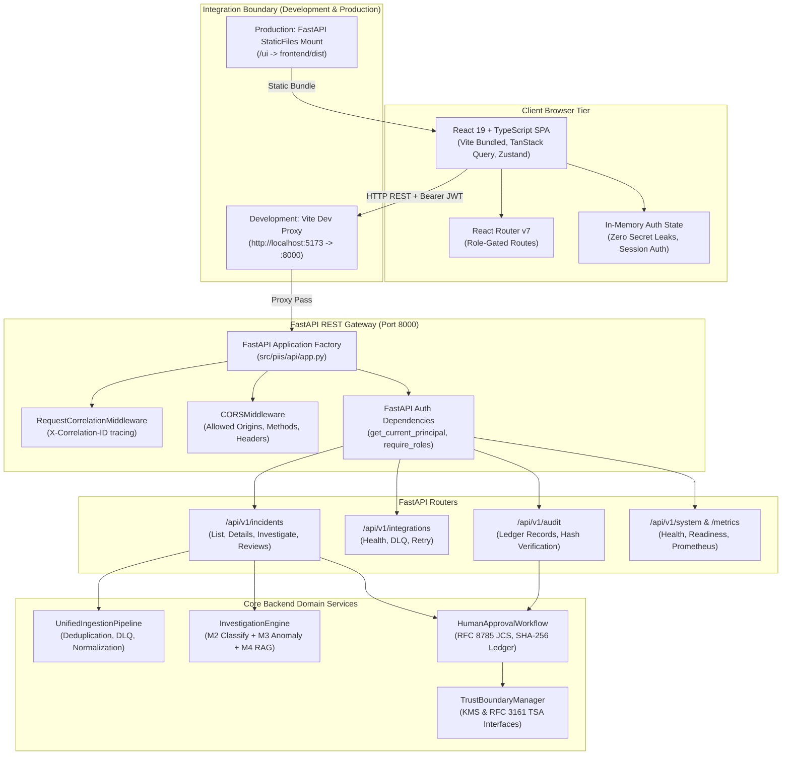

# PIIS UI-0 — Repository and Architecture Audit

> [!IMPORTANT]
> **Audit Status:** COMPLETE
> **Target Subsystem:** PIIS Telecom Edition Frontend Integration Architecture
> **Current Backend Baseline:** Python 3.11, FastAPI 0.128.8, Pydantic 2.12.5, 388/388 Automated Tests Passing (100%)
> **Scope:** Architecture Discovery, Serving Mechanism, Authentication Mechanics, and Proposed Frontend Boundary

---

## 1. Executive Summary

Milestone UI-0 establishes the architectural blueprint for transitioning the Production Incident Intelligence System (PIIS — Telecom Edition) from an inlined single-file proof-of-concept Single Page Application (`src/piis/api/ui.py`) to an enterprise-grade, dedicated **React + TypeScript** web application powered by **Vite**.

The existing backend represents an evidence-grounded, read-only telecom decision-support platform. The backend remains the sole authoritative source of truth for all business logic, incident routing, severity prediction, anomaly correlation, evidence retrieval, cryptographic audit trails, and human-in-the-loop authorization.

---

## 2. Current Backend Architecture & UI Serving Inspection

### 2.1 Current UI Implementation (`src/piis/api/ui.py`)
Inspection of [`src/piis/api/ui.py`](file:///c:/Production%20level%20projects/PIIS/src/piis/api/ui.py) reveals:
- **Serving Mechanism:** The user interface is embedded as a raw multi-line Python string constant (`UI_HTML`, 709 lines) containing inline HTML, CSS, and vanilla JavaScript.
- **Route Registration:** Registered via FastAPI `APIRouter` with two GET endpoints:
  - `GET /` -> `serve_operator_workspace()` returning `HTMLResponse(UI_HTML)`
  - `GET /ui` -> `serve_operator_workspace()` returning `HTMLResponse(UI_HTML)`
- **Static Assets:** Static asset mounting (`fastapi.staticfiles.StaticFiles`) is **not configured** in [`src/piis/api/app.py`](file:///c:/Production%20level%20projects/PIIS/src/piis/api/app.py). All stylesheets, SVG icons, fonts, and scripts are embedded directly into `UI_HTML`.
- **Zero External CDN Dependencies:** The existing UI includes zero external scripts, stylesheets, or web fonts. All typography uses standard system fonts (`-apple-system, BlinkMacSystemFont, "Segoe UI", Roboto`), and all icons are rendered via SVG paths.

### 2.2 Answers to Core Architecture Discovery Questions

| Question | Architectural Reality in Codebase | Source Reference |
| :--- | :--- | :--- |
| **1. How the current SPA is served?** | As an inlined HTML string (`UI_HTML`) returned via FastAPI `HTMLResponse` on `/` and `/ui`. | [`src/piis/api/ui.py#L705-L709`](file:///c:/Production%20level%20projects/PIIS/src/piis/api/ui.py#L705-L709) |
| **2. How API routes are registered?** | Modular routers (`system`, `incidents`, `integrations`, `audit`, `ui`) included in `create_app()` factory. | [`src/piis/api/app.py#L110-L115`](file:///c:/Production%20level%20projects/PIIS/src/piis/api/app.py#L110-L115) |
| **3. Whether static file serving is configured?** | **No.** `StaticFiles` is not mounted. All assets are currently inlined. | [`src/piis/api/app.py`](file:///c:/Production%20level%20projects/PIIS/src/piis/api/app.py) |
| **4. How API authentication works?** | Dependency `get_current_principal` parses `Authorization: Bearer <token>`, verifies JWT against JWKS via `AuthManager`. | [`src/piis/auth/dependencies.py#L34-L59`](file:///c:/Production%20level%20projects/PIIS/src/piis/auth/dependencies.py#L34-L59) |
| **5. How the UI currently obtains authorization?** | Operator manually inputs a JWT into a header password field; clicking "Set Auth" stores it in `sessionStorage`. | [`src/piis/api/ui.py#L124-L126`](file:///c:/Production%20level%20projects/PIIS/src/piis/api/ui.py#L124-L126) |
| **6. Whether browser sessions or bearer tokens are used?** | **Bearer tokens.** No cookies, HTTP-only session cookies, or server-side web session stores exist. | [`src/piis/api/ui.py#L404-L411`](file:///c:/Production%20level%20projects/PIIS/src/piis/api/ui.py#L404-L411) |
| **7. How human reviewer identity is established?** | `ProductionOIDCVerifier.verify_token` checks RSA JWKS signature, `nbf`, `exp`, `iss`, `aud`, and extracts `operator_id` and `role`. | [`src/piis/auth/manager.py#L123-L166`](file:///c:/Production%20level%20projects/PIIS/src/piis/auth/manager.py#L123-L166) |
| **8. How service principals are separated from humans?** | Service tokens declare `principal_type="SERVICE"` or `service_id` and are barred from human reviews via `require_human_operator`. | [`src/piis/auth/dependencies.py#L77-L90`](file:///c:/Production%20level%20projects/PIIS/src/piis/auth/dependencies.py#L77-L90) |
| **9. How API errors are returned?** | Standard JSON envelope: `{"error": "...", "detail": "...", "correlation_id": "...", "timestamp": "..."}`. | [`src/piis/api/app.py#L71-L107`](file:///c:/Production%20level%20projects/PIIS/src/piis/api/app.py#L71-L107) |
| **10. How environment configuration is managed?** | Direct calls to `os.environ.get(...)` with local development fallbacks. | [`src/piis/auth/manager.py#L47`](file:///c:/Production%20level%20projects/PIIS/src/piis/auth/manager.py#L47), [`trust_boundary.py#L416`](file:///c:/Production%20level%20projects/PIIS/src/piis/audit/trust_boundary.py#L416) |

---

## 3. Architecture Boundary & Integration Topology

---

## 4. Key Subsystem Discovery Findings

1. **Investigation Pipeline Lifecycle:**
   - Ingested incidents are stored as canonical incident dictionaries within `UnifiedIngestionPipeline`.
   - Calling `POST /api/v1/incidents/{incident_id}/investigate` triggers an evidence synthesis run combining M2 severity/routing prediction, M3 anomaly metrics, and M4 hybrid RAG retrieval.
   - The result is an `InvestigationContext` containing `sufficiency_report`, candidate `hypotheses`, and approved `recommendations`.
2. **Mandatory Human Sign-Off Invariant:**
   - Diagnostic recommendations generated by the investigation engine enter a `PENDING_REVIEW` state.
   - The system is architecturally and legally hard-locked to require an authenticated human NOC operator token to sign recommendations. Automated service accounts are barred.
3. **Audit Ledger Immutability:**
   - Human decisions are recorded in an RFC 8785 JSON Canonicalization Scheme (JCS) hash-chained audit trail.
   - Checkpoint sequence numbers advance monotonically with rollback and tamper protection.
4. **Current UI Deficiencies:**
   - No reactive state synchronization (requires manual "Refresh" button clicks).
   - Inlined JavaScript lacks static typing and compile-time schema validation.
   - Raw JWT pasted into text input without validation or expiration countdown.
   - Zero deep-linking or URL-based routing (navigation toggles CSS `.view-panel.active`).
   - Hardcoded inlined styles make maintenance difficult and prevent accessible theme customization.
