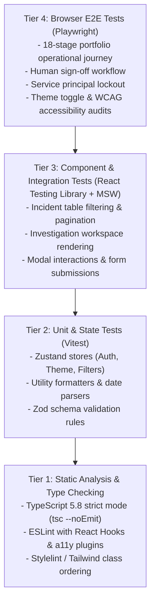

# PIIS UI-0 — Testing & Validation Strategy

> [!IMPORTANT]
> **Zero-Regression Invariant:**
> The introduction of the React frontend must preserve all 388 existing Python backend unit and integration tests without modification, relaxation, or skipping.
> The frontend testing harness must be 100% locally reproducible using deterministic fixtures without requiring live enterprise infrastructure or external network calls.

---

## 1. Multi-Tier Testing Pyramid



---

## 2. Testing Tiers & Framework Selection

### 2.1 Tier 1: Static Analysis & Type Checking
- **Tools:** `tsc --noEmit`, `eslint`, `prettier`.
- **Enforcement:**
  - TypeScript `strict: true`, `noImplicitAny: true`, `strictNullChecks: true`.
  - ESLint rules enforce zero unused variables, mandatory dependency arrays in `useEffect`, and accessibility linting (`eslint-plugin-jsx-a11y`).
  - Pre-commit git hook runs linting and type checking in $< 3\text{ seconds}$.

### 2.2 Tier 2: Unit & State Store Testing
- **Framework:** **Vitest** (Native Vite integration, fast in-memory execution).
- **Scope:**
  - `authStore.ts`: Tests in-memory token storage, claim extraction, role resolution, permission checks, and `logout()` state wipe.
  - `themeStore.ts`: Tests theme switching between `'dark'` and `'light'` and persistence in local storage.
  - `formatters.ts`: Validates ISO-8601 UTC timestamp formatting, VSWR ratio rounding, packet loss percentages, and hash truncation.
  - `validators.ts`: Validates Zod review rationale schemas (e.g. rejection of blank justifications).

### 2.3 Tier 3: Component & Contract Integration Testing
- **Framework:** **React Testing Library** + **Mock Service Worker (MSW)**.
- **Scope:**
  - Mock Service Worker intercepts `/api/v1/*` requests with deterministic JSON fixtures matching Pydantic schemas.
  - Tests verify that:
    1. Incident list displays loading skeletons while fetching and error banners on network drop.
    2. Filtering by domain `RAN` updates table rows without triggering full-page reload.
    3. Epistemic tags render with correct class names and semantic colors.
    4. Service principal sessions visibly disable human review actions with lock indicators.

### 2.4 Tier 4: Browser-Level End-to-End Testing
- **Framework:** **Playwright** (Headless Chromium, Firefox, WebKit).
- **Deterministic Test Harness:**
  - Spins up local FastAPI test server on an isolated port (`http://127.0.0.1:8925`).
  - Uses `LocalTestOIDCProvider` to mint role-specific tokens for testing.
- **Test Scenarios:**
  1. *Complete Human Approval Journey:* Operator logs in with `NOC_L2` token, navigates to incident `INC-SNOW-INC0089201`, opens investigation, reviews recommendation `REC-001`, submits approval with technical rationale, and verifies cryptographic receipt `RCPT-<HEX16>` rendered in audit ledger.
  2. *Adversarial Service Principal Lockout:* Automated bot session with `SERVICE_PRINCIPAL` token attempts to submit review; verified that UI blocks button and direct API attempt returns 403.
  3. *Theme & Contrast Audit:* Axe-core automated accessibility scan runs across all 9 pages in both Dark and Light modes, asserting zero WCAG 2.1 AA violations.
  4. *Responsive Layout:* Verifies UI adapts cleanly from $1920\text{px}$ dual-monitor NOC displays to $1366\text{px}$ field laptop displays.

---

## 3. CI/CD Integration & Automation

All frontend tests will be integrated into the repository workflow:

```bash
# 1. Type check
pnpm typecheck

# 2. Lint
pnpm lint

# 3. Unit and Component tests
pnpm test:unit

# 4. End-to-end browser smoke test (requires backend server)
pnpm test:e2e
```
