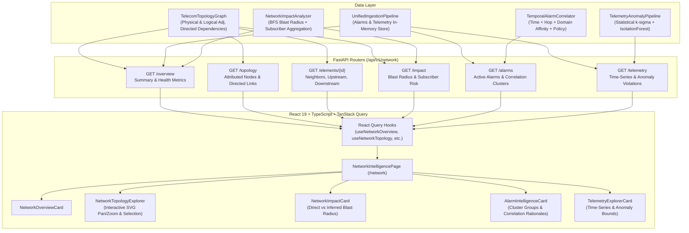

# PIIS UI-4 — Network Intelligence Workspace Architecture

**Milestone:** UI-4  
**Status:** ARCHITECTURAL SPECIFICATION  
**Date:** 2026-11-03  
**Authors:** PIIS Architecture Team  

---

## 1. Vision & Core Philosophy

The **Network Intelligence Workspace** provides deep, topological, temporal, and anomaly-driven observability across multi-domain telecom infrastructure without ever mutating live network state.

The system adheres to the non-negotiable core architectural principle:

$$\text{EXISTING TELECOM WORKFLOW} + \text{PIIS} = \text{ADDITIONAL OBSERVABILITY, INTEGRITY AND PROVENANCE}$$

### Critical Operational Boundaries
1. **Zero Execution of Network Commands:** PIIS never issues CLI, NETCONF, gNMI, or SNMP writes. All remediation actions are advisory recommendations submitted to human operators.
2. **Zero Fabricated Topology or Metrics:** Nodes, links, alarms, and telemetry strictly derive from registered topology graphs and ingested event pipelines. If data is absent, the UI explicitly renders `Data Unavailable` or zero-state indicators rather than synthetic filler.
3. **Strict Epistemic Transparency:** Every visual element is categorized by epistemic provenance:
   - `OBSERVED_FACT`: Raw alarms, raw telemetry counters, registered node metadata.
   - `COMPUTED_TOPOLOGY`: Shortest-path distance, upstream parents, downstream children.
   - `MODEL_PREDICTION`: Telemetry anomalies from Statistical $\sigma$-detectors and Isolation Forests.
   - `HYPOTHESIS`: Correlated alarm clusters, causal roots, and propagation hypotheses.
   - `DERIVED_ESTIMATE`: Blast radius calculations, nominal subscriber impact estimates.

---

## 2. Architecture & Data Flow

---

## 3. UI Component Hierarchy & Responsibilities

### 3.1. `NetworkIntelligencePage.tsx`
- Central workspace layout host at route `/network`.
- Holds selected element state (`selectedElementId: string | null`), active domain filter (`ALL`, `RAN`, `TRANSPORT`, `5G_CORE`, `SERVICE`), and active tab/view modes.
- Integrates with `incidentContextStore` if opened with context from an active incident.

### 3.2. `NetworkOverviewCard.tsx`
- Renders key network observability metrics:
  - Total Monitored Elements by Domain (`RAN`, `TRANSPORT`, `5G_CORE`, `SERVICE`).
  - Active Alarms count with severity breakdown (`CRITICAL`, `MAJOR`, `MINOR`, `WARNING`).
  - Correlated Clusters count.
  - Active Anomaly Violations.
  - Topology Sync timestamp and integrity hash.
- Clear distinction between literal zero (`0`) and unavailable data (`N/A`).

### 3.3. `NetworkTopologyExplorer.tsx`
- Interactive SVG-based node-link diagram rendering nodes and directed links.
- Interactive controls: Pan, Zoom In/Out, Reset View, Domain Filter, Element Search.
- Node rendering:
  - Color-coded by telecom domain (`RAN` = Amber, `TRANSPORT` = Emerald, `5G_CORE` = Sky, `SERVICE` = Purple).
  - Visual badges for active alarms (red pulsing beacon) and anomalies.
  - Directed dependency arrows showing service dependencies (upstream provider $\to$ downstream dependent).
- Selection Drawer: Clicking a node displays element attributes, nominal subscribers, direct upstream parents, and downstream children.

### 3.4. `NetworkImpactCard.tsx`
- Visualizes blast radius for the selected element or active incident cluster.
- Displays:
  - Direct affected elements (`OBSERVED_FACT`).
  - Inferred cascading elements (`DERIVED_ESTIMATE`).
  - Affected domains count and cross-domain propagation paths.
  - Estimated affected subscribers with mandatory epistemic disclaimer:
    > *"Aggregated nominal capacity across direct/inferred elements from registered topology metadata. Not dynamically observed from active UE counters."*

### 3.5. `AlarmIntelligenceCard.tsx`
- Presents correlated alarm clusters and unclustered alarms.
- For each cluster:
  - Dominant domain, event count, confidence score.
  - Explicit correlation rationales: time proximity ($\Delta t$), topological distance (hop count), and domain affinity.
  - Causal compatibility guardrail evaluation text.

### 3.6. `TelemetryExplorerCard.tsx`
- High-fidelity time-series chart showing metric values over time for selected element.
- Anomaly threshold indicators (upper and lower k-sigma dynamic bounds).
- Anomaly violation markers with score and severity.
- Explicit visual treatment for data gaps: discontinuous lines rather than synthetic flat lines.

---

## 4. Epistemic Taxonomy & Guardrails

The workspace strictly enforces the standard PIIS epistemic taxonomy:
- **`OBSERVED_FACT`**: Telemetry metrics, alarm codes, registered hardware/node properties.
- **`COMPUTED_TOPOLOGY`**: Hop distance, BFS path, parent/child relationships.
- **`MODEL_PREDICTION`**: Isolation Forest anomaly scores, statistical threshold breaches.
- **`HYPOTHESIS`**: Temporal-topological alarm correlation clusters, potential root-cause links.
- **`DERIVED_ESTIMATE`**: Estimated blast radius, nominal subscriber capacity impact.

---

## 5. Security & Read-Only Invariants

1. All new API endpoints use HTTP `GET`.
2. Required authorization: Valid JWT bearer token with `VIEW_INCIDENTS` or `VIEW_EVIDENCE` permission.
3. No external command runners, shell executions, or mutating hooks exist in the network intelligence pathway.
4. Error handling follows the structured error model with standard headers and fallback UI components (`ErrorState`, `EmptyState`).
