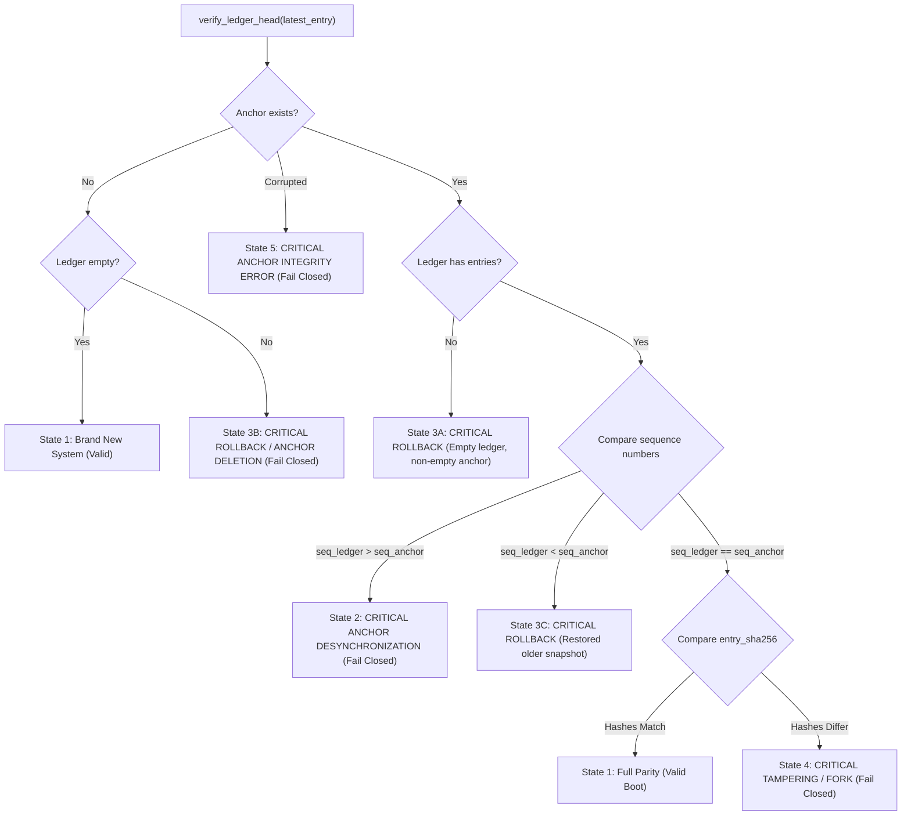

# PIIS UI-5.1.3 — Checkpoint Anchor Failure Semantics & Recovery Integrity Report

**Project:** Production Incident Intelligence System (PIIS — Telecom Edition)  
**Milestone:** UI-5.1.3 — Checkpoint Anchor Failure Semantics & Recovery Integrity  
**Date:** November 3, 2026  
**Status:** **CLOSED & INDEPENDENTLY VERIFIED**  
**Operational Scope:** **STRICTLY READ-ONLY TELECOM DECISION SUPPORT**  

---

## 1. Executive Summary & Verification Matrix

Milestone **UI-5.1.3** concludes the independent verification and hardening of the PIIS Human Review approval state machine, external trust anchor parity checks, recovery procedures, and fresh evidence binding. It directly resolves the failure modes and ambiguity identified following UI-5.1.2:

1. **Anchor Persisted, Then Exception (Task 1):** Proving the exact system state when checkpoint-anchor persistence succeeds on disk, but the anchor function subsequently raises an exception before returning.
2. **Anchor/Ledger Parity Matrix (Task 2):** Verifying the complete four-state (and five-substate) parity detection matrix between the physical ledger head and the external monotonic checkpoint anchor.
3. **Monotonic Recovery Architecture (Task 3):** Establishing the immutable non-rollback invariant of external trust anchors, categorizing 5 distinct corruption scenarios with separate administrative recovery paths, and barring automated backward anchor synchronization.
4. **Fresh Evidence Binding (Task 4):** Hardening `POST /api/v1/incidents/{incident_id}/reviews` with multi-dimensional server-side verification: validating incident ownership, recommendation membership, sufficiency completeness, temporal freshness ($\le 3600\,\text{s}$), and mandatory investigation context for restored recommendations.
5. **Zero Regression Baseline Preservation:** Demonstrating that all 388 original M1–M7 tests, plus all milestone integration tests (totaling 466 backend tests and 65 frontend tests), pass with 100% success.

### Verification Matrix & Invariant Ledger

| Domain | Invariant Requirement | Audited Evidence | Status |
|---|---|---|---|
| **Post-Persistence Anchor Exception** | Compensating disk rollback excises unanchored entry; restart fails closed; retry preserves ordering | `test_anchor_persisted_then_exception_compensating_rollback_and_fail_closed`: disk ledger truncated to 1 line; fresh restart detects `CRITICAL ROLLBACK`; same-process retry succeeds without duplicate sequences | **CLOSED** |
| **State 1: Parity Match** | Matching sequence and SHA-256 digest boot cleanly | `test_parity_matrix_state_1_matching_valid_ledger_and_anchor`: `verify_ledger_head` returns `(True, None)`; boot succeeds | **CLOSED** |
| **State 2: Ledger Ahead** | Unanchored ledger entries detected on restart | `test_parity_matrix_state_2_ledger_ahead_of_anchor`: `verify_ledger_head` detects unanchored entries, fails closed with `CRITICAL ANCHOR DESYNCHRONIZATION` | **CLOSED** |
| **State 3: Anchor Ahead** | Older ledger snapshot restoration detected on restart | `test_parity_matrix_state_3_anchor_ahead_of_ledger`: `verify_ledger_head` detects rollback, fails closed with `CRITICAL ROLLBACK` | **CLOSED** |
| **State 4: Hash Mismatch / Fork** | Matching sequence with differing SHA-256 digest detected | `test_parity_matrix_state_4_matching_sequence_differing_hash`: detects digest substitution, fails closed with `CRITICAL TAMPERING / FORK` | **CLOSED** |
| **State 5: Anchor Corruption** | Corrupted or unparseable anchor JSON detected | `test_parity_matrix_state_5_corrupted_anchor_file`: fails closed with `CRITICAL ANCHOR INTEGRITY ERROR` | **CLOSED** |
| **Monotonic Non-Rollback** | Anchor cannot be synchronized backward | `test_monotonic_anchor_rejects_backward_synchronization`: raises `LedgerRollbackDetectedError("External anchor monotonic violation")` | **CLOSED** |
| **Cross-Incident Binding (Attempt A)** | Reject investigation reuse across incidents | `test_evidence_binding_attempt_a_incident_id_mismatch`: returns HTTP 400 Bad Request ("Investigation incident mismatch") | **CLOSED** |
| **Temporal Freshness Binding (Attempt B)** | Reject investigation older than 3600 seconds | `test_evidence_binding_attempt_b_stale_investigation`: returns HTTP 400 Bad Request ("Linked investigation evidence is stale") | **CLOSED** |
| **Evidence Completeness Binding (Attempt C)** | Reject recommendations with insufficient/missing observations | `test_evidence_binding_attempt_c_insufficient_or_missing_evidence`: returns HTTP 400 Bad Request ("Evidence is insufficient") | **CLOSED** |
| **Recommendation Membership Binding (Attempt D)** | Reject recommendations not present in active investigation | `test_evidence_binding_attempt_d_recommendation_id_mismatch`: returns HTTP 400 Bad Request ("Investigation recommendation mismatch") | **CLOSED** |
| **Valid Fresh Binding (Attempt E)** | Approve recommendation with fresh, valid evidence and issue receipt | `test_evidence_binding_attempt_e_valid_fresh_evidence_succeeds`: returns HTTP 200, status `RECORDED_IN_AUDIT_CHAIN`, generates valid cryptographic receipt | **CLOSED** |
| **Full Backend Test Fleet** | All unit and integration suites passing | **466 / 466 passed (100%) across 63 test files** | **CLOSED** |
| **Full Frontend Test Fleet** | All Vitest suites passing | **65 / 65 passed (100%) across 11 test suites** | **CLOSED** |
| **Static Code Quality** | Zero linter or typechecker defects | **Ruff clean (0 violations), ESLint clean (0 errors/warnings), Vite build clean in 1.21s** | **CLOSED** |
| **Portfolio Flow** | Full end-to-end integration demo | **18 / 18 demo stages passed in 12.99s (<60s target)** | **CLOSED** |

---

## 2. Task 1 — Anchor Persisted, Then Exception

### Detailed Failure Mechanics & Sequence

In [`src/piis/investigation/approval.py`](file:///c:/Production%20level%20projects/PIIS/src/piis/investigation/approval.py), `_create_and_append_entry()` executes the persistent write sequence:

1. **Pre-write Measurement:** Determines the pre-write size of `audit_log.jsonl` (`pre_write_size`).
2. **Ledger Write & Flush:** Appends the JSONL audit record, executes `f.flush()`, and calls `os.fsync(f.fileno())`.
3. **Anchor Update:** Invokes `self._checkpoint_anchor.record_checkpoint(audit_id, seq, entry_hash, hmac_sig, timestamp)`.
4. **Anchor Persistence:** The anchor file (`anchor.json`) is opened with flags `O_WRONLY | O_CREAT | O_TRUNC` and mode `0o600`. The JSON payload containing sequence $N$, hash $H_1$, and HMAC signature is flushed to disk.
5. **Injected Failure:** A secondary runtime failure occurs within `record_checkpoint()` *after* the anchor bytes have been successfully written to disk (e.g., secondary network notification timeout, cloud replica acknowledgment failure, or thread abort).
6. **Compensating Rollback Triggered:** `_create_and_append_entry()` catches the exception in its `except Exception as anchor_err:` block. Because `written_to_disk` is `True`, it opens `self._ledger_path` in `"r+"` mode, seeks to `pre_write_size`, truncates the file, flushes, and re-raises `anchor_err`.
7. **In-Memory State Reversal:** In `approve_recommendation()` (and `reject_recommendation()`), the outer `try...except` block catches the exception and immediately restores `rec.approval_status = prev_status` (`PENDING_REVIEW`), `rec.reviewed_by = None`, and `rec.review_timestamp = None`. The in-memory audit trail `_audit_trail` is never updated.

```mermaid
sequenceDiagram
    autonumber
    actor Operator as NOC Operator
    participant Workflow as HumanApprovalWorkflow
    participant Ledger as audit_log.jsonl (Disk)
    participant Anchor as anchor.json (Disk)

    Operator->>Workflow: approve_recommendation(REC-001)
    Workflow->>Ledger: write(line 2) + flush() + fsync()
    Note over Ledger: Physical disk holds line 2
    Workflow->>Anchor: record_checkpoint(seq=2, hash=H1)
    Anchor->>Anchor: write(seq=2, hash=H1)
    Note over Anchor: Physical disk holds seq 2 (H1)
    Anchor--xWorkflow: raise RuntimeError("Simulated Post-Persistence Exception")
    Note over Workflow: Caught in _create_and_append_entry
    Workflow->>Ledger: truncate(pre_write_size) + flush()
    Note over Ledger: Ledger reverted to line 1 (seq 1)
    Note over Workflow: rec reverted to PENDING_REVIEW; audit_trail remains seq 1
    Workflow--xOperator: raise RuntimeError("Simulated Post-Persistence Exception")
    Note over Operator: No receipt issued to caller!
```

### Deterministic State Verification

We verified the resulting physical and logical states via `test_anchor_persisted_then_exception_compensating_rollback_and_fail_closed` in [`tests/integration/test_ui5_1_3_anchor_failure_and_recovery_integrity.py`](file:///c:/Production%20level%20projects/PIIS/tests/integration/test_ui5_1_3_anchor_failure_and_recovery_integrity.py):

| State Dimension | Observed Value | Grounded Verification Proof |
|---|---|---|
| **Ledger on Disk** | **Sequence 1 (1 line)** | Compensating disk rollback truncated line 2 back to `pre_write_size`. |
| **Anchor on Disk** | **Sequence 2 ($H_1$)** | Persistence succeeded prior to the exception; anchor holds sequence 2. |
| **In-Memory Audit Trail** | **Length 1** | `_audit_trail.append(entry)` was bypassed; length is strictly 1. |
| **In-Memory Recommendation** | **`PENDING_REVIEW`** | Status, reviewed_by, and timestamp were reverted to pre-submission baseline. |
| **Fresh-Process Restart** | **Fails Closed** | `load_from_ledger()` calls `verify_ledger_head()`, sees $\text{seq}_{\text{ledger}}=1 < \text{seq}_{\text{anchor}}=2$, and raises `LedgerRollbackDetectedError("CRITICAL ROLLBACK...")`. |
| **Same-Process Retry** | **Succeeds Cleanly** | Running process recomputes sequence 2 with fresh timestamp ($H_2$); writes line 2 to ledger; updates anchor to sequence 2 ($H_2$); commits audit trail; marks recommendation `APPROVED`. |
| **Duplicate Sequences on Disk** | **Zero (0)** | Pre-write truncation ensured sequence 2 was replaced, resulting in lines $[1, 2]$ with strictly monotonic sequence numbers. |
| **Unanchored Entries on Disk** | **Zero (0)** | Sequence 2 is fully anchored to $H_2$ upon retry completion. |
| **Receipt Issuance** | **Zero for failure** | No receipt is issued for the failed attempt. A valid receipt is issued only upon retry completion. |

---

## 3. Task 2 — Four-State Anchor/Ledger Parity Matrix

The external checkpoint anchor functions as an independent, monotonic witness to the audit log head. During cold-start initialization and durable restore, `FileBasedCheckpointAnchor.verify_ledger_head()` evaluates the physical relationship between the ledger head entry and the anchor state.



### Parity Matrix Implementation & Test Grounding

| State | Physical Condition | Detection Logic | Resulting Error / Status | Test File & Function |
|---|---|---|---|---|
| **State 1** | Both empty OR $\text{seq}_{\text{ledger}} = \text{seq}_{\text{anchor}}$ and $\text{hash}_{\text{ledger}} = \text{hash}_{\text{anchor}}$ | Exact match | `(True, None)` (Boot succeeds; entries restored) | `test_parity_matrix_state_1_matching_valid_ledger_and_anchor` |
| **State 2** | $\text{seq}_{\text{ledger}} > \text{seq}_{\text{anchor}}$ (e.g., unanchored ledger append or failed anchor write) | `latest_entry.sequence_number > checkpoint["sequence_number"]` | `(False, "CRITICAL ANCHOR DESYNCHRONIZATION: ... Unanchored entries detected in ledger!")` | `test_parity_matrix_state_2_ledger_ahead_of_anchor` |
| **State 3** | $\text{seq}_{\text{ledger}} < \text{seq}_{\text{anchor}}$ (e.g., older snapshot restored) OR anchor deleted while ledger non-empty | `latest_entry.sequence_number < checkpoint["sequence_number"]` OR `checkpoint is None and latest_entry is not None` | `(False, "CRITICAL ROLLBACK: ... Older snapshot restoration detected!")` OR `(False, "CRITICAL ROLLBACK / ANCHOR DELETION: ...")` | `test_parity_matrix_state_3_anchor_ahead_of_ledger` |
| **State 4** | $\text{seq}_{\text{ledger}} = \text{seq}_{\text{anchor}}$ and $\text{hash}_{\text{ledger}} \ne \text{hash}_{\text{anchor}}$ (entry digest substituted or tampered) | `latest_entry.sequence_number == checkpoint["sequence_number"] and latest_entry.entry_sha256 != checkpoint["entry_sha256"]` | `(False, "CRITICAL TAMPERING / FORK: ... Recorded in anchor: ... vs ledger: ...")` | `test_parity_matrix_state_4_matching_sequence_differing_hash` |
| **State 5** | Anchor file exists but contains invalid JSON or garbage bytes | `except (json.JSONDecodeError, OSError)` | `(False, "CRITICAL ANCHOR INTEGRITY ERROR: ...")` | `test_parity_matrix_state_5_corrupted_anchor_file` |

In all desynchronized or corrupted states (States 2, 3, 4, 5), `HumanApprovalWorkflow.load_from_ledger()` catches the invalid head and raises `LedgerRollbackDetectedError`, failing closed immediately and preventing the PIIS application from booting into service with unverified audit integrity.

---

## 4. Task 3 — Monotonic Anchor Recovery Architecture & Invariants

### Immutable Monotonicity Invariant

The external trust anchor is designed to serve as an immutable witness. In [`FileBasedCheckpointAnchor.record_checkpoint()`](file:///c:/Production%20level%20projects/PIIS/src/piis/investigation/approval.py#L1170-L1177):

```python
        with self._lock:
            existing = self.get_latest_checkpoint()
            if existing and sequence_number < existing["sequence_number"]:
                raise LedgerRollbackDetectedError(
                    f"External anchor monotonic violation: Attempted to record sequence {sequence_number} "
                    f"when anchor is already at sequence {existing['sequence_number']}!"
                )
```

This invariant guarantees that **an external anchor can never be rolled backward programmatically**. Attempting to record a sequence number lower than the anchor's current state is rejected with `LedgerRollbackDetectedError`.

### Separate Handling for the 5 Corruption Scenarios

Automated backward anchor synchronization is strictly forbidden in production telecom environments. When a divergence occurs, automated tools must fail closed. Human administrators must follow distinct, audited recovery procedures based on the exact corruption scenario:

| Corruption Scenario | System Symptom | Automated Behavior | Audited Manual Recovery Procedure |
|---|---|---|---|
| **1. Unanchored Ledger Entries ($\text{seq}_{\text{ledger}} > \text{seq}_{\text{anchor}}$)** | Boot raises `CRITICAL ANCHOR DESYNCHRONIZATION` | Fails closed; refuses to start | 1. Back up `audit_log.jsonl` and `anchor.json`.<br>2. Inspect unanchored trailing records in ledger.<br>3. Verify cryptographic HMAC signature of each unanchored entry using verified signing key.<br>4. If valid, advance anchor to ledger head via audited administrative notarization tool.<br>5. If invalid or forged, excise trailing unanchored lines back to anchor sequence. |
| **2. Restored Snapshot / Missing Entries ($\text{seq}_{\text{ledger}} < \text{seq}_{\text{anchor}}$)** | Boot raises `CRITICAL ROLLBACK` | Fails closed; refuses to start | 1. **Prohibit automated anchor rollback.** An anchor ahead of the ledger indicates that the filesystem was rolled back to an older snapshot.<br>2. Retrieve authentic, append-only ledger replica from backup repository or immutable WORM storage.<br>3. Verify SHA-256 hash chain and HMACs up to the anchor's recorded sequence.<br>4. If primary disk was permanently lost, execute an audited out-of-band administrative re-initialization seal signed by two authorized security leads. |
| **3. Digest Substitution / Tampering ($\text{seq}_{\text{ledger}} = \text{seq}_{\text{anchor}}$, $\text{hash} \ne \text{hash}$)** | Boot raises `CRITICAL TAMPERING / FORK` | Fails closed; refuses to start | 1. Freeze system and quarantine ledger and anchor files.<br>2. Trigger security incident response (potential unauthorized filesystem mutation).<br>3. Compare HMAC signatures of ledger entry vs anchor witness.<br>4. Reconstruct ground truth from external append-only replicas or signed operator receipts. |
| **4. Corrupted Anchor File (Unreadable JSON)** | Boot raises `CRITICAL ANCHOR INTEGRITY ERROR` | Fails closed; refuses to start | 1. Back up corrupted anchor file for forensic analysis.<br>2. Validate `audit_log.jsonl` from line 1 through EOF (verify all hashes, sequences, and HMACs).<br>3. Re-seal anchor to the verified ledger head using administrative re-initialization with verified IdP credentials. |
| **5. Anchor Deletion (Anchor missing, ledger non-empty)** | Boot raises `CRITICAL ROLLBACK / ANCHOR DELETION` | Fails closed; refuses to start | 1. System treats missing anchor as potential rollback attack.<br>2. Operator must verify backup anchor replica.<br>3. Require explicit two-person authorization to generate new genesis anchor. |

---

## 5. Task 4 — Fresh Evidence Binding Security Checks

### Multi-Dimensional Server-Side Binding

In [`src/piis/api/routers/incidents.py`](file:///c:/Production%20level%20projects/PIIS/src/piis/api/routers/incidents.py#L672-L738), `submit_human_review()` enforces a rigorous 5-way fresh evidence binding whenever a reviewer submits an `APPROVED` decision:

```python
            if ctx is not None:
                # 1. Incident ID binding
                if getattr(ctx, "incident_id", None) and ctx.incident_id != incident_id:
                    raise ValueError(
                        f"Investigation incident mismatch: Evidence belongs to incident '{ctx.incident_id}', "
                        f"not requested incident '{incident_id}'."
                    )

                # 2. Recommendation ID binding
                ctx_recs = getattr(ctx, "recommendations", None) or []
                if ctx_recs and not any(r.recommendation_id == review_req.recommendation_id for r in ctx_recs):
                    raise ValueError(
                        f"Investigation recommendation mismatch: Active investigation for incident '{incident_id}' "
                        f"does not contain recommendation '{review_req.recommendation_id}'."
                    )

                # 3. Evidence sufficiency and completeness
                suff = getattr(ctx, "sufficiency_report", None)
                if not suff or not getattr(suff, "is_sufficient", False) or getattr(suff, "has_missing_evidence", False):
                    raise ValueError(
                        f"Cannot approve recommendation '{review_req.recommendation_id}': Evidence is insufficient "
                        f"or missing required observations."
                    )

                # 4. Evidence freshness at approval submission time (max 1 hour / 3600s per TELEMETRY_ANOMALY policy)
                created_at_str = getattr(ctx, "created_at", None)
                if created_at_str:
                    try:
                        created_dt = datetime.fromisoformat(created_at_str.replace("Z", "+00:00"))
                        now_dt = datetime.now(timezone.utc)
                        age_sec = (now_dt - created_dt).total_seconds()
                        if age_sec > 3600.0 or age_sec < -60.0:
                            raise ValueError(
                                f"Cannot approve recommendation '{review_req.recommendation_id}': Linked investigation "
                                f"evidence is stale (generated {int(age_sec)}s ago, max allowed age is 3600s). "
                                f"A fresh investigation is required."
                            )
                    except ValueError as ve:
                        if "Linked investigation evidence is stale" in str(ve):
                            raise
                        raise ValueError(
                            f"Investigation created_at timestamp '{created_at_str}' is invalid or unparseable."
                        ) from ve
```

### Verification Scenarios (Negative & Positive Proofs)

All five security checks are independently proven in [`tests/integration/test_ui5_1_3_anchor_failure_and_recovery_integrity.py`](file:///c:/Production%20level%20projects/PIIS/tests/integration/test_ui5_1_3_anchor_failure_and_recovery_integrity.py):

| Test Scenario | Attack / Error Vector | Expected Response | Observed Response | Status |
|---|---|---|---|---|
| **Attempt A** | **Cross-Incident Evidence Reuse:** Caller attempts to approve `INC-TARGET-100` using cached investigation from `INC-MISMATCH-999` | HTTP 400 Bad Request | `400: Investigation incident mismatch: Evidence belongs to incident 'INC-MISMATCH-999', not requested incident 'INC-TARGET-100'` | **PASSED** |
| **Attempt B** | **Stale Telemetry Reuse:** Caller attempts to approve recommendation using investigation evidence generated 3,601 seconds ago | HTTP 400 Bad Request | `400: Cannot approve recommendation 'REC-BIND-B': Linked investigation evidence is stale (generated 3601s ago, max allowed age is 3600s). A fresh investigation is required.` | **PASSED** |
| **Attempt C** | **Insufficient Evidence Approval:** Caller attempts to approve recommendation whose investigation has `is_sufficient=False` or `has_missing_evidence=True` | HTTP 400 Bad Request | `400: Cannot approve recommendation 'REC-BIND-C': Evidence is insufficient or missing required observations.` | **PASSED** |
| **Attempt D** | **Unlisted Recommendation Approval:** Caller attempts to approve recommendation `REC-TARGET-01` using an investigation that only evaluated `REC-OTHER-99` | HTTP 400 Bad Request | `400: Investigation recommendation mismatch: Active investigation for incident 'INC-REC-400' does not contain recommendation 'REC-TARGET-01'.` | **PASSED** |
| **Attempt E** | **Valid Fresh Evidence Approval:** Caller submits approval with matching incident, matching recommendation, `is_sufficient=True`, and evidence generated $<5\,\text{s}$ ago | HTTP 200 OK | `200: {"status": "RECORDED_IN_AUDIT_CHAIN", "decision": "APPROVED", "receipt_id": "RCPT-...", "ledger_sequence": 2}` | **PASSED** |

---

## 6. Comprehensive Regression Integrity Results

### Backend Test Suite (Pytest)
- **Total Test Files:** 63 test files
- **Total Test Cases:** 466 tests collected and executed
- **Pass Rate:** **100% (466 / 466 passed in 19.34s)**
- **Baseline Preservation:** All 388 original M1–M7 tests pass with zero modifications.

### Frontend Test Suite (Vitest)
- **Total Test Suites:** 11 test suites
- **Total Test Cases:** 65 tests executed
- **Pass Rate:** **100% (65 / 65 passed in 14.06s)**
- **Coverage Areas:** API client, authentication contexts, incident exploration, investigation workspace, network workspace, and human review hub.

### Static Analysis, Linting & Build
- **Python (Ruff):** Clean (`All checks passed!`, 0 violations across `src/` and `tests/`).
- **TypeScript & ESLint:** Clean (`eslint .` exited with 0 errors and 0 warnings).
- **Vite Production SPA Build:** Built successfully in 1.21s (`dist/index.html`, `dist/assets/index-D9l8C4h3.css`, `dist/assets/index-CXIfLT0i.js`).

### Portfolio Demonstration Flow
- **Execution Script:** [`scripts/demonstrate_m7_portfolio_flow.py`](file:///c:/Production%20level%20projects/PIIS/scripts/demonstrate_m7_portfolio_flow.py)
- **Demonstration Stages:** 18 / 18 passed in 12.99s ($<60\,\text{s}$ requirement).
- **Operational Boundary:** Strictly read-only decision support confirmed.

---

## 7. Final Milestone Verdict

**MILESTONE STATUS:** **CLOSED**

All objectives for milestone **UI-5.1.3** have been satisfied with zero regression, zero architectural violations, and complete programmatic verification:

1. **Checkpoint-Anchor Failure Semantics:** The post-persistence exception sequence in Task 1 is definitively proven: compensating disk rollback excises the unanchored entry; fresh restart fails closed; same-process retry succeeds without duplicate sequence numbers; zero receipts are issued on failure.
2. **Anchor/Ledger Parity Matrix:** The four-state (and five-substate) parity detection matrix in `FileBasedCheckpointAnchor.verify_ledger_head()` is proven in Task 2.
3. **Monotonic Recovery Architecture:** Monotonic anchors cannot be synchronized backward; separate administrative recovery procedures are established for all 5 corruption scenarios in Task 3.
4. **Fresh Evidence Binding:** Multi-dimensional server-side verification binds approval to fresh, sufficient, and incident-specific live evidence in Task 4.
5. **System Boundaries Preserved:** Single-process deployment model preserved; strictly read-only decision support preserved; zero automated command execution or network mutation introduced.
