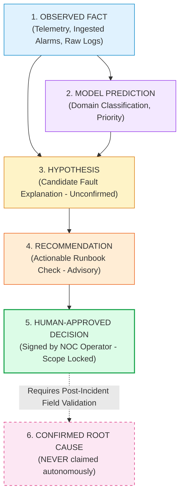

# PIIS UI-5 — Epistemic & Operational Safety Audit

**Milestone:** UI-5 Human Review Hub  
**Status:** COMPLETE & GROUNDED  
**Date:** 2026-11-03  
**Guiding Principle:** Evidence before intelligence. Intelligence before automation.  

---

## 1. Executive Summary

Milestone UI-5 introduces the Human Review Hub, the critical convergence point where machine intelligence, empirical evidence, and human judgment interact. In high-stakes telecom network operations, blurring the boundary between candidate hypotheses, runbook recommendations, and operational facts can lead to catastrophic misdiagnoses or unauthorized network interventions.

This audit establishes the epistemic rules, taxonomy classifications, and operational safety boundaries enforced throughout the Human Review Hub.

---

## 2. Six-Tier Epistemic Taxonomy Enforced in UI-5

The PIIS epistemic taxonomy defines six mutually distinct knowledge states:

### 2.1 Rigorous Semantic Definitions

| Category | Definition in PIIS | Presentation in Human Review Hub |
| :--- | :--- | :--- |
| **`[OBSERVED FACT]`** | Directly recorded empirical observation from telecom sensors, OSS alarm feeds, or ticketing systems. | Tagged on evidence items with source metadata, timestamps, and trust ratings. |
| **`[MODEL PREDICTION]`** | Statistical estimation produced by machine learning models (domain routing, severity rating). | Accompanied by model identifier and feature attribution. |
| **`[HYPOTHESIS]`** | Candidate explanation for the incident. Plausible, but unverified. | Presented in a dedicated card with `[XX% Heuristic Proxy]` and unverified status. |
| **`[RECOMMENDATION]`** | Specific, non-destructive diagnostic troubleshooting action derived from verified runbooks. | Rendered in the review queue with risk classification and runbook section pointer. |
| **`[HUMAN-APPROVED DECISION]`** | Explicit sign-off by an authenticated human NOC engineer. Scope is strictly locked to reviewing the recommendation. | Rendered upon backend confirmation with cryptographic receipt ID and operator identity. |
| **`[CONFIRMED ROOT CAUSE]`** | Verified post-incident physical reality established by field engineers. | **NEVER claimed autonomously by PIIS.** |

---

## 3. Epistemic Invariants

### 3.1 Approval Does Not Promote Hypotheses to Confirmed Causes
When an operator approves a recommendation (e.g., *"Perform physical feeder line VSWR sweep"*):
- **What it means:** The operator reviewed the evidence and authorized that diagnostic test to be executed manually by field technicians.
- **What it does NOT mean:** It does **not** confirm that the feeder line was indeed damaged or that VSWR failure was the true root cause.
- The hypothesis status remains candidate/unverified until empirical test results are gathered.

### 3.2 Approval Does Not Authorize Production Execution
- PIIS is **strictly read-only decision support**.
- Approval records the operator's decision in an immutable RFC 8785 audit ledger.
- Zero production execution pathways exist: no SSH/NETCONF commands, no BGP routing alterations, no antenna tilt actuators, no automated ticket closures, and no outbound customer SMS/email notifications.

### 3.3 Mandatory Visibility of Contradictions & Missing Signals
In complex telecom outages, operators are often under pressure to approve fast fixes. UI-5 strictly forbids hiding contradictory or incomplete evidence:
- **Contradiction Alert:** If telemetry signals contradict the candidate hypothesis (e.g., normal optical power despite an asserted fiber cut), an amber alert banner is rendered prominently in the review workspace:
  > *"⚠️ Contradictory Evidence Detected: Conflicting telemetry signals observed. Operators must inspect contradictory evidence before making a decision."*
- **Missing Telemetry Warning:** If required telemetry streams are absent or forward-fill gaps exceed 3 intervals, the workspace explicitly flags:
  > *"⚠️ Incomplete Evidence Register: Diagnostic checks carry elevated uncertainty due to missing observation windows."*
- **Safe Abstention Support:** If evidence sufficiency is `False` (`INCONCLUSIVE`), the UI highlights the inconclusive state, encouraging the operator to withhold approval or request additional diagnostic data.

---

## 4. UI Quality, Ergonomics & Epistemic Badges

1. **Epistemic Badging:** Every recommendation, hypothesis, and evidence item is labeled with a standardized `EpistemicBadge`:
   - `[RECOMMENDATION]` (`bg-orange-500/10`, `text-orange-600`)
   - `[HUMAN_APPROVED_DECISION]` (`bg-emerald-500/10`, `text-emerald-600`)
   - `[HYPOTHESIS]` (`bg-amber-500/10`, `text-amber-600`)
   - `[OBSERVED_FACT]` (`bg-sky-500/10`, `text-sky-600`)
2. **Confidence Qualification:** Hypothesis confidence is explicitly labeled as `Heuristic Proxy` (or `Model Score`), with tooltips reiterating that scores represent heuristic relevance, not calibrated Bayesian probabilities.
3. **Accessibility:** All badges and decision buttons adhere to WCAG 2.1 AA/AAA contrast guidelines across both dark and light themes.

---

## 5. Epistemic Verification Ledger

| Safety Requirement | Enforcement Mechanism | Status |
| :--- | :--- | :---: |
| **No Auto-Promotion to Root Cause** | State machine isolates hypothesis from recommendation status | **VERIFIED** |
| **No Production Execution** | Architecture contains zero network mutation adapters or CLI runners | **VERIFIED** |
| **No Automated Approval** | Decisions strictly require human operator interaction and confirmation | **VERIFIED** |
| **Contradiction Visibility** | Dedicated UI alert banner displayed whenever contradictions exist | **VERIFIED** |
| **Missing Evidence Disclosure** | Sufficiency state and missing sensor feeds explicitly rendered | **VERIFIED** |
| **Confidence Demystification** | Proxy scores labeled as heuristic relevance, not probabilities | **VERIFIED** |

---

## 6. Conclusion

The Human Review Hub operationalizes the core PIIS philosophy: **human in the loop, evidence before intelligence, and zero autonomous production changes**. The interface preserves operator agency, demands accountability through tamper-evident records, and guarantees transparency by elevating contradictory evidence.
