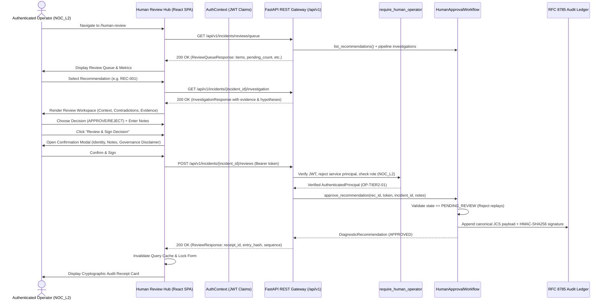

# PIIS UI-5 — Human Review Hub Architecture & Implementation Specification

**Milestone:** UI-5 Human Review Hub  
**Status:** COMPLETE & GROUNDED  
**Date:** 2026-11-03  
**Architecture:** React 19 + TypeScript + TanStack Query + Zustand + FastAPI Backend  

---

## 1. System Overview & Architecture

The Human Review Hub (`/human-review`) is the primary operational portal for Tier 1–3 Network Operations Center (NOC) engineers to inspect, evaluate, and cryptographically notarize diagnostic recommendations generated by the PIIS multi-stage investigation engine.



---

## 2. Backend Integration & Data Contracts

### 2.1 Schemas (`src/piis/api/schemas.py`)

#### `ReviewQueueItem`
```python
class ReviewQueueItem(BaseModel):
    """Review queue item representing an actionable diagnostic recommendation."""
    recommendation_id: str
    incident_id: str
    incident_title: Optional[str] = None
    incident_severity: str = "UNKNOWN"
    network_domain: str = "CROSS_DOMAIN"
    description: str
    reason: str
    supporting_evidence_ids: List[str] = Field(default_factory=list)
    source_runbook_id: str
    source_section: Optional[str] = None
    risk_classification: str
    human_approval_required: bool = True
    approval_status: str
    reviewed_by: Optional[str] = None
    review_timestamp: Optional[str] = None
    review_notes: Optional[str] = None
    is_sufficient: bool = True
    has_contradictions: bool = False
    has_missing_evidence: bool = False
    created_at: Optional[str] = None
```

#### `ReviewQueueResponse`
```python
class ReviewQueueResponse(BaseModel):
    """Paginated collection of reviewable recommendations in the human review queue."""
    items: List[ReviewQueueItem]
    total_count: int
    pending_count: int
    approved_count: int
    rejected_count: int
    limit: int = 50
    offset: int = 0
```

#### `ReviewSubmissionRequest`
```python
class ReviewSubmissionRequest(BaseModel):
    """Request submitted by a human operator to approve or reject a recommendation."""
    recommendation_id: str = Field(description="ID of recommendation to approve or reject")
    decision: str = Field(description="'APPROVED' or 'REJECTED'")
    review_notes: str = Field(description="Operator technical rationale or justification")
```

#### `ReviewResponse`
```python
class ReviewResponse(BaseModel):
    """Cryptographic audit receipt returned after human sign-off."""
    incident_id: str
    recommendation_id: str
    decision: str
    reviewed_by: str
    review_timestamp: str
    audit_entry_hash: str
    ledger_sequence: int
    status: str
    receipt_id: str
```

### 2.2 Endpoints

| Endpoint | Method | Purpose | Auth & Roles |
| :--- | :---: | :--- | :--- |
| `/api/v1/incidents/reviews/queue` | `GET` | Retrieve review queue with status/domain/risk filters | `Permission.VIEW_RECOMMENDATIONS` |
| `/api/v1/incidents/{incident_id}/recommendations` | `GET` | Get recommendations for an incident | `Permission.VIEW_RECOMMENDATIONS` |
| `/api/v1/incidents/{incident_id}/reviews` | `GET` | Get decision audit records for an incident | `Permission.VIEW_RECOMMENDATIONS` |
| `/api/v1/incidents/{incident_id}/reviews` | `POST` | Submit human review decision | Human operator (`NOC_L1/L2/L3/INCIDENT_MANAGER`) |

---

## 3. Frontend Component Hierarchy

The Human Review Hub is composed of modular, accessible components in `frontend/src/components/review/`:

```text
HumanReviewPage.tsx
├── GovernanceNoticeBanner
├── ReviewSummaryMetricsBar
└── Two-Column Responsive Workspace Grid
    ├── ReviewQueueList.tsx (Left / Master)
    │   ├── SearchInput
    │   ├── FilterBar (Status, Domain, Risk)
    │   ├── SortingControls (Time, Severity, Risk)
    │   ├── QueueCardList (Individual Recommendation Cards)
    │   │   ├── EpistemicBadge
    │   │   ├── SeverityBadge / DomainBadge
    │   │   └── RiskClassificationBadge
    │   ├── EmptyState (when no matches or empty queue)
    │   └── ErrorState (with retry on API failure)
    │
    └── ReviewWorkspace.tsx (Right / Detail)
        ├── IncidentContextBanner (Title, Severity, Domain, Link to Investigation)
        ├── RecommendationSpecCard (Action, Reason, Runbook Section, Preconditions)
        ├── SufficiencyAlertBanner (Contradiction & Missing Telemetry warnings)
        ├── EvidenceRegisterList (Supporting observations, Trust levels, Timestamps)
        ├── HypothesisSeparationCard (Ranked hypotheses with Heuristic Proxy scores)
        ├── DecisionGateway (if PENDING_REVIEW)
        │   ├── DecisionToggle (APPROVE vs REJECT)
        │   ├── NotesTextarea (Required justification with validation)
        │   └── SubmitButton ("Review & Sign Decision")
        ├── TerminalStatusPanel (if already APPROVED or REJECTED)
        ├── ReviewConfirmationModal.tsx (Dialog with summary, identity, & disclaimer)
        └── ReviewReceiptCard.tsx (Cryptographic Receipt upon backend confirmation)
```

---

## 4. Query Lifecycle & State Synchronization

- **TanStack Query Keys:**
  - `['review-queue', filters]`: Fetches review queue items with auto-caching.
  - `['investigation', selectedIncidentId]`: Fetches full evidence and hypotheses for selected item.
  - `['incident-reviews', selectedIncidentId]`: Fetches past audit records for the incident.
- **Shared Context Store (`useIncidentContextStore`):**
  - Synchronizes `selectedIncidentId` across the application so navigating between Incident Explorer, Investigation Workspace, and Human Review Hub maintains context.
- **Cache Invalidation:**
  - Upon successful `POST /reviews`:
    - `queryClient.invalidateQueries({ queryKey: ['review-queue'] })`
    - `queryClient.invalidateQueries({ queryKey: ['investigation', incidentId] })`
    - `queryClient.invalidateQueries({ queryKey: ['incident-reviews', incidentId] })`
    - `queryClient.invalidateQueries({ queryKey: ['audit-records'] })`

---

## 5. Resilience & Error Handling

| Scenario | HTTP Status | UI Representation | Action Taken |
| :--- | :---: | :--- | :--- |
| **Empty Queue** | 200 OK (`items: []`) | Clean `EmptyState` explaining recommendations appear when incidents are investigated | Directs user to Incident Explorer |
| **API Network Failure** | 0 / Offline | `ErrorState` with "Retry" button | User can retry without page refresh |
| **Unauthorized Token** | 401 Unauthorized | Auth failure toast/banner | Prompts operator to authenticate |
| **Forbidden Role** | 403 Forbidden | Explicit error alert stating role lacks review privilege | Prevents submission attempt |
| **Service Principal Reject** | 403 Forbidden | Explains service principals cannot sign off on human reviews | Enforces human accountability |
| **Duplicate / Replay** | 409 Conflict | Explains recommendation is in terminal state | Locks form, refreshes queue state |
| **Validation Error** | 400 / 422 | Field error highlighting required note/reason | Prevents submission until valid |
| **Server Error** | 500 Internal | Server error alert with correlation ID | Advises operator to contact admin |

---

## 6. Conclusion

The Human Review Hub architecture enforces rigorous separation of concerns, guarantees that every decision is backed by authenticated human credentials and cryptographically bound in the audit trail, and provides operators with transparent, uncompromised evidence before sign-off.
