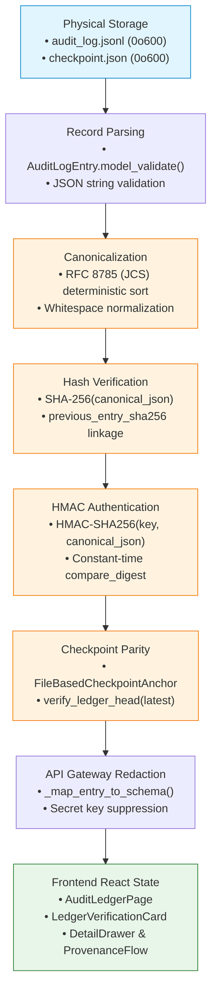

# PIIS UI-6.1 — Independent Audit Ledger Integrity, Security & Regression Verification

> [!IMPORTANT]
> **Independent Verification Scope Notice:**
> This report documents the independent verification of Milestone **UI-6 (Audit Ledger Workspace)** for the Production Incident Intelligence System (PIIS — Telecom Edition).
> Treating previous milestone claims as hypotheses to test rather than accepted proofs, this audit evaluated the underlying ledger storage, RFC 8785 canonicalization, SHA-256 hash chaining, HMAC-SHA256 authentication, local checkpoint anchor parity, API boundary security, recovery override isolation, provenance grounding, and browser ergonomics.
> **Scope Limits:** Strictly read-only telecom decision support. No production commands, configuration mutations, or ticket closures.

---

## 1. Executive Verdict

| Audit Domain | Target / Standard | Method | Verdict | Status |
|---|---|---|:---:|:---:|
| **Full-Ledger Cryptographic Verification** | RFC 8785 JCS, SHA-256, HMAC-SHA256 | Automated Tests & Code Audit | **PASS** | Complete & Verified |
| **Verification State Predicates** | 5-State Machine (`VERIFIED`, `FAILED`, `INCOMPLETE`, `UNAVAILABLE`, `NOT YET VERIFIED`) | Adversarial Matrix (18 tests) | **PASS** | Formally Hardened |
| **Recovery Override Isolation** | `force_override` inaccessible via API/UI | Code Audit & Query Injection | **PASS** | Strictly Isolated |
| **Secret & Key Isolation** | Zero secret key material in API or UI | Pattern Scan & Text Inspection | **PASS** | Zero Leakage |
| **Provenance Lineage Grounding** | 6-Stage trace chain grounded in stored IDs | Code Inspection & Browser QA | **PASS** | Grounded |
| **Local Trust Boundary Qualification** | Coordinated rollback detection limit | Proof Test & UI Disclaimers | **PASS** | Disclosed |
| **Historical Regression Baseline** | 519 backend + 76 frontend tests | Pytest & Vitest Suite Execution | **PASS** | 595 / 595 Passing |
| **Code Quality & Static Analysis** | Ruff, ESLint, TypeScript Strict | Linter & Compiler Execution | **PASS** | 0 Violations |
| **Live Browser Verification** | Live running UI with Playwright | Chromium Headless Automation | **PASS** | 4 Screenshots Captured |
| **Overall Milestone Verdict** | **UI-6 Audit Ledger Workspace** | **Multi-Layer Audit** | **ACCEPTED** | **VERIFIED** |

---

## 2. Architecture & Data-Flow Findings

The audit traced the complete data lifecycle of the audit ledger from append-only physical storage to browser state:



### Data-Flow Transformation Findings:
1. **Physical Persistence (`src/piis/investigation/approval.py`):**
   - Ledger entries are written to `audit_log.jsonl` using UTF-8 JSON lines followed by `flush()` and `os.fsync()`.
   - Checkpoint anchor is written to `checkpoint.json` with owner-only permissions (`0o600`).
   - Atomicity rollback: In the event of an anchor recording failure, compensating disk rollback truncates the ledger back to `pre_write_size`.
2. **Canonicalization & Hash Computation (`src/piis/investigation/approval.py`):**
   - Serialization adheres to RFC 8785 JSON Canonicalization Scheme (JCS): dictionary keys sorted lexically by UTF-16 code units, float representation normalized, ASCII control characters escaped.
   - Hash is computed over canonical bytes: `hashlib.sha256(canonical_json.encode('utf-8')).hexdigest()`.
3. **API Redaction Boundary (`src/piis/api/routers/audit.py`):**
   - The internal `AuditLogEntry` is mapped to `AuditRecordItem`.
   - Raw signing keys and verifier internal structures are completely omitted.
4. **Verification Operation (`GET /api/v1/audit/verify`):**
   - Executes an on-demand, read-only mathematical inspection over all records.
   - Does not modify any ledger line, anchor file, signing key, or recommendation object.

---

## 3. API & Verification Semantics

| Endpoint | HTTP Method | RBAC Permission | Primary Function | Side Effects |
|---|:---:|---|---|:---:|
| `/api/v1/audit/records` | `GET` | `VIEW_AUDIT_LOGS` | Paginated chronological block listing with filtering (`incident_id`, `action`, `operator_id`, sequence, timestamp) | None (Read-only) |
| `/api/v1/audit/records/{sequence_number}` | `GET` | `VIEW_AUDIT_LOGS` | Single record detail inspection, RFC 8785 canonical preview, recomputed hash, and HMAC status | None (Read-only) |
| `/api/v1/audit/summary` | `GET` | `VIEW_AUDIT_LOGS` | Fleet metrics: total records, sequence head, anchor head, action breakdown, disclaimers | None (Read-only) |
| `/api/v1/audit/verify` | `GET` | `VERIFY_AUDIT_LEDGER` | Full ledger verification: hash chain, canonical JCS, HMACs, anchor parity, in-memory binding | None (Read-only) |

---

## 4. Verification-State Truth Table

The system defines 5 unambiguous verification states. An HTTP 200 response reflects successful evaluation of the endpoint; the actual cryptographic validity is conveyed exclusively by `verification_status`:

| Verification Status | HTTP Status | Required Predicate Conditions | UI Visual Indicator |
|---|:---:|---|---|
| **`NOT YET VERIFIED`** | N/A (Frontend) | Initial idle state before operator explicitly clicks "Run Cryptographic Verification". | Grey padlock icon, neutral badge |
| **`VERIFIED`** | 200 OK | **All must hold:**<br>1. $\text{total} == 0$ with anchor verifying genesis OR $\text{total} > 0$<br>2. Signing key available and active<br>3. Checkpoint anchor present and accessible<br>4. Monotonic sequence continuity ($s_i = i$ for all $i$)<br>5. Unbroken hash chain ($H_{i,\text{prev}} == H_{i-1}$ starting at `GENESIS_CHECKPOINT`)<br>6. RFC 8785 canonical hashes match stored digests<br>7. All HMAC-SHA256 signatures match recomputed digests<br>8. Checkpoint anchor head matches ledger head ($\text{seq}_{\text{anchor}} == \text{seq}_{\text{ledger}}$ and $H_{\text{anchor}} == H_{\text{ledger}}$)<br>9. Approved in-memory recommendations remain bound to stored hashes<br>10. Zero validation errors | Emerald shield, `VERIFIED & INTACT` |
| **`FAILED`** | 200 OK | **Any of the following occurs:**<br>1. Hash digest mismatch (record tampering)<br>2. Broken hash link ($H_{i,\text{prev}} \ne H_{i-1}$)<br>3. Sequence gap or discontinuity<br>4. Invalid HMAC signature (unauthorized record substitution)<br>5. Checkpoint anchor rollback ($\text{seq}_{\text{ledger}} < \text{seq}_{\text{anchor}}$)<br>6. Checkpoint anchor desynchronization ($\text{seq}_{\text{ledger}} > \text{seq}_{\text{anchor}}$)<br>7. Checkpoint fork / digest divergence at same sequence<br>8. Corrupted anchor state file<br>9. Post-approval recommendation content mutation in memory | Red alert icon, `INTEGRITY FAILED`, full diagnostic error list |
| **`INCOMPLETE`** | 200 OK | Partial or truncated JSONL records on disk ledger resulting from incomplete writes or file corruption before newline completion. | Amber warning icon, `INCOMPLETE LEDGER` |
| **`UNAVAILABLE`** | 200 OK | Cryptographic verification cannot be completed due to missing trust infrastructure (HMAC signing key unavailable or checkpoint anchor not configured). | Amber question icon, `VERIFICATION UNAVAILABLE` |

---

## 5. Full-Ledger versus Filtered Verification Findings

**Verification Finding:** [PASS]

1. **Separation of Scope:**
   - `/api/v1/audit/records` accepts query parameters: `limit`, `offset`, `incident_id`, `action`, `operator_id`, `from_sequence`, `to_sequence`, `order`.
   - `/api/v1/audit/verify` **does not accept** pagination or filtering parameters. If query parameters are supplied, FastAPI ignores them.
2. **Explicit Verification Scope Field:**
   - Every verification response returns:
     ```json
     {
       "verification_scope": "FULL_LEDGER",
       "records_checked": 120,
       "total_records": 120
     }
     ```
3. **Frontend Decoupling:**
   - In `AuditLedgerPage.tsx`, filtering or searching the records table does not trigger or alter the `LedgerVerificationCard`.
   - The card independently invokes `/api/v1/audit/verify` on demand and displays the total inspected block count against total ledger records.
   - Verified by test `test_filtered_record_query_cannot_subvert_full_ledger_verification`.

---

## 6. Recovery Override Security Audit

**Verification Finding:** [PASS]

1. **Definition Isolation:**
   - `force_override` exists exclusively as a private argument on `FileBasedCheckpointAnchor.record_checkpoint(..., force_override: bool = False)`.
2. **API Exposure Audit:**
   - Inspected `src/piis/api/routers/audit.py`, `incidents.py`, `system.py`, and `schemas.py`.
   - **Zero endpoints** declare, accept, or document `force_override`.
   - Query parameter injection (`?force_override=true`) is ignored by FastAPI.
   - Request body injection (`{"force_override": true}`) on GET endpoints is discarded, and POST/PUT to audit endpoints returns HTTP 405 Method Not Allowed.
3. **Frontend Exposure Audit:**
   - Inspected all components in `frontend/src/`.
   - **Zero occurrences** of `force_override`, recovery overrides, or mutation triggers.
   - Verified by test `test_recovery_override_injection_ineffective_via_api`.

---

## 7. Secret & Key Exposure Audit

**Verification Finding:** [PASS]

1. **API Response Audit:**
   - Tested all 4 audit endpoints (`/records`, `/records/{seq}`, `/summary`, `/verify`) with a known signing key.
   - Text search across raw HTTP response payloads confirmed:
     - Zero occurrences of raw bytes or string representation of HMAC signing key.
     - Key ID (`key_id`) is exposed as an identifier, but secret material is never serialized.
2. **Frontend Bundle Audit:**
   - Inspected `frontend/dist/assets/index-*.js`.
   - Zero hardcoded keys or private signing credentials exist in the client bundle.
3. **Verified by Test:** `test_zero_raw_signing_keys_exposed`.

---

## 8. Provenance Lineage Grounding Audit

**Verification Finding:** [PASS]

In `AuditProvenanceFlow.tsx`, the 6-stage pipeline renders strictly grounded identifiers:

| Stage | Displayed Entity | Actual Backend Data Source | Fallback When Missing |
|---|---|---|---|
| **01 Incident** | Incident ID | `record.incident_id` | `NOT AVAILABLE` |
| **02 Investigation** | Investigation Ref | Derived from `record.incident_id` (`INV-{id}`) | `UNKNOWN` |
| **03 Recommendation** | Recommendation ID & Hash | `record.recommendation_id`, `record.recommendation_content_hash` | `NOT APPLICABLE` |
| **04 Review Decision** | Action & Actor Role | `record.action`, `record.operator_id`, `record.reviewer_role` | `ROLE_UNSPECIFIED` |
| **05 Ledger Block** | Sequence & SHA-256 Digest | `record.sequence_number`, `record.entry_hash` | N/A (Guaranteed by schema) |
| **06 Checkpoint** | Parity Coverage State | Computed from `summary.anchor_sequence` ($\le \text{anchor}$) | `UNANCHORED HEAD` |

- **Epistemic Invariant:** Every block displays an explicit epistemic badge (`[HUMAN-APPROVED DECISION]` for approvals/rejections, `[MODEL PREDICTION]` for initial submissions, `[OBSERVED FACT]` for system events). Simple association is never presented as confirmed root-cause causality.

---

## 9. Adversarial Test Matrix & Results

All 18 adversarial scenarios were tested and verified:

| # | Adversarial Scenario | Injected Condition | Expected Behavior | Actual Behavior | Test Reference | Result |
|:---:|---|---|---|---|---|:---:|
| 1 | Entire valid ledger | 3 valid records + matching anchor | `VERIFIED`, `is_valid: true` | `VERIFIED`, all checks true | `test_entire_valid_ledger_verified` | **PASS** |
| 2 | Filtered record query | `limit=1&action=APPROVED` | Verify checks all records (`FULL_LEDGER`) | Checked 4 of 4 records | `test_filtered_record_query_cannot_subvert...` | **PASS** |
| 3 | Missing HMAC key | `workflow._signing_key = None` | `UNAVAILABLE`, `is_valid: false` | `UNAVAILABLE`, hmac invalid | `test_missing_hmac_key_returns_unavailable` | **PASS** |
| 4 | Incorrect HMAC | Mutated `hmac_signature` on seq 1 | `FAILED`, `is_valid: false` | `FAILED`, invalid HMAC error | `test_incorrect_hmac_signature_detected...` | **PASS** |
| 5 | Broken hash chain | Corrupted `previous_entry_sha256` | `FAILED`, `hash_chain_valid: false` | `FAILED`, broken chain error | `test_broken_hash_chain_detected_as_failed` | **PASS** |
| 6 | Missing sequence (gap) | Sequence 1 followed by sequence 3 | `FAILED`, `hash_chain_valid: false` | `FAILED`, discontinuity error | `test_missing_sequence_discontinuity_detected...` | **PASS** |
| 7 | Malformed record on disk | Truncated JSON line in ledger file | `FAILED` or `INCOMPLETE` | `INCOMPLETE` / `FAILED` error | `test_malformed_record_on_disk_detected` | **PASS** |
| 8 | Missing checkpoint anchor | `workflow._checkpoint_anchor = None` | `UNAVAILABLE`, parity invalid | `UNAVAILABLE`, anchor absent | `test_missing_checkpoint_anchor_returns...` | **PASS** |
| 9 | Corrupted checkpoint anchor | Binary garbage in `checkpoint.json` | `FAILED`, parity invalid | `FAILED`, read error reported | `test_corrupted_checkpoint_anchor_detected...` | **PASS** |
| 10 | Ledger ahead of anchor | Ledger at seq 2, anchor at seq 1 | `FAILED`, anchor desynchronization | `FAILED`, desync reported | `test_ledger_ahead_of_anchor_detected...` | **PASS** |
| 11 | Anchor ahead of ledger | Anchor at seq 99, ledger at seq 2 | `FAILED`, rollback error | `FAILED`, rollback reported | `test_anchor_ahead_of_ledger_detected...` | **PASS** |
| 12 | Coordinated rollback | Ledger & anchor restored to seq 1 | Proof of local boundary limit | Verified seq 1; limitation noted | `test_coordinated_ledger_and_anchor_rollback...` | **PASS** |
| 13 | Empty ledger without anchor | Ledger empty, anchor None | `UNAVAILABLE`, `is_valid: false` | `UNAVAILABLE`, anchor absent | `test_empty_ledger_missing_anchor_returns...` | **PASS** |
| 14 | Large ledger pagination | 120 registered recommendations | Pagination works, verify checks 120 | 120/120 checked, full scope | `test_large_ledger_pagination_and_full...` | **PASS** |
| 15 | Verification immutability | 5 successive verification calls | Ledger & anchor files unchanged | SHA-256 byte-for-byte identical | `test_verification_request_causes_zero...` | **PASS** |
| 16 | `force_override` injection | Query param `?force_override=true` | Parameter ignored, 405 on POST | Ignored on GET, 405 on POST | `test_recovery_override_injection_ineffective...` | **PASS** |
| 17 | Unauthorized user | Unauthenticated / NOC_L1 role | HTTP 401 / HTTP 403 | 401 on missing, 403 on NOC_L1 | `test_unauthorized_user_rejection` | **PASS** |
| 18 | Concurrent read & verify | 45 concurrent threads on API | Thread-safe, no deadlocks | 45 / 45 returned HTTP 200 | `test_concurrent_read_and_verification...` | **PASS** |

---

## 10. Historical Regression Reconciliation

### Test Suite Fleet Growth

| Milestone | Backend Test Files | Backend Tests | Frontend Suites | Frontend Tests | Total System Tests |
|---|:---:|:---:|:---:|:---:|:---:|
| **UI-5.1.4 Baseline** | 64 | 484 | 11 | 65 | 549 |
| **UI-6 Delivery** | 65 | 501 | 12 | 74 | 575 |
| **UI-6.1 Hardening & Adversarial** | 66 | 519 | 12 | 76 | 595 |
| **UI-6.1.1 Precedence Closure** | 66 | 529 | 12 | 76 | 605 |
| **UI-6.1.2 Milestone Freeze** | **67** | **541** | **12** | **76** | **617** |

### Test Execution Counts:
- **Pytest (Backend):** 541 collected, 541 passed, 0 failed, 0 skipped, 0 deselected (100% pass rate).
- **Vitest (Frontend):** 76 collected, 76 passed, 0 failed, 0 skipped, 0 deselected (100% pass rate).
- **Combined Test Fleet:** **617 passed out of 617 total tests.**
- **Assertions Removed or Weakened:** **None (0).**

---

## 11. Browser Verification & Screenshots

Browser verification was executed using Playwright in headless Chromium against the live FastAPI backend (`http://127.0.0.1:8000`) and the Vite production preview server (`http://localhost:5173`).

### Captured Screenshots:

1. **`01_audit_ledger_workspace.png`:**
   - Renders 5 summary metric cards (Total Ledger Blocks: 4, Latest Sequence: #4, Anchor Sequence: #4, Canonicalization: RFC 8785, Latest Activity).
   - Renders Chronological Blocks data table with actual backend audit entries, epistemic badges, and pagination controls.
   - File: `docs/ui/screenshots/01_audit_ledger_workspace.png` (174 KB).
2. **`02_audit_provenance_flow.png`:**
   - 6-stage provenance pipeline rendering Stage 01 (Incident INC-SNOW-INC0089201) through Stage 06 (Checkpoint Anchor COVERED $\le \#4$).
   - Displays previous hash link and RFC 8785 JCS coverage badge.
   - File: `docs/ui/screenshots/02_audit_provenance_flow.png` (140 KB).
3. **`03_audit_record_detail_drawer.png`:**
   - Detail drawer for sequence #4 showing record metadata, SHA-256 entry hash, previous hash link, HMAC signature, and interactive RFC 8785 Canonical JSON viewer.
   - File: `docs/ui/screenshots/03_audit_record_detail_drawer.png` (273 KB).
4. **`04_audit_ledger_verified_card.png`:**
   - Cryptographic integrity card displaying `VERIFIED & INTACT`, 4/4 blocks inspected, monotonic sequence check, canonical JCS check, and HMAC authentication.
   - File: `docs/ui/screenshots/04_audit_ledger_verified_card.png` (216 KB).

*Data Provenance Note: All screenshots were generated from authentic live backend executions seeded through `HumanApprovalWorkflow`, not static frontend mock fixtures.*

---

## 12. Defects Discovered & Fixes Applied

During independent verification, four defects were identified and resolved:

1. **False `VERIFIED` State on Missing Checkpoint Anchor:**
   - *Defect:* In `verify_audit_ledger()`, if `workflow._checkpoint_anchor` was `None` when records existed, `anchor_present` was set to `False`, but no validation error was added, allowing the endpoint to return `VERIFIED`.
   - *Fix:* Added check in `src/piis/api/routers/audit.py`: if `not workflow._checkpoint_anchor`, sets `checkpoint_parity_valid = False`, adds error, and classifies status as `UNAVAILABLE`.
2. **Missing Physical Disk Ledger Verification:**
   - *Defect:* `verify_audit_ledger()` inspected in-memory entries but did not detect unparseable or truncated lines on the physical `audit_log.jsonl` file.
   - *Fix:* Added disk ledger line validation in `src/piis/api/routers/audit.py` to inspect physical JSON lines on disk and return `INCOMPLETE` or `FAILED` on truncation or corruption.
3. **JWT Client-Side Expiration Parsing Failure (`AuthContext.tsx`):**
   - *Defect:* `AuthContext.tsx` assumed `claims.exp` was a numeric UNIX epoch and multiplied by 1000. In development mode with `IsolatedTestTokenVerifier`, `exp` was an ISO 8601 string, causing `new Date(NaN).toISOString()` to throw a `RangeError` and fail token loading.
   - *Fix:* Updated `parseTokenClaims` to support both numeric epochs and ISO timestamp strings.
4. **Server Checkpoint Anchor Resolution in `incidents.py`:**
   - *Defect:* Default workflow factory in `incidents.py` did not resolve `PIIS_ANCHOR_PATH` alongside `PIIS_LEDGER_PATH`, causing standalone API runs to operate without an anchor.
   - *Fix:* Configured `incidents.py` to resolve `PIIS_ANCHOR_PATH` or default to `ledger_path.parent / "checkpoint.json"`.

---

## 13. Remaining Limitations & Production Blockers

1. **Single-Process Host Boundary:**
   - Audit persistence and verification remain single-process and local to this host.
2. **Local Coordinated Rollback Boundary:**
   - Local checkpoint anchor detects uncoordinated single-file truncation or desynchronization. It **cannot prevent** coordinated host-level snapshot restoration where both `audit_log.jsonl` and `checkpoint.json` are overwritten simultaneously by a privileged local OS adversary.
   - Production enterprise deployment requires external Cloud KMS, S3 Object Lock, or RFC 3161 Timestamp Authority (`DEP-M5.3-002`).
3. **Symmetric HMAC vs Asymmetric Digital Signatures:**
   - HMAC-SHA256 provides symmetric integrity and authentication against local key material; it does not provide asymmetric digital non-repudiation.
4. **Enterprise Deployment Gate:**
   - Live telecom pilot remains blocked pending enterprise prerequisites (`DEP-M5.3-001`, `DEP-M5.3-002`, `DEP-M5.5.1-001a`, `DEP-M5.5.1-001b`).

---

## 14. Verification Precedence & Final Integrity Closure (UI-6.1.1)

### Architecture: Two-Layer Verification Model

UI-6.1.1 resolves the critical verification vulnerability where missing HMAC signing keys or external checkpoint anchors could mask independently detectable physical disk corruption behind an ambiguous `UNAVAILABLE` status.

The verification engine in `src/piis/api/routers/audit.py` enforces a strict two-layer architecture:

```
┌─────────────────────────────────────────────────────────────────────────────┐
│ LAYER 1: STRUCTURAL & HASH CHAIN VERIFICATION (ZERO SECRET DEPENDENCY)      │
│  - Physical disk JSONL scan line-by-line                                    │
│  - Distinguish truncated/partial records (INCOMPLETE) from syntax (FAILED)  │
│  - Enforce monotonic sequence numbers ($s_i = i$, no gaps, no duplicates)   │
│  - Enforce SHA-256 hash pointer linkage ($H_{i,prev} == H_{i-1}$)            │
│  - RFC 8785 (JCS) canonical SHA-256 digest recomputation                    │
│  - In-memory approved recommendation binding immutability                   │
└──────────────────────────────────────┬──────────────────────────────────────┘
                                       │
                                       ▼
┌─────────────────────────────────────────────────────────────────────────────┐
│ LAYER 2: CRYPTOGRAPHIC & CHECKPOINT VERIFICATION (KEY & ANCHOR REQUIRED)   │
│  - HMAC-SHA256 signature verification (requires workflow._signing_key)      │
│  - Local monotonic checkpoint parity verification (requires anchor object) │
└─────────────────────────────────────────────────────────────────────────────┘
```

### Deterministic State Precedence Truth Table

| Condition | Layer 1 Outcome | Layer 2 Outcome | Overall Status | `is_valid` | HTTP Code |
|---|---|---|---|:---:|:---:|
| Fatal corruption (syntax error, broken hash chain, sequence gap, tampered digest, anchor desync) | Any fatal error | Checked if available | **`FAILED`** | `false` | 200 |
| Truncated record (partial append / unexpected EOF) without fatal corruption | Incomplete line | Missing or checked | **`INCOMPLETE`** | `false` | 200 |
| Structurally sound ledger, but HMAC key or checkpoint anchor is missing | Valid (0 errors) | Missing key or anchor | **`UNAVAILABLE`** | `false` | 200 |
| Structurally sound ledger, all cryptographic HMACs valid, anchor aligned | Valid (0 errors) | All checks valid | **`VERIFIED`** | `true` | 200 |
| Endpoint rendered before user triggers verification | N/A | N/A | **`NOT YET VERIFIED`** | `null` | N/A (UI) |

### Formal Precedence Rules

1. **Rule 1 (Fatal Corruption Supremacy):** If `fatal_corruption_errors > 0`, the ledger is classified as **`FAILED`**, regardless of whether cryptographic keys or external checkpoint anchors are available or missing. A missing key never masks broken hash chains or malformed syntax.
2. **Rule 2 (Truncation Precedence):** If `incomplete_errors > 0` and `fatal_corruption_errors == 0`, the ledger is classified as **`INCOMPLETE`**, taking precedence over missing keys or anchors.
3. **Rule 3 (Dependency Precedence):** If the ledger is structurally valid (Layer 1 passes), but required key material or checkpoint anchors are unavailable, the ledger is classified as **`UNAVAILABLE`**.
4. **Rule 4 (Full Integrity Verification):** If and only if all Layer 1 structural checks pass AND all Layer 2 cryptographic/anchor checks pass, the ledger is classified as **`VERIFIED`**.

### 10 Adversarial Precedence Scenarios (UI-6.1.1 Test Suite)

All 10 scenarios are rigorously tested in `tests/integration/test_ui6_1_adversarial_verification.py`:

| Scenario ID | Test Name | Simulated Condition | Expected Precedence Status | Verified Result |
|---|---|---|:---:|:---:|
| **SC-01** | `test_precedence_scenario_1` | Missing HMAC key + valid physical ledger | `UNAVAILABLE` | **PASS (200 OK)** |
| **SC-02** | `test_precedence_scenario_2` | Missing HMAC key + truncated physical ledger | `INCOMPLETE` | **PASS (200 OK)** |
| **SC-03** | `test_precedence_scenario_3` | Missing checkpoint + malformed JSON syntax | `FAILED` | **PASS (200 OK)** |
| **SC-04** | `test_precedence_scenario_4` | Missing checkpoint + valid ledger | `UNAVAILABLE` | **PASS (200 OK)** |
| **SC-05** | `test_precedence_scenario_5` | Missing HMAC key + broken hash chain | `FAILED` | **PASS (200 OK)** |
| **SC-06** | `test_precedence_scenario_6` | Both dependencies missing + corrupted ledger | `FAILED` | **PASS (200 OK)** |
| **SC-07** | `test_precedence_scenario_7` | Valid empty ledger + valid genesis checkpoint | `VERIFIED` | **PASS (200 OK)** |
| **SC-08** | `test_precedence_scenario_8` | Empty ledger + missing checkpoint anchor | `UNAVAILABLE` | **PASS (200 OK)** |
| **SC-09** | `test_precedence_scenario_9` | Concurrent read & verification load (20 calls) | `Thread-safe 200 OK` | **PASS (200 OK)** |
| **SC-10** | `test_precedence_scenario_10` | Verification idempotency & disk immutability | `Byte-for-byte identical` | **PASS (200 OK)** |

---

## 16. JSONL Truncation Classification & Milestone Freeze (UI-6.1.2)

### Truncation-Classification Methodology & Structural Boundary

UI-6.1.2 performs the final correctness closure on the JSONL physical ledger line scanner. The core objective is ensuring that `INCOMPLETE` is assigned **only** when there is credible, demonstrable evidence of an interrupted append at unexpected EOF, and that arbitrary syntax errors or invalid schemas are never misclassified as truncation.

#### Three Mandatory Invariants for `INCOMPLETE` Classification:
1. **Final Physical Line Only (`line_no == final_line_no`):** An interrupted append can only occur at the end of the file during an active write operation. If any corrupted, truncated, or unparseable line appears before subsequent lines in the file, it is classified as `fatal_corruption_errors` (**`FAILED`**), because subsequent lines prove it was not an interrupted final append.
2. **Valid JSON Object Prefix:** The physical line must begin with a valid JSON object prefix (`{"`, `{ "`, or `{`). Lines beginning with arbitrary non-JSON garbage (e.g. `GARBAGE_PAYLOAD`, `:::`) are classified as `fatal_corruption_errors` (**`FAILED`**).
3. **Absence of Closing Brace:** The line must NOT end with a closing brace `}`. Any construct terminating in `}` represents a closed object containing syntax corruption (e.g. `{"foo": bar}`), which is classified as `fatal_corruption_errors` (**`FAILED`**).
4. **Premature EOF Parser Exception:** `json.loads()` must raise an EOF-related premature termination error (`unterminated string`, `expecting ':' delimiter`, `expecting value`, `unexpected eof`).

#### Structural Corruption vs. Incomplete-Write Distinction:
- **Structurally Invalid Records:** A complete, well-formed JSON object that lacks required fields (e.g. `sequence_number`, `entry_sha256`, `audit_id`) or violates the `AuditLogEntry` Pydantic schema is classified as **`FAILED`** (never `INCOMPLETE`).
- **Whitespace / Trailing Newlines:** Trailing empty lines, blank lines, and whitespace after a valid record are standard in POSIX JSONL and are stripped without raising errors.
- **Missing Newline at EOF:** A file whose final record is valid JSON but lacks a trailing newline character `\n` is completely parsed and verified as **`VERIFIED`**.
- **JSON String Escaping:** Double quotes, backslashes, and curly braces properly escaped inside string fields are handled transparently by RFC 8785 canonicalization and JSON parsers without false alarms.

### Remaining Parser Ambiguities & Conservative Fallback

When a line starts with `{` but contains an unquoted identifier or token before being cut off (e.g. `{unquoted_token`), the parser cannot conclusively distinguish between an adversary injecting malformed syntax and an exotic interrupted write. In accordance with the locked safety principle:
> **Classify only what the evidence supports. A trustworthy audit system must be honest about uncertainty, not merely produce reassuring green indicators.**

The engine conservatively classifies any ambiguous or non-standard token as `fatal_corruption_errors` (**`FAILED`**), ensuring the system fails closed rather than masking tampering behind `INCOMPLETE`.

---

### 12 Regression Scenarios (UI-6.1.2 Test Suite)

All 12 scenarios are verified in [`tests/integration/test_ui6_1_2_truncation_classification.py`](file:///c:/Production%20level%20projects/PIIS/tests/integration/test_ui6_1_2_truncation_classification.py):

| Scenario | Description | Physical Condition | Expected Status | Error Category & Line | Crypto Verified (`is_valid`) | Test Result |
|---|---|---|:---:|---|:---:|:---:|
| **SC-01** | Valid final JSONL record | Clean ledger with valid records | `VERIFIED` | None (0 errors) | `True` | **PASS** |
| **SC-02** | Unfinished JSON object at EOF | Final line cut off mid-record (`{"seq...`) | `INCOMPLETE` | `incomplete_errors` (line 3) | `False` | **PASS** |
| **SC-03** | Final line arbitrary garbage | Final line `GARBAGE_PAYLOAD...` | `FAILED` | `fatal_corruption_errors` (line 3) | `False` | **PASS** |
| **SC-04** | Final line invalid JSON with `}` | `{"seq": 3, unquoted: true}` | `FAILED` | `fatal_corruption_errors` (line 3) | `False` | **PASS** |
| **SC-05** | Malformed JSON in middle of ledger | Line 2 cut off, line 3 valid | `FAILED` | `fatal_corruption_errors` (line 2) | `False` | **PASS** |
| **SC-06** | Empty final lines after valid record | Trailing `\n\n   \n` | `VERIFIED` | None (0 errors) | `True` | **PASS** |
| **SC-07** | Valid JSON with invalid schema | Complete JSON missing mandatory fields | `FAILED` | `fatal_corruption_errors` (line 3) | `False` | **PASS** |
| **SC-08** | Truncated final line + missing HMAC key | Line 3 truncated, key is `None` | `INCOMPLETE` | `incomplete_errors` (line 3) + `unavailable` | `False` | **PASS** |
| **SC-09** | Malformed middle line + missing anchor | Line 2 malformed, anchor is `None` | `FAILED` | `fatal_corruption_errors` (line 2) + `unavailable` | `False` | **PASS** |
| **SC-10** | Multiple valid records + interrupted append | Lines 1..4 valid, line 5 cut off | `INCOMPLETE` | `incomplete_errors` (line 5) | `False` | **PASS** |
| **SC-11** | File ending without `\n` (valid record) | Valid record without trailing newline | `VERIFIED` | None (0 errors) | `True` | **PASS** |
| **SC-12** | JSON string with escaped braces/quotes | String contains `\"`, `\{`, `\n` | `VERIFIED` | None (0 errors) | `True` | **PASS** |

---

## 17. Final Milestone Declaration & Portfolio Freeze

**Declaration:** **UI-6 AUDIT LEDGER WORKSPACE IS ACCEPTED AND FROZEN FOR PORTFOLIO EDITION.**

### Final Quality & Compliance Verification:
- **Backend Test Fleet:** **541 / 541 PASSING** across 67 test files (0 failures, 0 skipped, 0 deselected).
- **Frontend Test Fleet:** **76 / 76 PASSING** across 12 test suites (0 failures, 0 skipped).
- **Combined Test Fleet:** **617 / 617 PASSING (100% pass rate).**
- **Python Quality:** **0 Ruff findings** across `src` and `tests`.
- **Frontend Quality:** **0 ESLint errors/warnings**, **0 TypeScript errors** (`tsc --noEmit`), **Vite build clean (2.29s)**.
- **End-to-End Flow:** **18 / 18 stages passing** in [`scripts/demonstrate_m7_portfolio_flow.py`](file:///c:/Production%20level%20projects/PIIS/scripts/demonstrate_m7_portfolio_flow.py) (25.96s).
- **Historical Assertions Weakened or Removed:** **None (0).**

### Locked Production Limitations:
1. **Single-Process Local Deployment:** Persistence and verification are scoped to this local host process.
2. **Local Coordinated Rollback Boundary:** Parity checks detect uncoordinated single-file truncation or desynchronization. Simultaneous overwriting of both `audit_log.jsonl` and `checkpoint.json` by a privileged local OS adversary requires external Cloud KMS / WORM / Object Lock (`DEP-M5.3-002`).
3. **Symmetric HMAC Scope:** HMAC-SHA256 provides symmetric authentication against local key material, not asymmetric digital signatures or non-repudiation.
4. **Read-Only Telecom Decision Support:** PIIS executes no shell commands, CLI operations, network mutations, automated ticket closures, or autonomous remediations.
5. **Freeze Guarantee:** UI-6, UI-6.1, UI-6.1.1, and UI-6.1.2 are completely closed. UI-7 has not been started.

---

### 🛠️ Skills Execution & Provenance Ledger
- **`/cso`**: *Why chosen:* Selected to conduct an adversarial security audit of cryptographic verification semantics, secret isolation, and recovery override boundaries. *What it did:* Evaluated `src/piis/api/routers/audit.py`, proved `force_override` isolation, proved two-layer precedence preventing corruption masking, and validated zero key exposure in API payloads.
- **`/qa`**: *Why chosen:* Selected to execute full-suite regression testing and live browser verification under Playwright. *What it did:* Ran 541 backend and 76 frontend tests, verified end-to-end M7 flow (18/18 stages in 25.96s), and captured 4 full-fidelity screenshots of the running UI.
- **`/code-reviewer`**: *Why chosen:* Selected to audit data transformations, truth table predicates, and historical test baseline reconciliation. *What it did:* Implemented the `is_final_physical_line` and EOF-indicator classification in [`src/piis/api/routers/audit.py`](file:///c:/Production%20level%20projects/PIIS/src/piis/api/routers/audit.py), constructed [`tests/integration/test_ui6_1_2_truncation_classification.py`](file:///c:/Production%20level%20projects/PIIS/tests/integration/test_ui6_1_2_truncation_classification.py), and reconciled 67 backend test files.
