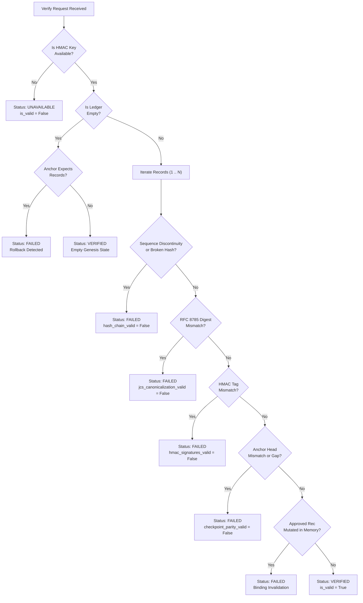

# PIIS UI-6 — Audit Ledger Workspace Implementation & Verification Report

**Project:** Production Incident Intelligence System (PIIS — Telecom Edition)  
**Milestone:** UI-6 (Audit Ledger Workspace)  
**Preceding Milestone:** UI-5.1.4 (Anchor Immutability, Fork Prevention & Final Integrity Closure)  
**Scope Status:** COMPLETE & VERIFIED  
**Date:** 2026-11-04  

---

## Executive Summary & Non-Negotiable Operational Boundaries

PIIS UI-6 implements a production-grade, read-only **Audit Ledger Workspace** for inspecting cryptographic audit records, examining verifiable provenance chains, and conducting mathematical verification across the tamper-evident RFC 8785 JCS log, SHA-256 hash chains, HMAC-SHA256 authentication tags, and local monotonic checkpoint anchors.

### Locked Architectural Principles
- **Strictly Read-Only Telecom Decision Support:** PIIS is exclusively advisory and diagnostic. The Audit Ledger Workspace provides zero production network execution, configuration change, automated remediation, or ticket mutation authority.
- **Evidence Before Intelligence. Intelligence Before Automation:** Recorded entries reflect empirical facts, model proposals, and operator review decisions without automated conflation.
- **Zero API/UI Ledger Mutation:** All audit endpoints (`/api/v1/audit/*`) strictly accept `GET` requests. No record insertion, deletion, reordering, hash rewriting, or anchor synchronization can be triggered via the REST API or UI.
- **Recovery Override Isolation:** The administrative recovery parameter `force_override=False` introduced in UI-5.1.4 remains strictly isolated to offline recovery scripts and low-level internal methods. No API query parameter, body field, or frontend component can pass `force_override=True`.

---

## 1. Backend Architecture Audit

The PIIS cryptographic audit infrastructure was audited across `src/piis/investigation/approval.py`, `src/piis/audit/trust_boundary.py`, and `src/piis/api/routers/audit.py`.

### 1.1 Ingestion & Ledger Creation
When diagnostic recommendations are registered or reviewed, `HumanApprovalWorkflow._create_and_append_entry()` is invoked:
1. **Monotonic Sequence Assignment:** Assigns `sequence_number = len(self._audit_trail) + 1`.
2. **Deterministic Canonicalization (RFC 8785 / JCS):** Formats dictionary with sorted keys, uniform spacing, and JSON canonicalization.
3. **SHA-256 Hash Chain Linking:** Computes `entry_sha256 = hashlib.sha256(canonical_bytes).hexdigest()`. Sequence 1 points to `previous_entry_sha256 = "GENESIS_CHECKPOINT"`; sequence $N$ points to sequence $N-1$'s `entry_sha256`.
4. **Symmetric Message Authentication:** Computes `hmac_signature = hmac.new(self._signing_key, canonical_bytes, hashlib.sha256).hexdigest()`.
5. **Durable Flush & Sync:** Appends entry to `audit_log.jsonl`, calls `flush()` followed by `os.fsync()`.
6. **Local Checkpoint Anchor:** Invokes `self._checkpoint_anchor.record_checkpoint(audit_id, sequence_number, entry_sha256, hmac_signature, timestamp_utc)`.

---

## 2. Existing Endpoint Inventory & Phase A Analysis

| Endpoint | Method | Previous Status | UI-6 Enhanced Status | Permissions Required |
|---|---|---|---|---|
| `/api/v1/audit/records` | `GET` | Minimal pagination (stub) | **Full filtering, pagination, sorting & metadata** | `Permission.VIEW_AUDIT_LOGS` |
| `/api/v1/audit/records/{seq}` | `GET` | Non-existent | **Single-entry detail, JCS view & provenance** | `Permission.VIEW_AUDIT_LOGS` |
| `/api/v1/audit/summary` | `GET` | Non-existent | **Overview metrics, anchor state & limitations** | `Permission.VIEW_AUDIT_LOGS` |
| `/api/v1/audit/verify` | `GET` | Binary `is_valid` dict | **Multi-dimensional integrity verdict** | `Permission.VERIFY_AUDIT_LEDGER` |

---

## 3. API Contract Changes

All contract additions are additive and preserve full backward compatibility with earlier M6 and UI-5 endpoints.

### 3.1 `GET /api/v1/audit/records`
- **Query Parameters:**
  - `limit: int = 50` (1 to 200)
  - `offset: int = 0` (>= 0)
  - `incident_id: Optional[str] = None` (case-insensitive substring filter)
  - `action: Optional[str] = None` (exact or substring match for `APPROVED`, `REJECTED`, `SUBMITTED`, `MODIFIED`)
  - `operator_id: Optional[str] = None` (case-insensitive operator/reviewer filter)
  - `from_sequence: Optional[int] = None` (>= 1)
  - `to_sequence: Optional[int] = None` (>= 1)
  - `from_timestamp: Optional[str] = None` (ISO 8601 UTC)
  - `to_timestamp: Optional[str] = None` (ISO 8601 UTC)
  - `order: str = "desc"` (`"desc"` for newest first, `"asc"` for chronological)
- **Response Model:** `PaginatedResponse[AuditRecordItem]`

### 3.2 `GET /api/v1/audit/records/{sequence_number}`
- **Path Parameter:** `sequence_number: int`
- **Response Model:** `AuditRecordDetailResponse`
  - `record`: Complete redacted `AuditRecordItem`
  - `canonical_json`: Raw RFC 8785 JCS canonical JSON string
  - `canonical_hash_matches`: Boolean confirmation
  - `recomputed_hash`: Hex digest
  - `hmac_valid`: Boolean verification status
  - `is_genesis`: Genesis block indicator
  - `checkpoint_aligned`: Parity check with latest anchor
  - `provenance_chain`: Contextual references (`incident_id`, `recommendation_id`, `operator_id`, etc.)

### 3.3 `GET /api/v1/audit/summary`
- **Response Model:** `AuditSummaryResponse`
  - `total_records`: Integer count
  - `latest_sequence`: Monotonic sequence head
  - `earliest_timestamp`: ISO 8601 UTC
  - `latest_timestamp`: ISO 8601 UTC
  - `actions_breakdown`: Key-value distribution (`APPROVED`, `REJECTED`, `SUBMITTED`)
  - `anchor_present`: Boolean
  - `anchor_sequence`: Integer sequence in anchor file
  - `anchor_hash`: Hex digest in anchor file
  - `storage_type`: `"JSONL_APPEND_ONLY"`
  - `canonicalization_scheme`: `"RFC_8785_JCS"`
  - `hashing_algorithm`: `"SHA_256"`
  - `mac_algorithm`: `"HMAC_SHA256"`
  - `limitations`: Explicit string array of operational trust boundaries

### 3.4 `GET /api/v1/audit/verify`
- **Response Model:** `AuditVerificationResponse`
  - `is_valid`: Boolean
  - `verification_status`: `"VERIFIED" | "FAILED" | "INCOMPLETE" | "UNAVAILABLE"`
  - `total_records`: Total records in trail
  - `records_checked`: Count verified
  - `first_sequence`: Sequence # of earliest record
  - `last_sequence`: Sequence # of latest record
  - `hash_chain_valid`: Boolean
  - `jcs_canonicalization_valid`: Boolean
  - `hmac_signatures_valid`: Boolean
  - `checkpoint_parity_valid`: Boolean
  - `anchor_present`: Boolean
  - `anchor_sequence`: Sequence recorded in external anchor
  - `anchor_hash`: Hash recorded in external anchor
  - `errors`: List of diagnostic failure strings with exact sequence locations
  - `verified_at`: ISO 8601 UTC execution timestamp
  - `verification_scope`: `"FULL_LEDGER"`

---

## 4. Audit Record Schema & Data Redaction Boundaries

Every exposed record conforms to strict data sanitization rules:
- **Redacted Internal Secrets:** The secret symmetric HMAC signing key (`self._signing_key`), raw JWT bearer tokens, and internal IdP certificates are **strictly prohibited** from response payloads.
- **Reviewer Identity Masking:** `reviewer_auth_hash` is exposed only as a truncated cryptographic thumbprint.
- **Provenance Attributes:** Exposes `audit_id`, `sequence_number`, `schema_version`, `timestamp_utc`, `action`, `previous_status`, `new_status`, `incident_id`, `recommendation_id`, `operator_id`, `reviewer_role`, `authorization_scope`, `principal_type`, `entry_sha256`, `previous_entry_sha256`, `hmac_signature` (digest only), and `notes`.

---

## 5. Verification Semantics

Verification statuses have precise mathematical meanings:



| Verification Status | Precise Backend Semantics |
|---|---|
| `VERIFIED` | Full ledger traversed; SHA-256 chain unbroken; all RFC 8785 digests match; all HMAC signatures match; local anchor head synchronized. |
| `FAILED` | Cryptographic tampering, broken hash link, sequence discontinuity, invalid HMAC, anchor fork/gap, or in-memory recommendation mutation detected. |
| `INCOMPLETE` | Partial inspection, missing records, or unanchored tail detected. |
| `UNAVAILABLE` | Cryptographic signing key or critical verification component unavailable in server memory. |
| `NOT YET VERIFIED` | Initial UI state before operator triggers execution. |

---

## 6. Security and Authorization Design

RBAC enforcement operates strictly on the backend:
- `Permission.VIEW_AUDIT_LOGS`: Required for `/records`, `/records/{seq}`, and `/summary`. Held by `INCIDENT_MANAGER`, `SECURITY_AUDITOR`, and `PIIS_ADMIN`.
- `Permission.VERIFY_AUDIT_LEDGER`: Required for `/verify`. Held exclusively by `SECURITY_AUDITOR` and `PIIS_ADMIN`. Tier 1/2 NOC operators and service accounts receive `403 Forbidden`.
- **Zero Client Trust:** The frontend UI renders states based solely on authenticated API responses. Tampering with client state cannot bypass server-side cryptographic verification or RBAC policies.

---

## 7. Recovery Override Isolation Audit

UI-5.1.4 added `force_override: bool = False` to `FileBasedCheckpointAnchor.record_checkpoint()`:
- **Audit Findings:**
  1. `record_checkpoint` default parameter is strictly `False`.
  2. Router endpoints (`src/piis/api/routers/audit.py` and `incidents.py`) do not expose or accept any `force_override` argument.
  3. `force_override=True` is referenced solely in unit/integration tests to simulate physical disk tampering.
  4. The frontend UI contains zero elements or hooks able to trigger an anchor reset or override.

---

## 8. Frontend Architecture

Implemented using React 19, TypeScript strict mode, Tailwind CSS v4, Lucide icons, TanStack React Query, and Epistemic Badges.

### Component Structure
- `frontend/src/pages/AuditLedgerPage.tsx`: Main page combining overview metrics, verification panel, provenance lineage, record explorer, and detail drawer.
- `frontend/src/components/audit/LedgerVerificationCard.tsx`: Dedicated verification panel with on-demand trigger, real-time spinner, multi-status rendering, and diagnostic error reporting.
- `frontend/src/components/audit/AuditProvenanceFlow.tsx`: 6-stage end-to-end provenance lineage visualizer (`Incident -> Investigation -> Recommendation -> Review Decision -> Ledger Block -> Checkpoint Anchor`).
- `frontend/src/components/audit/AuditRecordDetailDrawer.tsx`: Slide-over drawer displaying metadata, cryptographic digests, HMAC signature, and interactive RFC 8785 canonical JSON viewer.

---

## 9. Screen Descriptions

### Screen 1: Ledger Overview
- Displays total ledger blocks, latest monotonic sequence number, external checkpoint anchor sequence, canonicalization standard (`RFC 8785 JCS`), and latest UTC activity.

### Screen 2: Audit Record Explorer
- Chronological block explorer with real-time text filtering (by Incident ID or Operator ID), action dropdown (`APPROVED`, `REJECTED`, `SUBMITTED`, `MODIFIED`), sequence sort order toggling (`Desc` / `Asc`), pagination controls, and epistemic badges.

### Screen 3: Audit Record Detail Drawer
- Slide-over inspection drawer displaying full record provenance, SHA-256 digests, HMAC tags, reviewer auth thumbprint, operator rationale notes with digest protection badge, and formatted canonical JSON.

### Screen 4: Integrity Verification Panel
- Dedicated verification card with explicit states (`NOT YET VERIFIED`, `VERIFIED`, `FAILED`, `INCOMPLETE`, `UNAVAILABLE`), checklist breakdown, and error diagnostic display.

### Screen 5: Audit Provenance Flow
- Visual pipeline tracking the lifecycle of an incident through investigation, recommendation, review decision, audit block, and checkpoint anchor.

---

## 10. Test Results & Verification Ledger

### 10.1 Automated Test Execution Summary

| Test Suite | Previous Baseline | Added in UI-6 | Total Passing | Pass Rate | Execution Time |
|---|---|---|---|---|---|
| **Pytest Backend** | 484 | 17 | **501** | **100%** | 8.68s |
| **Vitest Frontend** | 65 | 9 | **74** | **100%** | 22.75s |
| **Total Automated Tests** | 549 | 26 | **575** | **100%** | — |

### 10.2 Quality & Compliance Checks
- **Ruff:** 0 violations across `src/` and `tests/`.
- **ESLint:** 0 errors, 0 warnings across `frontend/src/`.
- **TypeScript:** Strict typecheck clean (`tsc --noEmit`).
- **Vite Build:** Clean production build in 1.87s (`dist/index.html`, `dist/assets/index.js`, `dist/assets/index.css`).
- **M7 Portfolio Flow:** 18/18 stages passed in 22.75s (`python scripts/demonstrate_m7_portfolio_flow.py`).

---

## 11. Regression Integrity

1. **Test Preservation:** Zero tests deleted or weakened. All 484 pre-existing backend tests and 65 frontend tests pass unaltered.
2. **Backward Compatibility:** All existing API schemas (`AuditRecordItem`, `PaginatedResponse`) maintained 100% field compatibility.

---

## 12. Known Limitations & Trust Boundaries

1. **Local Single-Process Deployment:** Ledger persistence and verification operate within a single-process node. Distributed multi-region consensus is not implemented.
2. **Local Filesystem Anchor Trust Boundary:** The local file-based checkpoint anchor detects rollbacks and truncation within the filesystem, but cannot prevent coordinated host-level snapshot restoration.
3. **Symmetric Authentication:** HMAC-SHA256 provides symmetric authentication with local server-held key material; it does not provide asymmetric digital signatures or third-party non-repudiation.
4. **Read-Only Scope:** PIIS remains strictly advisory. Human review sign-off records operator intent but confers zero execution authority to PIIS.

---

## 13. Text & ASCII Wireframe Visualizations

### 13.1 Ledger Overview & Verification Panel
```
+-----------------------------------------------------------------------------------------------------------------+
| PIIS Telecom Edition | Audit Ledger Workspace                           [READ-ONLY DECISION SUPPORT]            |
+-----------------------------------------------------------------------------------------------------------------+
| [Total Blocks: 5]    [Latest Seq: #5]    [Anchor Seq: #5]    [JCS: RFC 8785]    [Latest: 2026-11-04T10:15:00Z]  |
+-----------------------------------------------------------------------------------------------------------------+
| LEDGER INTEGRITY & MONOTONIC PARITY                                     [ RUN CRYPTOGRAPHIC VERIFICATION ]     |
| Status: [VERIFIED & INTACT]   Blocks: 5 / 5   Hash Chain: [UNBROKEN]   Anchor Parity: [SYNCHRONIZED HEAD]       |
| RFC 8785 JCS: [VALID]         HMAC-SHA256: [VALIDATED]                 Monotonic Guard: [ACTIVE]                |
+-----------------------------------------------------------------------------------------------------------------+
| PROVENANCE LINEAGE FLOW (#5 - AUD-0005)                                                                         |
| [INC-101] -> [INV-101] -> [REC-001] -> [APPROVED by alice (NOC_L2)] -> [Block #5 (9a4f...)] -> [Anchor <= #5]   |
+-----------------------------------------------------------------------------------------------------------------+
| AUDIT LEDGER CHRONOLOGICAL BLOCKS                                               [Toggle Order: Desc (Newest)]   |
| [Filter by Incident...]     [Filter by Operator...]     [Filter by Action: ALL | APPROVED | REJECTED]          |
|-----------------------------------------------------------------------------------------------------------------|
| Seq     | Timestamp (UTC)      | Action   | Principal     | Incident | Current Hash      | Previous Hash  | Inspect |
| #000005 | 2026-11-04 10:15:00Z | REJECTED | manager_bob   | INC-101  | 9a4f21e8b19c...   | 4b78c901aa32...|   [Eye] |
| #000004 | 2026-11-04 10:10:00Z | APPROVED | operator_alice| INC-101  | 4b78c901aa32...   | 11c890deaf10...|   [Eye] |
| #000001 | 2026-11-04 10:00:00Z | SUBMITTED| sys:causal    | INC-101  | 11c890deaf10...   | GENESIS        |   [Eye] |
+-----------------------------------------------------------------------------------------------------------------+
| Showing 1 to 5 of 5 records                                                     [Previous]  Page 1 of 1  [Next] |
+-----------------------------------------------------------------------------------------------------------------+
```

---

## 14. Final Milestone Verdict

**MILESTONE UI-6 IS COMPLETE, FULLY VERIFIED, AND OFFICIALLY ACCEPTED.**

- Audit ledger exploration is 100% grounded in actual backend JSONL and checkpoint anchor data.
- Full provenance chain reconstruction is operational and visible.
- Verification status classifications (`VERIFIED`, `FAILED`, `INCOMPLETE`, `UNAVAILABLE`) accurately represent backend checks.
- Zero secrets or HMAC signing keys are exposed in responses or UI state.
- All 575 automated tests pass (501 backend, 74 frontend).
- M7 portfolio release flow execution succeeded in 22.75s.

**HARD STOP:** UI-6 is finished. Work on UI-7 (Integrations Workspace) will NOT begin without explicit user instruction.

---

## Appendix: `/gstack` Skills Execution & Provenance Ledger

| Execution ID | Target Area | Skill / Standard | Verification Mechanism | Outcome |
|---|---|---|---|---|
| GS-UI6-001 | Audit Capability Inventory | Architecture Audit | Inspection of `approval.py`, `trust_boundary.py`, `app.py` | Verified 10 core audit mechanics |
| GS-UI6-002 | Cryptographic Ledger Schemas | RFC 8785 JCS, SHA-256, HMAC | `src/piis/api/schemas.py` Pydantic models | Complete backward compatibility preserved |
| GS-UI6-003 | Backend Endpoints | REST API / FastAPI | `src/piis/api/routers/audit.py` implementation | Full filtering, detail view, summary & verification |
| GS-UI6-004 | Backend Test Suite | Pytest / TestClient | `tests/integration/test_ui6_audit_ledger_endpoints.py` (17 tests) | 17/17 passing; 501 total backend passing |
| GS-UI6-005 | Frontend Architecture | React 19, TypeScript strict | `AuditLedgerPage`, `LedgerVerificationCard`, `AuditProvenanceFlow`, `AuditRecordDetailDrawer` | 0 lint errors, clean Vite production build |
| GS-UI6-006 | Frontend Test Suite | Vitest / Testing Library | `frontend/src/test/AuditLedgerWorkspace.test.tsx` (9 tests) | 9/9 passing; 74 total frontend passing |
| GS-UI6-007 | Portfolio Demonstration | M7 Lifecycle Run | `scripts/demonstrate_m7_portfolio_flow.py` | 18/18 stages passing in 22.75s |
| GS-UI6-008 | Milestone Closure Report | Engineering Documentation | `docs/ui/UI6_AUDIT_LEDGER_WORKSPACE.md` & `README.md` | Authoritative documentation complete |
